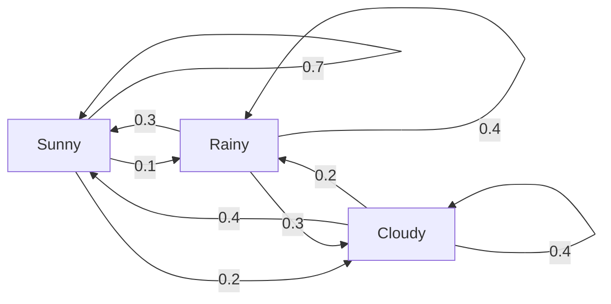
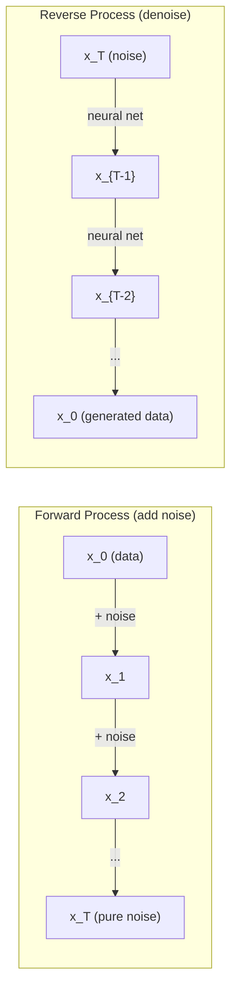

# Processos estocásticos

> 具有结构的随机性──random walks、Markov chains 和 diffusion models 背后的数学──

**Type:** Learn
**Language:**Python
**Prerequisites:** Phase 1, Lessons 06-07（probability, Bayes）
**Time:** ~75 分钟

## Objectivo de aprendizagem
- 模拟 1D 和 2D random walks,并验证位移的 $\sqrt{n}$缩放规律
- Construir cadeia Markov 模拟器,并通过自己的组合 计算其静止分布
-                                                                                                                                                                                                                                                                                                                                                                                                                                                                                                                              
- Para avançar o processo de difusão com o movimento browniano                                                                                                                                                                                                                                                                                                                                                                                                                                                                                                               

## 问题
Muitos sistemas de IA envolvem a aleatoriedade de evolução ao longo do tempo. Não é aleatoriedade estática, mas aleatoriedade estruturada, cada passo depende do que aconteceu antes.

Os modelos de linguagem uma vez geram um token. Cada token depende do contexto anterior. O modelo produz uma distribuição de probabilidade, de um modo de análise, e depois continua.

Os modelos de difusão  gradualmente para imagem adicionar ruído, até que se torne puro ruído estático.

Agentes de aprendizagem de reforço em ambiente tomam ações. Cada ação leva, com alguma probabilidade, a um novo estado. Agente em um mundo acidental segue uma política acidental.

A amostragem MCMC é o pilar da inferência Bayesiana, que constrói uma cadeia de Markov, sua distribuição estácionária é a seguinte.

Tudo isto é baseado em quatro ideias básicas:
1. Caminhos aleatórios  最简单的 stochastic process
2. Cadeias de Markov  带有过渡矩阵的结构化随机性
3. Dinâmica de Langevin  带噪声的渐进下降
4. Metropolis-Hastings   从任意分布采样

## 概念
### Caminhos aleatórios

Desde a posição 0 开始── cada passo,抛一枚公平硬币──正面:向右移动(+1)──反面:向左移动(-1)──

- Não .$n$O teu lugar é o teu lugar.$n$个随机                                                                                                                                                                                                                                                                                                                                                                                                                                                                                                                          $\pm 1$值的总和──期望位置是0(这个走是无偏的)──但距离原点的期望距离按 $\sqrt{n}$- Não.

Este caminho é justo, não há deriva em nenhuma direção, mas com o tempo ele vai descer de um ponto para outro.$n$O desvio padrão do passo seguinte é$\sqrt{n}$- Não.

```
Step 0:  Position = 0
Step 1:  Position = +1 or -1
Step 2:  Position = +2, 0, or -2
...
Step 100: Expected distance from origin ~ 10 (sqrt(100))
Step 10000: Expected distance from origin ~ 100 (sqrt(10000))
```

**在 2D 中**, caminhar em fase e probabilidade de ascensão, descensão, movimentos para a esquerda ou para a direita.$\sqrt{n}$缩放规律──路径会描绘出类似碎形的模式──

**为什么是 $\sqrt{n}$？**Cada passo é de probabilidade de +1 ou -1$n$步后, posição $S_n = X_1 + X_2 + \cdots + X_n$, cada um deles .$X_i$- Não .$\pm 1$ Cada passo é variado em 1, e cada passo é independente, por isso $\mathop{\mathrm{Var}}(S_n) = n$ Desvio padrão = $\sqrt{n}$ De acordo com o teorema do limite central,$S_n / \sqrt{n}$收到 distribuição normal padrão。

Esta espécie$\sqrt{n}$缩放在 ML 中随处可见──SGD 噪音按1/sqrt(batch_size) 缩放──Embedding 维度按 $\sqrt{d}$缩放──平方根是独立随机加和的标志──

**与 Brownian motion 的联系。**Tome um passo de tamanho$1/\sqrt{n}$、 por unidade de tempo $n$Passeio aleatório.$n$Quando o tempo chega, o movimento browniano se aproxima.$B(t)$Um processo contínuo, entre eles.$B(t)$服从平均值为 0 变量 为 $t$Distribuição normal.

O movimento browniano é a base matemática da difusão. Ele descreve o movimento de fluxo de partículas no corpo, bem como o movimento do preço das ações, bem como o processo de ruído nos modelos de difusão.

**Gambler's ruin。**Um caminhador aleatório da posição .$k$開始,在 0 和 $N$Há barreiras de absorção.$N$Qual é a probabilidade de chegar a 0?$P(\text{到达 } N) = k/N$                                                                                                                                                                                                                                                              

### Cadeias de Markov

A cadeia de Markov é um sistema, que depende de uma probabilidade fixa de transferência entre estados.

```math
P(X_{t+1} = j \mid X_t = i, X_{t-1} = \ldots) = P(X_{t+1} = j \mid X_t = i)
```

É a propriedade de Markov. Significa que podemos usar uma matriz de transição.$P$Descrever toda a dinâmica:

```math
P[i][j] = \text{从状态 } i \text{ 转移到状态 } j \text{ 的概率}
```

$P$De cada vez que eu faço uma pergunta, tenho de ir a algum lugar.

**示例 —— Weather：**

```
States: Sunny (0), Rainy (1), Cloudy (2)

P = [[0.7, 0.1, 0.2],    (if sunny: 70% sunny, 10% rainy, 20% cloudy)
     [0.3, 0.4, 0.3],    (if rainy: 30% sunny, 40% rainy, 30% cloudy)
     [0.4, 0.2, 0.4]]    (if cloudy: 40% sunny, 20% rainy, 40% cloudy)
```

De qualquer estado 开始──经过多次过渡 之后, estados de distribuição 收到静止分布 $\pi$, entre os $\pi P = \pi$É isso.$P$O valor próprio é o vetor próprio esquerdo de 1

Para a cadeia meteorológica, a distribuição estácional é [0,53, 0,18, 0,29]  长期来看, não importa o estado inicial é o que é, 53% do tempo é ensolarado.



**计算 stationary distribution。**Há duas formas:

1. **Power method**:将任意初始分布反复乘以 $P$Depois de passar por muitas iterações, vai ficar bem.
2. **Eigenvalue method**: encontrar $P$O valor próprio é o vetor próprio esquerdo de 1 .$P^T$O valor próprio é o próprio vetor de 1

两种方法都要求链 满足收条件――

**收敛条件。**Se uma cadeia Markov  satisfazer as seguintes condições, ela receberá a única distribuição estacionária:
- **Irreducible**Cada estado pode chegar a qualquer outro estado.
- **Aperiodic**A cadeia não terá ciclo fixo

A maioria das cadeias que encontram no ML satisfazem estas duas condições.

**Absorbing states。**Se entrar num estado, nunca sairá.$P[i][i] = 1$), este estado é absorvendo de;. Absorção de cadeias de Markov pode ser usado para construir com estados terminais process                                                                                                                                                                                                                                                 

**Mixing time。**需要多少步,chain 才会接近stationary distribution? formalized地说,就是 total variação distância com a distância de estacionalidade reduzir a um 值以下的步数.$P$de diferença espectral ((1 减去自值 1 之外最大的自值 模) controlar o tempo de mistura。 diferença 越大, mistura 越快──

### Compartilhar com Modelos de Língua

Modelo de linguagem 中的代币生成 近似是一个马克沃过程──给定当前文text,模型输出下一个代币 上的分布──Temperatura 控制敏度:

```math
P(\text{token}_i) = \frac{\exp(\text{logit}_i / \text{temperature})}{\sum_j \exp(\text{logit}_j / \text{temperature})}
```

- Temperatura = 1,0: Standard Distribution
- Temperatura < 1,0:更尖(更确定性)
- Temperatura > 1,0:更平坦(更随机)
- Temperatura $\to 0$- Não. - Não.

Amostragem de topo de K  Certado até probabilidade máxima $k$个 tokens──Top-p(nucleus) amostragem 截断到累积概率 超过 $p$Dos mínimos tokens 集合──两者都会修改 Markov transição probabilidades──

### Movimento brownista

O limite de tempo contínuo de caminhada aleatória.$B(t)$Tem três características:
1. $B(0) = 0$
2. $B(t) - B(s)$服从平均值为 0 变量 为 $t - s$Distribuição normal$t > s$)
3. Não-reparados

O movimento browniano é continuado, mas é indiscutível. Está em movimento em cada medida.

Em um movimento de separação, você pode ser assim, como o movimento browniano:

```math
B(t + dt) = B(t) + \sqrt{dt} \, z, \quad \text{其中 } z \sim \mathcal{N}(0, 1)
```

$\sqrt{dt}$缩放很重要── é derivado do teorema do limite central de caminhadas aleatórias.

### Dinâmica de Langevin

Descenso gradiente 寻找函数的最小值──Langevin dinâmica 寻找与 $\exp(-U(x)/T)$A distribuição de probabilidade de um certo número, entre eles $U$É uma função energética,$T$É a temperatura.

```math
x_{t+1} = x_t - dt \, \nabla U(x_t) + \sqrt{2 T \, dt} \, z_t
```

Há duas formas de agir na partícula:
1. **Gradient force**($-dt \cdot \nabla U$): 推向低能量(类似 Gradient Descent)
2. **Random force**($\sqrt{2T dt} \cdot z$): 推向随机方向 (exploração)

- Temperatura$T = 0$时, é puro descida gradiente. Alta temperatura. Baixo, é quase um passeio aleatório. Em temperatura adequada. Baixo, a partícula irá explorar a paisagem energética e permanecer por mais tempo nas regiões de baixa energia.

**与 diffusion models 的联系。**O processo avançado do modelo de difusão é:

```math
x_t = \sqrt{\alpha_t} \, x_{t-1} + \sqrt{1 - \alpha_t} \cdot \text{noise}
```

É uma cadeia de Markov que mistura dados e ruído.$x_T$É o ruído Gaussiano.

processo inverso  do ruído voltar para os dados  Também é uma cadeia de Markov, mas suas probabilidades de transição são obtidas pela Rede Neural.



### MCMC: Markov Chain Monte Carlo

Às vezes, você precisa de um valor que pode ser obtido, mas não pode ser uma distribuição direta.$p(x)$O posterior bayesiano é um exemplo clássico. Você sabe a probabilidade de multiplicar o anterior, mas a normalização da constante é difícil de lidar.

**Metropolis-Hastings**Construir uma distribuição estacionária $p(x)$Da cadeia de Markov:

1. De alguma posição.$x$ começam
2. Distribuição das propostas$Q(x' \mid x)$提议一个新位置                                                                                                                                                                                                                                                                                                                                                                                                                                                                                                                        $x'$
3. 计算 aceitação:$a = p(x') Q(x \mid x') / (p(x) Q(x' \mid x))$
4. E probabilidade $\min(1, a)$ aceitar $x'$否则留在 $x$- Não.
5. - Não, não.

Se $Q$É simétrico.$Q(x' \mid x) = Q(x \mid x') = \mathcal{N}(x, \sigma^2){}$),ratio 可简化为 $a = p(x') / p(x)$ Você só precisa de proporção de probabilidade  normalização constante 会相互抵消。

Em condições de temperatura, esta cadeia é garantida.$p(x)$Mas se a proposta for rejeitada muito, a proposta pode ser muito lenta.

**为什么它有效。**Relação de aceitação  assegurar o equilíbrio detalhado: situado $x$Não se moveu .$x'$de probabilidade, igual a localizada $x'$Não se moveu .$x$概率──equilíbrio detalhado significa $p(x)$É a distribuição estacionária da cadeia.$p(x)$- Não.

**实践注意事项：**
- **Burn-in**: abandonado $N$个样本――chain 需要时间从起点到静止分布――
- **Thinning**: cada$k$个样本保留一个, para reduzir a autocorrelação.
- **Multiple chains**A partir de diferentes pontos de funcionamento, várias cadeias são executadas. Se elas forem recebidas até a mesma distribuição, há evidências de receção.
- **Acceptance rate**Para:$d$维 Gaussian propostas, melhor taxa de aceitação 大约是 23%(Roberts & Rosenthal, 2001)。Too high significa cadeia 几乎不移──Too low significa que quase todos os rejeitam──

### Processos estocásticos em IA

| Process | AI Application |
|---------|---------------|
| Random walk | RL 中的 exploration、Node2Vec embeddings |
| Markov chain | Text generation、MCMC sampling |
| Brownian motion | Diffusion models（forward process） |
| Langevin dynamics | Score-based generative models、SGLD |
| Markov decision process | Reinforcement learning |
| Metropolis-Hastings | Bayesian inference、posterior sampling |


```figure
random-walk-diffusion
```

## Construí-lo
### 步骤 1: Simulador de caminhada aleatória

```python
import numpy as np

def random_walk_1d(n_steps, seed=None):
    rng = np.random.RandomState(seed)
    steps = rng.choice([-1, 1], size=n_steps)
    positions = np.concatenate([[0], np.cumsum(steps)])
    return positions


def random_walk_2d(n_steps, seed=None):
    rng = np.random.RandomState(seed)
    directions = rng.choice(4, size=n_steps)
    dx = np.zeros(n_steps)
    dy = np.zeros(n_steps)
    dx[directions == 0] = 1   # right
    dx[directions == 1] = -1  # left
    dy[directions == 2] = 1   # up
    dy[directions == 3] = -1  # down
    x = np.concatenate([[0], np.cumsum(dx)])
    y = np.concatenate([[0], np.cumsum(dy)])
    return x, y
```

1D caminhar  armazenamento soma cumulativa ⋅ cada passo é +1 ou -1 ⋅ atravess ⋅$n$步后,位置就是总和──variância 随 随 随 随$n$线性增长, portanto, desvio padrão 按 $\sqrt{n}$- Não.

### 步骤 2: cadeia de Markov

```python
class MarkovChain:
    def __init__(self, transition_matrix, state_names=None):
        self.P = np.array(transition_matrix, dtype=float)
        self.n_states = len(self.P)
        self.state_names = state_names or [str(i) for i in range(self.n_states)]

    def step(self, current_state, rng=None):
        if rng is None:
            rng = np.random.RandomState()
        probs = self.P[current_state]
        return rng.choice(self.n_states, p=probs)

    def simulate(self, start_state, n_steps, seed=None):
        rng = np.random.RandomState(seed)
        states = [start_state]
        current = start_state
        for _ in range(n_steps):
            current = self.step(current, rng)
            states.append(current)
        return states

    def stationary_distribution(self):
        eigenvalues, eigenvectors = np.linalg.eig(self.P.T)
        idx = np.argmin(np.abs(eigenvalues - 1.0))
        stationary = np.real(eigenvectors[:, idx])
        stationary = stationary / stationary.sum()
        return np.abs(stationary)
```

Distribuição estacionária é $P$O valor próprio é o vetor próprio esquerdo de 1 .$P^T$Os vetores próprios para encontrá-lo (transposada) transformará os vetores próprios esquerdo em vetores próprios direitos)

### 步骤 3: Dinâmica de Langevin

```python
def langevin_dynamics(grad_U, x0, dt, temperature, n_steps, seed=None):
    rng = np.random.RandomState(seed)
    x = np.array(x0, dtype=float)
    trajectory = [x.copy()]
    for _ in range(n_steps):
        noise = rng.randn(*x.shape)
        x = x - dt * grad_U(x) + np.sqrt(2 * temperature * dt) * noise
        trajectory.append(x.copy())
    return np.array(trajectory)
```

Gradiente General$x$推向低能量――噪声 防止它陷入局部停滞――在平衡时,样本分布与$\exp(-U(x)/\text{temperature})$É verdade.

### 步骤 4: Metrópole-Hastings

```python
def metropolis_hastings(target_log_prob, proposal_std, x0, n_samples, seed=None):
    rng = np.random.RandomState(seed)
    x = np.array(x0, dtype=float)
    samples = [x.copy()]
    accepted = 0
    for _ in range(n_samples - 1):
        x_proposed = x + rng.randn(*x.shape) * proposal_std
        log_ratio = target_log_prob(x_proposed) - target_log_prob(x)
        if np.log(rng.rand()) < log_ratio:
            x = x_proposed
            accepted += 1
        samples.append(x.copy())
    acceptance_rate = accepted / (n_samples - 1)
    return np.array(samples), acceptance_rate
```

O algoritmo propõe um novo ponto, verifica se tem uma probabilidade mais alta (ou em relação à probabilidade de crescimento), e depois repete:

## Use-o
Na prática, você usará uma biblioteca madura para implementar esses algoritmos. Mas entender o mecanismo para depurar e ajustar é muito importante.

```python
import numpy as np

rng = np.random.RandomState(42)
walk = np.cumsum(rng.choice([-1, 1], size=10000))
print(f"Final position: {walk[-1]}")
print(f"Expected distance: {np.sqrt(10000):.1f}")
print(f"Actual distance: {abs(walk[-1])}")
```

### Usando matrizes de transição de numpy

```python
import numpy as np

P = np.array([[0.7, 0.1, 0.2],
              [0.3, 0.4, 0.3],
              [0.4, 0.2, 0.4]])

distribution = np.array([1.0, 0.0, 0.0])
for _ in range(100):
    distribution = distribution @ P

print(f"Stationary distribution: {np.round(distribution, 4)}")
```

A distribuição inicial será repetida$P$△ atravessando enough many iterations △ depois, ele vai receber a distribuição estacionária, seja de onde você comece.

### Conexão com o quadro real

- **PyTorch diffusion：**Abraçando o rosto`diffusers`Em meio`DDPMScheduler`实现了前和逆马科夫链
- **NumPyro / PyMC：**Usando o MCMC(NUTS sampleler, é uma melhoria para Metropolis-Hastings) para realizar inferência bayesiana
- **Gymnasium (RL)：**Função de passo ambiente  define um processo de decisão Markov

### 验证 Convergência de cadeia Markov

```python
import numpy as np

P = np.array([[0.9, 0.1], [0.3, 0.7]])

eigenvalues = np.linalg.eigvals(P)
spectral_gap = 1 - sorted(np.abs(eigenvalues))[-2]
print(f"Eigenvalues: {eigenvalues}")
print(f"Spectral gap: {spectral_gap:.4f}")
print(f"Approximate mixing time: {1/spectral_gap:.1f} steps")
```

O espaço espectral  diz-te cadeia  esquece sua velocidade inicial. O espaço é 0.2 significa cerca de 5 passos.

## Entrega-o
本课产出:
- `outputs/prompt-stochastic-process-advisor.md` Um prompt, para ajudar a identificar determinados problemas, adaptado a quaisquer estruturas de processo estocástico

## Relações

| Concept | Where it shows up |
|---------|------------------|
| Random walk | Node2Vec graph embeddings、RL 中的 exploration |
| Markov chain | LLMs 中的 Token generation、MCMC sampling |
| Brownian motion | DDPM 中的 forward diffusion process、SDE-based models |
| Langevin dynamics | Score-based generative models、stochastic gradient Langevin dynamics (SGLD) |
| Stationary distribution | MCMC convergence target、PageRank |
| Metropolis-Hastings | Bayesian posterior sampling、simulated annealing |
| Temperature | LLM sampling、RL 中的 Boltzmann exploration、simulated annealing |
| Mixing time | MCMC 的 convergence speed、spectral gap analysis |
| Absorbing state | End-of-sequence token、RL 中的 terminal states |
| Detailed balance | MCMC samplers 的 correctness guarantee |

Modelos de difusão 值得特别关注──DDPM(Ho et al., 2020) definiram uma cadeia Markov avançada:

```math
q(x_t \mid x_{t-1}) = \mathcal{N}\left(x_t; \sqrt{1-\beta_t} \, x_{t-1}, \beta_t I\right)
```

Entre eles $\beta_t$É um horário de ruído.$T$步后,$x_T$Como é que é ?$\mathcal{N}(0, I)$◊ processo inverso por um pré-test ruído de Rede Neural 参数化:

```math
p_\theta(x_{t-1} \mid x_t) = \mathcal{N}\left(x_{t-1}; \mu_\theta(x_t, t), \sigma_t^2 I\right)
```

Cada passo da geração é um passo aprendido na cadeia de Markov. Entender cadeias de Markov significa entender modelos de difusão como e por que podem gerar dados.

SGLD(Stochastic Gradient Langevin Dynamics) vai combinar o mini-batch Gradient Descent com o ruído Langevin 结起来──你不计算完整的 Gradient,而是使用 Stochastic estimate并添加校准的噪音──随着学习率 衰退,SGLD 会从优化 过渡到样品采样  你几乎免费得到近似的贝叶斯后样品──这是从神经网络 获得不确定性估计的最简单方式之一──

穿越这些联系的关键洞见是: processos stochastic não são apenas ferramentas teóricas. Eles são mecanismos de cálculo modernos no sistema AI. Quando você ajusta a temperatura do LLM, você está ajustando uma cadeia de Markov. Quando você treina um modelo de difusão, você está aprendendo a reverter um processo semelhante ao movimento browniano. Quando você executa inferências bayesianas, você está construindo uma cadeia posterior de recepção.

## 练习
1. **模拟 1000 条 10000 步的 random walks。**绘制最终位置的分布──验证它近似为平均0、标准偏差 $\sqrt{10000} = 100$- O Gauss.

2. **使用 Markov chain 构建 text generator。**Em um pequeno corpo, você pode aprender a fazer uma transição para cada palavra, para que você possa fazer uma transição para a próxima palavra.

3. **使用 Metropolis-Hastings 实现 simulated annealing。**Desde alta temperatura 开始 (几乎接受所有内容), então gradualmente降温 (仅接受改进) ⋅ Usar para encontrar o mínimo valor de função com muitos mínimos locais.

4. **比较不同 temperatures 下的 Langevin dynamics。**Do potencial de duplo poço$U(x) = (x^2 - 1)^2$Em temperaturas baixas, as amostras se agrupam num poço. Em temperaturas altas, elas se distribuem em dois poços.

5. **实现 forward diffusion process。**A partir de um sinal 1D (por exemplo, onda sinusa) começar a utilizar um cronograma de ruído linear, em 100 passos, gradualmente adicionar ruído.

### 提示

**练习 1。**Para 1000 sementes diferentes 调用 `random_walk_1d(10000, seed=i)`,并保留 de cada vez a posição final. O controlo significa se se aproxima de 0 a desvio padrão ou se se aproxima de 100, bem como se a posição final é de cerca de 68% entre -100 e 100 ⋅

**练习 2。**统计每对相邻单词出现的次数,再将每行除以该行总和,使每行之和为1――将矩阵传入 统计`MarkovChain(transition_matrix, state_names)`,并调用 `simulate`◊ Check output em cada um dos seus parentes

**练习 3。**É$\exp(-\Delta / T)$A probabilidade de aceitar pontos mais pobres e, a cada passo,$T$乘以一个因子,例如 0.99──在一个已知最小的函数上测试,并与细网格搜索的结果核对──

**练习 4。**Gradiente é $4x(x^2 - 1)$, vai transmitir-lhe .`langevin_dynamics(grad_U, x0, dt, temperature, n_steps)`- Não.$x = 0$A barreira de altitude é de 1, portanto, em temperaturas diferentes de 0,05 a 1,$x$Mude a frequência do símbolo, descubra a frequência que começa a subir rapidamente quando a temperatura...

**练习 5。**调用 `diffusion_forward(signal, 100)`,并将所有 $(1 - \beta_t)$Como se fosse, eu ia dar o último passo.$\bar{\alpha}$Se eu...$\bar{\alpha}$Ainda está longe de 0, o sinal não é só ruído, precisa aumentar.`beta_end`△先使用真实噪音 测试 denoiser:此时 $(x_t - \sqrt{1 - \bar{\alpha}_t} \epsilon)/\sqrt{\bar{\alpha}_t}$必須精确還原原始信号──

## 关键术语
| Term | What people say | What it actually means |
|------|----------------|----------------------|
| Random walk | “抛硬币式移动” | 一个 position 在每一步按随机 increments 改变的过程 |
| Markov property | “无记忆性” | future 只依赖当前 state，而不依赖 history |
| Transition matrix | “概率表” | $P[i][j]$ = 从 state $i$ 移动到 state $j$ 的概率 |
| Stationary distribution | “长期平均” | 满足 $\pi P = \pi$ 的分布 $\pi$ —— chain 的 equilibrium |
| Brownian motion | “随机抖动” | random walk 的 continuous-time limit，$B(t) \sim \mathcal{N}(0, t)$ |
| Langevin dynamics | “带噪声的 Gradient Descent” | 结合 deterministic Gradient 与 random perturbation 的 update rule |
| MCMC | “向目标行走” | 构造一个 stationary distribution 为你想要的分布的 Markov chain |
| Metropolis-Hastings | “提议并接受/拒绝” | 使用 acceptance ratios 来确保收敛的 MCMC algorithm |
| Temperature | “随机性旋钮” | 控制 exploration 与 exploitation 之间权衡的参数 |
| Diffusion process | “噪声进，噪声出” | Forward：逐渐添加 noise。Reverse：逐渐移除 noise。生成 data。 |

## 延伸阅读
- **Ho, Jain, Abbeel (2020)** Denoising Diffusion Probability Models.  开启 diffusion model 革命的 DDPM 论文──清晰推导了前进和反转马科夫链──
- **Song & Ermon (2019)**  Modelagem gerativa estimando os gradientes da distribuição de dados. Utilize dinâmica Langevin  conduzir a amostragem  metodologia baseada em pontuação──
- **Roberts & Rosenthal (2004)** Geral state space Markov chains and MCMC algorithms.                                                                                                                                                                                                                                                      
- **Norris (1997)** Markov Chains. 标准教材── abrangem convergência、distribuições estacionárias 和 tempos de batimento──
- **Welling & Teh (2011)**  Aprendizagem baiesa através da Dinâmica de Langevin Gradiente Estocástico.                                                                                                                                                                                                                                                 
