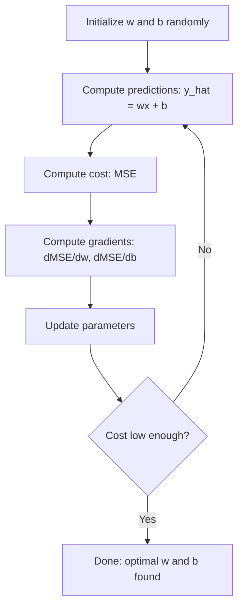

# Regressão linear

> Regressão linear irá desenhar o melhor caminho em seus dados. É o mundo de aprendizado de máquina.

**Type:** Build
**Languages:** Python
**Prerequisites:** Phase 1 (Linear Algebra, Calculus, Optimization), Phase 2 Lesson 1
**Time:** ~90 minutes

## Objectivo de aprendizagem

- 推导 erro quadrado médio 的 Gradiente Descent 更新规则,并从零实现线路回归
- A partir da complexidade de cálculo e a perspectiva de uso do cenário comparado Descenso gradual com equação normal
- 构建带特征标准化的多线性回归模型,并解释学到的权重
-  Explicar Regressão de Ridge (L2 regularização)  Como punir pesos maiores para evitar sobre-ajustamento

## 问题

Você tem um conjunto de dados: área da casa e seu preço de compra. Você pode calcular o preço de uma casa nova. Você pode calcular o preço de uma casa nova, mas você precisa de uma fórmula.

A regressão linear lhe dará esta linha. Mais importante, introduziu um ciclo de treinamento completo de ML: definir o modelo, definir a função de custo, otimizar os parâmetros. Cada algoritmo de ML segue o mesmo modelo.

Não se aplica apenas a simples problemas. A regressão linear é utilizada na previsão de demanda em sistemas de produção, análise de testes A/B, modelagem financeira e é a linha de base de cada tarefa de regressão.

## 概念

### Modelo

Regressão linear 假设 entrada ($x$) com a produção ($y$)  existem relações sexuais:

```math
y = wx + b
```

- `w`(peso/inclinação):当 $x$增加 1 时,$y$ alterar o quanto
- `b`(precisão/intercepção):当 $x = 0$时,$y$Valor

对于多个输入 (特征), é expandido para:

```math
y = w_1 x_1 + w_2 x_2 + \cdots + w_n x_n + b
```

Ou escrever em forma de vetor:$y = w^T x + b$

目標: encontrar $w$和 $b$O valor é o valor do valor.$y$Em todos os exemplos de treinamento , é possível aproximar-se da realidade .$y$- Não.

### Função de custo (erro médio quadrado)

Como medir o máximo possível de aproximação? Você precisa de um único número para indicar que há muitos erros. A escolha mais comum é o Erro Médio Quadrado (MSE):

```math
\text{MSE} = \frac{1}{n} \sum (y_{\text{预测值}} - y_{\text{实际值}})^2
```

Por que é necessário quadrado? Há duas razões. Primeiro, ele pede maior erro do que pequeno erro.

A função custo irá formar uma forma de peso.$w$和 viés $b$,MSE 曲面看起来像一个碗凸抛物面) 碗底就是MSE 最小的位置──训练就是找到这个底部──

### Descenso gradual

Descenso gradual através de passos continuamente para baixo para encontrar o fundo da taça.



Os graduantes vão dizer-lhe duas coisas: cada parâmetro deve mover-se em que direcção e quanto deve mover-se.

Para o$\hat{y} = wx + b$- O MSE:

```math
\begin{aligned}
\frac{\partial \text{MSE}}{\partial w} &= \frac{2}{n} \sum (\hat{y} - y) \, x \\
\frac{\partial \text{MSE}}{\partial b} &= \frac{2}{n} \sum (\hat{y} - y)
\end{aligned}
```

更新规则:

```math
\begin{aligned}
w &= w - \text{learning\_rate} \cdot \frac{\partial \text{MSE}}{\partial w} \\
b &= b - \text{learning\_rate} \cdot \frac{\partial \text{MSE}}{\partial b}
\end{aligned}
```

Taxa de aprendizagem 控制步长──太大:会越过最小值并发散──太小:training 会耗时很久──典型起始值: 0.01、0.001 或 0.0001──

### Equação Normal ((闭式解)

Especialmente para a regressão linear, há uma fórmula direta que pode dar os maiores pesos em qualquer caso:

```math
w = (X^T X)^{-1} X^T y
```

Ele passa pela Matrix, um passo atrás.$w$◊ É muito adequado para pequenos conjuntos de dados. Para grandes conjuntos de dados (contudo, milhões de páginas ou milhares de características), é mais recomendado o Descenso Gradiente, porque a inversão de matrizes é a complexidade numérica das características.$O(n^3)$- Não.

### Regressão Linear Multipla

∆ Para vários recursos, modelo 变为:

```math
y = w_1 x_1 + w_2 x_2 + \cdots + w_n x_n + b
```

Uma forma de trabalho é a mesma: MSE é a função de custo, Descenso gradiente, assim como todos os pesos. A única diferença é que você se adapta a um hiperplano, e não a uma linha.

A escalagem de características é muito importante. Se um recurso é de 0 a 1, outro é de 0 a 1.000.000, a descida de gradiente é difícil de obter, pois a superfície de custo vai ficar mais longa.

### Regressão polinômica

Se a relação não é linear, você ainda pode criar características polinômias para usar regressão linear:

```math
y = w_1 x + w_2 x^2 + w_3 x^3 + b
```

Esta continua a ser a regressão linear, porque o modelo é de peso ($w_1, w_2, w_3$Não, não, não, não.$x$As características não lineares.

Polinômios de grau superior podem se adequar a curvas mais complexas, mas também há risco de sobre-ajuste.

### R-Correção quadrada

O MSE diz-te que há muito que se pode fazer, mas esse número depende de...$y$de dimensão: R-quadrado ($R^2$)  fornecer um indicador de medida independente de uma medida:

```math
\begin{aligned}
R^2 &= 1 - \frac{\text{残差平方和}}{\text{相对均值的离差平方和}} \\
&= 1 - \frac{SS_{\text{res}}}{SS_{\text{tot}}}
\end{aligned}
```

- $R^2 = 1.0$:完美预测
- $R^2 = 0.0$Modelo não é melhor do que cada vez que se prevê
- $R^2 < 0.0$Modelo 比预测 média 更差

### Regularização 预览 (Regressão de Ridge)

Quando você tem muitas características, o modelo pode passar por uma distribuição de pesos maiores para sobre-ajustar.

```math
\text{代价} = \text{MSE} + \lambda \sum w_i^2
```

惩罚项会抑制 maiores pesos―hiperparâmetro $\lambda$ controlo:$\lambda$越高,重量 越小, regularisation 越强── os cursos posteriores vão explorar mais profundamente este ponto── agora só precisamos saber que ele existe, bem como por que ele ajuda──

```figure
linear-regression-fit
```

## Construção

### 步骤 1: gerar dados de exemplo

```python
import random
import math

random.seed(42)

TRUE_W = 3.0
TRUE_B = 7.0
N_SAMPLES = 100

X = [random.uniform(0, 10) for _ in range(N_SAMPLES)]
y = [TRUE_W * x + TRUE_B + random.gauss(0, 2.0) for x in X]

print(f"Generated {N_SAMPLES} samples")
print(f"True relationship: y = {TRUE_W}x + {TRUE_B} (+ noise)")
print(f"First 5 points: {[(round(X[i], 2), round(y[i], 2)) for i in range(5)]}")
```

### 步骤 2: usar Descenso Gradiente de zero para realizar regressão linear

```python
class LinearRegression:
    def __init__(self, learning_rate=0.01):
        self.w = 0.0
        self.b = 0.0
        self.lr = learning_rate
        self.cost_history = []

    def predict(self, X):
        return [self.w * x + self.b for x in X]

    def compute_cost(self, X, y):
        predictions = self.predict(X)
        n = len(y)
        cost = sum((pred - actual) ** 2 for pred, actual in zip(predictions, y)) / n
        return cost

    def compute_gradients(self, X, y):
        predictions = self.predict(X)
        n = len(y)
        dw = (2 / n) * sum((pred - actual) * x for pred, actual, x in zip(predictions, y, X))
        db = (2 / n) * sum(pred - actual for pred, actual in zip(predictions, y))
        return dw, db

    def fit(self, X, y, epochs=1000, print_every=200):
        for epoch in range(epochs):
            dw, db = self.compute_gradients(X, y)
            self.w -= self.lr * dw
            self.b -= self.lr * db
            cost = self.compute_cost(X, y)
            self.cost_history.append(cost)
            if epoch % print_every == 0:
                print(f"  Epoch {epoch:4d} | Cost: {cost:.4f} | w: {self.w:.4f} | b: {self.b:.4f}")
        return self

    def r_squared(self, X, y):
        predictions = self.predict(X)
        y_mean = sum(y) / len(y)
        ss_res = sum((actual - pred) ** 2 for actual, pred in zip(y, predictions))
        ss_tot = sum((actual - y_mean) ** 2 for actual in y)
        return 1 - (ss_res / ss_tot)


print("=== Training Linear Regression (Gradient Descent) ===")
model = LinearRegression(learning_rate=0.005)
model.fit(X, y, epochs=1000, print_every=200)
print(f"\nLearned: y = {model.w:.4f}x + {model.b:.4f}")
print(f"True:    y = {TRUE_W}x + {TRUE_B}")
print(f"R-squared: {model.r_squared(X, y):.4f}")
```

### 步骤 3:Equação normal ((闭式解)

```python
class LinearRegressionNormal:
    def __init__(self):
        self.w = 0.0
        self.b = 0.0

    def fit(self, X, y):
        n = len(X)
        x_mean = sum(X) / n
        y_mean = sum(y) / n
        numerator = sum((X[i] - x_mean) * (y[i] - y_mean) for i in range(n))
        denominator = sum((X[i] - x_mean) ** 2 for i in range(n))
        self.w = numerator / denominator
        self.b = y_mean - self.w * x_mean
        return self

    def predict(self, X):
        return [self.w * x + self.b for x in X]

    def r_squared(self, X, y):
        predictions = self.predict(X)
        y_mean = sum(y) / len(y)
        ss_res = sum((actual - pred) ** 2 for actual, pred in zip(y, predictions))
        ss_tot = sum((actual - y_mean) ** 2 for actual in y)
        return 1 - (ss_res / ss_tot)


print("\n=== Normal Equation (Closed-Form) ===")
model_normal = LinearRegressionNormal()
model_normal.fit(X, y)
print(f"Learned: y = {model_normal.w:.4f}x + {model_normal.b:.4f}")
print(f"R-squared: {model_normal.r_squared(X, y):.4f}")
```

### 步骤 4: Regressão linear múltipla

```python
class MultipleLinearRegression:
    def __init__(self, n_features, learning_rate=0.01):
        self.weights = [0.0] * n_features
        self.bias = 0.0
        self.lr = learning_rate
        self.cost_history = []

    def predict_single(self, x):
        return sum(w * xi for w, xi in zip(self.weights, x)) + self.bias

    def predict(self, X):
        return [self.predict_single(x) for x in X]

    def compute_cost(self, X, y):
        predictions = self.predict(X)
        n = len(y)
        return sum((pred - actual) ** 2 for pred, actual in zip(predictions, y)) / n

    def fit(self, X, y, epochs=1000, print_every=200):
        n = len(y)
        n_features = len(X[0])
        for epoch in range(epochs):
            predictions = self.predict(X)
            errors = [pred - actual for pred, actual in zip(predictions, y)]
            for j in range(n_features):
                grad = (2 / n) * sum(errors[i] * X[i][j] for i in range(n))
                self.weights[j] -= self.lr * grad
            grad_b = (2 / n) * sum(errors)
            self.bias -= self.lr * grad_b
            cost = self.compute_cost(X, y)
            self.cost_history.append(cost)
            if epoch % print_every == 0:
                print(f"  Epoch {epoch:4d} | Cost: {cost:.4f}")
        return self

    def r_squared(self, X, y):
        predictions = self.predict(X)
        y_mean = sum(y) / len(y)
        ss_res = sum((actual - pred) ** 2 for actual, pred in zip(y, predictions))
        ss_tot = sum((actual - y_mean) ** 2 for actual in y)
        return 1 - (ss_res / ss_tot)


random.seed(42)
N = 100
X_multi = []
y_multi = []
for _ in range(N):
    size = random.uniform(500, 3000)
    bedrooms = random.randint(1, 5)
    age = random.uniform(0, 50)
    price = 50 * size + 10000 * bedrooms - 1000 * age + 50000 + random.gauss(0, 20000)
    X_multi.append([size, bedrooms, age])
    y_multi.append(price)


def standardize(X):
    n_features = len(X[0])
    means = [sum(X[i][j] for i in range(len(X))) / len(X) for j in range(n_features)]
    stds = []
    for j in range(n_features):
        variance = sum((X[i][j] - means[j]) ** 2 for i in range(len(X))) / len(X)
        stds.append(variance ** 0.5)
    X_scaled = []
    for i in range(len(X)):
        row = [(X[i][j] - means[j]) / stds[j] if stds[j] > 0 else 0 for j in range(n_features)]
        X_scaled.append(row)
    return X_scaled, means, stds


y_mean_val = sum(y_multi) / len(y_multi)
y_std_val = (sum((yi - y_mean_val) ** 2 for yi in y_multi) / len(y_multi)) ** 0.5
y_scaled = [(yi - y_mean_val) / y_std_val for yi in y_multi]

X_scaled, x_means, x_stds = standardize(X_multi)

print("\n=== Multiple Linear Regression (3 features) ===")
print("Features: house size, bedrooms, age")
multi_model = MultipleLinearRegression(n_features=3, learning_rate=0.01)
multi_model.fit(X_scaled, y_scaled, epochs=1000, print_every=200)

print(f"\nWeights (standardized): {[round(w, 4) for w in multi_model.weights]}")
print(f"Bias (standardized): {multi_model.bias:.4f}")
print(f"R-squared: {multi_model.r_squared(X_scaled, y_scaled):.4f}")
```

### 步骤 5: Regressão polinômica

```python
class PolynomialRegression:
    def __init__(self, degree, learning_rate=0.01):
        self.degree = degree
        self.weights = [0.0] * degree
        self.bias = 0.0
        self.lr = learning_rate

    def make_features(self, X):
        return [[x ** (d + 1) for d in range(self.degree)] for x in X]

    def predict(self, X):
        features = self.make_features(X)
        return [sum(w * f for w, f in zip(self.weights, row)) + self.bias for row in features]

    def fit(self, X, y, epochs=1000, print_every=200):
        features = self.make_features(X)
        n = len(y)
        for epoch in range(epochs):
            predictions = [sum(w * f for w, f in zip(self.weights, row)) + self.bias for row in features]
            errors = [pred - actual for pred, actual in zip(predictions, y)]
            for j in range(self.degree):
                grad = (2 / n) * sum(errors[i] * features[i][j] for i in range(n))
                self.weights[j] -= self.lr * grad
            grad_b = (2 / n) * sum(errors)
            self.bias -= self.lr * grad_b
            if epoch % print_every == 0:
                cost = sum(e ** 2 for e in errors) / n
                print(f"  Epoch {epoch:4d} | Cost: {cost:.6f}")
        return self

    def r_squared(self, X, y):
        predictions = self.predict(X)
        y_mean = sum(y) / len(y)
        ss_res = sum((actual - pred) ** 2 for actual, pred in zip(y, predictions))
        ss_tot = sum((actual - y_mean) ** 2 for actual in y)
        return 1 - (ss_res / ss_tot)


random.seed(42)
X_poly = [x / 10.0 for x in range(0, 50)]
y_poly = [0.5 * x ** 2 - 2 * x + 3 + random.gauss(0, 1.0) for x in X_poly]

x_max = max(abs(x) for x in X_poly)
X_poly_norm = [x / x_max for x in X_poly]
y_poly_mean = sum(y_poly) / len(y_poly)
y_poly_std = (sum((yi - y_poly_mean) ** 2 for yi in y_poly) / len(y_poly)) ** 0.5
y_poly_norm = [(yi - y_poly_mean) / y_poly_std for yi in y_poly]

print("\n=== Polynomial Regression (degree 2 vs degree 5) ===")
print("True relationship: y = 0.5x^2 - 2x + 3")

print("\nDegree 2:")
poly2 = PolynomialRegression(degree=2, learning_rate=0.1)
poly2.fit(X_poly_norm, y_poly_norm, epochs=2000, print_every=500)
print(f"  R-squared: {poly2.r_squared(X_poly_norm, y_poly_norm):.4f}")

print("\nDegree 5:")
poly5 = PolynomialRegression(degree=5, learning_rate=0.1)
poly5.fit(X_poly_norm, y_poly_norm, epochs=2000, print_every=500)
print(f"  R-squared: {poly5.r_squared(X_poly_norm, y_poly_norm):.4f}")

print("\nDegree 2 fits the true curve well. Degree 5 fits training data slightly better")
print("but risks overfitting on new data.")
```

### 步骤 6: Regressão de escala (regularização L2)

```python
class RidgeRegression:
    def __init__(self, n_features, learning_rate=0.01, alpha=1.0):
        self.weights = [0.0] * n_features
        self.bias = 0.0
        self.lr = learning_rate
        self.alpha = alpha

    def predict_single(self, x):
        return sum(w * xi for w, xi in zip(self.weights, x)) + self.bias

    def predict(self, X):
        return [self.predict_single(x) for x in X]

    def fit(self, X, y, epochs=1000, print_every=200):
        n = len(y)
        n_features = len(X[0])
        for epoch in range(epochs):
            predictions = self.predict(X)
            errors = [pred - actual for pred, actual in zip(predictions, y)]
            mse = sum(e ** 2 for e in errors) / n
            reg_term = self.alpha * sum(w ** 2 for w in self.weights)
            cost = mse + reg_term
            for j in range(n_features):
                grad = (2 / n) * sum(errors[i] * X[i][j] for i in range(n))
                grad += 2 * self.alpha * self.weights[j]
                self.weights[j] -= self.lr * grad
            grad_b = (2 / n) * sum(errors)
            self.bias -= self.lr * grad_b
            if epoch % print_every == 0:
                print(f"  Epoch {epoch:4d} | Cost: {cost:.4f} | L2 penalty: {reg_term:.4f}")
        return self


print("\n=== Ridge Regression (L2 Regularization) ===")
print("Same data as multiple regression, with alpha=0.1")
ridge = RidgeRegression(n_features=3, learning_rate=0.01, alpha=0.1)
ridge.fit(X_scaled, y_scaled, epochs=1000, print_every=200)
print(f"\nRidge weights: {[round(w, 4) for w in ridge.weights]}")
print(f"Plain weights: {[round(w, 4) for w in multi_model.weights]}")
print("Ridge weights are smaller (shrunk toward zero) due to the L2 penalty.")
```


## Use-o

Agora, com um pouco de aprendizagem, faça o mesmo, é assim que você realmente vai usar a produção.

```python
from sklearn.linear_model import LinearRegression as SklearnLR
from sklearn.linear_model import Ridge
from sklearn.preprocessing import PolynomialFeatures, StandardScaler
from sklearn.model_selection import train_test_split
from sklearn.metrics import mean_squared_error, r2_score
import numpy as np

np.random.seed(42)
X_sk = np.random.uniform(0, 10, (100, 1))
y_sk = 3.0 * X_sk.squeeze() + 7.0 + np.random.normal(0, 2.0, 100)

X_train, X_test, y_train, y_test = train_test_split(X_sk, y_sk, test_size=0.2, random_state=42)

lr = SklearnLR()
lr.fit(X_train, y_train)
y_pred = lr.predict(X_test)

print("=== Scikit-learn Linear Regression ===")
print(f"Coefficient (w): {lr.coef_[0]:.4f}")
print(f"Intercept (b): {lr.intercept_:.4f}")
print(f"R-squared (test): {r2_score(y_test, y_pred):.4f}")
print(f"MSE (test): {mean_squared_error(y_test, y_pred):.4f}")

poly = PolynomialFeatures(degree=2, include_bias=False)
X_poly_sk = poly.fit_transform(X_train)
X_poly_test = poly.transform(X_test)

lr_poly = SklearnLR()
lr_poly.fit(X_poly_sk, y_train)
print(f"\nPolynomial degree 2 R-squared: {r2_score(y_test, lr_poly.predict(X_poly_test)):.4f}")

scaler = StandardScaler()
X_train_scaled = scaler.fit_transform(X_train)
X_test_scaled = scaler.transform(X_test)

ridge = Ridge(alpha=1.0)
ridge.fit(X_train_scaled, y_train)
print(f"Ridge R-squared: {r2_score(y_test, ridge.predict(X_test_scaled)):.4f}")
print(f"Ridge coefficient: {ridge.coef_[0]:.4f}")
```

Seu de implementar desde o zero e aprender de forma pequena irá produzir os mesmos resultados. Diferença está em: aprender de forma pequena irá tratar casos de ponta.

## 交付

本课会产出:
- `outputs/skill-regression.md`- uma habilidade, usada para escolher o método de regressão adequado

## 练习

1. 实现 batch gradient descent ̊stochastic gradient descent (SGD) 和 mini-batch gradient descent ̊在同一数据集上比较收速度──哪个收最快?哪个成本曲线最平滑?
2. A partir da função cúbica ($y = ax^3 + bx^2 + cx + d + \text{噪声}$• Produção de dados:                                                                                                                                                                                                                                                            $R^2$E teste$R^2$Até que ponto o excesso de qualidade se tornou evidente?
3. 实现 regressão de Lasso(L1 regularização:$\text{惩罚项} = \alpha \sum \lvert w_i \rvert$O que é que faz com que a L1 produz soluções escassas, enquanto a L2 não?

## 关键术语

| Term | 人们常说 | 实际含义 |
|------|----------------|----------------------|
| Linear regression | “在数据中画一条线” | 找到 weight $w$ 和 bias $b$，使 $wx+b$ 与真实 $y$ 值之间的平方差之和最小 |
| Cost function | “model 有多差” | 一个将 model parameters 映射为单一数字的函数，用于衡量 prediction error，并由 optimization 最小化 |
| Mean squared error | “平方误差的平均值” | $\frac{1}{n} \sum (\text{预测值} - \text{实际值})^2$，对大误差施加不成比例的惩罚 |
| Gradient descent | “往下坡走” | 使用偏导数，沿着降低 cost function 的方向迭代调整 parameters |
| Learning rate | “步长” | 控制每一步 Gradient Descent 中 parameters 改变量的标量 |
| Normal equation | “直接求解” | 闭式解 $w = (X^T X)^{-1} X^T y$，无需迭代即可得到最优 weights |
| R-squared | “拟合有多好” | model 所解释的 $y$ 方差比例，范围从负无穷到 1.0 |
| Feature scaling | “让 features 可比较” | 将 features 转换到相近范围（例如 zero mean、unit variance），使 Gradient Descent 更快收敛 |
| Regularization | “惩罚复杂度” | 向 cost function 添加一个会缩小 weights 的项，以防止 overfitting |
| Ridge regression | “L2 regularization” | 向 MSE 添加 $\lambda \sum w_i^2$ 惩罚项的 linear regression |
| Polynomial regression | “用线性数学拟合曲线” | 对 polynomial features ($x, x^2, x^3, \ldots$) 做 linear regression，对 weights 仍然是线性的 |
| Overfitting | “记住 training data” | 使用过于复杂的 model，以至于拟合了 training data 中的噪声，并在新数据上失效 |

## 延伸阅读

- [An Introduction to Statistical Learning (ISLR)](https://www.statlearning.com/)-- 免费 PDF, capítulo 3 及第 6 章 涵盖线性回归与规范化,并包含实用R示例
- [The Elements of Statistical Learning (ESL)](https://hastie.su.domains/ElemStatLearn/)- PDF gratuito, é ISLR mais matemático, para a crescente e lasso tem mais profundidade de tratamento
- [Stanford CS229 Lecture Notes on Linear Regression](https://cs229.stanford.edu/main_notes.pdf)-- Andrew Ng's notes, do princípio da primeira natureza de indução da equação normal e descida gradual
- [scikit-learn LinearRegression documentation](https://scikit-learn.org/stable/modules/linear_model.html)-- LinearRegression、Ridge、Lasso 和 ElasticNet, contendo exemplos de código
