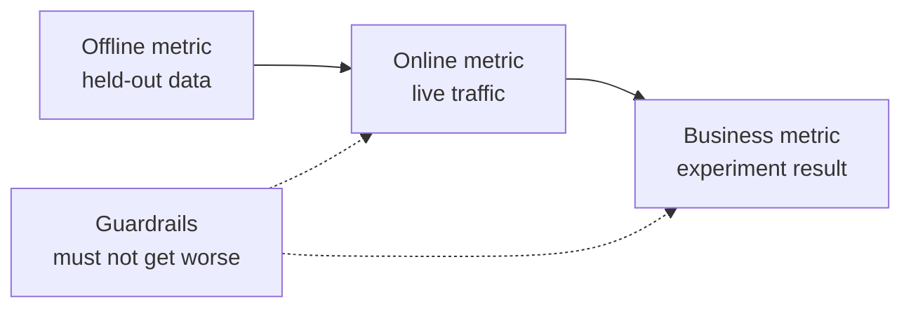

# 机器学习系统设计: do problema ao modelo já implantado

> O modelo é apenas parte do sistema. O modelo determina o que o modelo prevê. Quem, de acordo com a previsão, adota a ação.

**Type:** Build
**Languages:** Python
**Prerequisites:** 阶段 2，第 09 课（模型评估）和第 13 课（ML 流水线）
**Time:** 约 110 分钟

## Objectivo de aprendizagem

- Definir os problemas de negócios como tarefas de gestão, definir o conteúdo da previsão, tomar decisões sobre a utilização da previsão e as causas de problemas que não são resolvidos por regras
- Distinguir entre linha, linha, negócios e indicadores de manutenção, comparar cada modelo com linha simples e linha inicial
- Com base na estimativa de volume de tráfego e no cálculo de quantidade de dados, o custo diário, o atraso e a antiguidade dos dados
- 选择发布方式(影子、金丝雀、A/B 测试),并为每种故障模式选择安全默认行为
- 识别模型如何通过决策改变下一版本训练数据的反循环
- 编写 ML 设计文档,并按固定检查清单评分

## 问题

Uma empresa de subscrição requisitou um modelo de previsão de vazão. Cientistas de dados treinaram um módulo de classificação de gradiente, relatando que a AUC atingiu 0,91 e, três meses depois, ninguém o usou.

原因与算法无关──没有人决定分数应触发什么行动──分数每周才更新一次,但客户挽留团队每天打电话──标签来自取消订阅表,而该表还存储取消原因,因此某特征直接包含答案──也没有人把模型与客户团原始规则比较:给连续两周不活跃客户打电话──

Estes fracassos já foram enterrados antes do início do treinamento. Todos eles são fracassos de design, e o arquivo de design pode ser seguido de forma gradual.

## 核心概念

### Do objetivo do negócio ao objetivo do ML

商务目标不等于 ML 任务―― use four questions to translate it into task:

1. 模型具体预测什么,预测对象是什么实体?
2. Qual é a decisão que se toma com previsão, por quem ou por que sistema?
3. Qual é o tempo de previsão, quais dados disponíveis nesse momento?
4. Como é que a decisão é melhorada?

| 业务目标 | 预测 | 使用预测的决策 | ML 任务 |
|---|---|---|---|
| 减少流失 | 用户未来 30 天取消订阅的概率 | 每晚向风险最高的 5% 用户发送挽留优惠 | 二分类 |
| 减少欺诈损失 | 一笔支付属于欺诈的概率 | 在 100 ms 内批准、送审或阻止 | 二分类 |
| 保持货架有货 | 下周各门店每天的销售件数 | 各门店订货量 | 预测 |
| 展示相关商品 | （用户，商品）对的相关性分数 | 信息流中的商品顺序 | 排序 |

Segundo, a maior necessidade de detalhes são definidos. Não há uma clara janela de tempo, físico e operacional.

### 何时不应使用 ML

Regras do aprendizado de máquina 1                                                                                                                                                                                                                                                                                                                                                                                                                                                                                                                      

- 简短规则可以实现目标,并能持续保持正确. 简短规则可以实现目标,并能持续保持正确. 简短规则可以实现目标,并能持续保持正确. 简短规则运行,测试和解释的成本更低.
- Não há etiquetas, nem métodos de recolha práticos.
- Não há ninguém que tome medidas de acordo com a previsão, portanto, a previsão mais precisa não traz mudanças.
- 预测时可用数据不含所需信号──
- Uma vez o erro também não pode ser aceito, e ninguém pode verificar a saída.
- Os custos de construção e operação dos sistemas são superiores ao valor que resulta de melhores decisões.

Quando as regras se tornam extensas e fracas, o ML só começa a valer a pena. A mesma regra 3 recomenda priorizar o uso do ML em vez de regras de inicialização complexas, pois o modelo aprendido é mais fácil de atualizar e manter.

### 3 - Indicadores

Em três níveis, medir o sistema de inteligência, ao mesmo tempo que definir um conjunto de restrições:

| 层面 | 何时能测量 | 流失预测示例 |
|---|---|---|
| 离线指标 | 上线前，在留出的历史数据上 | 优惠阈值处的 F1、风险最高 5% 中的精确率 |
| 在线指标 | 上线期间，在真实流量上 | 优惠接受率、已评分用户比例、分数分布 |
| 业务指标 | 上线数周后，通过实验 | 干预组与保留对照组的 30 天流失率 |
| 护栏指标 | 始终监测 | 每挽留一名用户的优惠成本、退订率、p99 延迟 |



Os níveis de dados em linha frequentemente dão conclusões diferentes. Os dados históricos de avaliação dos indicadores de negócios não são do passado. Os indicadores de negócios online dependem da reação das pessoas às decisões.

选择与决策匹配的离线指标――如果任务联系风险最高的5%用户,就测这个5%中的精确率――AUC对所有值综合评估,包括你从未使用的值――规则 2 要求先设计并实现指标,再决定ML系统具体做什么――

### 基线

Se o melhor alternativo for apenas 0,30, F1 atingir 0,56 é muito bom; se uma regra for atingir 0,60, é muito ruim.

- **简单基线。**始终预测多数类别,或始终预测训练集平均值──模型评估课使用过这种检查──
- **启发式基线。**Regras de conhecimento do campo, ou características únicas adequadas aos dados de treinamento.
- **现有系统。**Método de tomada de decisão, mesmo que seja apenas um utilizador de formulários eletrônicos.

O valor de elevação é o número de pontos do modelo, menos o número de pontos de base mais fortes. Antes de verificar o resultado, é preciso definir o mínimo de elevação e garantir que seja suficiente para cobrir os custos extras do sistema.

### Requisitos de dados e etiquetas

訓練前回答这些问题:

- **标签来源。**Qual é o nome do evento definido, por quem é responsável?
- **标签延迟。**预测后多久才知道真实结果? fraude rejeição de pagamento pode surgir após semanas de pagamento;流失标签 流失标签 流失标签 流失标签 流失标签 流失标签 流失标签 流失标签 流失标签 流失标签 流失标签 流失标签 流失标签 流失标签 流失标签 流失标签 流失标签 流失标签 流失标签 流失标签 流失标签 流失标签 流失标签 流失标签 流失标签 流失标签 流失标签 流失标签 流失标签 流失标签 流失标签 流失标签 流失标签 流失标签 流失标签 流失标签 流失标签 流失标签 流失标签 流失 流失 流失 流失 流失 流失 流失 流失 流失 流失 流失 流失 流失 流失 流失 流失 流失 流失 流失 流失 流失 流失 流失 流失 流失 流失 流失 流失 流失 流失 流失 流失 流失 流失 流失 流失 流失 流失 流失 流失 流失 流 流失 流 流失 流 流失 流失 流 流失 流失 流失 流失 流失 流 流 流 流 流 流失 流 流 流失 流 流 流 流 流 流 流 流 流 流 流 流 流 流 流 流 流 流 流 流 流 流 流 流 流 流 流 流 流 流 流 流 流 流 流 流 流 流 流 流 流 流 流 流 流 流 流 流 流 流 流 流 流 流 流 流 
- **标签质量。**Quem é que o marca, com frequência de erro?
- **预测时的可用性。**Cada característica é presente quando ocorre a previsão? Os resultados que surgem depois de as características escritas vão divulgar os sinais durante o treinamento.
- **各类样本量。**Há apenas 200 amostras reais, normalmente apenas podem ser usadas modelos simples.
- **时间切分。**留出最近一段时间──时间序列课按时间分类数据也出于同样的原因──

### 延迟、 produção e orçamento de custos

Três números para cada tipo de serviço:

- **延迟预算。**O atraso é 99 de 100 pedidos, que são inferiores ao tempo de uso.
- **峰值吞吐量。**按最忙一分钟而非日均流量配置系统──峰值 QPS(每秒请求数) 往往是平均值的数倍──
- **成本预算。**Usando o custo diário em dólares ou o custo em dólares de 1000 vezes de previsão, é fácil comparar o esquema.

Pouco teorizará os dois primeiros: o número de solicitações processadas é igual ao volume de transmissão multiplicado por atraso. Se por segundo 400 solicitações são processadas por 50 ms, então, em média, há 20 solicitações processadas.

###  Contrato de vendas e contrato de vendas

提供预测 Há duas formas básicas:

- **批量推理。**定時任務為各实体评分,將分數寫入表或鍵值存储──應用在收到请求时读取已存存分──
- **在线推理。** aplicativo em pedido até que o tempo de envio do recurso para o modelo de serviço, esperar o número de retornos.

| 属性 | 批量 | 在线 |
|---|---|---|
| 新鲜度 | 距离上次运行的时间，加上运行耗时 | 使用当前请求的数据 |
| 请求延迟 | 一次键值读取，几毫秒 | 特征获取时间加模型耗时 |
| 成本驱动因素 | 实体数乘以每天运行次数 | 按峰值 QPS 配置的副本数 |
| 新实体 | 下一次运行前没有分数 | 第一次请求时即可评分 |
| 故障时 | 旧分数仍可读取 | 请求失败或超时 |

Este pacote de ferramentas estimará os custos de ambos os lados. O custo de lote aumenta com o número de unidades físicas e o número de operações diárias. Permite o tempo de expansão a cada vez mais curto, o tempo de expansão a cada vez mais frequente. O custo online aumenta com o fluxo de valor máximo, pois as cópias de lojas entre lojas de alto nível também devem ser pagas.

混合设计很常见: tarefas de lote nocturnal dados aos usuários já avaliados, routes on-line para processar novos usuários e necessidades de novos dados.

### 部署模式

Novo modelo分阶段 kontakt usuário:

1. **影子运行（Shadow）。**O novo modelo recebe uma dupla de fluxo real.
2. **金丝雀发布（Canary）。**O novo modelo é usado para uma pequena parte do fluxo para tomar decisões reais, geralmente de 1% a 5% ∞.
3. **A/B 测试。**Os usuários do grupo de usuários usam diferentes modelos. Usando os indicadores de negócios de análise estatística e medição, é necessário tempo e tráfego suficientes para ver a diferença.

Cada fase precisa ser concluída em poucos minutos.[影子与金丝雀发布课](../../../17-infrastructure-and-production/20-shadow-canary-progressive/docs/en.md)和 [A/B 测试课](../../../17-infrastructure-and-production/21-ab-testing-llm-features/docs/en.md)A partir de hoje, o sistema de ensino superior é um dos mais importantes.

### Recurso

Quando a decisão do modelo muda os dados de treinamento da versão seguinte, surge um ciclo de contra-ataques.

- **干预隐藏标签。**流失模型发送优惠,挽留了部分用户──下个月,高风险用户看起来很忠诚,重新训练的模型便学到这些特征不能预测流失──
- **被阻止的行动没有结果。**O modelo de fraude bloqueia um pagamento, este pagamento em vez de nunca produzir uma marca de rejeição.
- **曝光限制反馈。**O modelo de classificação mostra apenas os produtos classificados, portanto, apenas esses produtos são clicados.

O conceito comum do método de recuperação é manter alguns dados não afetados pelo modelo. O grupo de usuários não aceita interveniência; dá uma pequena quantidade de fluxo para a distribuição de decisões; com cada amostra, o número de registros e as decisões, para que o treinamento posterior possa distinguir entre os dados afetados e os dados limpos.

### • O comportamento de segurança

Cada parte do sistema vai falhar tarde e cedo. Deve ser no estágio de design e não no acidente que decida o comportamento de defeito em inglês:

| 故障 | 没有预案时的结果 | 安全默认行为 |
|---|---|---|
| 模型服务超时 | 请求失败 | 使用启发式基线 |
| 夜间批任务失败 | 分数缺失或过旧 | 在固定期限内提供最近的正常分数，之后使用规则 |
| 特征缺失或越界 | 模型对坏输入评分 | 使用文档规定的默认值，并记录事件 |
| 新实体没有历史 | 没有分数 | 使用规则或总体均值 |
| 分数分布突然变化 | 大规模错误决策 | 暂停自动行动，并通知人工处理 |

O indicador de parte da linha de base é também um dos principais problemas, por isso deve-se primeiro implementá-lo.

### design arquivo

design documentar in training begun pre-centra record acima décisions.                                                                                                                                                                                                                                                       

| 章节 | 回答的问题 | 阻塞条件 |
|---|---|---|
| 问题 | 预测什么，哪项决策使用它，为什么规则不够？ | 必须明确决策 |
| 指标 | 适用哪些离线、在线、业务和护栏指标？ | 必须明确业务指标 |
| 基线 | 适用哪些简单、启发式和现有系统基线？ | 必须有启发式或现有系统基线 |
| 数据 | 标签来自哪里、延迟多久，每个特征预测时是否可用？ | 不得泄露标签 |
| 预算与服务 | 有哪些延迟、峰值 QPS、成本和陈旧时间限制，哪种模式满足它们？ | 无 |
| 发布 | 使用哪些影子、金丝雀及 A/B 阶段，如何回滚？ | 必须有影子或金丝雀阶段，以及回滚 |
| 反馈循环 | 模型如何改变未来数据，如何保留干净数据？ | 无 |
| 故障模式 | 每种故障的默认行动是什么？ | 每种故障都必须有默认行为 |
| 监控 | 上线后观察什么？ | 无 |

```figure
mlprod-serving-cost
```

## Desde zero construção

`code/main.py` apenas utilizar a biblioteca de padrões, contém três ferramentas: modelo de custos de serviço, modelo de linha de comparação e revisor de arquivos de design.

###                                                                                                                                                                                                                                                               

工作负载保存流量与预算数字,成本模型保存价格── estes preços são exemplos de quantificação integral de prática, não de preços de fornecedores──

```python
@dataclass(frozen=True)
class Workload:
    name: str
    entities: int
    requests_per_day: int
    peak_qps: float
    max_staleness_hours: float
    latency_budget_ms: float


@dataclass(frozen=True)
class CostModel:
    batch_dollars_per_million: float = 0.40
    batch_job_hours: float = 1.0
    lookup_dollars_per_million: float = 0.25
    lookup_latency_ms: float = 4.0
    replica_dollars_per_hour: float = 0.50
    replica_qps: float = 200.0
    min_replicas: int = 2
    online_latency_ms: float = 35.0
```

### Segundo passo: volume de produção e custo do serviço on-line

As tarefas de lote devem ser concluídas dentro do limite de tempo anterior. O intervalo entre duas operações é igual ao limite máximo de redução do tempo de tarefa.

```python
def batch_plan(workload: Workload, costs: CostModel) -> ServingPlan:
    refresh_hours = workload.max_staleness_hours - costs.batch_job_hours
    if refresh_hours <= 0:
        return ServingPlan(
            "batch", False, math.inf, costs.lookup_latency_ms, math.inf, 0.0,
            "staleness limit is shorter than one batch job",
        )
    runs_per_day = 24.0 / refresh_hours
    predictions = workload.entities * runs_per_day
    dollars = (
        predictions / 1e6 * costs.batch_dollars_per_million
        + workload.requests_per_day / 1e6 * costs.lookup_dollars_per_million
    )
    ...
```

O serviço online precisa ser pago para manter o valor máximo de sucesso e, pelo menos, manter duas cópias para garantir a disponibilidade:

```python
def online_plan(workload: Workload, costs: CostModel) -> ServingPlan:
    replicas = max(costs.min_replicas, math.ceil(workload.peak_qps / costs.replica_qps))
    dollars = replicas * costs.replica_dollars_per_hour * 24.0
    feasible = costs.online_latency_ms <= workload.latency_budget_ms
    ...
```

`choose_serving`sele satisfação de atrasos e de restrições de tempo, retornar aos mais baratos.`None`, sugere que precisa de ajustar o orçamento.

### III. Passo: Comparar modelos com bases

Comparar o mesmo indicador de avaliação de modelo e todas as linhas-chave.

```python
def compare_to_baselines(
    y_true: list,
    model_pred: list,
    baselines: dict[str, list],
    metric,
    metric_name: str,
    higher_is_better: bool = True,
    min_lift: float = 0.02,
) -> BaselineReport:
    if not baselines:
        raise ValueError("a model needs at least one baseline")
    scores = {name: metric(y_true, pred) for name, pred in baselines.items()}
    pick = max if higher_is_better else min
    best_name = pick(scores, key=scores.get)
    model_score = metric(y_true, model_pred)
    lift = model_score - scores[best_name] if higher_is_better else scores[best_name] - model_score
    return BaselineReport(metric_name, {"model": model_score, **scores}, best_name, lift, min_lift)
```

启发式基线是单特征规则──`fit_rule`Em dados de treinamento, considere cada valor dessa característica como valor, mantendo o melhor valor F1.

### 第 4 步:为设计文档评分

Cada item de verificação contém um comando, um peso, um sinal de obstrução, uma mensagem e uma função de verificação.

```python
CheckItem("decision", 2, True, "name the action that uses each prediction", lambda d: _text(d, "problem.decision")),
CheckItem("baselines", 2, True, "add a heuristic or current-system baseline", check_baselines),
CheckItem("no_leakage", 2, True, "confirm every feature exists at prediction time",
          lambda d: get_path(d, "data.features_available_at_prediction_time") is True),
CheckItem("serving_fit", 1, False, "pick a serving mode that meets the staleness, latency, and cost budgets",
          check_serving_fit),
```

`check_serving_fit`复用成本模型,从文档读取负载数字,并估算选定模式的成本──如果该模式不能满足陈旧时间上限、延迟预算或每日成本预算,检查就失败──声明采用批但只允许三分钟陈旧时间的文档不能通过──成本模型没有混合方案,因此声明混合的文档也会失败,直到你加入该方案在练习1中──

`review_design_doc`A conclusão é apenas pronta para revisão.

### 第 5 步:运行

```bash
python3 code/main.py
```

```console
nightly churn scores
  ok batch        $0.91/day      4 ms  1.0 runs per day over 2,000,000 entities
  ok online      $24.00/day     35 ms  2 replicas sized for 40 peak QPS
  choose: batch

feed ranking, 2-hour freshness
  ok batch       $48.50/day      4 ms  24.0 runs per day over 5,000,000 entities
  ok online      $24.00/day     35 ms  2 replicas sized for 120 peak QPS
  choose: online

=== Model versus baselines (churn, metric F1) ===
  model                    0.564
  days_idle > 12.8688      0.500
  random at base rate      0.232
  majority class           0.000
  model beats the strongest baseline (days_idle > 12.8688) by +0.064
```

A maioria das linhas de base F1 é 0, porque ela não prevê o fluxo. As regras de suporte são apenas os verdadeiros concorrentes. O modelo é mais alto que 0.064, portanto há razões para usar o modelo. Se as características forem mais fracas, as regras podem vencer, então as regras são o sistema que deve ser implementado.

设计文档评审会印发缺少六阻塞项的薄弱文档,以及 1.00 评分的完整文档――传入路径可评审您自己的文档:

```bash
python3 code/main.py my_design_doc.json
```

## Utilize já usado

工具包各部都应团队在生产中使用的工具──

**基线。**O scikit-learn irá implementar simples bases como estimador, para que possam ser colocadas no mesmo fluxo com o modelo:

```python
from sklearn.dummy import DummyClassifier, DummyRegressor
from sklearn.metrics import f1_score

majority = DummyClassifier(strategy="most_frequent").fit(X_train, y_train)
base_rate = DummyClassifier(strategy="stratified", random_state=0).fit(X_train, y_train)
mean_value = DummyRegressor(strategy="mean").fit(X_train, y_reg_train)

print(f1_score(y_test, majority.predict(X_test)))
```

`most_frequent`                                                                                                                                                                                                                                                                                                                                                                                                                                                                                                                             `majority_baseline`- Não .`stratified`                                                                                                                                                                                                                                                                                                                                                                                                                                                                                                                             `base_rate_baseline`Não há regras de iniciação, porque as regras de iniciação vêm de um campo específico.

**批量服务。**Apache Airflow、Dagster 等工作流调度器运行评分任务,任务将分数写入数仓表,或 Redis、DynamoDB 等键值存储──

**在线服务。**KServe、BentoML、NVIDIA Triton、TorchServe etc. Servidor de modelo será modelo embuxado em HTTP ou gRPC 端点后──

**发布。**Argo Rollouts e Kubernetes  ferramentas para a publicação de distribuição de dados.

**设计评审。**O Breck  et al. publicação ML Test Score  contém 28                                                                                                                                                                                                                                                                                                                                                                                                                                                                                                             

## 交付成果

本课产 出 `outputs/skill-ml-design-review.md` A avaliação de cada fase do processo de elaboração de documentos, priorizando a identificação de deficiências de obstáculos, a utilização de um volume de curso e a seleção de serviços de análise de custos e de cálculo online.

## 练习

1. Por`choose_serving`添加混合方案: lote para avaliações de usuários já utilizados, online para avaliações de novos usuários.
2. Modificar o fluxo de dados, até que o modelo não vença mais as regras.
3. Em chequear lista adicionada`budgets.max_dollars_per_1k_predictions`项,并编写缺少该项时会失败的测试──
4. Para pagar o cheque de fraude, escrever JSON design documentário, executar o chequeiro, reparar cada bloqueio.
5. 模拟流失反循环: remover recebeu 优惠用户的标签, re-train,并测量 F1 变化──

## 关键术语

| 术语 | 常见说法 | 实际含义 |
|------|----------------|----------------------|
| ML 任务 | “做一个流失模型” | 预测目标、实体、时间窗口，以及使用预测的决策 |
| 离线指标 | “模型分数” | 上线前在留出的历史数据上计算的指标 |
| 在线指标 | “实时数据” | 模型运行时在真实流量上测量的指标 |
| 业务指标 | “目标” | 决策必须改变、通过实验测量的公司业务结果 |
| 护栏指标 | “不要造成损害” | 新模型上线时不能变差的指标 |
| 基线 | “简单模型” | 模型必须以规定幅度超越的简单、启发式或现有系统预测器 |
| 批量推理 | “预先算好的分数” | 定时任务为每个实体评分并存储结果，供查询使用 |
| 在线推理 | “实时模型” | 每个请求到达时由模型评分 |
| 影子部署 | “暗发布” | 新模型对真实流量评分，但无人使用输出 |
| 金丝雀发布 | “逐步上线” | 新模型为逐渐扩大的小部分流量决策，同时备好回滚 |
| 反馈循环 | “模型训练自己” | 模型决策改变下一版本的训练数据 |

## 延伸阅读

- [Sculley et al., Hidden Technical Debt in Machine Learning Systems (NeurIPS 2015)](https://papers.nips.cc/paper/2015/hash/86df7dcfd896fcaf2674f757a2463eba-Abstract.html)O sistema de produção de energia e de energia é um dos principais componentes do sistema de energia.
- [Google, Rules of Machine Learning](https://developers.google.com/machine-learning/guides/rules-of-ml)O primeiro modelo, indicadores e regras práticas de formação e conformidade com o serviço
- [Breck et al., The ML Test Score (IEEE Big Data 2017)](https://research.google/pubs/the-ml-test-score-a-rubric-for-ml-production-readiness-and-technical-debt-reduction/): Messação de produção e preparação de 28 testes
- [Kohavi, Tang, and Xu, Trustworthy Online Controlled Experiments (Cambridge University Press, 2020)](https://experimentguide.com/)Como operar para obter conclusões confiáveis
- [Sato, Wider, and Windheuser, Continuous Delivery for Machine Learning (2019)](https://martinfowler.com/articles/cd4ml.html)Data, Modelo e Deploiamento de Fluxos de Água
- [Google Cloud, MLOps: Continuous delivery and automation pipelines in machine learning](https://cloud.google.com/architecture/mlops-continuous-delivery-and-automation-pipelines-in-machine-learning)Três níveis de maturidade de formação e automação dos serviços
