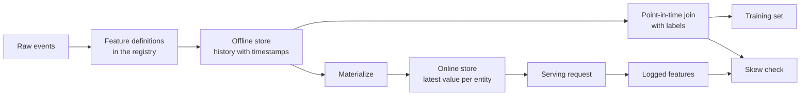

# Características de armazenamento e formação

> Uma característica é definida apenas por uma única parte, mas há duas formas de leitura.

**Type:** Build
**Languages:** Python
**Prerequisites:** Phase 2，第 08 课（特征工程）、第 13 课（机器学习流水线）、第 15 课（时间序列）和第 19 课（机器学习系统设计）
**Time:** ~100 分钟

## Objectivo de aprendizagem

- Explicar o significado do armazenamento on-line, do armazenamento on-line, do tempo de eventos e do TTL e as respectivas responsabilidades
- 实现时点正确的关联,并展示简单关联 如何将未来值复制到训练数据中
- 列出训练服务偏差的四个原因:两条代码路径、特征陈旧、默认值不同和时间穿越
- Construir um registro de características, fazer a mesma definição ao mesmo tempo para o uso de caminhos de treinamento e caminhos de serviço
- Em dias anteriores, preenchendo as novas características, sem ler os dados posteriores a cada período.
- Para a mesma entidade e momento, comparar características no registro de serviços com características que surgem do caminho de treinamento, de modo a detectar a diferença

## 问题

Uma equipe construiu um modelo de usuário perdido. Cada tag diz se o usuário não comprou em 30 dias após o dia de tag.`user_id`O tag está relacionado com a característica do usuário, e baseado em`days_since_last_purchase`訓練一条規則──離線准确率 0.948──

Em fluxo real, este modelo não é como versões mais antigas e mais simples. A tabela de características guarda o valor mais recente de cada usuário, o tempo que passa por trás do dia de marcação. Um usuário faz a última compra no 115o dia, até o 175o dia, já está colocado em 60 dias, por isso a característica em si contém respostas.

As duas falhas são as mesmas: treinamento e serviços on-line são calculados de duas maneiras diferentes usando o mesmo recurso. Este curso será realizado a partir de cada parte do arquivo de características de construção zero. Você vai escrever um formulário de registro, re-enchimento de lógica, ponto de ligação, arquivo de TTL, bem como um exame de diferença.

## 概念

### Duas partes do mesmo traço

Forma de solicitação de características diferentes de treinamento e serviço on-line:

| 属性 | 训练（离线） | 服务（在线） |
|---|---|---|
| 问题 | “一千万个（实体，时间）组合各自对应的值是什么？” | “这个实体现在的值是什么？” |
| 时间 | 过去的多个时点 | 当前 |
| 数据量 | 每个任务数百万行 | 每次请求一行 |
| 延迟 | 可以接受数分钟 | 几毫秒 |
| 存储 | 离线存储：在列式文件或数据仓库中保存带时间戳的完整历史 | 在线存储：在键值数据库中保存每个实体的最新值 |

O material de armazenamento é o valor mais recente de armazenamento on-line de cópia para armazenamento on-line.



### 实体、时间 与 TTL

Cada linha de características pode ser descrita em quatro termos:

- **实体（Entity）。**Características que descrevem os elementos de chave, por exemplo`user_id`Ou `card_id`- Não.
- **事件时间戳（Event timestamp）。**O valor é o momento de criação.
- **创建时间戳（Created timestamp）。**系统写入该行时刻──今日执行的回填会写入事件时间早 hơn、创建时间为当前时间的行──
- **TTL（time to live，生存时间）。**O valor permitido para atingir a maior idade.

具有相同实体、数据源和 TTL 的一组特征, normalmente chamado de 特征视图 (特征视图) 特征视图 (特征视图) 

### 时点正确的关联

Uma linha de treinamento deve associar os sinais e os valores de características já existentes no momento do sinal.

1. 找到同一实体的特征行──
2. Apenas reter o tempo do evento  não atrasar o tempo de marcas  de corrida.
3. - O que é que é?
4. Se o tempo de tag  redução do seu tempo de evento  exceder o TTL, é abandonado este caminho.

Abaixo, mostramos um tag de um usuário, 16 dias, bem como as características geradas por semana:

| 特征行日期 | `purchases_30d` | 时点关联 | 仅按 `user_id` 进行朴素关联 |
|---|---|---|---|
| 7 | 4 | | |
| 14 | 3 | 选中 | |
| 21 | 1 | 未来 | |
| 28 | 0 | 未来 | 选中 |

O tag deve julgar se o usuário comprou qualquer mercadoria entre os dias 17 e 46 de janeiro. O tag já tem os dias que não comprou após o tag já foi calculado.

时序列一课按时间分数据, também por a mesma razão. 时点关联将这条例应用到每一行,而不是只是一个分时点.

###                                                                                                                                                                                                                                                               

O Google define a diferença de desempenho entre o treinamento e o serviço online, e lista três razões: duas diferenças na forma como o treinamento e o serviço processam dados, e quatro razões específicas aparecem repetidamente:

| 原因 | 发生的情况 | 演示中的例子 |
|---|---|---|
| 两条代码路径 | 训练与服务使用不同代码计算特征 | 服务窗口包含 `now - 30` 这一天，训练窗口却不包含 |
| 特征陈旧 | 服务读取的值与训练所用值的年龄不同 | 训练读取每周快照，而新服务计算实时的新值 |
| 默认值不同 | 两条路径对缺失值的填充方式不同 | 对“尚未购买”，训练使用 365，服务使用 -1 |
| 时间穿越 | 训练读取了标签时刻之后的值 | 朴素关联为每个标签读取最新快照 |

A mesma direção, no artigo 32.o, exige que o código seja usado de forma repetitiva, tanto na linha de treinamento quanto na linha de serviço.

### Lista de inscrições

O registro é um catálogo definido de características. Cada item contém nome, entidade, fonte de dados, mudança, janela, valor de predefinição, TTL, responsável, versão e descrição.

两条规则可以保证其安全性:

- 两条路径都从注册表读取定义―― qualquer serviço não pode ser privado de manutenção de mudanças lógicas.
- Modificar definição quando criar nova versão. A versão antiga continua a ser mantida, para que o modelo antigo possa ainda usar as características do treinamento.

### - Não .

O novo característico não tem história, mas o treinamento requer que ele seja executado em cada data de data passada, escrito em uma linha para cada entidade e data.

O custo de cálculo de reabastecimento aumenta com o número de entes e dias. Também pode trazer vazamentos ocultas: o reabastecimento executado hoje, embora tenha sido escrito antes do tempo do evento, pode ler dados atrasados ou dados modificados mais tarde.

### 检测偏差

O artigo 29o da mesma directiva exige que os recursos sejam registrados durante a utilização do serviço e utilizados para o treinamento. Mesmo que apenas registem uma pequena quantidade de amostras, também pode verificar a conformidade.

为了定位原因, compare os seguintes resultados:

1. O resultado da leitura está relacionado com o resultado do treinamento.
2. Os resultados da recomposição em tempo real estão relacionados com os resultados do treinamento.
3. O código é um código que é usado para identificar o código de forma individual.

```figure
mlprod-pit-join
```

## 动手构建

`code/main.py`O código do meio apenas usa o código padrão. O tempo é de vários dias.

### 步骤 1: Características definidas e registro

`FeatureDefinition`将变换表示为数据:聚合方式、窗口和默认值──其`compute`方法绝不会读取 `as_of`后后事件── em seguida, o que aconteceu?

```python
@dataclass(frozen=True)
class FeatureDefinition:
    name: str
    entity: str
    aggregate: str
    window_days: int | None
    default: float
    version: int = 1
    owner: str = "growth-team"
    description: str = ""

    def compute(self, events: list[Event], as_of: int) -> float:
        visible = [e for e in events if e.day <= as_of]
        if self.window_days is not None:
            visible = [e for e in visible if e.day > as_of - self.window_days]
        if self.aggregate == "count":
            return float(len(visible))
        if self.aggregate == "sum":
            return round(sum(e.amount for e in visible), 2)
        if self.aggregate == "days_since_last":
            return float(as_of - max(e.day for e in visible)) if visible else self.default
        raise ValueError(f"unknown aggregate {self.aggregate!r}")
```

`FeatureRegistry.register`Permitir reinscrição da mesma definição, mas recusar o nome e a versão da mesma, mas uma definição diferente.`fill_defaults`Para os dois caminhos, a falta de valor proporciona o mesmo valor padrão.

模型通过 `spend_30d@1`Esta é a definição fixa.`compute`和 `fill_defaults`会解析引用,不含 `@`O nome da série é "A Cidade do Céu".`@`Mas não há nenhuma versão de citações.`ValueError`, portanto, o erro de ortografia não será lido sem aviso até a versão mais recente.

### 步骤 2: Reemplenha de armazenamento

```python
def backfill(registry: FeatureRegistry, names: list[str], events: list[Event], days: list[int]) -> list[FeatureRow]:
    rows = []
    for entity, entity_events in sorted(group_events(events).items()):
        for day in days:
            rows.append(FeatureRow(entity, day, registry.compute(names, entity_events, day)))
    return rows
```

演示为 299 用户在 25 个快照日回填三个特征,共生成 7475 行──

### 步骤 3:时点关联

Antes de data, para cada entidade, a linha é ordenada uma vez.`bisect_right`找到标签日当天或之前的最后一行──TTL 检查会丢弃过旧行──

```python
def point_in_time_join(labels: list[LabelRow], rows: list[FeatureRow], ttl_days: int | None = None) -> list[JoinedRow]:
    by_entity: dict[str, list[FeatureRow]] = defaultdict(list)
    for row in rows:
        by_entity[row.entity].append(row)
    days_index = {}
    for entity, entity_rows in by_entity.items():
        entity_rows.sort(key=lambda r: r.day)
        days_index[entity] = [r.day for r in entity_rows]
    joined = []
    for label in labels:
        days = days_index.get(label.entity, [])
        pos = bisect.bisect_right(days, label.day) - 1
        match = by_entity[label.entity][pos] if pos >= 0 else None
        if match is not None and ttl_days is not None and label.day - match.day > ttl_days:
            match = None
        joined.append(JoinedRow(
            label.entity, label.day, label.label,
            match.day if match else None, match.values if match else None,
        ))
    return joined
```

### 步骤 4: Método de simples relações causadas de vazamento

`naive_latest_join`Apenas por matéria ligada, portanto, para cada rótulo retornar à linha mais recente. Apresentação em 100、120 e 140 dias construção de rótulos, e preparar uma única característica regra em cada treinamento.

```console
  naive join used a snapshot from after the label day for 100% of rows
  offline accuracy, naive join: 0.948 (rule: idle > 53 days)
  offline accuracy, PIT join:   0.893 (rule: idle > 19 days)
  accuracy on day 145, trained with naive join: 0.763
  accuracy on day 145, trained with PIT join:   0.876
```

O desempenho de desconexão de simples ligados melhorou: 0,948 contra 0,893...... mas em novos dados, foi pior: 0,763 contra 0,876......

### 步骤 5: armazenamento e materialização em linha

O armazenamento online para cada corpo retém uma linha, e recusa exceder as linhas de TTL.`materialize`Só escrevo no dia não atrasado do tempo da tarefa.

```python
class OnlineStore:
    def __init__(self, ttl_days: int):
        self.ttl_days = ttl_days
        self._latest: dict[str, FeatureRow] = {}

    def write(self, row: FeatureRow) -> None:
        current = self._latest.get(row.entity)
        if current is None or row.day >= current.day:
            self._latest[row.entity] = row

    def read(self, entity: str, now: int) -> dict[str, float] | None:
        row = self._latest.get(entity)
        if row is None or row.day > now or now - row.day > self.ttl_days:
            return None
        return dict(row.values)
```

TTL é 10 dias, o número 145 da leitura retornará ao número 140 da leitura. Se não houver nova materialização, o número 160 da leitura retornará ao valor padrão, pois a leitura já tem 20 dias de história.

### 步骤 6: Previsão de diferença

`detect_skew`Comparar dois`(entity, day)`O código de visão apresenta uma diferença absoluta entre a proporção de desproporção e a média de cada característica, quando o valor superior a 1% é diferente, marcando a característica.`ValueError` A falta de solicitação pode ocultar a diferença, enquanto a não realização de uma inspecção não pode explicar qualquer problema.

```python
def detect_skew(
    training: dict[tuple[str, int], dict[str, float]],
    serving: dict[tuple[str, int], dict[str, float]],
    features: list[str],
    tolerance: float = 1e-6,
    max_mismatch_rate: float = 0.01,
) -> list[SkewReport]:
    if set(training) != set(serving):
        raise ValueError(f"{len(set(training) ^ set(serving))} keys are in only one view: log and compare the same requests")
    if not training:
        raise ValueError("no requests to compare")
    keys = sorted(training)
    reports = []
    for feature in features:
        diffs = [abs(training[k][feature] - serving[k][feature]) for k in keys]
        mismatches = sum(1 for d in diffs if d > tolerance)
        rate = mismatches / len(keys)
        mean_diff = sum(diffs) / len(keys)
        reports.append(SkewReport(feature, len(keys), rate, mean_diff, rate > max_mismatch_rate))
    return reports
```

演示记录第141~第150天的请求,并运行概念部分介绍的三组比较──请求池中包含了 20 没有历史记录的新用户──

```bash
python3 code/main.py
```

```console
=== Skew checks on 383 logged requests, days 141 to 150 ===
  online store read  vs  training join (one definition, same snapshots)
    ok   days_since_last_purchase   mismatch   0.0%  mean |diff|    0.00
    ok   purchases_30d              mismatch   0.0%  mean |diff|    0.00
    ok   spend_30d                  mismatch   0.0%  mean |diff|    0.00
  fresh compute      vs  training join (staleness only)
    SKEW days_since_last_purchase   mismatch  83.0%  mean |diff|    2.77
    SKEW purchases_30d              mismatch  30.5%  mean |diff|    0.38
    SKEW spend_30d                  mismatch  37.1%  mean |diff|   16.77
  second code path   vs  fresh compute (code differences only)
    SKEW days_since_last_purchase   mismatch   5.5%  mean |diff|   20.07
    SKEW purchases_30d              mismatch  12.5%  mean |diff|    0.13
    SKEW spend_30d                  mismatch  12.5%  mean |diff|    5.09
```

Leia mais sobre estes três blocos de saída:

- **同一定义、相同快照。**O armazenamento online e o treinamento estão ligados a ler o mesmo material, portanto, a diferença é de zero.
- **陈旧性。**Na maioria das solicitações, o valor de cálculo real-time é diferente do valor de cálculo de cada semana. Os dados aqui não são melhores, pois o modelo de aprendizado é o valor mais elevado de seis dias anteriores.
- **代码差异。**O segundo código de rota varia em 12,5% da conta de janelas, porque sua janela contém mais de um dia.`days_since_last_purchase`A diferença é grande: 1 para 365

## Utilize ferramentas existentes

A festa é um recurso aberto de armazenamento.

| 从零实现 | Feast |
|---|---|
| `FeatureDefinition`、`FeatureRegistry` | 特征仓库中的 `Entity`、`FeatureView` 和 `Field`，通过 `feast apply` 注册 |
| `FeatureRow` 历史记录 | 离线存储，例如基于 Parquet 文件的 `FileSource` 或数据仓库表 |
| 带 TTL 的 `point_in_time_join` | `store.get_historical_features(entity_df=..., features=[...])` |
| `materialize` | `feast materialize-incremental <end time>` |
| `OnlineStore.read` | `store.get_online_features(features=[...], entity_rows=[...])` |
| 创建时间戳检查 | 数据源上的 `created_timestamp_column` 和 `filter_by_created_timestamp=True` |

定义如下──这些代码遵循节日快速入门指南,运行本课不需要它们──

```python
from datetime import timedelta

from feast import Entity, FeatureView, Field, FileSource
from feast.types import Float32, Int64

user = Entity(name="user", join_keys=["user_id"])

user_activity_source = FileSource(
    name="user_activity_source",
    path="data/user_activity.parquet",
    timestamp_field="event_timestamp",
    created_timestamp_column="created",
)

user_activity = FeatureView(
    name="user_activity",
    entities=[user],
    ttl=timedelta(days=10),
    schema=[
        Field(name="purchases_30d", dtype=Int64),
        Field(name="spend_30d", dtype=Float32),
        Field(name="days_since_last_purchase", dtype=Int64),
    ],
    source=user_activity_source,
)
```

Em seguida, treinamento e serviços online

```python
from feast import FeatureStore

store = FeatureStore(repo_path=".")

training_df = store.get_historical_features(
    entity_df=labels_df,
    features=["user_activity:purchases_30d", "user_activity:days_since_last_purchase"],
    filter_by_created_timestamp=True,
).to_df()

online = store.get_online_features(
    features=["user_activity:purchases_30d", "user_activity:days_since_last_purchase"],
    entity_rows=[{"user_id": 42}],
).to_dict()
```

`labels_df`Para cada etiqueta guardar uma linha, contendo`user_id`- Não.`event_timestamp`O TTL é comparado a cada momento no quadro de dados físicos, e não a cada momento de consulta.`point_in_time_join`O TTL 检查一致──同一页还介绍了 `filter_by_created_timestamp=True`, pode evitar a fuga de recarga de valor para os dados de treinamento. Não todos os armazéns offline apoiam esta opção.

Tecton、Hopsworks 和 grande nuvem máquina de aprendizagem de plataformas de armazenamento de características, também adotando o mesmo offline e armazenamento on-line分工.

## 交付成果

本课产 出 `outputs/skill-feature-skew-audit.md` A capacidade de auditoria caracterizou o tempo de transmissão e treinamento da linha de fluxo de água  diferença de serviço, verificando, em seguida, a novidade dos dados de cada caminho, bem como os registros necessários para verificar a diferença 

## 练习

1. 将快照间隔将7天改为1天――再运行陈旧性比较,并解释结果――
2. Para a análise, há muitas práticas que perdem características, e para a transformação, utilizam valores padrão.
3. Por`FeatureRow`添加创建日期──让关联忽略标签日后写入的行──
4. - Não .`spend_7d`Registrar para`spend_30d`Editora: Editora: Editora: Editora: Editora: Editora: Editora: Editora: Editora: Editora: Editora: Editora: Editora: Editora: Editora: Editora: Editora: Editora: Editora: Editora: Editora: Editora: Editora: Editora: Editora: Editora: Editora: Editora: Editora: Editora: Editora: Editora: Editora: Editora: Editora: Editora: Editora: Editora: Editora: Editora: Editora: Editora: Editora: Editora: Editora: Editora: Editora: Editora: Editora: Editora: Editora: Editora: Editora: Editora: Editora: Editora: Editora: Editora: Editora: Editora: Editora: Editora: Editora: Editora: Editora: Editora: Editora: Editora: Editora: Editora: Editora: Editora
5. 修复 `legacy_serving_features`, até que o terceiro grupo de revisão de diferença seja aprovado.

## 关键术语

| 术语 | 常见说法 | 实际含义 |
|------|----------------|----------------------|
| 特征存储 | “存特征的数据库” | 根据同一组定义计算特征，并同时提供给训练与在线服务的系统 |
| 离线存储 | “训练数据” | 带事件时间戳的完整特征历史，由训练任务和回填任务读取 |
| 在线存储 | “特征缓存” | 每个实体的最新值，供服务路径以毫秒级延迟读取 |
| 实体 | “ID” | 特征所描述对象的键，例如用户或银行卡 |
| 事件时间戳 | “何时发生” | 特征值成立的时刻 |
| 时点关联 | “截至某时刻的关联” | 为每个标签匹配标签时刻当天或之前的最新特征行 |
| TTL | “有效期” | 特征值在被读取方视为缺失之前允许达到的最大年龄 |
| 物化 | “同步到线上” | 将最新特征值从离线存储复制到在线存储的任务 |
| 回填 | “计算历史” | 在过去的日期执行特征定义，以生成其历史记录 |
| 训练—服务偏差 | “离线时明明有效” | 训练与在线服务中的特征或行为差异 |

## 延伸阅读

- [Feast：时点关联](https://docs.feast.dev/getting-started/concepts/point-in-time-joins)TTL 语义与创建时间 过
- [Feast 文档](https://docs.feast.dev/): Características de armazenamento e de fisicalização
- [Google：《机器学习规则》](https://developers.google.com/machine-learning/guides/rules-of-ml)No âmbito do programa de formação, os participantes devem ter em conta as regras de formação e de formação.
- [Breck 等：《机器学习的数据验证》（SysML 2019）](https://research.google/pubs/data-validation-for-machine-learning/)Google's data verification, incluindo treinamento  serviço diferença
- [TensorFlow Data Validation 指南](https://www.tensorflow.org/tfx/guide/tfdv)Modelo de inspecção, de desvio e de deslocamento
- [Sculley 等：《机器学习系统中隐藏的技术债》（NeurIPS 2015）](https://papers.nips.cc/paper/2015/hash/86df7dcfd896fcaf2674f757a2463eba-Abstract.html)Modelo: Rondamento de dados dependentes de dados
