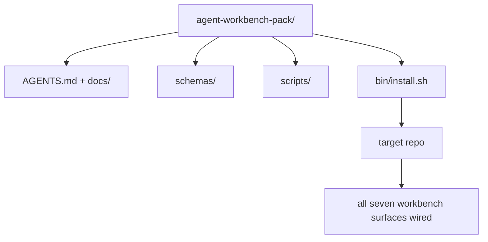

# Capstone: entregar um pacote de trabalho de agente de reposição

> Esta mini-track é uma que pode ser colocada em qualquer pacote de repo.`cp -r`E depois, na manhã seguinte, deixamos o agente trabalhar. Esta pedra fundamental é o artefato que realmente entregou o curso.

**类型：**Construir
**语言：**Python (stdlib)
**前置要求：**Fases 14 · 31 até 14 · 41
**时间：**- 75 minutos.

## Objectivo de aprendizagem

- O trabalho de um banco de trabalho é feito em um conjunto de sete áreas.
- Fixar esquema、script 和 modelo, fazer novo repo  obter uma linha de base já disponível―
- Adicione um script de instalação, coloque este pacote de forma diferente.
- Decidir o que fica na embalagem, o que fica na parte externa, e fazer a diferença para cada um.
-  demonstrar uma vez que o agente assistiu a uma mudança de armazenamento, e fornecer provas de que o avaliador pode reagir 

## 问题

Um Workbench que existe no Google Doc, Chat History e três scriptes apenas esquecidos, um Workbench que será reconstruído todos os meses. A solução é um pacote com versões: um repo ou catálogo, que contém superfície, esquema, script, bem como um instaltador de comando para executar.

Quando a aula terminar, você vai entregar no disco.`outputs/agent-workbench-pack/`, e um que pode colocá-lo em qualquer repo de destino .`bin/install.sh`- Não.

## 概念



### Layout do pacote

```
outputs/agent-workbench-pack/
├── AGENTS.md
├── docs/
│   ├── agent-rules.md
│   ├── reliability-policy.md
│   ├── handoff-protocol.md
│   └── reviewer-rubric.md
├── schemas/
│   ├── agent_state.schema.json
│   ├── task_board.schema.json
│   └── scope_contract.schema.json
├── scripts/
│   ├── init_agent.py
│   ├── run_with_feedback.py
│   ├── verify_agent.py
│   └── generate_handoff.py
├── bin/
│   └── install.sh
└── README.md
```

### O que deixe, o que põe de fora

Deixe-me aqui:

- Esquema de superfície.
- Os quatro guiões acima são o tempo de execução.
- Quatro documentos... são regras e rubricas...

 colocar fora:

- 项目特定任务──任务属于目标 repo 的董事会, não pertence ao pacote──
- 供应商 SDK 调用──这个包与框架无关──
- Embordagem 文案── Este pacote  colocado na equipa já tem embarque 旁边, em vez de colocar dentro ⋅

### Instalador

Um breve .`bin/install.sh`(ou `bin/install.py`):

1. Não há nada .`--force`时, rejeitar a cobertura de instalação até que haja um pacote.
2. Vai empacotar o pacote em repo.
3. Se existisse`.github/workflows/`, então, entras em CI.
4. 打印后续步骤: preencher o painel de preenchimento 设置接受命令 运行 init script──

### 版本管理

Esta mala leva-a com ela .`VERSION`文件──需要迁移的 schema bump 和脚本 变更会出现重大突破──仅 doc 的变更会出现突破补丁──目标 repo 的 文件──需要迁移的 schema bump 和脚本──变更会出现重大突破──仅 doc 的变更会出现突破补丁──目标 repo 的 文件──需要迁移的 schema bump 和脚本──变更会出现重大突破──只有 doc 的变更会出现突破补丁──目标 repo 的 文件──需要迁移的方案和脚本──目标 repo 的 文件── 文件── 文件── 文件── 文件── 文件── 文件── 文件── 文件── 文件── 文件── 文件── 文件── 文件── 文件── 文件── 文件── 文件── 文件── 文件── 文件── 文件── 文件── 文件── 文件── 文件── 文件── 文件── 文件── 文件── 文件── 文件── 文件── 文件── 文件── 文件── 文件── 文件── 文件── 文件── 文件── 文件── 文件── 文件── 文件── 文件── 文件── 文件── 文件── 文件── 文件── 文件── 文件── 文件── 文件── 文件── 文件── 文件── 文件── 文件── 文件── 文件── 文件── 文件── 文件── 文件── 文件── 文件── 文件── 文件── 文件── 文件── 文件── 文件── 文件──   文件`agent_state.json`记录 it initiation 时对应的包版──


```figure
wb-pack-install
```

## Construí-lo

`code/main.py`Vou fazer a pacotada ao lado da aula.`outputs/agent-workbench-pack/`Em meio, não use esta mini-track como um programa de aprendizagem, bem como o documento que já escreveu.

- Não .

```
python3 code/main.py
```

Esse script vai copiar e fixar a superfície, escrever no README, imprimir a árvore de pacotes, e depois zero.

## Modelo de produção

Um pacote só tem valor quando é capaz de suportar uma garrafa e não é amigável para cima.

**`VERSION` 是 contract，不是 marketing。**O maior problema é a migração de estado. O menor problema é a reatividade do checker. O problema é o de um parche.`.workbench-version`写入目标 repo; se objetivo de bloqueio e de pacotamento `VERSION`Não coincidência,`lint_pack.py`É isso que eu quero.`npm`- Não.`Cargo`和 `pyproject.toml`O agente não vai mudar estas regras.

**跨工具分发的单一来源。**Nx  fornecer um `nx ai-setup`, de um único configurador  colocação `AGENTS.md`- Não.`CLAUDE.md`- Não.`.cursor/rules/`- Não.`.github/copilot-instructions.md`和一个MCP server──这个包也应该这样做;installator 输出 symlink(`ln -s AGENTS.md CLAUDE.md`), deixe um único facto de ser originado por cada agente de codificação.

**`uninstall.sh` 会在存在非平凡 state 时拒绝执行。** Descarregar este pacote Não pode excluir usuário `agent_state.json`- Não.`task_board.json`Ou `outputs/`❖ Uninstaller 会 eliminar schema、script、doc 和 `AGENTS.md`(带 `--keep-agents-md`Opt-out), e se o arquivo de estado tiver qualquer alteração não enviada, é rejeitado continuar.

**Skill-as-publishable。SkillKit-style 分发。**Este pacote  como habilidade SkillKit 交付:`skillkit install agent-workbench-pack`O pacote de repo é a fonte de fato; o SkillKit é a divisão de dados; o vendedor bloqueia vai desaparecer; sete superfícies  manter imutável.

## Use-o

Pacote de entrega em três locais:

- **作为一个你放进 repo 的目录。** `cp -r outputs/agent-workbench-pack /path/to/repo`- Não.
- **作为一个公开 template repo。**Forca e personalização,并用 `VERSION`Controlar a deriva.
- **作为一个 SkillKit skill。**Entre no teu agente, deixe-me pôr uma ordem.

O pacote é uma receita.

## Entrega-o

`outputs/skill-workbench-pack.md`A partir de agora, a Comissão irá criar um pacote de regulamentações para os projectos: regra, regra, regra, regra, regra, regra, regra, regra, regra, regra, regra, regra, regra, regra, regra, regra, regra, regra, regra, regra, regra, regra, regra, regra, regra, regra, regra, regra, regra, regra, regra, regra, regra, regra, regra, regra, regra, regra, regra, regra, regra, regra, regra, regra, regra, regra, regra, regra, regra, regra, regra, regra, regra, regra, regra, regra, regra, regra, regra, regra, regra, regra, regra, regra, regra, regra, regra, regra, regra, regra, regra, regra, regra, regra, regra, regra, regra, regra, regra, regra, regra, regra, regra, regra, regra, regra, regra, regra, regra, regra, regra, regra, regra, regra, regra, regra, regra, regra, regra, regra, regra, regra, regra, regra, regra, regra, regra, regra, regra, regra, regra, regra, regra, regra, regra, regra, regra, regra, regra, regra, regra, regra, regra, regra, regra, regra, regra, regra, regra, regra, regra, regra, regra, regra, regra, regra, regra, regra, regra, regra, regra, regra, regra, regra, regra, regra, regra, regra, regra, regra, regra, regra, regra, regra, regra, regra, regra, regra, regra, regra, regra, regra, regra, reg

## 练习

1. Decidir qual é o quinto documento que vale a pena elevar para o pacote canônico.
2. Usar Python re-instalar,并添加 `--dry-run`A sua ergonomia é muito mais elevada do que a da bash.
3. - Adicione um .`bin/uninstall.sh`Não é normal. O que é anormal?
4. - Adicione um .`lint_pack.py`, embalagem     `VERSION`时失败──把它连入包──自备备用机的CI──
5. Escrever um manual de trabalho manual para o pacote. O que é que pode ser feito para minimizar o tempo de inatividade?

## 职业实践: provar uma vez que o depósito muda

打包演示证明组装程序能够运行并生成文件──它不能证明您的代理能完成新任务──生成的检查能够验证该任务,或已部署的系统能正常工作──请区分这些结论──

Em um armazém que você possui ou recebe modificações, escolha uma pequena tarefa real. Use um agente de programação que você já tenha sido capaz de visitar.

Além de fazer experiências, outro reservar uma vez o tempo de trabalho.`learning-artifacts/`Preservar os modelos e as embalagens existentes no armazém, como referência.

### 1. 明确任务并选择自主程度

Utilize o quadro de tarefas da Secção 43 e o plano de evidências da Secção 44.

 escolher um modelo de trabalho: direção gradual 带检查点的实现, ou execução autónoma de uma clara fronteira  explicar a incerteza  os potenciais efeitos e a reversão por que apoiam essa escolha  reedição local de pequena escala, que pode exigir menos controles de controle de visita 

 definir o orçamento de tempo efetivo; se o agente  fornecer funções relacionadas, também deve definir um token ou limite de custos  para dados de medida inacessíveis, como registros reais  para a reincidência de falhas  novas limitações  orçamento  consumir ou não resolver tarefas  definir, determinar condições de parada, e notar quem tem o direito de resolver

### 2.  Preparar ambiente mínimo e útil

查找相关实现、调用方、测试和本地指令──记录每个来源为何应进入上下文,以及哪些现有证据能够推翻过去的笔记──不要默认加载整个仓库──

Para cada tipo de expansão, determinar a seleção: habilidades (skill) fornecer processos de uso repetível; MCP (instrumental) fornecer capacidade de acesso; 子 (hook) executar verificações de determinação; plugins (plugin) oferecer capacidade de ampliação; apenas manter a expansão da tarefa que realmente precisa, e apenas conceder o mínimo de direitos necessários para o seu trabalho normal.

 recordar um novo projeto que você rejeitou irá trazer custos de manutenção ou manutenção. Reverificar uma memória ou instrução passada. Se a evidência apoia a retirada ou substituição, é executado no ambiente de aprendizagem que você próprio gerenciar.

### 3. 记录基线并实现

 editar antes, executar os exames existentes mais relevantes, mostrar o estado atual do comportamento necessário.

让代理在任务约定内实现变更. 保留干预日志,说明每次纠正,权限变更或计划调整的原因. 让代理在任务约定内实现变更. 让代理在任务约定内实现变更. 让代理在任务约定内实现变更. 让代理在任务约定内实现变更. 保留干预日志,说明每次纠正,权限变更或计划调整的原因. 让代理在任务约定内实现变更. 让代理在任务约定内实现变更. 让代理在任务约定内实现变更. 让代理在任务约定内实现变更. 让代理在任务约定内实现变更. 让代理在任务约定内实现变更. 保留干预日记,说明每次纠正,权限变更或计划调整的原因. 让代理是可选的;如果确实有用, 否则, 否否否否否否否否否否否否否否否否否否否否否否否否否否否否否否否否否否否否否否否否否否否否否否否否否否否否否否否否否否否否否否否否否否否否否否否否否否否否否否否否否否否否否否否否否否否否否否否否否否否否否否否否否否否否否否否否否否否否否否否否否否否否否否否否否否否否否否否否否否否否否否否否否否否否否否否否否否否否否否否否否否否否否否否否否否否否否否否否否否否否否否否否否否否否否否否否否否否否否否否否否否否否否否否否否否否否否否否否否否否否否否否否否否否否否否否否否否否否否否否否否否否否否否否否否否否否否否否否否否否否否否否否否否否否否否否否否否否否否否否否否否否否否否否否

### 4. 质疑证据

选择能够观察变更界面的验证方式――对于 UI, reconstituir, e verificar o processo de usuário que realmente fornece serviços sob a largura de um portal de visão relevante――对 API, check requests and sequencing responses――对于 CLI, run build orders, check output and output――对选择任务的检查,并说明它们的局限性――

De acordo com a tarefa, escrever independentemente o resultado esperado, não se baseie na realização de um agente. Introduzir um resultado de erro específico em uma cópia única, por exemplo, aceitar o resultado de ineficácia ou omissão necessária.

Se o exame estiver em vigor, primeiro reforçar o modo de observação, reincidir-se-á em ele, recuperar-se-á e continuar-se-á a executar até o fim.

Para observar os objetivos originais e permitir a modificação, a diferença final da avaliação, incluindo as alterações da avaliação.

### 5. 演练运行与恢复

Entrega de produtos em ambiente local ou em ambiente de pré-lançamento de uma vez.`local`- Não.`staging`Ou `live`,并注注确确的版本或交付物标识;; O exercício local só suporta as conclusões locais; o exercício não requer a implantação no ambiente de produção;;

 escolher um sinal de falha relacionado com a tarefa, definir valor、observação de janelas e responsabilidade.  explicar como deve responder ao excesso de valor. 

演练回滚到已知可用交付物件,并检查前行为是否恢复──适用时,应考虑持久化数据:只换二进制文件不一定能撤销数据变更──记录任何未经验证的恢复步骤──

### 6. 改进 下一次执行并交接

Para comparar os resultados com a linha de base, incluindo o tempo de consumo real, os dados de quantidade de dados e a intervenção artificial. Uma missão só pode explicar o que aconteceu na missão, não pode provar um agente  em geral mais rápido ou mais confiável 

De acordo com o § 46, a correção real que ocorreu uma vez será transformada em teste, menor limite de competências, processo automatizado ou exemplo mais claro. Re-implementar o controle afetado.

### O processo de avaliação

Peça ao revisor que verifique os documentos de prova, e pelo menos replique os mais fracos de verificação de aceitação.`demonstrated`(provado)`needs revision`(necessita modificação) ou `unverified`(未验证) Como estado, simultaneamente fornecendo provas de posição e razão.

| 维度 | 评审者应质疑的证据 |
|---|---|
| 任务与自主程度 | 初始行为、边界明确的目标、合理的权限与预算，以及可执行的停止规则 |
| 上下文与环境 | 相关来源、合理的工具访问权限，以及经过重新核查的退役决定 |
| 验证 | 变更前后的实际行为，以及相同检查能够拒绝的、刻意引入的错误结果 |
| 评审与运行 | 已检查的差异、独立质疑、标明环境的运行观测，以及演练过的恢复流程 |
| 迭代与交接 | 一项经过验证的改进、如实说明的局限、干净的最终状态，以及可复现的下一步行动 |

Antes de a missão ser concluída, resolver o problema.`needs revision`As provas de que não se pode obter devem ser mantidas.`unverified`O conjunto de trabalhos mostra o seu poder de julgamento em engenharia em uma tarefa definida, não garante a obtenção de emprego ou condições de implantação.

## 交付物

Mantenha o pacote de uso e o que tiveres feito.[career-agent-evidence.md](https://github.com/rohitg00/ai-engineering-from-scratch/blob/main/phases/14-agent-engineering/42-agent-workbench-capstone/outputs/career-agent-evidence.md)O modelo irá integrar os trabalhos de estrutura de tarefas, planejamento de execução, credenciamento de execução, avaliação, recuperação de exercícios e de ligação para um estudo de caso avaliável.

## 关键术语

| 术语 | 人们常说 | 它实际含义 |
|------|----------------|------------------------|
| Workbench pack | “starter kit” | 一个带版本的目录，携带全部七个 surface |
| Installer | “Setup script” | 以幂等方式放置 pack 的 `bin/install.sh` |
| Pack version | “VERSION” | schema/script 变更使用 major bump，仅 doc 变更使用 patch |
| Drop-in pack | “cp -r and go” | Pack 在第一天无需按 repo 定制即可工作 |
| Forkable template | “GitHub template” | GitHub 的 “Use this template” 可以从中 clone 的公开 repo |

## 延伸阅读

- Fases 14 · 31 até 14 · 41  Esta embalagem 打包 de cada superfície
- [SkillKit](https://github.com/rohitg00/skillkit) Em 32 agentes de IA instalar esta habilidade
- [Nx Blog, Teach Your AI Agent How to Work in a Monorepo](https://nx.dev/blog/nx-ai-agent-skills) 跨六种工具的单一来源发电机
- [agents.md — the open spec](https://agents.md/) Roteador do seu pacote  deve implementar o conteúdo
- [HKUDS/OpenHarness](https://github.com/HKUDS/OpenHarness) de pacotes equivalentes
- [andrewgarst/agentic_harness](https://github.com/andrewgarst/agentic_harness) 带 eval suite de Redis apoiado 参考实现
- [Augment Code, A good AGENTS.md is a model upgrade](https://www.augmentcode.com/blog/how-to-write-good-agents-dot-md-files) embalagem doc 
- [Anthropic, Effective harnesses for long-running agents](https://www.anthropic.com/engineering/effective-harnesses-for-long-running-agents)
- [Anthropic, Harness design for long-running application development](https://www.anthropic.com/engineering/harness-design-long-running-apps)
- Fase 14 · 30  消费 这个包 的验证门 的评估驱动代理开发
- Fase 14 · 41  Esta embalagem deve ser melhorada antes/após o referencial
