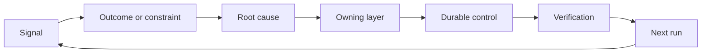

#  Construção de uma rota de reinserção e de retirada

> A publicação de código encerrou o ciclo de construção do período atual, e abriu um ciclo de aprendizagem de longo prazo.

**Type:** Learn + Build
**Languages:** Python (stdlib)
**Prerequisites:** Phase 14 lessons 46 and 53
**Time:** ~75 minutes

## Objectivo de aprendizagem

- Transformar os eventos de falhas, avaliações de dados, comportamento e correção de erros em ações de responsabilidade.
- A partir de agora, o sistema de segurança será aplicado em todos os sistemas de segurança.
- O risco de recaída deve ser classificado de forma prioritária, de acordo com a gravidade e a frequência de recaída.
- Para cada sistema de controlo, fixarem-se as condições de retirada (Condição de aposentadoria)
- 沟通交付决策, fornecer provas, avaliar e determinar os decisores responsáveis.

## A própria infraestrutura

Uma equipe pode coletar uma grande quantidade de sistemas de rastreamento de cadeias, registros de avaliação, registros de suporte e diários de falhas, mas não pode tirar qualquer aprendizado cognitivo.**晋级通道（Promotion）**A partir de observações, os dados são apresentados em um único e único documento.

O último ciclo do "Ratchet Feedback" é:

1. Observar até sinais de observação concretos;
2. Relacionar a produção prevista com resultados, condições de restrição ou hipóteses de pré-imposição;
3. Identificar os níveis mais subjacentes do sistema de responsabilidade da indução;
4. 实施受控的持久化改进;
5. 验证 事故复发的概率已切实降低;
6. 定期复审该控制机制是否应继续保留──

## 精准路由至应对责任层级

| 信号类型 | 归属目的地 |
|---|---|
| 误报、功能倒退、错误输出结果 | 评测集（Evaluation）或自动化测试 |
| 上下文缺失、重复劳动、过时事实 | 上下文数据源或检索路由策略 |
| 不安全操作或越权漏洞 | 安全策略（Policy）或权限硬边界 |
| 超时、重试风暴、依赖服务不可用 | 运行时控制（Runtime Control） |
| 新的产品需求或尚未决断的权衡取舍 | 经过规范成型（Shaped）的待办项 |

Quando os testes automatizados ou as limitações de dureza são suficientes para que o erro seja completamente impossível, não adicione mais um parágrafo de sugestão no Prompt.



## A responsabilidade pertence a si mesma como parte do mecanismo de controlo.

Cada projecto de acção deve ter claramente:

- 唯一的人类责任人 (o único proprietário);
-  a classificação prioritária com base na avaliação global das consequências da destruição e da frequência de reincidência;
- 拟修改的目标系统组件 (Artifact) 拟修改的目标系统组件 (Artifact)
- provar o esquema de verificação da modificação efetivamente efetiva;
- O sistema de controlo de dados deve ser executado em conformidade com o artigo 10.o, n.o 1.
- 明确的退役条件 (Condição de aposentadoria)

Um programa de melhoria sem ninguém reconhecer, o seu volume é apenas um episódio de um pequeno espetáculo de observação.

## 果断退役过时的控制机制 果断退役过时的控制机制

Contrariamente ao sistema pesado, as estratégias e os controles continuam a acumular-se.

- As alterações fundamentais ocorreram na estrutura dos sistemas ou no fluxo de trabalho dos negócios;
- O mecanismo de invariabilidade do nível inferior já substituiu completamente as instruções de texto do nível superior;
- Durante a janela de tempo prevista, o falha de prevenção nunca mais surgiu;
- A regulamentação de controlo impede a frequência de desenvolvimento normal das actividades, já ultrapassando os benefícios que lhe são trazidos pela prevenção de perigos.

O controle de retirada também precisa de apoio real, não pode ser apenas porque parece que o ano passou muito tempo.

## 打通 produto construção e código de agente

O mesmo mecanismo de rotas pode servir simultaneamente a negócios de produtos e desenvolvimento de inteligência em dois circuitos:

- ▌o desenvolvimento do plano de produção de produtos ou de medidas;
- Otimizar o funcionamento do Agente de codificação, o teste de automação de motor, a carga de dados, o domínio de operação, o manual ou o mecanismo de ligação de automação;
- 線上真故障既能促成产品功能边界调整,也能促成 Agente 工作台的加固──

É por isso que o quadro de missões não está na fase de encerramento da codificação antes da declaração, mas atravessa cada vez que o sistema aceita mudanças.

## 动手实现

Esta experiência foi realizada para classificar os sinais de teste, criar rotas de ação de atribuição de responsabilidade, em ordem de prioridade, e de saída.`outputs/feedback-backlog.json`- Não.

```bash
python3 code/main.py
python3 -m unittest discover code/tests -v
```

尝试添加一个运行时超时信号,验证它将被正确路由至运行时控制层,而不是泛化混入通用需求待机列表.

## 实践实验: responsável pela tomada de decisões após o fracasso

Do seu caminho de aprendizagem profissional para projetos de trabalho correspondentes, escolha um fluxo de trabalho.[职业交付模板](https://github.com/rohitg00/ai-engineering-from-scratch/blob/main/phases/14-agent-engineering/54-build-the-feedback-ratchet/outputs/career-delivery-evidence.md)- Não.

Python  experimentação gerar exemplos de ações de execução. Não observa usuário                                                                                                                                                                                                                                                                                                                                                                                                                                                                                                            

### 1. Está bem o que aconteceu.

记录用户、任务、当前工作流,以及你希望改善的结果──链接到经过同意的观察记录、已脱敏的支持记录,或可复制的任务轨迹──区分你直接观察的事实、他人报告情况,以及你的推断──

 encontrar uma falha: falha de supostação  resultados inusáveis  custos inesperados, ou atrasos de comunicação  explicar quais provas mudaram a sua compreensão  falha precisa de resposta e decisão, em vez de ser envasada em uma história de sucesso

Se não puder contactar o usuário, faça com o companheiro uma simulação de marcas claras, ou basear-se em uma simulação de cenários claros.

### 2. Em limites de poder

列出未知项目,选择成本最低,可逆,且有望解决影响最重大未知项目行动――说明哪些事可以由你决定,哪些选择受到既有约束,哪些操作需要先获得授权才能执行――

Por exemplo, enquanto espera a permissão para usar dados do cliente, você pode preparar o download offline já desacelerado. A progressão ativa significa concluir o trabalho de autorização, e a decisão será bloqueada, dizendo claramente; não vai expandir seus direitos de acesso ou aprovação.

### 3. Comparar o esquema e a responsabilidade de decisão

Por não precisar de saber os detalhes da implementação, escrever um breve resumo de decisão.

- Problemas de utilizador, bem como provas de mudança do plano;
- Pelo menos duas variedades de programas; quando razoavelmente viáveis, incluir programas de mão de obra de menor custo ou de desenvolvimento não necessário;
- 質量、交互設計、工作量、運行成本和风险的权衡;
- As suas recomendações, as suas incertezas e as suas decisões necessárias;
-  Responsabilidade de decisão  Os interessados afectados, bem como a data de necessidade de tomar decisões

Por favor, acompanhe um representante de uma das partes interessadas afetadas, questione um dos seus pontos de vista.

### 4.  conduzir experiências de fronteira definida

Dependendo da necessidade de resposta, escolher o tipo original, o ponto de ensaio ou a fase de produção de trabalho. Antes dos resultados da coleta, definir o público, os dados, a autorização, o tempo de execução, o programa de reestruturação, bem como as condições de continuar, ajustar ou parar.

Desde o início do usuário até a conclusão da tarefa, explore todo o processo de comunicação.

O modelo de resposta é mais rápido, pode fazer a tarefa completa ser lenta, ou fazer com que os resultados sejam mais difíceis de obter confiança.

### 5. Comparar resultados com economia

Usando os mesmos indicadores definidos, tarefas gerais, métodos de coleta e comparáveis, a janela de observação, a linha de base e os resultados posteriores, os resultados serão colocados ao lado do valor numérico.

Incluir um resultado do usuário  um índice de qualidade ou segurança , bem como o total de trabalho de auditoria artificial

 estimar o custo de cada tarefa realizada com sucesso, incluir o modelo de admissão, reexame, serviço de apoio e auditoria artificial, explicar a hipótese de preço único da força humana, distinguir o valor da utilização real e o valor da estimativa, comparar o custo com o programa de substituição artificial ou a hipótese de valor por trás do projeto,

                                                                                                                                                                                                                                                                                                                                                                                                                                                                                                                             [LLM FinOps 课程](https://aiengineeringfromscratch.com/lesson?path=phases/17-infrastructure-and-production/27-finops-llms), mais adiante a aprendizagem de custos de atribuição à economia unitária.

### 6. 完成闭环

De acordo com os padrões de pre-declaração, recomenda continuar, ajustar ou parar. Se as evidências ainda não estiverem definidas, apontando a ausência de observações, bem como os seguintes testes definidos de fronteira, o registro da resposta do tomador de decisão responsável pela decisão; se ainda não tiver sido tomada uma decisão, é reservado para um estado de espera.

 escolher um melhoramento no próprio processo de entrega: um quadro de tarefas mais claro, um usuário mais antigo, um melhor sistema de avaliação, um agente menor, uma unidade de comunicação ou um caso de avaliação mais específico, o responsável e o período de revisão são designados.

复审时,决定保留、修改还是退役改进的记录选择的证据── Se uma nova lista aumenta a sua capacidade de trabalho, mas não impede o fracasso do objetivo, não deve ser permanentemente mantida──

## 交付物

- Não .[career-delivery-evidence.md](https://github.com/rohitg00/ai-engineering-from-scratch/blob/main/phases/14-agent-engineering/54-build-the-feedback-ratchet/outputs/career-delivery-evidence.md) Copiar o seu próprio projeto, e usar o link de prova para preencher.  Deixar o modelo no armazém manter-se reutilizar.  Copiar o seu próprio projeto, e usar o link de prova para preencher.  Deixar o modelo no armazém manter-se reutilizar.  Copiar o seu próprio projeto, e incluir o seu conjunto de trabalhos no seu conjunto de trabalhos de trabalho.  Copiar o seu próprio projeto, e incluir o seu conjunto de trabalhos no seu armazém.  Copiar o seu próprio projeto, e incluir o seu conjunto de trabalhos no seu armazém.  Copiar o seu próprio projeto, e incluir o seu conjunto de trabalhos no seu armazém.  Copiar o seu conjunto de trabalhos e fazer o seu conjunto de trabalhos.  Copiar o seu conjunto de trabalhos e fazer o seu conjunto de trabalho.

## 验证

Com o companheiro, use os seguintes padrões de recepção artificial.**met**(ha sido satisfeito)**needs work**(necessita de melhoria) ou **not observed**(enquanto não observado),并提供证据链接或具体缺失的观测──填好了字段,并不能证明判断合理──

| 检查项 | 满足标准的证据 |
|---|---|
| 工作流有事实依据 | 可追溯的观测支持问题定义；他人报告、推断和模拟均有标记。 |
| 遵守授权边界 | 下一项可逆工作明确，任何受限操作都等待真正的决策责任人授权。 |
| 权衡沟通清晰 | 记录可信的替代方案、利益相关方的异议、建议，以及明确的决策请求。 |
| 交互经过测试 | 走查覆盖成功、失败、恢复，以及人工审核工作量。 |
| 结果经过比较 | 基线与后续度量的定义一致；样本、护栏指标、成本和比较局限清晰可见。 |
| 对挫折承担责任 | 证据改变了继续、调整或停止的决策，并导向一项有明确责任人的后续行动。 |
| 流程得到改进 | 一项工作流改进具备责任人、复审日期，以及基于证据的保留、修改或退役决定。 |

Mesmo que cada passo em frente seja aprovado, o comportamento do usuário real não observado continua a ser um faltar de evidências.

## 课后练习

1. A partir de agora, o sistema de correção de dados será aplicado em todos os dispositivos de correção de dados.
2. Identificar que é capaz de impedir de forma fundamental a sua reaparição no nível mais baixo do sistema.
3. Para experimentar a produção de ações complementares, os comandos de verificação automática ou os indicadores de observação são realmente realizáveis.
4. Para um artigo de estratégias de segurança existentes, estabelecer condições de retirada claras.
5. A partir daí, o sistema de aprendizagem de correção de um tipo de aprendizagem é capaz de fazer uma análise de um tipo de aprendizagem de correção de um tipo de aprendizagem de aprendizagem de correção de um tipo de aprendizagem de aprendizagem de aprendizagem de aprendizagem.

## 延伸阅读

- [Basili, Caldiera, and Rombach, The Goal Question Metric Approach](https://www.cs.toronto.edu/~sme/CSC444F/handouts/GQM-paper.pdf), explorar como, através de mecanismos de medição orientados para o objectivo, se pode alcançar a compreensão contínua de nível organizacional.
- [Fagerholm et al., Building Blocks for Continuous Experimentation](https://doi.org/10.1145/2601248.2601276), análise de dados e evidências concretas de que a tecnologia e a organização estão ligadas ao desenvolvimento contínuo do produto.
- [Nuseibeh and Easterbrook, Requirements Engineering: A Roadmap](https://www.cs.toronto.edu/~sme/papers/2000/ICSE2000.pdf), explicação das necessidades como o desenvolvimento do processo de desenvolvimento através do ciclo de vida do sistema inteiro.

## 交付物沉

- Não .`outputs/feedback-backlog.json`Como exemplo de caminho,并保留你完成的职业交付证据,记录自己的决策──两者共同为产品判断力与交付──产品判断和交付──学习路径结尾,并为下一个预期产出框架提供依据──
