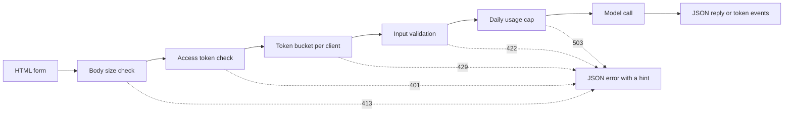

# 模型演示界面: de função a aplicação compartilhável

> 模型演示有一定:输入、模型调用和输出──在分享链接之前,先为每部分设定限制──

**Type:** Build
**Languages:** Python
**Prerequisites:** Phase 11 · 13（构建生产级 LLM 应用）、Phase 17 · 08（推理指标）、Phase 17 · 19（AI 网关）
**Time:** ~90 分钟

## Objectivo de aprendizagem

- 写出演示的输入、模型调用和输出约定,并为每部分设定限制──
- Use standard library construir uma aplicação HTTP, contendo uma página HTML, um JSON terminal e um servidor de envio de eventos terminal.
- De acordo com o custo de baixa a alta verificação de entrada, e retornar capaz de dizer ao usuário o próximo passo de operação JSON  erro.
- Utilize cada caixa de instruções de cliente, limite máximo de uso diário e instruções de visita opcionais, proteger a exposição pública.
- 编写不保留输入文本和客户端地址的请求日志──
- Comparar a demonstração da biblioteca de padrões com duas versões do quadro, e salientar que a demonstração deve ser atualizada para o sinal do produto.

## 问题

Seu modelo já pode funcionar no bloco de notas. Agora, um revisor quer tentar 10 entradas, um cliente quer ver o resultado no celular.

Notebook 单元格没有输入限制,也没有进度显示;;;;;;;;;;;;;;;;;;;;;;;;;;;;;;;;;;;;;;;;;;;;;;;;;;;;;;;;;;;;;;;;;;;;;;;;;;;;;;;;;;;;;;;;;;;;;;;;;;;;;;;;;;;;;;;;;;;;;;;;;;;;;;;;;;;;;;;;;;;;;;;;;;;;;;;;;;;;;;;;;;;;;;;;;;;;;;;;;;;;;;;;;;;;;;;;;;;;;;;;;;;;;;;;;;;;;;;;;;;;;;;;;;;;;;;;;;;;;;;;;;;;;;;;;;;;;;;;;;;;;;;;;;;;;;;;;;;;;;;;;;;;;;;;;;;;;;;;;;;;;;;;;;;;;;;;;;;;;;;;;;;;;;;;;;;;;;;;;;;;;;;;;;;;;;;;;;;;;;;;;;;;;;;;;;;;;;;;;;;;;;;;;;;;;;;;;;;;;;;;;;;;;;;;;;;;;;;;;;;;;;;;;;;;;;;;;;;;;;;;;;;;;;;;;;;;;;;;;;;;;;;;;;;;;;;;;;;;;;;;;;;;;;;;;;;;;;;

- Usuário pega um arquivo de 40.000 caracteres.
- Um guião envia 500 pedidos em um minuto. Cada pedido é feito com um modelo de pagamento.
- 页面八秒没有显示任何内容,于是用户再次点击四次按──
-  server日志 retém cada entrada, incluindo a entrada que contém o número de conta do cliente.

presentação interface com pouca quantidade de código é capaz de prevenir estes erros.

## 概念

### O show é um encontro .

Cada apresentação tem três partes. A entrada é o conteúdo que o usuário pode enviar; o modelo de conversão será a entrada transformada em saída; o saída é o conteúdo que o usuário vê, também inclui erros.

Antes de escrever a página, primeiro escreva este contrato:

| 部分 | 需要回答的问题 | 本课的答案 |
|------|--------------------|-----------------------|
| 输入 | 什么类型、多大、允许哪些字符？ | 长度为 1 到 500 个字符的字符串，不含控制字符 |
| 模型调用 | 一次调用需要多久、成本多少？ | 一个不到一毫秒即可运行完毕、没有调用费用的玩具关键词模型 |
| 输出 | 成功和失败时，用户分别看到什么？ | 标签、分数和回复，或带有操作提示的 JSON 错误 |

Notebook  não estabelece quaisquer restrições para estas três partes.



O teste é executado de forma consecutiva, de baixo a alto, em função do custo. O pedido de desempenho é efetivo, pois o primeiro teste não é aprovado e não consome quase nenhum recurso do servidor.

### O modelo é executado antes de ser verificado.

O navegador pode verificar o seu conteúdo antes de enviar qualquer conteúdo.`maxlength`和 `required`As características, sem necessidade de rede de rede, permitem ao usuário fornecer o seu feedback. Estas verificações só podem ajudar a obedecer às regras dos usuários.

Para verificar o servidor por custo de baixo a alto:

1. 读取 `Content-Length`Peliculação: Antes de ler o pedido, rejeite exceder o limite acima.
2. 解析 JSON 请求体──拒绝不是 JSON对象的请求体──
3. 检查字段──拒绝空文本、超长文本和控制字符──
4. Só através de todas as solicitações de inspecção, para consumir um modelo de manipulação.

| 未通过的检查 | HTTP 状态 | 错误代码 |
|--------------|-------------|------------|
| 没有 `Content-Length` 请求头 | 411 Length Required（需要长度） | `length_required` |
| `Content-Length` 不是数字 | 400 Bad Request（错误请求） | `bad_length` |
| 请求体超过 4,096 字节 | 413 Content Too Large（内容过大） | `body_too_large` |
| 尚未收到 `Content-Length` 指定的字节数，请求体就停止传输 | 408 Request Timeout（请求超时） | `request_timeout` |
| 内容类型不是 JSON | 415 Unsupported Media Type（不支持的媒体类型） | `unsupported_media_type` |
| 请求体不是 JSON 对象 | 400 Bad Request（错误请求） | `bad_json` |
| 文本缺失、为空、过长或含有控制字符 | 422 Unprocessable Content（无法处理的内容） | `missing_text`、`empty_text`、`text_too_long`、`control_characters` |

A RFC 9110 define estes estados e seus nomes.

Exemplos também fazem parte do design de entrada. Exemplos mostram ao usuário o que é o tipo de entrada adequada, também permitem que o avaliador clique apenas uma vez para poder fazer um teste.

### 让用户知道模型正在工作

模型调用可能需要几秒钟. Se não houver um problema, o usuário não pode distinguir entre o modelo lento e a página danificada.

Esta página da aula oferece quatro tipos de opções:

- Peliculação de execução
- Mostra-se que já está a tempo, a cada 100 milímetros,
- O primeiro token chegou, mostrou o primeiro token 时间.
- Por favor, termina, mostra o tempo de uso total.

Em aprendizagem[推理指标](../../08-inference-metrics-goodput/)时,首代币 时间(TTFT) é um indicador de servidor.

### E-From-Form-E-From-Form-E-From-Form-E-From-Form-E-From-Form-E-From-Form-E-From-Form-E-From-Form-E-From-Form-E-From-Form-From-Form-E-From-Form-From-Form-From-Form-From-Form-From-Form-From-Form-From-Form-From-Form-From-Form-From-Form-From-Form-From-Form-From-Form-From-Form-From-Form-From-Form-From-Form-From-Form-From-Form-From-Form-From-Form-From-Form-From-Form-From-From-Form-From-Form-From-From-Form-From-From-From-From-From-From-From-From-From-From-From-From-From-From-From-From-From-From-From-From-From-From-From-From-From-From-From-From-From-From-From-From-From-From-From-From-From-From-From-From-From-From-From-From-From-From-From-From-From-From-From-From-From-From-From-From-From-From-From-From-From-From-From-From-From-From-From-From-From-From-From-From-From-From-From-From-From-From-From-From-From-From-From-From-From-From-From

语言模型个别代币 生成回复. Se o servidor esperar até o último token 才发送, o usuário deve esperar o processo de geração inteiro.

服务器发送事件(Server-Send Events,SSE) é o padrão de forma de realizar este comportamento.`text/event-stream` Cada evento é feito por um grupo `event:`和 `data:`行组成,并以一个空行结束──WHATWG HTML 标准定义了这个格式──

```text
event: token
data: {"index":0,"text":"Label:"}

event: token
data: {"index":1,"text":" positive."}

event: done
data: {"label":"positive","score":1.0,"tokens":11}
```

浏览器提供用于 SSE 的 `EventSource`接口, mas apenas envia GET Petição. GET Petição será inserida e colocada no URL, enquanto Web  servidor e agente irá URL 写入访问日志.`fetch()`和 `response.body.getReader()`读取响应,并自行解析事件格式──

流式响应存在单次 JSON 回复 没有问题: o servidor em primeiro token 之前就发送了状态码200.`error`事件,由页将该事件显示为错误──

Na construção[生产级 LLM 应用](../../../11-llm-engineering/13-production-app/)时, framework substituir você através de SSE 发送代币──本课手写同协议,让你能够看到服务器发送的每一行──

###  redigir o usuário capaz de basear essa ação de informações erradas

 err errão de informação tem duas tarefas: dizer ao usuário o que aconteceu e dizer ao usuário seguinte o que fazer.

Cada erro neste demonstrativo usa a mesma estrutura JSON:

```json
{
  "error": {
    "code": "text_too_long",
    "message": "The text has 812 characters. The limit is 500.",
    "hint": "Shorten the text to 500 characters or fewer.",
    "request_id": "a8f3c2b435e3"
  }
}
```

- `code`É um nome, código e teste de cliente.
- `message`陈述事实,并附上用户需求的数值──
- `hint` Dê um usuário que pode executar operação
- `request_id`O usuário será conectado a um registro de um dia.

RFC 9457 define o padrão de erro de formato da API HTTP, chamado de problema detalhe (problem details) ⋅ Este exemplo usa uma estrutura mais refinada para realizar o mesmo propósito.

### Segurança compartilhar exposição pública

Public links will change the population who can send requests. Para cada tipo de risco, um sistema de controle é:

| 风险 | 本演示中的控制措施 | 面向更多受众的控制措施 |
|------|----------------------|-------------------------------|
| 单个客户端发送过多请求 | 每客户端一个令牌桶，配合 429 和 `Retry-After` | 登录后按用户限流 |
| 陌生人发现链接 | `Authorization` 请求头中的可选访问令牌 | 通过身份提供方实现单点登录 |
| 总成本无限增长 | 每日用量上限，配合 503 和 `Retry-After` | 模型提供方的支出限制和告警 |
| 输入非常大或异常 | 请求体大小限制、文本长度限制、控制字符检查 | 输入与输出的内容审核 |
| 日志保留私人输入 | 只记录输入长度和客户端的带密钥哈希 | 日志保留期限与访问控制 |

O número de usuários que utilizam dois valores. A capacidade de um cliente determina o número de usuários que enviam o seu pedido; a taxa de reabastecimento determina a taxa de pedido de longo prazo.

```text
tokens = min(capacity, tokens + refill_rate * seconds_since_last_request)
accept the request if tokens >= 1, then subtract 1
```

桶为空时, servidor retornar `429 Too Many Requests` RFC 6585  define o código de estado 429,并允许服务器附带 `Retry-After`响应头──本演示始终添加该响应头,给出距离下一个令牌可用还需要等待的数秒──页面读取响应头,并此期间禁用按──

演示使用客户端 IP 地址作为桶的键.  在反向代理后面, cada pedido é proveniente do nome do agente, de modo que todos os usuários vão compartilhar um桶. 

Em aprendizagem[AI 网关](../../19-ai-gateways/)Quando, o sistema de transferência de dados é executado por um cliente, o mesmo é necessário, mas apenas a sua dimensão é menor. O sistema de transferência de dados é limitado, mas não controla o volume total.

O processo de inserção e de entrada também requer um tratamento cuidadoso.`http.server`O processador coloca o endereço IP do cliente e o pedido em erro padrão. Se o ingresso estiver localizado no URL, o ingresso também entrará em um logário. Este show substituiu esse logário. Cada pedido apenas escreve um registro, contendo routes, status codes, erros de código, atraso e comprimento de entrada. O endereço do cliente é transformado em hash de chave, ou seja, usando o hash de chave secreta calculada, para que você não precise guardar o endereço de acordo com o pedido estatístico do cliente.

 Diga ao usuário que informações você retém.  Exibição de página de instruções, o servidor retém o texto de comprimento, mas nunca retém o texto em si.

### 演示何时成为产品

O show é um processo de fornecimento de serviços, voltado para pessoas conhecidas e um breve período de conversação.

- Os que estão fora da equipa usam-na todos os dias.
- Alguém propôs objectivos ou relatórios de serviço interrupto.
- Usuário requer o login, salvar resultados ou ver o histórico.
- O custo semanal do modelo se torna um projeto do orçamento.
- 输入包含受合同或法律约束的数据──

| 属性 | 演示 | 产品 |
|----------|------|---------|
| 用户 | 已知人群，短时会话 | 未知人群，每日使用 |
| 状态 | 无 | 账户、历史、已保存的结果 |
| 可用性 | 尽力而为，单进程 | 书面目标、副本、值班责任人 |
| 成本控制 | 一个每日用量上限 | 每用户配额和计费 |
| 可观测性 | 每请求一条日志 | 链路跟踪、指标和告警 |

Quando vemos estes sinais, a demonstração deve ser transferida para a produção de nível LLM  aplicativo de cursos ── essa tecnologia  aumentou a autenticação de identidade                                                                                                                                                                                                                                           

```figure
demo-token-bucket
```

## 动手构建

Só há um documento.`code/main.py`, além de padrão não precisa de qualquer dependência.

```bash
python3 code/main.py
```

Autodesk Inspection Verifier 令牌桶 流格式, bem como uma verdadeira HTTP 往返通信── ele inicia o servidor no portão em branco, envia três solicitações, interrompe o servidor, e sai.

```bash
python3 code/main.py --serve
```

Em Browser`http://127.0.0.1:8000`❖ Ctrl+C 停止服务器──

### 第 1 步: modelo调用

O modelo é um calculador de palavras-chave, que marca o texto como positivo, negativo ou negativo.

```python
def classify(text):
    words = WORD_RE.findall(text.lower())
    positive = sum(1 for word in words if word in POSITIVE)
    negative = sum(1 for word in words if word in NEGATIVE)
    score = (positive - negative) / max(1, positive + negative)
    if score > 0:
        label = "positive"
    elif score < 0:
        label = "negative"
    else:
        label = "neutral"
    return {"label": label, "score": round(score, 3), "positive_cues": positive,
            "negative_cues": negative, "words": len(words)}


def generate(text):
    result = classify(text)
    reply = (
        f"Label: {result['label']}. Positive cues: {result['positive_cues']}. "
        f"Negative cues: {result['negative_cues']}. Words read: {result['words']}."
    )
    parts = reply.split(" ")
    yield parts[0]
    for part in parts[1:]:
        yield " " + part
```

Quando o modelo é real, só precisa ser substituído.`generate` Inverter em API 调用或本地模型──保持函数签名不变:输入字符串,输出代币──验证器、限制和页面都保持不变──

### Segundo passo: verificação e resposta errada

Uma classe anormal carrega todos os erros. Ele contém o código de estado HTTP, o código de erro estável, as mensagens, as dicas de operação e as respostas selecionáveis.

```python
class DemoError(Exception):
    def __init__(self, status, code, message, hint, headers=None):
        super().__init__(message)
        self.status = status
        self.code = code
        self.message = message
        self.hint = hint
        self.headers = dict(headers or {})


def validate_text(payload, max_chars=MAX_CHARS):
    if "text" not in payload:
        raise DemoError(422, "missing_text", 'The field "text" is missing.', 'Add a "text" field with your input.')
    text = payload["text"]
    if not isinstance(text, str):
        raise DemoError(422, "text_not_string", 'The field "text" is not a string.', "Send the input as a string.")
    text = text.strip()
    if not text:
        raise DemoError(422, "empty_text", "The text is empty.", "Type a sentence or pick an example.")
    if len(text) > max_chars:
        raise DemoError(422, "text_too_long", f"The text has {len(text)} characters. The limit is {max_chars}.",
                        f"Shorten the text to {max_chars} characters or fewer.")
    if CONTROL_RE.search(text):
        raise DemoError(422, "control_characters", "The text contains control characters.",
                        "Remove the hidden characters, then send the text again.")
    return text
```

O testador primeiro elimina o primeiro número de vagas.`check_body_size`和 `parse_json_body`Para 411、413、415 e 400 情形使用相同模式──`error_body`Vai ser qualquer coisa.`DemoError`转换为概念部分展示的 JSON 结构──

### 第 3 步:令牌桶

```python
class TokenBucket:
    def __init__(self, capacity, refill_per_second, now):
        if capacity < 1:
            raise ValueError("capacity must be at least 1")
        if refill_per_second <= 0:
            raise ValueError("refill_per_second must be positive")
        self.capacity = float(capacity)
        self.refill_per_second = float(refill_per_second)
        self.tokens = float(capacity)
        self.updated = now

    def take(self, now, cost=1.0):
        elapsed = max(0.0, now - self.updated)
        self.tokens = min(self.capacity, self.tokens + elapsed * self.refill_per_second)
        self.updated = now
        if self.tokens >= cost:
            self.tokens -= cost
            return 0.0
        return (cost - self.tokens) / self.refill_per_second
```

`take`                                                                                                                                                                                                                                                                                                                                                                                                                                                                                                                             `Retry-After`- Não.

`RateLimiter`Em`OrderedDict`Por cada cliente, um barril de água é guardado.`ThreadingHTTPServer`Em linha independente, cada pedido é processado, portanto, é usado para proteger este dicionário.`max_clients`Quando o limite de fluxo for removido, o cliente que não tenha feito a solicitação será removido.`max_clients`Estabeleça o número de clientes ativos que você espera.

限流器 aceitar um `clock`参数──测试传入 `FakeClock`Não é preciso esperar, podemos avançar 10 segundos.`UsageCap`Utilizando o mesmo modo de processamento por dia: com 86.400 segundos de tempo, o número de vezes de volta ao fim da hora, o número de segundos de espera.

### 第 4 步: Event流

```python
def sse_event(event, data):
    payload = json.dumps(data, separators=(",", ":"), ensure_ascii=False)
    return f"event: {event}\ndata: {payload}\n\n".encode("utf-8")


def stream_events(text, generate_fn=generate, delay=0.0, sleep=time.sleep):
    count = 0
    try:
        for token in generate_fn(text):
            yield sse_event("token", {"index": count, "text": token})
            count += 1
            if delay:
                sleep(delay)
    except Exception:
        yield sse_event("error", MODEL_ERROR)
        return
    result = classify(text)
    yield sse_event("done", {"label": result["label"], "score": result["score"], "tokens": count})
```

`json.dumps`Vai mudar de letra para letra.`\n`Estes dois caracteres. Portanto, cada evento tem apenas uma linha de dados, que não contém o formato de eventos destruídos.

生成器捕获模型故障,并发送 `error`O servidor já enviou um status de execução.`delay`和 `sleep`Os parâmetros podem diminuir a velocidade do fluxo durante a apresentação do navegador, enquanto o teste mantém-se rápido.

### 第 5 步: requisito processador

`DemoHandler`继承自 `BaseHTTPRequestHandler`POST  processador por conceito parte descrita de ordem de execução de inspecção:

```python
def do_POST(self):
    app = self.server.app
    request_id = uuid.uuid4().hex[:12]
    client_id = self.client_address[0]
    started = time.perf_counter()
    route = self.path if self.path in self.routes else "other"
    status, code, chars = 200, None, 0
    try:
        declared = self.headers.get("Content-Length")
        try:
            if route == "other":
                raise DemoError(404, "not_found", "This endpoint does not exist.",
                                "Send requests to /api/predict or /api/stream.")
            size = check_body_size(declared, app.config.max_body_bytes)
        except DemoError:
            self.drain(int(declared) if declared and declared.isdigit() else 0)
            raise
        try:
            body = self.rfile.read(size)
        except TimeoutError:
            self.close_connection = True
            raise DemoError(408, "request_timeout", "The request body did not arrive in time.",
                            "Send the request again with the full body.") from None
        app.admit(client_id, self.headers.get("Authorization"))
        text = app.read_text(self.headers.get("Content-Type"), body)
        chars = len(text)
        app.charge()
        if route == "/api/predict":
            self.send_json(200, predict(text), request_id)
        else:
            code = self.send_stream(text, request_id)
    except DemoError as err:
        status, code = err.status, err.code
        self.send_error_json(err, request_id)
    except TimeoutError:
        status, code = 408, "request_timeout"
        self.close_connection = True
    except Exception:
        status, code = 500, "internal_error"
        self.send_error_json(DemoError(500, "internal_error", "The server failed on this request.",
                                       "Try again. Quote the request id if you report the problem."), request_id)
    finally:
        latency_ms = (time.perf_counter() - started) * 1000
        app.log.record(request_id, route, client_id, status, chars, latency_ms, code)
```

`admit`检查访问令牌和令牌桶──`charge`Chequear o limite máximo diário e executar o limite final, portanto, apenas o pedido válido é contabilizado `finally`块中写入一条日志, incluindo o pedido de rejeição.`route`, não é um caminho original, pois o caminho pode conter uma query string do texto do usuário.

Quatro elementos que podem prevenir falhas facilmente ignoradas:

-                                                                                                                                                                                                                                                                                                                                                                                                                                                                                                                              `timeout = 10`Não há, declaração de envio de 100 caracteres, mas apenas envia 10 caracteres de cliente, vai ocupar permanentemente um servidor de linha. Processador de envio com ID de pedido 408 JSON  erro, então fechar a ligação.
- `log_message`直接返回,不输出内容── isto irá remover contendo o endereço do cliente e o registro padrão do pedido──
- `drain`O RFC 1122 indica que, quando a ligação do sistema principal está fechada, o TCP irá enviar o reajuste; o cliente, portanto, pode receber até 413 respostas.
- `send_stream` Captura `BrokenPipeError`Não fechar o gerador. Quando o usuário fechar a página, o modelo parar, a solicitação também não aumenta o custo.

`BaseHTTPRequestHandler`默认使用HTTP/1.0── portanto, o servidor fecha a ligação no momento em que o seu modo de resposta termina── utilizando o servidor HTTP/1.1 através de um código de transmissão de blocos para enviar o seu código de resposta, para realizar o mesmo propósito──

### 第 6 步: página

`render_page` Retorna a um HTML 文档, em que está em formato interno e em formato de script.

```javascript
const reader = response.body.getReader();
const decoder = new TextDecoder();
let buffer = "";
while (true) {
  const chunk = await reader.read();
  if (chunk.done) { break; }
  buffer += decoder.decode(chunk.value, { stream: true });
  let cut = buffer.indexOf("\n\n");
  while (cut >= 0) {
    const frame = parseFrame(buffer.slice(0, cut));
    buffer = buffer.slice(cut + 2);
    cut = buffer.indexOf("\n\n");
    if (frame.event === "token") { output.textContent += frame.data.text; }
  }
}
```

网络数据块可能在事件中结束. 读取器会将未完整部分保留在 `buffer`- Até que o meu carro esteja pronto.

                                                                                                                                                                                                                                                                                                                                                                                                                                                                                                                             `textContent`写入模型输出, absolutamente não usam `innerHTML` O modelo de saída é inacreditável.`onerror`属性元素, essa característica é possível executar o código no navegador do usuário.

 servidor também vai enviar `default-src 'none'`de `Content-Security-Policy`响应头―― Esta estratégia apenas permite um script embuxado e um estilo embuxado, e passa por seus respectivos SHA-256 哈希识别它们── o navegador rejeita todos os outros script, incluindo o script do invasor para inserir na página──

```python
def csp_hash(source):
    digest = hashlib.sha256(source.encode("utf-8")).digest()
    return "'sha256-" + base64.b64encode(digest).decode("ascii") + "'"
```

### O passo 7 é executá-lo, e tentar fazê-lo sair errado.

Iniciar o servidor, e depois usar o segundo terminal.`curl`O servidor que está em funcionamento continua a enviar sete solicitações. O barril tem capacidade de cinco ordenados, cada dois segundos, um ordenado:

```bash
for i in 1 2 3 4 5 6 7; do
  curl -s -o /dev/null -w '%{http_code} ' -X POST http://127.0.0.1:8000/api/predict \
    -H 'Content-Type: application/json' -d '{"text": "ok"}'
done
```

```text
200 200 200 200 200 429 429
```

Espera 10 segundos, e depois envia o texto:

```bash
curl -s -X POST http://127.0.0.1:8000/api/predict \
  -H 'Content-Type: application/json' -d '{"text": ""}'
```

```json
{"error": {"code": "empty_text", "message": "The text is empty.", "hint": "Type a sentence or pick an example.", "request_id": "e3e3599feaea"}}
```

Utilize关闭输出缓冲 `curl -N`观察事件流:

```bash
curl -N -X POST http://127.0.0.1:8000/api/stream \
  -H 'Content-Type: application/json' -d '{"text": "The screen is bright."}'
```

Se você quiser solicitar um mandato de visita, configure antes do servidor de inicialização `DEMO_ACCESS_TOKEN`△ página subsequente mostrará um令牌 entrada caixa。

```bash
export DEMO_ACCESS_TOKEN="$(python3 -c 'import secrets; print(secrets.token_urlsafe(24))')"
echo "$DEMO_ACCESS_TOKEN"
python3 code/main.py --serve
```

运行测试:

```bash
python3 -m unittest discover -s code/tests -v
```

HTTP 测试在端口 0 上启动服务器,由操作系统选择空端口──`tearDown`停止服务器,并检查它的线程是否已结束──

## 使用框架

Gradio 和 Streamlit Estes dois Python frameworks podem usar menos código para construir e apresentações.`main.py`导入约定, portanto, os verificadores e modelos permanecem inalterados.`main.py`Ou teste, não precisa de instalar qualquer um dos seus quadros.

###  Em torno de um conjunto de funções

Gradio é um Python  função embalagem Web 界面── entrada e saída componentes descrição约定, gerador função enviado parte输出──

```python
import os

import gradio as gr

from main import EXAMPLES, MAX_CHARS, DemoError, classify, generate, validate_text


def label_text(text):
    try:
        clean = validate_text({"text": text})
    except DemoError as err:
        raise gr.Error(f"{err.message} {err.hint}")
    label = classify(clean)["label"]
    reply = ""
    for token in generate(clean):
        reply += token
        yield reply, label


demo = gr.Interface(
    fn=label_text,
    inputs=gr.Textbox(label="Text to label", lines=5, max_length=MAX_CHARS),
    outputs=[gr.Textbox(label="Reply"), gr.Textbox(label="Label")],
    examples=list(EXAMPLES),
    flagging_mode="never",
)

if __name__ == "__main__":
    demo.queue(max_size=20).launch(auth=("demo", os.environ["DEMO_PASSWORD"]))
```

- Cada vez .`yield`A função é substituída por um valor de saída completo.

Em partilha de links antes,明确设置 `flagging_mode` Mode default irá mostrar o marcador em pressão.  Usuário em pressão. Gradio irá entrar e sair o CSV 文件写入服务器.  Valor `"never"`Vai-me embora.

`queue(max_size=20)`限制等待中的请求数量──默认并发限制是每个事件只运行一个调用──在你提高限制之前,慢模型一次只服务一个用户──Gradio ainda irá criar API 端点在应用启动时,让脚本无需通过页面就能调用演示──你的限流也必须覆盖这些端点──

### Cada entrada será re-lançado

Quando o usuário muda cada um dos controles, o Streamlit vai reiniciar o seu próprio script de ponta a ponta.

```python
import streamlit as st

from main import EXAMPLES, MAX_CHARS, DemoError, classify, generate, validate_text

st.title("Toy sentiment demo")
st.caption("Do not paste private data.")

example = st.selectbox("Start from an example", ["", *EXAMPLES])
with st.form("demo"):
    text = st.text_area("Text to label", value=example, max_chars=MAX_CHARS)
    submitted = st.form_submit_button("Run model")

if submitted:
    try:
        clean = validate_text({"text": text})
    except DemoError as err:
        st.error(f"{err.message} {err.hint}")
    else:
        st.write_stream(generate(clean))
        st.write(f"Label: {classify(clean)['label']}")
```

`st.write_stream`直接接受生成器, escrever em cada bloco de dados até o momento de chegada.`@st.cache_resource`Carregar o modelo real, pois cada vez que o enviar todos re-carregarão o script.

### Comportamento de acordo com os diferentes regimes

| 需求 | 标准库（本课） | Gradio | Streamlit |
|------|--------------------------------|--------|-----------|
| 表单、示例、结果区域 | 自己编写 HTML | `Interface` 根据组件和 `examples` 构建 | 使用 `st.text_area`、`st.selectbox` 等控件 |
| 输入长度限制 | 页面上的 `maxlength` 加服务器检查 | `Textbox` 上的 `max_length` | `st.text_area` 上的 `max_chars` |
| 部分输出 | 自己编写 SSE 和流读取器 | 使用生成器函数，每次 `yield` 替换输出 | `st.write_stream` 配合数据块生成器 |
| 进度显示 | 自己编写计时器 | 输出区域的进度显示，由 `show_progress` 设置 | `st.write_stream` 在每个数据块到达时显示它 |
| 面向用户的错误 | 带有 `code`、`message`、`hint`、`request_id` 的 JSON | `raise gr.Error(...)` 显示消息 | `st.error(...)` 显示消息 |
| 并发 | 每请求一个线程，无上限 | 队列，默认每个事件只运行一个调用 | 每次交互都会为该会话重新运行脚本 |
| 公开链接 | 自己运行服务器和管理域名 | `launch(share=True)` 提供一周后过期的链接 | 自己将应用部署到服务器 |
| 登录 | Bearer 令牌检查 | `launch(auth=...)` 使用用户名和密码 | `st.login()` 配合 OpenID Connect 提供方 |
| 限流与成本上限 | 令牌桶和每日上限 | 自己编写代码，通过请求获取客户端地址 | 自己编写代码 |
| 工具写入磁盘的输入信息 | 日志中只有输入长度 | 被标记的样本写入 CSV 文件，除非设置 `flagging_mode="never"` | 由自己的代码决定 |

 framework em aspectos de página economia de trabalho mais: examples, progress display and parts output.

## Entrega-o

本课产 出 `outputs/skill-demo-interface-checklist.md` fornecer-lhe a descrição ou código de uma demonstração de modelo, ele irá avaliar a determinação, a repressão, os erros e as medidas de controle do link público, e dar conclusões aprovadas ou não aprovadas.

## 练习

1. - Não .`BUCKET_CAPACITY`设置为 2,将 `REFILL_PER_SECOND`设置为 1──预测七请求循环的输出,再实际运行并比较──
2. Em um pedido de adição`language`字段, apenas aceitar `"en"`◊ 422  erro de qualquer outro valor de devolução ◊
3. 找出一个玩具模型会错分类的句子,例如"A tela não é boa".将它作为第四个示例,并在页面上添加说明,解释模型的局限性
4. Em sua máquina, o show será colocado para o lado de trás do agente.`trust_proxy`选项, only read 來自代理地址 的 的 的 的 的 的 的 的 的 的 的 的 的 的 的 的 的 的 的 的 的 的 的 的 的 的 的 的 的 的 的 的 的 的 的 的 的 的 的 的 的 的 的 的 的 的 的 的 的 的 的 的 的 的 的 的 的 的 的 的 的 的 的 的 的 的 的 的 的 的 的 的 的 的 的 的 的 的 的 的 的 的 的 的 的 的 的 的 的 的 的 的 的 的 的 的 的 的 的 的 的 的 的 的 的 的 的 的 的 的 的 的 的 的 的 的 的 的 的 的 的 的 的 的 的 的 的 的 的 的 的 的 的 的 的 的 的 的 的 的 的 的 的 的 的 的 的 的 的 的 的 的 的 的 的 的 的 的 的 的 的 的 的 的 的 的 的 的 的 的 的 的 的 的 的 的 的 的 的 的 的 的 的 的 的 的 的 的 的 的 的 的 的 的 的 的 的 的 的 的 的 的 的 的 的 的 的 的 的 的 的 的 的 的 的 的 的 的 的 的 的 的 的 的 的 的 的 的 的 的 的 的 的 的 的 的 的 的 的 的 的 的 的 的 的 的 的 的 的 的 的 的 的 的 的 的 的 的 的 的 的 的 的 的 的 的 的 的 的 的 的 的 的 的 的 的 的 的 的 的 的 的 的 的 的 的 的 的 的 的 的 的 的 的 的 的 的 的 的 的 的 的 的 的 的 的 的 的 的 的 的 的 的 的 的 的 的 的 的 的 的 的 的 的 的 的 的 的 的 的 的 的 的 的 的 的 的 的 的 的 的 的 的 的 的 的 的 的 的 的 的 的 的 的 的 的 的 的 的 的 的 的 的 的 的 的 的 的 的 的 的 的 的 的 的 的 的 的 的 的 的 的 的 的 的 的 的 的 的 的 的 的 的 的 的 的 的 的 的 的 的 的 的 的 的 的 的 的 的 的`X-Forwarded-For`❖ redação de testes, prova que o cliente não pode escolher as chaves do seu próprio banco.
5. - Não .`generate`替换为对流式返回代币的模型 API调调调――保持验证器、限制和事件形式不变──比较页面上的首代币 时间与服务器日志中的延迟──

## 关键术语

| 术语 | 人们常说 | 实际含义 |
|------|-----------------|------------------------|
| 演示约定 | “UI” | 输入限制、模型调用，以及包含错误在内的输出结构 |
| 令牌桶 | “限流器” | 每客户端一个计数器，按固定速率补充，最多达到容量上限；每个请求消耗一个令牌 |
| Retry-After | “稍后再试” | 响应头，指定客户端多久之后，或在哪个日期之后，可以再次尝试 |
| 服务器发送事件 | “流式传输” | 由 `event:` 和 `data:` 行组成的 `text/event-stream` 响应，每个事件后有一个空行 |
| 首 token 时间 | “延迟” | 从发出请求到第一个 token 显示在用户屏幕上的时间 |
| 用量上限 | “预算” | 一个时间窗口内所有客户端合计的模型调用次数上限 |
| 带密钥哈希 | “匿名 ID” | 使用秘密盐值对客户端地址计算 HMAC（基于哈希的消息认证码）；它只是化名，任何持有盐值的人都能检验某个已知地址 |
| 内容安全策略 | “CSP” | 响应头，告诉浏览器页面允许使用哪些脚本、样式和连接 |

## 延伸阅读

- [Python `http.server` 文档](https://docs.python.org/3/library/http.server.html)O protocolo de segurança de um servidor é um protocolo de segurança de um servidor.
- [WHATWG HTML 标准：服务器发送事件](https://html.spec.whatwg.org/multipage/server-sent-events.html)Eventos e eventos`EventSource`- Não.
- [MDN：使用服务器发送事件](https://developer.mozilla.org/en-US/docs/Web/API/Server-sent_events/Using_server-sent_events): event format with browser API exemplo:
- [MDN：使用可读流](https://developer.mozilla.org/en-US/docs/Web/API/Streams_API/Using_readable_streams)Como é que o que se passa?`fetch()`Responder ao seu desejo.
- [MDN：使用 Fetch API](https://developer.mozilla.org/en-US/docs/Web/API/Fetch_API/Using_Fetch):带 JSON 请求体的请求及响应处理──
- [MDN：429 Too Many Requests](https://developer.mozilla.org/en-US/docs/Web/HTTP/Reference/Status/429)和 [MDN：Retry-After](https://developer.mozilla.org/en-US/docs/Web/HTTP/Reference/Headers/Retry-After)O código de estado e sua resposta
- [MDN：内容安全策略](https://developer.mozilla.org/en-US/docs/Web/HTTP/Guides/CSP):                                                                                                                                                                                                                                                                                                                                                                                                                                                                                                                             `default-src`- O que é isso?
- [RFC 6585](https://www.rfc-editor.org/rfc/rfc6585.html): Novos números de status HTTP, incluindo 429。
- [RFC 9110](https://www.rfc-editor.org/rfc/rfc9110.html):HTTP 语义, incluindo 413、415 和 422。
- [RFC 9457](https://www.rfc-editor.org/rfc/rfc9457.html): problem details, é o padrão JSON  erro formato de HTTP API.
- [RFC 1122](https://www.rfc-editor.org/rfc/rfc1122.html)Requisitos do principal, incluindo o encerramento de dados ainda não lidos, quando ocorre a reinstalação do TCP (§ 4.2.2.13).
- [Gradio：分享应用](https://gradio.app/guides/sharing-your-app): compartilhar links, ID, API, página e limite de circulação.
- [Gradio：流式输出](https://gradio.app/guides/streaming-outputs): através do gerador função fornecer parte do output.
- [Gradio：Interface](https://gradio.app/docs/gradio/interface)- Não .`examples`- Não.`flagging_mode`和 `concurrency_limit`- Não.
- [Gradio：使用标记功能](https://gradio.app/guides/using-flagging): são marcados em posição de armazenamento no disco.
- [Streamlit：基本概念](https://docs.streamlit.io/get-started/fundamentals/main-concepts)Re-operação de dados:
- [Streamlit：st.write_stream](https://docs.streamlit.io/develop/api-reference/write-magic/st.write_stream)和 [Streamlit：缓存](https://docs.streamlit.io/develop/concepts/architecture/caching): parte de saída, bem como apenas carregando um modelo.
- [Streamlit：st.login](https://docs.streamlit.io/develop/api-reference/user/st.login)Por meio do OpenID Connect                                                                                                                                                                                                                                                                                                                                                                                                                                                                                                                        
