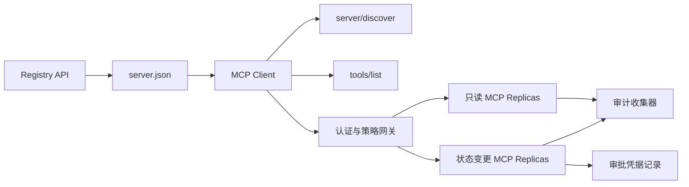

# 综合实战项目 13:带 Registro e gestão sem estado MCP Server

> O MCP de nível de produção não é um processo de servidor simples. É um conjunto completo de contratos: dados de base publicáveis, serviços de detecção em tempo real, solicitações sem estado, envelope, identificação e autorização, decisões de estratégia de detalhes, certificados de auditoria e certificados de implantação.

**Type:** Capstone
**Languages:** Python 与 TypeScript 参考模型；支持任何生产级编程语言
**Prerequisites:** Phase 11, Phase 13, Phase 14, Phase 17 与 Phase 18
**必修 MCP 进阶课：** [Lesson 28: Tool Contracts](../../../13-tools-and-protocols/28-mcp-tool-contracts-and-content/docs/en.md)- Não .[Lesson 29: 可靠性与流控](../../../13-tools-and-protocols/29-mcp-reliability-cancellation-and-flow-control/docs/en.md)- Não .[Lesson 30: Registry 供应链](../../../13-tools-and-protocols/30-mcp-registry-supply-chain-and-drift/docs/en.md), 及 [Lesson 31: 一致性工程](../../../13-tools-and-protocols/31-mcp-conformance-versioning-and-operations/docs/en.md)
**目标协议规范：**MCP `2026-07-28`
**Time:** ~25 小时

## Objectivo de aprendizagem

- 实现合规的无状态 MCP Requerimentos e resultados Envelope。
- O Registro de dados estáticos e o protocolo real-time no momento da operação são muito diferentes.
- Construir um sistema de identificação de ferramentas de classificação e de detecção de dados.
- Para cada ferramenta 调用强制执行签发发发商 (emissor) 收受众 (audiência) 作用域 (câmbio) 及审批策略 (assessoria) 
- 部署无 Session 亲和性绑定 流通 HTTP 集群──
- Em linha de rede, autorizações, estratégias, registros e fronteiras de auditoria, fornecer provas de engenharia completas.

## MCP  必須 必須 必須 必須 必須 必須 必須 必須 必須 必須 必須 必須 必須 必須 必須 必須 必須 必須 必須 必須 必須 必須 必須 必須 必須 必須 必須 必須 必須 必須 必須 必須 必須 必須 必須 必須 必須 必須 必須 必須 必須 必須 必須 必須 必須 必須 必須 必須 必須 必須 必須 必須 必須 必須 必須 必須 必須 必須 必須 必須 必須 必須 必須 必須 必須 必須 必須 必須 必須 必須 必須 必須 必須 必須 必須 必須 必須 必須 必須 必須 必須 必須 必須 必須 必須 必須 必須 必須 必須 必須 必須 必須 必須 必須 必須 必須 必須 必須 必須 必須 必須 必須 必須 必須 必須 必須 必須 必須 必須 必須 必須 必須 必須 必須 必須 必須 必須 必須 必須 必須 必須 必須 必須 必須 必須 必須 必須 必須 必須 必須 必須 必須 必須 必須 必須 必須 必須 必須 必須 必須 必須 必須 必須 必須 必須 必須 必須 必須 必須 必須 必須 必須 必須 必須 必須 必須 必須 必須 必須 必須 必須 必須 必須 必須 必須 必須 必須 必須 必須 必須 必須 必須 必須 必須 必須 必須 必須 必須 必須 必須 必須 必須 必須 必須 必須 必須 必須 必須 必須 必須 必須 必須 必須 必須 必須 必須 必須 必須 必須

Antes de o projeto ser concebido como já pronto para produção, é necessário completar o curso de quatro etapas da Fase 13:

1. [Lesson 28](../../../13-tools-and-protocols/28-mcp-tool-contracts-and-content/docs/en.md)Definir este servidor  deve ser exposto de ferramenta ∆ Schema ∆ Structured content ∆ ∆ ∆ ∆ ∆ ∆ ∆ ∆ ∆ ∆ ∆ ∆ ∆ ∆ ∆ ∆ ∆ ∆ ∆ ∆ ∆ ∆ ∆ ∆ ∆ ∆ ∆ ∆ ∆ ∆ ∆ ∆ ∆ ∆ ∆ ∆ ∆ ∆ ∆ ∆ ∆ ∆ ∆ ∆ ∆ ∆ ∆ ∆ ∆ ∆ ∆ ∆ ∆ ∆ ∆ ∆ ∆ ∆ ∆ ∆ ∆ ∆ ∆ ∆ ∆ ∆ ∆ ∆ ∆ ∆ ∆ ∆ ∆ ∆ ∆ ∆ ∆ ∆ ∆ ∆ ∆ ∆ ∆ ∆ ∆ ∆ ∆ ∆ ∆ ∆ ∆ ∆ ∆ ∆ ∆ ∆ ∆ ∆ ∆ ∆ ∆ ∆ ∆ ∆ ∆ ∆ ∆ ∆ ∆ ∆ ∆ ∆ ∆ ∆ ∆ ∆ ∆ ∆ ∆ ∆ ∆ ∆ ∆ ∆ ∆ ∆ ∆ ∆ ∆ ∆ ∆ ∆ ∆ ∆ ∆ ∆ ∆ ∆ ∆ ∆ ∆ ∆ ∆ ∆ ∆ ∆ ∆ ∆ ∆ ∆ ∆ ∆ ∆ ∆ ∆ ∆ ∆ ∆ ∆ ∆ ∆ ∆ ∆ ∆ ∆ ∆ ∆ ∆ ∆ ∆ ∆ ∆ ∆ ∆ ∆ ∆ ∆ ∆ ∆ ∆ ∆ ∆ ∆ ∆ ∆ ∆ ∆ ∆ ∆ ∆ ∆ ∆ ∆ ∆ ∆ ∆ ∆ ∆ ∆ ∆ ∆ ∆ ∆ ∆ ∆ ∆ ∆ ∆ ∆ ∆ ∆ ∆ ∆ ∆ ∆ ∆ ∆ ∆ ∆ ∆ ∆ ∆ ∆ ∆ ∆ ∆ ∆ ∆ ∆ ∆ ∆ ∆ ∆ ∆ ∆ ∆ ∆ ∆ ∆ ∆ ∆ ∆ ∆ 
2. [Lesson 29](../../../13-tools-and-protocols/29-mcp-reliability-cancellation-and-flow-control/docs/en.md)O processo de reestruturação da rede de telecomunicações é um processo de reestruturação de dados.
3. [Lesson 30](../../../13-tools-and-protocols/30-mcp-registry-supply-chain-and-drift/docs/en.md)O que é um "descrição de um registro" é um "descrição de um registro" ou "descrição de um registro" ou "descrição de um registro" ou "descrição de um registro" ou "descrição de um registro" ou "descrição de um registro" ou "descrição de um registro" ou "descrição de um registro" ou "descrição de um registro" ou "descrição de um registro" ou "descrição de um registro" ou "descrição de um registro" ou "descrição de um registro" ou "descrição de um registro" ou "descrição de um registro" ou "descrição de um registro" ou "descrição de um registro" ou "descrição de um registro" ou "descrição de um registro" ou "descrição de um registro" ou "descrição de um registro" ou "descrição de um registro" ou "descrição de um registro" ou "descrição de um registro" ou "descrição de um registro" ou "descrição de um registro" ou "descrição de um registro" ou "descrição de um registro" ou "descrição de um registro" ou "descrição de um registro" ou "descrição de um "do" ou "do" ou "descrição de um "do" ou "do" ou "do" ou "do" ou "do "do" ou "do" ou "do" ou "do" ou "do" ou "do" ou "do" ou "do "do" ou "do" ou "do "do" ou "do" ou "do" ou "do" ou "do" ou "do" ou "do "do" ou "do" ou "do" ou "do" ou "do "do" ou "do" ou "do" ou "do" ou "do" ou "do "do" ou "do "do" ou "do" ou "do "do "do" ou "do "do" ou "do "do" ou "do "do "do" ou "do" ou "do "do "do" ou "do "do" ou "do "do" ou "do "do "do" ou "do "do" ou "do
4. [Lesson 31](../../../13-tools-and-protocols/31-mcp-conformance-versioning-and-operations/docs/en.md)O que é o "Definição de um Estado-Membro" é o "Definição de um Estado-Membro".

Este projeto é responsável por integrar estes elementos de produção, não pode ser elaborado com um único teste de SDK simples.

## 问题背景

A plataforma interna da empresa precisa de um conjunto de ferramentas de escrita de dados apenas para leitura e de uma pequena quantidade de ferramentas de operação com capacidade de mudança de estado. O desenvolvedor deve ser capaz de descobrir o servidor, entender como se conectar, verificar sua capacidade de operação em tempo real e só poder utilizar as suas operações de acesso autorizado.

O verdadeiro problema não é escrever uma função Python, mas como fazer com que os seguintes seis conjuntos de fontes de verdade mantenham a sua altitude de consonância:

1. `server.json`Declarado o servidor está instalado ou através do qual o terminal de rede visita;
2. `server/discover`▌Declarou a capacidade de apoio real ao processo actual em funcionamento;
3. Cada pedido especifica a versão do protocolo utilizada e a declaração de capacidade do cliente;
4. 授权系统将调用方与合法的签发者、资源指示器 (Ressource Indicator) 及 Scope 绑定;
5.  a decisão independente do motor estratégico sobre a preparação de execução da operação específica e da entrada;
6. O auditório registou todas as conversas transfronteiriças e nunca divulgou a carga ou a chave de credenciais.

Qualquer um dos componentes que ocorra, a plataforma poderá mostrar um servidor órfão não conectado, um cliente errôneo, incompatível com o seu código de acesso, ou um token errôneo emitido para outros recursos, ou executar operações altamente destrutivas sem autorização.

## 两层发现机制 (As duas camadas de descoberta)

Registro 静态索引与实时的 MCP Server  responde a uma questão de dimensão completamente diferente:

| 发现层次 | 交互契约 | 回答的核心问题 |
|---|---|---|
| 发布层 (Publication) | `server.json` 与 Registry API | 该 Server 是什么？其代码包或远程网络端点在哪里？如何进行配置？ |
| 运行时 (Runtime) | `server/discover` | 该运行进程当前实际支持哪些协议版本、能力特性、扩展及 Server 身份？ |

Registro oficial 采用带版本控制的 `server.json`Schema。 a distância条目 pode declarar Streamable HTTP 地址:

```json
{
  "$schema": "https://static.modelcontextprotocol.io/schemas/2025-12-11/server.schema.json",
  "name": "com.example/internal-readonly",
  "title": "Internal Read-Only Tools",
  "description": "Read-only incident and data lookup tools.",
  "version": "1.0.0",
  "remotes": [
    {
      "type": "streamable-http",
      "url": "https://mcp.internal.example.com/readonly"
    }
  ]
}
```

Registro Schema 版本与 MCP 协议版本完全独立,不要混为一谈――cada documento é obrigatório para ser rigorosamente examinado em função de seu próprio contrato.

具備合规 Schema 不代表拥有命名空间所有权──对 `example.com`完成验证的发布者使用反向 DNS 命名空间 `com.example/*`Ou então, o espaço de nome.

Servidor  deve ser implementado `server/discover`O cliente pode fazê-lo ativamente antes de iniciar o seu negócio:

```json
{
  "resultType": "complete",
  "supportedVersions": ["2026-07-28"],
  "capabilities": {
    "tools": {
      "listChanged": false
    }
  },
  "_meta": {
    "io.modelcontextprotocol/serverInfo": {
      "name": "com.example/internal-readonly",
      "version": "1.0.0"
    }
  },
  "ttlMs": 3600000,
  "cacheScope": "public"
}
```

## 无状态 MCP 核心(Core de MCP sem estado)

MCP `2026-07-28`- Não. - Não.`initialize`握手与 `Mcp-Session-Id` Todos os pedidos estão em`params._meta`Na sequência, o texto é:

```json
{
  "io.modelcontextprotocol/protocolVersion": "2026-07-28",
  "io.modelcontextprotocol/clientCapabilities": {},
  "io.modelcontextprotocol/clientInfo": {
    "name": "internal-platform-client",
    "version": "1.0.0"
  }
}
```

O equilíbrio de carga pode sem preocupação continuar a enviar pedidos para diferentes réplicas saudáveis, pois qualquer replica pode ser totalmente verificada e processada por si mesma.

常规成功结果返回 `resultType: "complete"`, e o servidor 应在 `_meta.io.modelcontextprotocol/serverInfo`中标明身份──协议版本非法返回 Invalid Params 错误码 `-32602`; para versão legal mas não apoiada, devolver `-32022`Não está em dados`supported`Com`requested`- Não.

### Avaliação de serviços

`tools/list`必須保证确定性排序, seus resultados incluem:

- `ttlMs`: Fação face a cliente's freshness cache-
- `cacheScope`- Não .`public`(public共享) ou `private`(上下文私有);
-  estruturalmente estável, que permite que a mesma lista seja capaz de utilizar o Quick Cache do modelo;
- `resultType: "complete"`Com dados do servidor.

 para o controle de direitos de um usuário específico, normalmente deve ser exportado `cacheScope: "private"`, não pode ser possível manter a visibilidade de ferramentas de usuário em arquivo de partilha pública.

## Transmissão HTTP

面向网络的服务器 暴露单一的 POST 端点── cada POST JSON-RPC Pedidos ou notificações são independentes──

针对请求,Server 返回单个JSON 响应或针对该次请求开启的请求作用域 SSE 流――长周期的变更通知通过 `subscriptions/listen`建立长连接流──

Pequenação deve ser especificada como HTTP Pequenação:

- `MCP-Protocol-Version`: coincidência com os dados solicitados;
- `Mcp-Method`: consonância com JSON-RPC 方法名一致;
- `Mcp-Name`: em调用 `tools/call`É um método de fazer um visual.
- `Accept: application/json, text/event-stream`- Não.

O chefe não está em conformidade com o pedido.`-32020`错误码――校验 `Origin`Defender DNS 重绑定,并将请求作用域 SSE 流的动作断视为请求取消──



```figure
cf-mcp-gate
```

## 认证与策略决策

传输层元数据绝不等权限凭证.

1. 动态发现受保护资源元数据;
2. Servidor autorizado para a seleção de recursos;
3. 优先使用 Client ID Metadata Documents(CIMD)
4. In Inferência de Indicador de Recursos no processo de autorização;
5. 验证返回的                                                                                                                                                                                                                                                                                                                                                                                                                                                                                                                        `iss`Servidor de autorização de registos;
6. 按 Emitente 隔离存储 凭据 客户,绝不跨 Emitente 复用;
7. Em MCP Server 侧验证 Token 的签发者、受众、过期时间与 Scope;
8. A execução de decisões de estratégia secundária para nomear e utilizar instrumentos específicos e para os parâmetros reais.

### A aprovação do trabalho é um registro de credenciais, e não um escopo mágico.

status变更调用需要一个结构化的人工审批凭证 (construído)  Approvamento Record),与操作员、工具名、规范化参数哈希值 (digest) 、目标环境、过期时间及单次/多次使用策略深度绑定──单独一条聊天消息绝不能充当审批凭证──

Python 模型将对排序键的规范化 JSON 计算哈希,并将该 Digest与Token Subject、工具名、服务器 URL 和过期时间签名绑定──改哪怕一个参数段,该审批记录均不能重放──审批记录是独立证证证证,而不是直接进入Token 里乱塞的 Scope──

## 动手构建步骤

1. **建模发布元数据**:编写并验证 `server.json`, assegurar que o espaço de nomeamento seja conforme às regras de DNS.
2. **实现实时服务发现**: em tratamento de qualquer negócio RPC prioridade de implementação`server/discover`- Não.
3. **实现无状态 Envelope**Cada requisito deve ser preenchido com capacidade de dados, para remover todos os níveis de sessão.
4. **构建工具集**O JSON é um sistema de dados de dados de dados de dados de dados de dados de dados de dados de dados de dados de dados de dados de dados de dados de dados de dados de dados de dados de dados de dados de dados de dados de dados de dados de dados de dados de dados de dados de dados de dados de dados de dados de dados de dados de dados de dados de dados de dados de dados de dados de dados de dados de dados de dados de dados de dados de dados de dados de dados de dados de dados de dados de dados de dados de dados de dados de dados de dados de dados de dados de dados de dados de dados de dados de dados de dados de dados de dados de dados de dados de dados de dados de dados de dados de dados de dados de dados de dados de dados de dados de dados de dados de dados de dados de dados de dados de dados de dados de dados de dados de dados de dados de dados de dados de dados de dados de dados de dados de dados de dados de dados de dados de dados de dados de dados de dados de dados de dados de dados de dados de dados de dados de dados de dados de dados de dados de dados de dados de dados de dados de dados de dados de dados de dados de dados de dados de dados de dados de dados de dados de dados de dados de dados de dados de dados de dados de dados de dados de dados de dados de dados de dados de dados de dados de dados de dados de dados de dados de dados de dados de dados de dados de dados de dados de dados de dados de dados de dados de dados de dados de dados de dados de dados de dados de dados de dados de dados de dados de dados de dados de dados de dados de dados de dados de dados de dados de dados de dados de dados de dados de dados de dados de dados de dados de dados de dados de dados de dados de dados de dados de dados de dados de dados de dados de dados de dados de dados de dados de dados de dados de dados de dados de dados de dados de dados de dados de dados de dados de dados de dados de dados de dados de dados de dados de dados de dados de dados de dados de dados de dados de dados de dados de dados de dados de dados de dados de dados de dados de dados de dados de dados de dados de dados de dados de dados de dados de dados de dados de dados de dados de dados de dados de dados de dados de dados de dados de dados de dados de dados de dados de dados de dados
5. **支持缓存感知的工具列表**Output determination排序的工具列表,并配置 `ttlMs`Com`cacheScope`- Não.
6. **接入认证与策略网关**O Título de aprovação é o Título de aprovação de Títulos de aprovação.
7. **分离静态 Registry 与运行时校验**: em relação`server.json`Com o tempo real.`server/discover`,及时上报漂移──
8. **接入脱敏审计日志**O que é um dos principais fatores que podem ser observados em um laboratório de laboratório?
9. **验证水平扩展**Em um balançador de carga, duas réplicas sem estado são colocadas em um balançador de carga.
10. **真实网络验证**através de reais redes de captura de requisições de cabeças e JSON, verificando vários casos de uso de direção e contrariação anormal.

## Deve-se ter em conta o que é o "pacote de provas"

O código apresentado deve incluir as seguintes cinco categorias de provas de projeto:

| 证据类别 | 最低验证标准 | 来源课程 |
|---|---|---|
| 网络线路 (Wire) | 正反向用例中脱敏的原始 HTTP 头与 JSON-RPC 体，覆盖类型错误、头不匹配、不支持版本等 | [Lesson 31](../../../13-tools-and-protocols/31-mcp-conformance-versioning-and-operations/docs/en.md) |
| 代理网络 (Proxy) | 直连与经过代理转发的报文对比，证明协议错误未被粗暴折叠为 500 且流式传输未被缓冲 | [Lessons 29](../../../13-tools-and-protocols/29-mcp-reliability-cancellation-and-flow-control/docs/en.md) 与 [31](../../../13-tools-and-protocols/31-mcp-conformance-versioning-and-operations/docs/en.md) |
| 准入管理 (Admission) | 已验证的发布者命名空间、不可变 Registry 记录哈希、实时 `server/discover` 观察凭证与准入账本事件 | [Lesson 30](../../../13-tools-and-protocols/30-mcp-registry-supply-chain-and-drift/docs/en.md) |
| 重试与取消 (Retry) | 取消与完成的竞态测试、显式超时、安全只读重试、写操作幂等键、重连刷新机制 | [Lesson 29](../../../13-tools-and-protocols/29-mcp-reliability-cancellation-and-flow-control/docs/en.md) |
| 发布回滚 (Rollback) | 明确的先前版本哈希、描述符锁定、健康检查窗口、路由平滑切换结果与决策证据 | [Lessons 30](../../../13-tools-and-protocols/30-mcp-registry-supply-chain-and-drift/docs/en.md) 与 [31](../../../13-tools-and-protocols/31-mcp-conformance-versioning-and-operations/docs/en.md) |

## 本地参考模型运行

Python modelo demonstra, em caso de não abrir conjuntos de rede externos, completar o nomeação espaço experimental ̇ realtime detecção ̇ determinação lista ̇ solicitação de dados experimental ̇ Token identificação ̇ baseado em hash ̇ aprovação e processo de auditoria:

```bash
cd phases/19-capstone-projects/13-mcp-server-with-registry
python3 code/main.py
python3 -m unittest discover -s code/tests -v
```

O projeto TypeScript mostrou em um caso de SDK MCP externo sem o seu crédito, através de estúdio original  exposição sem estado JSON-RPC  interface e retornar para parâmetros ilegais `isError: true`- Não .

```bash
cd phases/19-capstone-projects/13-mcp-server-with-registry/code/ts
npm install
npm run typecheck
npm test
npm run demo
```

## 线路协议报文范例

```http
POST /mcp HTTP/1.1
Host: mcp.internal.example.com
Content-Type: application/json
Accept: application/json, text/event-stream
MCP-Protocol-Version: 2026-07-28
Mcp-Method: tools/call
Mcp-Name: postgres.readonly
Authorization: Bearer REDACTED

{
  "jsonrpc": "2.0",
  "id": 42,
  "method": "tools/call",
  "params": {
    "name": "postgres.readonly",
    "arguments": {"sql": "SELECT 1"},
    "_meta": {
      "io.modelcontextprotocol/protocolVersion": "2026-07-28",
      "io.modelcontextprotocol/clientCapabilities": {},
      "io.modelcontextprotocol/clientInfo": {
        "name": "internal-platform-client",
        "version": "1.0.0"
      }
    }
  }
}
```

## 核心专业术语

| 术语 | 行业俗称 | 规范真实定义 |
|---|---|---|
| 无状态 MCP (Stateless MCP) | “到处都没有状态” | 协议层不存在 Session；跨调用状态属于显式传递且由业务服务端持久化管理 |
| `server.json` | “工具清单清单” | Registry 静态元数据，用于定义发布命名、代码打包、配置项与传输端点 |
| `server/discover` | “传统握手” | 强制实现的常规业务 RPC，用于获取实时支持的版本与能力，而非建立会话 |
| 缓存作用域 (Cache scope) | “能不能缓存？” | 标识可缓存结果是否可以被跨上下文公共复用（`public`）或仅限当前上下文（`private`） |
| 策略决策 (Policy decision) | “Token 允许就能调” | 针对调用者主体、工具、操作目标、参数载荷及外部上下文的细粒度二次判定 |
| 审批凭证 (Approval record) | “人工在群里点了同意” | 绑定至具体操作者、确切参数哈希与过期时间的强防篡改凭据证据 |
| 显式句柄 (Explicit handle) | “Session ID” | 业务层具名状态的普通应用标识符，绝非底层传输连接会话 |

## 延伸阅读

- [MCP 2026-07-28 核心变更](https://modelcontextprotocol.io/specification/2026-07-28/changelog)
- [Streamable HTTP 传输规范](https://modelcontextprotocol.io/specification/2026-07-28/basic/transports/streamable-http)
- [MCP 服务发现](https://modelcontextprotocol.io/specification/2026-07-28/server/discover)
- [MCP 鉴权与授权规范](https://modelcontextprotocol.io/specification/2026-07-28/basic/authorization)
- [官方 Registry server.json 要求](https://github.com/modelcontextprotocol/registry/blob/main/docs/reference/server-json/official-registry-requirements.md)
