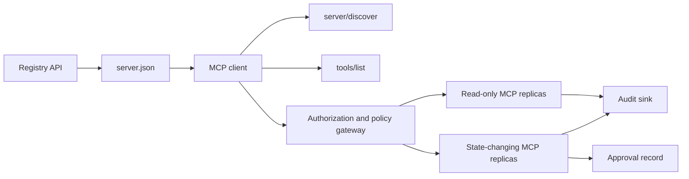

# 综合实战项目 13:带 Registro e gestão sem estado MCP Server

> O MCP de nível de produção não é um processo de servidor simples. É um conjunto completo de contratos: dados de base publicáveis, serviços de detecção em tempo real, solicitações sem estado, envelope, identificação e autorização, decisões de estratégia de detalhes, certificados de auditoria e certificados de implantação.

**Type:** Capstone
**Languages:** Python 与 TypeScript 参考模型；支持任何生产级编程语言
**Prerequisites:** Phase 11, Phase 13, Phase 14, Phase 17 与 Phase 18
**必修 MCP 进阶课：** [Lesson 28: Tool Contracts](../../../13-tools-and-protocols/28-mcp-tool-contracts-and-content/docs/en.md)- Não .[Lesson 29: 可靠性与流控](../../../13-tools-and-protocols/29-mcp-reliability-cancellation-and-flow-control/docs/en.md)- Não .[Lesson 30: Registry 供应链](../../../13-tools-and-protocols/30-mcp-registry-supply-chain-and-drift/docs/en.md), 及 [Lesson 31: 一致性工程](../../../13-tools-and-protocols/31-mcp-conformance-versioning-and-operations/docs/en.md)
**目标协议规范：**MCP `2026-07-28`
**Time:** ~25 小时

## Objectivo de aprendizagem

- 实现合规的无状态 MCP Requerimentos e resultados Envelope。
- O Registro de dados estáticos e o protocolo real-time no momento da operação são muito diferentes.
- Construir um sistema de identificação de ferramentas de classificação e de detecção de dados.
- Para cada ferramenta 调用强制执行签发发发商 (emissor) 收受众 (audiência) 作用域 (câmbio) 及审批策略 (assessoria) 
- 部署无 Session 亲和性绑定 流通 HTTP 集群──
- Em linha de rede, autorizações, estratégias, registros e fronteiras de auditoria, fornecer provas de engenharia completas.

## MCP  必須 必須 必須 必須 必須 必須 必須 必須 必須 必須 必須 必須 必須 必須 必須 必須 必須 必須 必須 必須 必須 必須 必須 必須 必須 必須 必須 必須 必須 必須 必須 必須 必須 必須 必須 必須 必須 必須 必須 必須 必須 必須 必須 必須 必須 必須 必須 必須 必須 必須 必須 必須 必須 必須 必須 必須 必須 必須 必須 必須 必須 必須 必須 必須 必須 必須 必須 必須 必須 必須 必須 必須 必須 必須 必須 必須 必須 必須 必須 必須 必須 必須 必須 必須 必須 必須 必須 必須 必須 必須 必須 必須 必須 必須 必須 必須 必須 必須 必須 必須 必須 必須 必須 必須 必須 必須 必須 必須 必須 必須 必須 必須 必須 必須 必須 必須 必須 必須 必須 必須 必須 必須 必須 必須 必須 必須 必須 必須 必須 必須 必須 必須 必須 必須 必須 必須 必須 必須 必須 必須 必須 必須 必須 必須 必須 必須 必須 必須 必須 必須 必須 必須 必須 必須 必須 必須 必須 必須 必須 必須 必須 必須 必須 必須 必須 必須 必須 必須 必須 必須 必須 必須 必須 必須 必須 必須 必須 必須 必須 必須 必須 必須 必須 必須 必須 必須 必須 必須 必須 必須 必須 必須 必須 必須 必須 必須 必須 必須 必須

Antes de o projeto ser concebido como já pronto para produção, é necessário completar o curso de quatro etapas da Fase 13:

1. [Lesson 28](../../../13-tools-and-protocols/28-mcp-tool-contracts-and-content/docs/en.md)Definir este servidor  deve ser exposto de ferramenta ∆ Schema ∆ Structured content ∆ ∆ ∆ ∆ ∆ ∆ ∆ ∆ ∆ ∆ ∆ ∆ ∆ ∆ ∆ ∆ ∆ ∆ ∆ ∆ ∆ ∆ ∆ ∆ ∆ ∆ ∆ ∆ ∆ ∆ ∆ ∆ ∆ ∆ ∆ ∆ ∆ ∆ ∆ ∆ ∆ ∆ ∆ ∆ ∆ ∆ ∆ ∆ ∆ ∆ ∆ ∆ ∆ ∆ ∆ ∆ ∆ ∆ ∆ ∆ ∆ ∆ ∆ ∆ ∆ ∆ ∆ ∆ ∆ ∆ ∆ ∆ ∆ ∆ ∆ ∆ ∆ ∆ ∆ ∆ ∆ ∆ ∆ ∆ ∆ ∆ ∆ ∆ ∆ ∆ ∆ ∆ ∆ ∆ ∆ ∆ ∆ ∆ ∆ ∆ ∆ ∆ ∆ ∆ ∆ ∆ ∆ ∆ ∆ ∆ ∆ ∆ ∆ ∆ ∆ ∆ ∆ ∆ ∆ ∆ ∆ ∆ ∆ ∆ ∆ ∆ ∆ ∆ ∆ ∆ ∆ ∆ ∆ ∆ ∆ ∆ ∆ ∆ ∆ ∆ ∆ ∆ ∆ ∆ ∆ ∆ ∆ ∆ ∆ ∆ ∆ ∆ ∆ ∆ ∆ ∆ ∆ ∆ ∆ ∆ ∆ ∆ ∆ ∆ ∆ ∆ ∆ ∆ ∆ ∆ ∆ ∆ ∆ ∆ ∆ ∆ ∆ ∆ ∆ ∆ ∆ ∆ ∆ ∆ ∆ ∆ ∆ ∆ ∆ ∆ ∆ ∆ ∆ ∆ ∆ ∆ ∆ ∆ ∆ ∆ ∆ ∆ ∆ ∆ ∆ ∆ ∆ ∆ ∆ ∆ ∆ ∆ ∆ ∆ ∆ ∆ ∆ ∆ ∆ ∆ ∆ ∆ ∆ ∆ ∆ ∆ ∆ ∆ ∆ ∆ ∆ ∆ ∆ ∆ ∆ ∆ ∆ ∆ ∆ ∆ ∆ ∆ ∆ 
2. [Lesson 29](../../../13-tools-and-protocols/29-mcp-reliability-cancellation-and-flow-control/docs/en.md)O processo de reestruturação da rede de telecomunicações é um processo de reestruturação de dados.
3. [Lesson 30](../../../13-tools-and-protocols/30-mcp-registry-supply-chain-and-drift/docs/en.md)O que é um "descrição de um registro" é um "descrição de um registro" ou "descrição de um registro" ou "descrição de um registro" ou "descrição de um registro" ou "descrição de um registro" ou "descrição de um registro" ou "descrição de um registro" ou "descrição de um registro" ou "descrição de um registro" ou "descrição de um registro" ou "descrição de um registro" ou "descrição de um registro" ou "descrição de um registro" ou "descrição de um registro" ou "descrição de um registro" ou "descrição de um registro" ou "descrição de um registro" ou "descrição de um registro" ou "descrição de um registro" ou "descrição de um registro" ou "descrição de um registro" ou "descrição de um registro" ou "descrição de um registro" ou "descrição de um registro" ou "descrição de um registro" ou "descrição de um registro" ou "descrição de um registro" ou "descrição de um registro" ou "descrição de um registro" ou "descrição de um registro" ou "descrição de um "do" ou "do" ou "descrição de um "do" ou "do" ou "do" ou "do" ou "do "do" ou "do" ou "do" ou "do" ou "do" ou "do" ou "do" ou "do "do" ou "do" ou "do "do" ou "do" ou "do" ou "do" ou "do" ou "do" ou "do "do" ou "do" ou "do" ou "do" ou "do "do" ou "do" ou "do" ou "do" ou "do" ou "do "do" ou "do "do" ou "do" ou "do "do "do" ou "do "do" ou "do "do" ou "do "do "do" ou "do" ou "do "do "do" ou "do "do" ou "do "do" ou "do "do "do" ou "do "do" ou "do
4. [Lesson 31](../../../13-tools-and-protocols/31-mcp-conformance-versioning-and-operations/docs/en.md)O que é o "Definição de um Estado-Membro" é o "Definição de um Estado-Membro".

Este projeto é responsável por integrar estes elementos de produção, não pode ser elaborado com um único teste de SDK simples.

## 问题背景

A plataforma interna da empresa precisa de um conjunto de ferramentas de escrita de dados apenas para leitura e de uma pequena quantidade de ferramentas de operação com capacidade de mudança de estado. O desenvolvedor deve ser capaz de descobrir o servidor, entender como se conectar, verificar sua capacidade de operação em tempo real e só poder utilizar as suas operações de acesso autorizado.

O verdadeiro problema não é registrar uma função, mas como fazer com que os seguintes seis conjuntos de fontes de verdade se mantenham altamente alinhados:

1. `server.json`Declarado o servidor está instalado ou através do qual o terminal de rede visita;
2. `server/discover`▌Declarou a capacidade de apoio real ao processo actual em funcionamento;
3. Cada pedido especifica a versão do protocolo utilizada e a declaração de capacidade do cliente;
4. 授权系统将调用方与合法的签发者、资源指示器 (Ressource Indicator) 及 Scope 绑定;
5. 策略引擎独立决策该特定操作是否准备执行;
6. O auditório registou todas as conversas transfronteiriças e nunca divulgou a carga ou a chave de credenciais.

Qualquer um dos componentes que ocorra, a plataforma poderá mostrar um servidor órfão não conectado, um cliente errôneo, incompatível com o seu código de acesso, um token errôneo emitido para outros recursos ou uma operação destrutiva em caso de revisão não prevista.

## 两层发现机制 (As duas camadas de descoberta)

Registro 静态索引与实时的 MCP Server  responde a uma questão de dimensão completamente diferente:

| 发现层次 | 交互契约 | 回答的核心问题 |
|---|---|---|
| 发布层 (Publication) | `server.json` 与 Registry API | 该 Server 是什么？其代码包或远程网络端点在哪里？如何进行配置？ |
| 运行时 (Runtime) | `server/discover` | 该运行进程当前实际支持哪些协议版本、能力特性、扩展及 Server 身份？ |

Registro oficial 采用带版本控制的 `server.json`Schema。 a distância条目 pode declarar Streamable HTTP 地址:

```json
{
  "$schema": "https://static.modelcontextprotocol.io/schemas/2025-12-11/server.schema.json",
  "name": "com.example/internal-readonly",
  "title": "Internal Read-Only Tools",
  "description": "Read-only incident and data lookup tools.",
  "version": "1.0.0",
  "remotes": [
    {
      "type": "streamable-http",
      "url": "https://mcp.internal.example.com/readonly"
    }
  ]
}
```

Registro Schema  Version  MCP 协议版本 é totalmente independente, não para fazer os dois concordar, mas para alterar um dos dias.

具備合规 Schema 不代表拥有命名空间所有权──对 `example.com`完成验证的发布者使用反向 DNS 命名空间 `com.example/*`Ou seu filho nomea espaço. O processo de certificação do Registro é responsável por provar esta propriedade.

标准库模型中的 `validate_registry_document`Função está apenas numa parte do computador de configuração remota.`name`- Não.`description`Com`version`字段,可选的 `title`, nome e duração de um volume, formato de versão específica, bem como de cada`streamable-http`Ou `sse`端点的 HTTP(S) URL 格式──由于 este projeto global geralmente faz pesquisas em tempo real sobre o端点, também exige extra `remotes`Lista não está em aberto.`validate_publisher_namespace`单独对照已验证的发行者域名检查名称, e `validate_runtime_alignment`则将发布名称与版本同实时的 则将发布名称与版本同实时的`serverInfo` fazer comparação── oficial Schema também suporta apenas conteúdo de código de pacote de registros bem como mais distância 字段── antes de ser publicado, use a versão bloqueada oficial JSON Schema ou `mcp-publisher`Não considere este subconjunto independente como um esquema completo.

Servidor  deve ser implementado `server/discover`O cliente pode fazê-lo em outros métodos de desenvolvimento e ativamente usá-lo.

```json
{
  "resultType": "complete",
  "supportedVersions": ["2026-07-28"],
  "capabilities": {
    "tools": {
      "listChanged": false
    }
  },
  "_meta": {
    "io.modelcontextprotocol/serverInfo": {
      "name": "com.example/internal-readonly",
      "version": "1.0.0"
    }
  },
  "ttlMs": 3600000,
  "cacheScope": "public"
}
```

Os registos privados podem indicar dados de propriedade extra, de avaliação ou de ciclo de vida, mas não podem conceber estes dados como um segmento de linha MCP ou`server.json`根字段── 組織策略应与已发布记录并列存放── 当确实需要公开的自定义元数据时,使用登记的 `_meta.io.modelcontextprotocol.registry/publisher-provided`扩展,并保持在其 4 KB 上限之内──

## 无状态 MCP 核心(Core de MCP sem estado)

MCP `2026-07-28`- Deliberação do acordo`initialize`- Não .`notifications/initialized`Mãos em mãos, simultaneamente movido.`Mcp-Session-Id`- Não.

Cada pedido está em curso.`params._meta`Na sequência, o texto é:

```json
{
  "io.modelcontextprotocol/protocolVersion": "2026-07-28",
  "io.modelcontextprotocol/clientCapabilities": {},
  "io.modelcontextprotocol/clientInfo": {
    "name": "internal-platform-client",
    "version": "1.0.0"
  }
}
```

版本与能力是请求层的事实,而不是连接层的事实――负载平衡器可以无忧地连续请求分发给不同的健康复制品,因为 qualquer uma das réplicas pode ser completamente verificada e processada por si mesma.

常规成功结果返回 `resultType: "complete"`, e o servidor deve estar em cada resultado .`_meta.io.modelcontextprotocol/serverInfo`中标明身份──协议版本缺失或不是字符串时返回 Params invalidas 错误码 `-32602`O artigo 2.o`-32022` só para fornecer versões de caracteres mas não suportadas, os dados  devem ser corretos `{"supported": ["2026-07-28"], "requested": "..."}`- Não.

### Avaliação de serviços

 para o mesmo conjunto de ferramentas válidas,`tools/list`必須是確定性的──其結果包含:

- `ttlMs`: Fação face a cliente's freshness cache-
- `cacheScope`- Não .`public`(public共享) ou `private`(上下文私有);
-  estruturalmente estável, que permite que a mesma lista seja capaz de repetir o Cache Pronto do modelo;
- `resultType: "complete"`Com dados do servidor.

 para o controle de direitos de um usuário específico, normalmente deve ser exportado `cacheScope: "private"`, não pode ser possível manter a visibilidade de ferramentas de usuário em arquivo de partilha pública.

## Transmissão HTTP

面向网络的服务器 暴露单一的 POST 端点── cada POST JSON-RPC Pedidos ou notificações são independentes──

针对请求,Server 返回单个JSON 响应或针对该次请求开启的请求作用域 SSE 流――长周期的变更通知通过 `subscriptions/listen`建立长连接流,承载选择订阅的变更通知──当前传输中不存在独立的 GET流、Session DELETE、Session 请求头或 `Last-Event-ID`- Não.

Cada pedido contém:

- `MCP-Protocol-Version`: coincidência com os dados solicitados;
- `Mcp-Method`: consonância com JSON-RPC 方法名一致;
- `Mcp-Name`: para uso `tools/call`- Não.`resources/read`Com`prompts/get`O artigo 2.o
- `Accept: application/json, text/event-stream`- Não.

Uso de regras`-32020`错误拒绝不一致的镜像请求头――校验 `Origin`, vai desenvolver local Server  vinculado ao endereço do círculo, reconhecer o cliente distante,并将已关闭的请求作用域 SSE 响应视为取消──



```figure
cf-mcp-gate
```

## 认证与策略决策

传输层元数据绝对不等权限凭证.

对于远程 Server:

1. 动态发现受保护资源元数据;
2. Servidor autorizado para a seleção de recursos;
3. 优先使用客户ID Metadata Documents(CIMD) 注册客户端,将动态客户端注册(Dynamic Client Registration)视为兼容性支持;
4. In Inferência de Indicador de Recursos no processo de autorização;
5. 验证返回的                                                                                                                                                                                                                                                                                                                                                                                                                                                                                                                        `iss`Servidor de autorização de registos;
6. 按 Emitente 隔离存储 凭据 客户,绝不跨 Emitente 复用;
7. Em MCP Server 侧验证 Token 的签发者、受众、过期时间与 Scope;
8. A execução de decisões de estratégia secundária para nomear e utilizar instrumentos específicos e para os parâmetros reais.

`readOnlyHint`Com`destructiveHint`Para ajudar o cliente a apresentar riscos, não são meios de controle autorizados.

### A aprovação do trabalho é um registro de credenciais, e não um escopo mágico.

status变更调用需要一个结构化的人工审批凭证 (construído)  Approvamento Record),与操作员、工具名、规范化参数哈希值 (digest) 、目标环境、过期时间及单次/多次使用策略深度绑定──单独一条聊天消息绝不能充当审批凭证──

Python 模型将对排序键的规范化 JSON 计算哈希,并将该 Digest与Token Subject、工具名、服务器 URL 和过期时间绑定──改哪怕一个参数段,该审批记录也将在处理器运行之前重放失败──审批记录是独立证书证书,而不是添加到Access Token 中的 Scope──

Quando a redução da dimensão de impacto pode ser substancial, a separação de instrumentos de risco deve ser colocada numa superfície independente de avaliação individual.

## 动手构建

### 1. 建模发布元数据

                                                                                                                                                                                                                                                                                                                                                                                                                                                                                                                             `server.json`Não é necessário que o nome do editor seja usado em um espaço de nome que já está certificado.`repository`Ou `packages`O código de dados, bem como o código de dados, são dados de dados de dados de dados de dados de dados de dados de dados de dados de dados de dados de dados de dados de dados de dados de dados de dados de dados de dados de dados de dados de dados de dados de dados de dados de dados de dados de dados de dados de dados de dados de dados de dados de dados de dados de dados de dados de dados de dados de dados de dados de dados de dados de dados de dados de dados de dados de dados de dados de dados de dados de dados de dados de dados de dados de dados de dados de dados de dados de dados de dados de dados de dados de dados de dados de dados de dados de dados de dados de dados de dados de dados de dados de dados de dados de dados de dados de dados de dados de dados de dados de dados de dados de dados de dados de dados de dados de dados de dados de dados de dados de dados de dados de dados de dados de dados de dados de dados de dados de dados de dados de dados de dados de dados de dados de dados de dados de dados de dados de dados de dados de dados de dados de dados de dados de dados de dados de dados de dados de dados de dados de dados de dados de dados de dados de dados de dados de dados de dados de dados de dados de dados de dados de dados de dados de dados de dados de dados de dados de dados de dados de dados de dados de dados de dados de dados de dados de dados de dados de dados de dados de dados de dados de dados de dados de dados de dados de dados de dados de dados de dados de dados de dados de dados de dados de dados de dados de dados de dados de dados de dados de dados de dados de dados de dados de dados de dados de dados de dados de dados de dados de dados de dados de dados de dados de dados de dados de dados de dados de dados de dados de dados de dados de dados de dados de dados de dados de dados de dados de dados de dados de dados de dados de dados de dados de dados de dados de dados de dados de dados de dados de dados de dados de dados de dados de dados de dados de dados de dados de dados de dados de dados de dados de dados de dados de dados de dados de dados de dados de dados de dados de dados de dados de dados de dados de dados de dados de dados de dados de dados de dados de dados de dados de dados de dados de dados de dados de dados de dados

### 2. 实现实时服务发现

                                                                                                                                                                                                                                                              `server/discover`◊ Publicar supported protocol version、 capacidades集、 expandir com o servidor Identity,并添加一个使用 `-32022`A versão rejeita o uso de exemplo:

### 3. 实现无状态信封 (envelope)

Cada pedido deve levar a versão do acordo com a capacidade do cliente; cada resultado é devolvido .`resultType`Compatível com o servidor.

### 4. 构建工具表面

Com duas ferramentas de leitura e uma ferramenta de mudança de estado, cada ferramenta fornece um esquema JSON definido, uma descrição precisa, uma estrutura de resultados de determinação e uma explicação real. Quando o cliente depende dos resultados estruturados, adicione o esquema de saída.

### 5. 添加缓存感知的列表

Equipamento de regresso,并附带 `ttlMs`Com`cacheScope`分別测试缓存过期与列表变更通知行为

### 6. 添加认证与策略

校验发发发商、受众、过期时间与范围── para cada instrumento, convém-se a tomar decisões de estratégia de execução, e a aprovação será vinculada a operações de alto risco definidas── antes de ser rejeitada a ausência ou a aprovação do Gestor de Execução 

### 7. Separação do Registro com o curso de

Previo estudo de estado de`server.json`记录, reutilizar `server/discover`探测远程端点── Quando o processo de desenvolvimento de uma versão ou de uma versão necessária não coincide com o processo em tempo real, o relatório é deslocado──

### 8. 添加审计证据

记录操作者、发发发者、资源、工具、策略决策、请求标识符、追踪上下文、延迟与结果──持久化前对敏感参数和结果进行脱敏或计算摘要──审计接收端必须位于模型可见上下文之外──

### 9. 验证水平扩展 (expanso de nível de avaliação)

Em um balancedor de carga, coloque duas cópias sem estado, enviando pelo menos 100 e enviando solicitações, provando que a correção não depende da natureza. Se um instrumento precisa de transcorrência de um estado, gerar uma expressão de imperfeição, e colocá-lo em um sistema de perpetuidade compartilhado.

### 10. 跨越真实线路

针对真实服务器 二进制运行一致性检查―― capturar o pedido de cabeçalho com o pedido JSON, não apenas de SDK objetos──覆盖错误版本、请求头不匹配、缺少 Scope、受众错误、参数形、Handler 失败、取消与缓存过期等用例──

## Deve-se ter em conta o que é o "pacote de provas"

O material apresentado deve conter as seguintes cinco categorias de provas, caso contrário, é incompleto:

| 证据类别 | 最低验证标准 | 来源课程 |
|---|---|---|
| 网络线路 (Wire) | 正向与反向用例的脱敏原始请求头与 JSON-RPC 请求体，覆盖元数据类型错误、请求头不匹配、不受支持的版本、缺失或未知的 `resultType`、通知无响应以及响应 ID 匹配 | [Lesson 31](../../../13-tools-and-protocols/31-mcp-conformance-versioning-and-operations/docs/en.md) |
| 代理网络 (Proxy) | 同一稳定用例分别直连与经过已部署的中间层运行，记录入口、源站与出口的状态码及响应体摘要；证明协议错误未被折叠为通用 500 响应，且流式传输未被缓冲 | [Lessons 29](../../../13-tools-and-protocols/29-mcp-reliability-cancellation-and-flow-control/docs/en.md) 与 [31](../../../13-tools-and-protocols/31-mcp-conformance-versioning-and-operations/docs/en.md) |
| 准入管理 (Admission) | 已验证的发布者命名空间、不可变的 Registry 记录摘要、产物或远程端点来源证明、实时 `server/discover` 身份与能力观测、描述符锁定、当前 Registry 状态以及准入账本事件 | [Lesson 30](../../../13-tools-and-protocols/30-mcp-registry-supply-chain-and-drift/docs/en.md) |
| 重试与取消 (Retry) | 取消与完成的竞态、显式超时、安全的只读重试、写操作幂等键、重连后重新拉取，以及证明请求取消不会悄然变成持久任务取消 | [Lesson 29](../../../13-tools-and-protocols/29-mcp-reliability-cancellation-and-flow-control/docs/en.md) |
| 发布回滚 (Rollback) | 确切的先前版本、准入与产物摘要、描述符锁定、当前生效的 Registry 状态、当前健康窗口、路由恢复结果以及脱敏的决策证据 | [Lessons 30](../../../13-tools-and-protocols/30-mcp-registry-supply-chain-and-drift/docs/en.md) 与 [31](../../../13-tools-and-protocols/31-mcp-conformance-versioning-and-operations/docs/en.md) |

随版本一并保存脱敏证据包的摘要──只要缺少任意一类,就暂缓发布── não fora do processo, não fora do Registro, não fora do novo ID JSON-RPC 推断重试安全, nem fora da última implementação推断回滚就绪──

## 本地参考模型运行

Python modelo em caso de não abrir qualquer conjunto de rede, apresenta Registro 元データ、反向 DNS 發布者命名空间校验、發布與运行時身份核查、实时发现、确定性工具列表、逐请求元数据、可信签发发发发发发发者/受众/过期时间/Scope 检查、绑定操作的审批、一段有文档说明的 Registry 校验器、策略以及审核:

```bash
cd phases/19-capstone-projects/13-mcp-server-with-registry
python3 code/main.py
python3 -m unittest discover -s code/tests -v
```

TypeScript 项目在不借助 MCP SDK, em caso de estúdio 暴露无状态 JSON-RPC 结构──其`tools/call`路径执行与 `tools/list`O mesmo esquema de entrada de limites publicado; quando os instrumentos conhecidos são introduzidos em parametros ilegais, devolver.`isError: true`O resultado completo, e não é o executor:

```bash
cd phases/19-capstone-projects/13-mcp-server-with-registry/code/ts
npm install
npm run typecheck
npm test
npm run demo
```

Estes modelos provam que são lógicos de acordo com o local, não podem provar que o HTTP solicitação título, OAuth  câmbio, Registro  publicação, OPA  integração, balanço de carga ou captação de terminal.

## 线路协议报文范例

```http
POST /mcp HTTP/1.1
Host: mcp.internal.example.com
Content-Type: application/json
Accept: application/json, text/event-stream
MCP-Protocol-Version: 2026-07-28
Mcp-Method: tools/call
Mcp-Name: postgres.readonly
Authorization: Bearer REDACTED

{
  "jsonrpc": "2.0",
  "id": 42,
  "method": "tools/call",
  "params": {
    "name": "postgres.readonly",
    "arguments": {"sql": "SELECT 1"},
    "_meta": {
      "io.modelcontextprotocol/protocolVersion": "2026-07-28",
      "io.modelcontextprotocol/clientCapabilities": {},
      "io.modelcontextprotocol/clientInfo": {
        "name": "internal-platform-client",
        "version": "1.0.0"
      }
    }
  }
}
```

## 交付物

交付一个包含以下内容的代码仓库:

- 通過 Schema 校验的 `server.json`O artigo 2.o
- Apenas ler e o estado de mudança de dois tipos de servidor
- `server/discover`De certeza.`tools/list`, bem como os estratégios controlados.`tools/call`O artigo 2.o
- 带有两个可互换副本的流通 HTTP 部署;
- 认证与审批集成;
- Registro  emissor ou API  adaptador de Registro privado;
-  a definição de estratégias e o registo de aprovação das operações de fixação;
- 脱敏的审计输出和追踪传播;
- 线路与代理故障证;
- 准入、重试、健康与回滚证据, bem como resumo do pacote de provas de desaceleração.

| 权重 | 评分标准 | 证据 |
|---:|---|---|
| 25 | 协议正确性 | 无状态请求元数据、服务发现、结果、请求头与反向用例 |
| 20 | 授权 | 签发者、受众、过期时间、Scope 与绑定操作的审批用例 |
| 15 | Registry 完整性 | 合法的 `server.json`、发布记录、实时发现探测与漂移报告 |
| 15 | 策略与安全 | 允许、拒绝、畸形、过期审批与敏感数据用例 |
| 15 | 扩展性与可靠性 | 两个副本、无亲和性依赖、取消、超时与恢复 |
| 10 | 可审计性 | 接收端脱敏审计与追踪证据 |

##                                                                                                                                                                                                                                                               

1. Modificar o URL de distância publicado, mantendo o servidor em tempo real inalterado, fazer o registro 校验报告确切漂移──
2. E o mesmo tipo de entrada e envio duas vezes.`tools/list`, prova ferramenta sequência 字节级稳定;`ttlMs`过期并刷新──
3. Enviar um pedido legal, mas `MCP-Protocol-Version`Peliculação:`-32020`, e não utilizar estratégias ou ferramentas.
4. Por apenas ler o servidor  emitir um token e exibir o seu estado em um servidor alterado, provando que o usuário está em um processo de operação anterior ao seu sucesso.
5. A revisão deve ser feita em conformidade com o artigo 5.o, n.o 1, do Regulamento (CE) n.o 1069/2008.
6. O processo de intercâmbio será alterado por um conjunto de processos, que será alterado por um conjunto de processos.
7. Cancelar um domínio de solicitação de SSE  ligação, não usar o novo JSON-RPC`Last-Event-ID`恢复路径──

## 核心专业术语

| 术语 | 行业俗称 | 规范真实定义 |
|---|---|---|
| 无状态 MCP (Stateless MCP) | “到处都没有状态” | 协议层不存在 Session；跨调用状态是显式的，并由 Server 管理 |
| `server.json` | “工具清单” | Registry 静态元数据，用于定义发布命名、代码打包、配置项与传输端点 |
| `server/discover` | “传统握手” | 强制实现的常规 RPC，用于获取实时版本与能力，而非 Session 初始化器 |
| 缓存作用域 (Cache scope) | “能不能缓存？” | 标识可缓存结果是否可以被跨上下文公共复用（`public`）或仅限当前上下文（`private`） |
| 策略决策 (Policy decision) | “Token 允许就能调” | 针对调用者主体、工具、操作目标、参数载荷及外部上下文的细粒度二次判定 |
| 审批凭证 (Approval record) | “有人点了同意” | 在过期策略下绑定到一个操作者与一项重大操作的证据 |
| 显式句柄 (Explicit handle) | “Session ID” | 用于命名由 Server 管理之状态的普通应用数据，而非协议连接状态 |

## 延伸阅读

- [MCP 2026-07-28 核心变更](https://modelcontextprotocol.io/specification/2026-07-28/changelog)
- [Streamable HTTP 传输规范](https://modelcontextprotocol.io/specification/2026-07-28/basic/transports/streamable-http)
- [MCP 服务发现](https://modelcontextprotocol.io/specification/2026-07-28/server/discover)
- [MCP 鉴权与授权规范](https://modelcontextprotocol.io/specification/2026-07-28/basic/authorization)
- [官方 Registry server.json 要求](https://github.com/modelcontextprotocol/registry/blob/main/docs/reference/server-json/official-registry-requirements.md)
- [官方 Registry OpenAPI 契约](https://registry.modelcontextprotocol.io/openapi.yaml)
