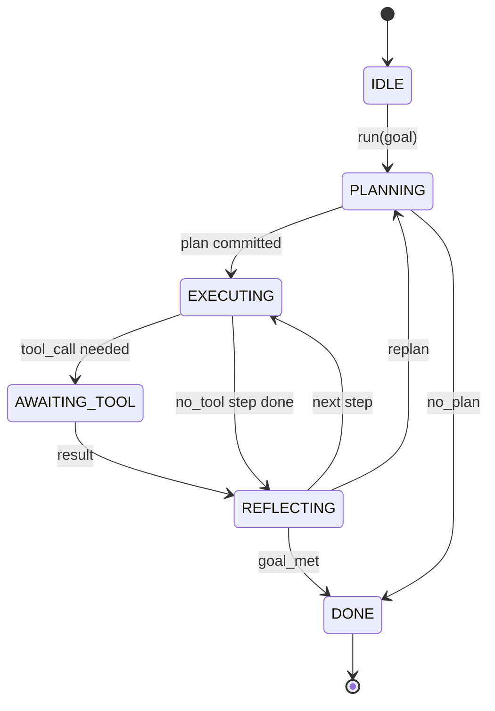

# Contrato de Loop do Agente Harness

> Harness é o agente. O modelo é o coprocessor.

**Type:** Build
**Languages:** Python
**Prerequisites:** Phase 13 lessons 01-07, Phase 14 lesson 01
**Time:** ~90 minutes

## Objetivos de aprendizagem


```figure
cf-loop-contract
```
- A máquina de estado de determinação de transições evidentes é definida por um agente.
-  implementar 10 tópicos de gancho do ciclo de vida, os operadores podem inserir políticas, telemetria e barris 
- Definir dois pontos de puxão, o ciclo em estas posições devolver o controle ao chamador e recuperar a entrada nova.
- 强制执行 per session budgets (turns, tool calls, wall-clock), simultaneamente em superlimit times não divulgar estado parcial:
- 发发含十一种事件类型的类型类型类型类型类型类型类型类型类型类型类型类型类型类型类型类型类型类型类型类型类型类型类型类型类型类型类型类型类型类型类型类型类型类型类型类型类型类型类型类型类型类型类型类型类型类型类型类型类型类型类型类型类型类型类型类型类型类型类型类型类型类型类型类型类型类型类型类型类型类型类型类型类型类型类型类型类型类型类型类型类型类型类型类型类型类型类型类型类型类型类型类型类型类型类型类型类型类型类型类型类型类型类型类型类型类型类型类型类型类型类型类型类型类型类型类型类型类型类型类型类型类型类型类型类型类型类型类型类型类型类型类型类型类型类型类型类型类型类型类型类型类型类型类型类型类型类型类型类型类型类型类型类型类型类型类型类型类型类型类型类型类型类型类型类型类型类型类型类型类型类型类型类型类型类型类型类型类型类型类型类型类型类型类型类型类型类型类型类型类型类型类型类型类型类型类型类型类型类型类型类型类型类型类型类型类型类型类型类型类型类型类型类型类型类型类型类型类型类型类型类型类型类型类型类型类型类型类型类型类型类型类型类型类型类型类型类型类型类型类型类型类型类型类型类型类型类型类型类型类

## 框架

Um agente de codificação sem ser humano de quatro ciclos não é um loop de chat. É uma máquina de estado, o operador pode interceptar seus nós, também pode auditar suas bordas. Uma vez que você escrever um contrato, substituir modelos, ferramentas ou políticas, não é mais uma reedição, mas se torna uma chamada de registro.

Este contrato é o que está sendo construído neste curso. Vamos nomear seis estados, dez tópicos, dois pontos de atracção, dez tipos de eventos, bem como um envelope orçamental.

## Estados

O loop tem seis estados. Cinco estão ativos. Um é terminal.



`IDLE`É o único ponto de entrada legal.`DONE`É a única exportação legal.`AWAITING_TOOL`É o único estado que produz ponto de atracção. Todas as outras transições são internas.

Esta máquina de estado é de certeza. Dá-se o mesmo registro de eventos, o arness vai reentrar no mesmo estado. Esta natureza permite que você possa reproduzir sessões para tentar, sem precisar re-reproduzir o modelo.

## tópicos de gancho

Hooks é o operador 接入ループ的接口──harness 会触发十个话题──cada tópico pode aceitar um número arbitrário de assinantes──Subscribers 按注册 顺序触发──um assinante pode mudar a carga útil、ar para abortar quando virar, ou retornar a um sentinela para saltar através do próximo passo──

```text
before_plan         after_plan
before_tool_call    after_tool_call
before_step         after_step
on_error
on_pause
on_budget_exceeded
on_complete
```

Esta forma mapeou o Claude Code, o Cursor e o OpenCode até o meio de 2025 e tendem a ser adotados.`rm -rf`O gancho está no lugar .`before_tool_call` Enviar o gancho do espaço de OpenTelemetry  colocar `after_step`                                                                                                                                                                                                                                                              `on_pause`- Não.

## pontos de puxão

O primeiro é que o meu pai está a fazer o que eu quero.`AWAITING_TOOL`Quando não tem resultados, não podemos continuar a avançar.`on_pause`Quando o orçamento se esgotar, ou um gancho,

Pulsão não é exceção. É uma volta.`resume(payload)`◊harness 会从停止的位置继续── é a mesma forma que o gerador Python──pull point                                                                                                                                                                                                                                                   `tools/call`                                                                                                                                                                                                                                                              

## fluxo de eventos

Loop 会在合同中特定位置把事件添加到打字流. Este fluxo é apenas append, os assinantes podem retransmitir de forma arbitrária.

- `session.start` 调用 `run(goal)`- Não .
- `plan.draft`Planeador  Retorno ao projeto de plano 时发出
- `plan.commit` Projeto submetido ao plano ativo 后发发
- `step.start` Cada passo de execução 开始时发出
- `step.end` Cada passo de execução 结束时发出
- `tool.call` 需要 tool 的步骤将控制权交给调用人 发发出
- `tool.result` Utilização de ferramenta resultado 恢复时发出
- `tool.error` Uso de erro 恢复时, ou gancho abortar chamada 时发出
- `budget.warn`  atingir o limite orçamental 时发出
- `session.pause` loop 因 pause (pausa)  orçamento ou gancho) 让出时发出
- `session.complete`O ciclo chega.`DONE`- Não .

eventos Não duplicar cargas úteis de gancho. Os ganchos são imperativos de mutação.

## Envelope orçamental

Uma sessão 携带三个限制──turn count、tool call count、wall-clock seconds── cada turno 会让转加一── cada chamada de ferramenta 会让工具调加一── cada transição de estado`on_budget_exceeded`, emissão`budget.warn`Depois , no próximo ponto de puxão , a transição para`IDLE`,并附带预算超越原因──

O orçamento não é um interruptor de execução. É um resultado.

## 本课不做什么

Não vai usar um modelo. Não vai registrar ferramentas reais. Não vai realizar transporte.

`main.py`O planejador determinista do meio é substituído. Ele retorna a um plano de três etapas codificado, dos quais dois precisam de um resultado de ferramenta.

## Como é que o meu nome é "Codex"

`HarnessLoop`É o principal tipo. Ele tem estado.`Budget`Com os limites.`Event`É o envelope tipado do fluxo superior.`HookRegistry`É a mesa de expedição.`_transition`É a única função que muda o estado, então as invariantes da máquina de estado estão concentradas em um lugar.

De cima para baixo`main.py`。 Então阅读 `code/tests/test_loop.py`Os testes vão fixar cada transição e cada ordem de disparo.

## Continuar em profundidade

Na construção de arnes no ambiente de produção, a parte mais difícil não é a máquina de estado, mas fazer o contrato ser executado. Este contrato deve suportar o planejador de recarga quente.`before_tool_call`Na classe de hoje, os testes serão cobertos por estes modos de falha.

O curso será adicionado ao Registro de Ferramentas. O curso será transportado por JSON-RPC. O curso será executado em função do orçamento real.
