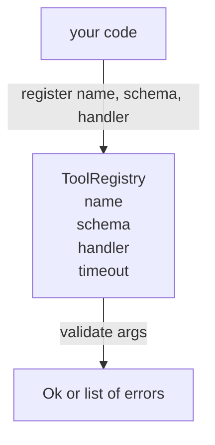

# 带 Schema Validation Tool Registry

> O agente 无法验证的工具,就是 agent 无法调用的工具――previamente construir registro 和 schema checker,再构建工具――

**Type:** Build
**Languages:** Python
**Prerequisites:** Phase 13 lessons 01-07, Phase 14 lesson 01
**Time:** ~90 minutes

## Objetivos de aprendizagem


```figure
cf-registry-validate
```
-  possuir um tipo de registro, nome de ferramenta de mapeamento → esquema → manipulador, deixe o despachador apenas precisar consultar uma vez, depois logo pode ser confiável
- 实现 JSON Schema 2020-12 的一个子集,覆盖百分之九十的工具调用 实际使用的关键字──
- 返回精确的、形如 json-pointer 的错路,让模型可以在一次往返内自我修改──
- Em caso de não haver uma supremacia evidente, recusar a reinscrição, porque a silenciosa cobertura é a razão de os catálogos de ferramentas de produção se deslocarem.
- 保持 validator 纯净(无I/O、无时间、无全球), para que possa ser re-executado no log de reprodução 上

## Por que o registro precisa de ferramentas

O agente de codificação de 2026 possui ferramentas registradas, comparado com o modelo, que podem ser colocadas em uma única janela de contexto. Uma arma de artifício anormal irá registrar duzentos ferramentas e expô-las em qualquer rodada. A única fonte de fato é que o registro é a única fonte de essas questões:

Nós devemos evitar erros, é publicar gestores sem esquemas, ou publicar esquemas sem validação. Ambas são muito comuns. Ambas transformam a camada inferior (de 23 a) em um jogo de adivinhação, e o único modelo de fracasso é o padrão de um gestor que deixa o rastro da pilha.

## registro de ferramentas 长什么样

```text
ToolRecord
  name        : str          (unique, lowercase alphanumeric and underscore segments separated by dots, e.g., snake_case.segment.case)
  description : str          (one line, shown to the model)
  schema      : dict         (JSON Schema 2020-12 subset)
  handler     : Callable     (async or sync, returns Any)
  idempotent  : bool         (dispatcher uses this for retry decisions)
  timeout_ms  : int          (override per-tool dispatcher default)
```

O esquema é o validador  única que vai tocar os segmentos ▌o manipulador para ele é opaco ▌.

## JSON Schema 2020-12 子集

A especificação completa para 2020-12 é um artigo.

```text
type           string / number / integer / boolean / object / array / null
properties     map of property name -> schema
required       list of property names
enum           list of allowed primitive values
minLength      integer, applies to strings
maxLength      integer, applies to strings
pattern        ECMA-262-compatible regex, applies to strings
items          schema applied to every array element
```

Este é suficiente para cobrir a ferramenta API                                                                                                                                                                                                                                                                                                                                                                                                                                                                                                                    

## Json ponteiro 错误路径

validação 失败时,validator 返回一个错误列表―― cada erro transporta uma direção para entrada 内部 json-pointer path──pointer é uma sequência de e-slope open, composta por nomes de propriedades e índices de matriz 组成──

```text
{"a": {"b": [1, 2, "x"]}}
                    ^
                    /a/b/2
```

modelo 读取错误 paths 的能力强于读取句子 的能力──如果 schema 要求 `args.user.email`, e o modelo 传入一个整数, erro 应该是 `/user/email`, e não tem .`expected_type: string`◊ modelo 会在下一次调用中修正它, não precisa de uma rodada de naturalization

## Registrar e revogar

`register(name, schema, handler, **opts)`默认拒绝重复注册──调用方必须传进 `override=True`才能替换── é um hábito de saúde no nível de operação── duas partes da biblioteca de códigos estão registradas silenciosamente no mesmo nome da ferramenta, é o tipo de bug que é encontrado durante a produção durante uma semana──

Registro de dados`get(name)`返回记录 或抛出异常──`validate(name, args)` Volta para um `Ok`Ou um grupo de erros.`names()`按注册顺序返回 ferramentas nomes。

## Validador é o quê, não é o quê

É uma única e repetida função de árvore de esquema. Não é uma função pura. Não é um tipo de transformação forçada.`"42"`Não vai passar pelo esquema numérico. Não vai ficar silencioso.

Não é uma fronteira de segurança. A validação é feita.

## Forma



## Como é que o meu nome é "Codex"

`code/main.py`Definindo`ToolRegistry`- Não.`ToolRecord`- Não.`ValidationError`, bem como oito funções de validador.`schema["type"]`Dispando ou...`enum`处理) ── cada validador de tipo ⋅ retornar a lista, ⋅ retornar ⋅ retornar `ValidationError`列表──altíssimo andarão 会拼接 errors, e em direção a regresso 列表──前置路段──

`code/tests/test_registry.py`覆盖登记"",override"",validation success"",带 paths"的验证失败,以及该子集中的每个关键词──

## Continuar em profundidade

Depois desta secção, você vai querer duas extensões são: para bloquear definições locais.`$ref`Resolução, bem como para formas rigorosas`additionalProperties: false`◊ ambos são muito pequenos. Com o catálogo de ferramentas crescendo para mais de cinquenta ferramentas, ambos são muito comuns.

下一课(twenty-two) vai construir JSON-RPC estúdio de transporte, colocar este registro 暴露给模型客户端──再下一课(twenty-three) vai colocar o outro em um timeout带和 retries 的发送器 后面──
