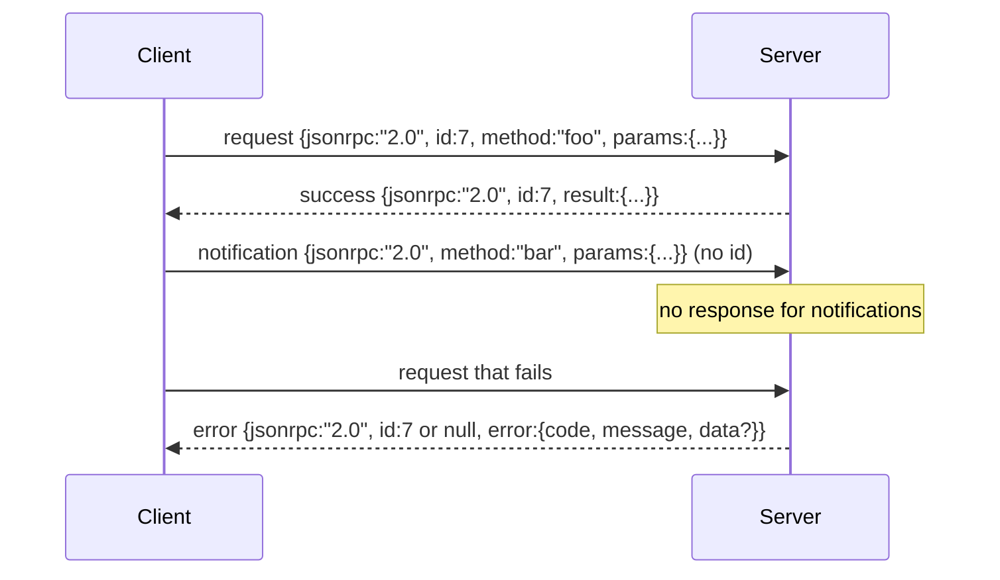

# Baseado em JSON-RPC 2.0 de Newline-Delimited Stdio

> O transporte entre o modelo cliente e o servidor de ferramentas é baseado em JSON-RPC de estúdio.

**Type:** Build
**Languages:** Python
**Prerequisites:** Phase 13 lessons 01-07, Phase 14 lesson 01
**Time:** ~90 minutes

## Objetivos de aprendizagem


```figure
cf-jsonrpc-frames
```
- Utiliza através de stdin 和 stdout 上的 newline-delimited JSON framing of JSON-RPC 2.0 通信──
- 映射五个标准错误代码(-32700, -32600, -32601, -32602, -32603),并以正确语义暴露它们──
- 区分请求,回应,通知和批发,而不发明新封面钥匙──
- Cada vez que se trata de um erro de análise, não se contamina o resto do fluxo.
- Utilize io.BytesIO  Construir uma demonstração que termina automaticamente, deixando o curso sem necessidade de gerar o processo infantil 即可运行──

## Por que o JSON-RPC continua a ser uma língua franca ?

Em 2026, um agente de codificação em uma única sessão pode juntar-se a 12 servidores de ferramentas 通信。 cada servidor é um processo independente ou endpoint remoto。 formato de fio desde 2013 vem sendo o mesmo。 JSON-RPC 2.0 é de duas páginas espec., pode sobreviver, é por causa de um esquema alternativo(gRPC、 cada vez que convocar um HTTP、 binário auto-definido) todos vão colocar JSON-RPC 没有取舍: eles vão estar em streaming、batching ou transporte-coupling 中选择其一── JSON-RPC em estúdios, sockets, websockets 和 HTTP 上是对称的,只要双方遵守规范,客户端可以驱动一个从未见过的服务器──

本课构建 stdio variant──Newline-delimited JSON──cada pedido é 一行──cada resposta é 一行──transporte boundary `\n`- Não.

## forma de fio

Existem quatro formas de envelope.



notificação 没有 `id` Servidor não tem que responder a ele. Se o servidor retorna a notificação, o cliente não tem como conectá-la a um site de chamada.

Batch é uma matriz de solicitações ou notificações JSON. Servidor  retorna a uma matriz de respostas, em ordem arbitrária, cada entrada sem notificação para responder a uma resposta.

## 五个 erro códigos

```text
-32700  Parse error      JSON could not be parsed
-32600  Invalid Request  Envelope shape is wrong
-32601  Method not found
-32602  Invalid params
-32603  Internal error
```

Os códigos entre -32000 e -32099  guardam-se para erros definidos pelo servidor. Todos os outros códigos são definidos pela aplicação.`data.exception`中放入 nome de classe de exceção。

Erro de análise Há uma regra especial.`id`Sim `null`, visto que a solicitação não foi analisada até o nível de obtenção de identificação.

## Quadro de linha nova e demonstração de BytesIO

transporte ̇ ̇ ̇ ̇ ̇ ̇ ̇ ̇ ̇ ̇ ̇ ̇ ̇ ̇ ̇ ̇ ̇ ̇ ̇ ̇ ̇ ̇ ̇ ̇ ̇ ̇ ̇ ̇ ̇ ̇ ̇ ̇ ̇ ̇ ̇ ̇ ̇ ̇ ̇ ̇ ̇ ̇ ̇ ̇ ̇ ̇ ̇ ̇ ̇ ̇ ̇ ̇ ̇ ̇ ̇ ̇ ̇ ̇ ̇ ̇ ̇ ̇ ̇ ̇ ̇ ̇ ̇ ̇ ̇ ̇ ̇ ̇ ̇ ̇ ̇ ̇ ̇ ̇ ̇ ̇ ̇ ̇ ̇ ̇ ̇ ̇ ̇ ̇ ̇ ̇ ̇ ̇ ̇ ̇ ̇ ̇ ̇ ̇ ̇ ̇ ̇ ̇ ̇ ̇ ̇ ̇ ̇ ̇ ̇ ̇ ̇ ̇ ̇ ̇ ̇ ̇ ̇ ̇ ̇ ̇ ̇ ̇ ̇ ̇ ̇ ̇ ̇ ̇ ̇ ̇ ̇ ̇ ̇ ̇ ̇ ̇ ̇ ̇ ̇ ̇ ̇ ̇ ̇ ̇ ̇ ̇ ̇ ̇ ̇ ̇ ̇ ̇ ̇ ̇ ̇ ̇ ̇ ̇ ̇ ̇ ̇ ̇ ̇ ̇ ̇ ̇ ̇ ̇ ̇ ̇ ̇ ̇ ̇ ̇ ̇ ̇ ̇ ̇ ̇ ̇ ̇ ̇ ̇ ̇ ̇ ̇ ̇ ̇ ̇ ̇ ̇ ̇ ̇ ̇ ̇ ̇ ̇ ̇ ̇ ̇ ̇ ̇ ̇ ̇ ̇ ̇ ̇ ̇ ̇ ̇ ̇ ̇ ̇ ̇ ̇ ̇ ̇ ̇ ̇ ̇ ̇ ̇ ̇ ̇ ̇ ̇ ̇ ̇ ̇ ̇ ̇ ̇ ̇ ̇ ̇ ̇ ̇ ̇ ̇ ̇ `\n`Se alguma linha não consegue paralisar, o transporte vai escrever numa banda.`id: null`A resposta do -32700 não continua. O fluxo não será contaminado.

Neste curso, nós vamos fazer um par.`io.BytesIO`包装成 stdin 和 stdout──server 读取 requisites até EOF,为每个请求 写进回复,然后返回──client 再读回回回复──没有过程 spawn──没有时间out──transport 行为与真实子进程管 完全相同,因为 Python 的`io`Interface  forneceu o mesmo `.readline()`和 `.write()`contrato.

## Disposição de método

Transporte não sabe quais são os métodos que existem.`handler(method, params)` manipulador  resultados de retorno ou抛出异常──三类例外 暴露特定代码──

```text
MethodNotFound -> -32601
InvalidParams  -> -32602
Anything else  -> -32603 with exception name in data
```

transporte  nunca verá o registro de ferramentas  registro  está localizado no controlador                                                                                                                                                                                                                                                                                                                                                                                                                                                                                                          

## erros  comportamento

```text
client writes              server reads             server writes
---------------            -----------              -------------
{...valid request...}      parses ok                {...response, id matches...}
{...broken json...         parse fails              {id:null, error: -32700}
{...valid request...}      parses ok                {...response, id matches...}
{...missing method...}     invalid envelope         {id:X, error: -32600}
```

Uma linha de JSON quebrada não vai parar de loopar.`method`campo Não vai parar de loopar.

## Notificações e fluxos de não-convergência

notificação é incêndio e esquecimento. Harness Utilize notificações Express progress events, cancelamento de sinais e linhas de log. Notificações.

本课实现一个出发通知助手,`write_notification` servidor em pedido   executado em uso                                                                                                                                                                                                                                                                                                                                                                                                                                                                                                                  

## Como é que o meu nome é "Codex"

`code/main.py`Definindo`StdioTransport`、parse ajudante(`parse_request`3) 、三 escriba assistentes`write_response`- Não.`write_error`- Não.`write_notification`), bem como o ciclo de expedição `serve`◊ constantes de código de erro ′ no âmbito do módulo。

`code/tests/test_transport.py`覆盖五个错误码、通知(不写回应)、批次(array in, array out, 跳过 notifications)、broken JSON(parse error 后继续),以及 handler 在调用中途写入通知的不对称流程──

## Continuar em profundidade

Este transporte 足以支后续课程──production transports 会添加三件事──一个能在转发后继续存在的相关性 id field你的`id`Já é isso, mas dentro da rede, você também precisa de um ID de rastreamento externo.`$/cancelRequest`de notificação, carrega o id da chamada de voo) ⋅ bem como um contato-tipo de negociação aperto de mão, deixe o mesmo socket pode simultaneamente dizer JSON-RPC e Streamable HTTP⋅ estes não vão mudar o fio⋅ eles só adicionar metadados⋅
