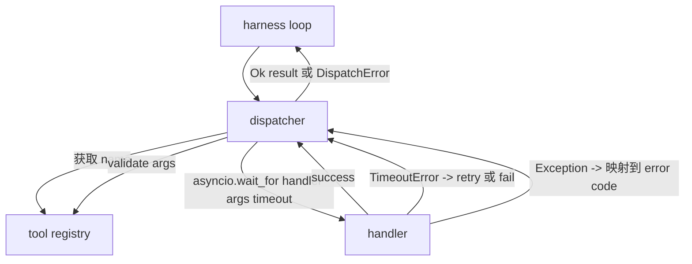
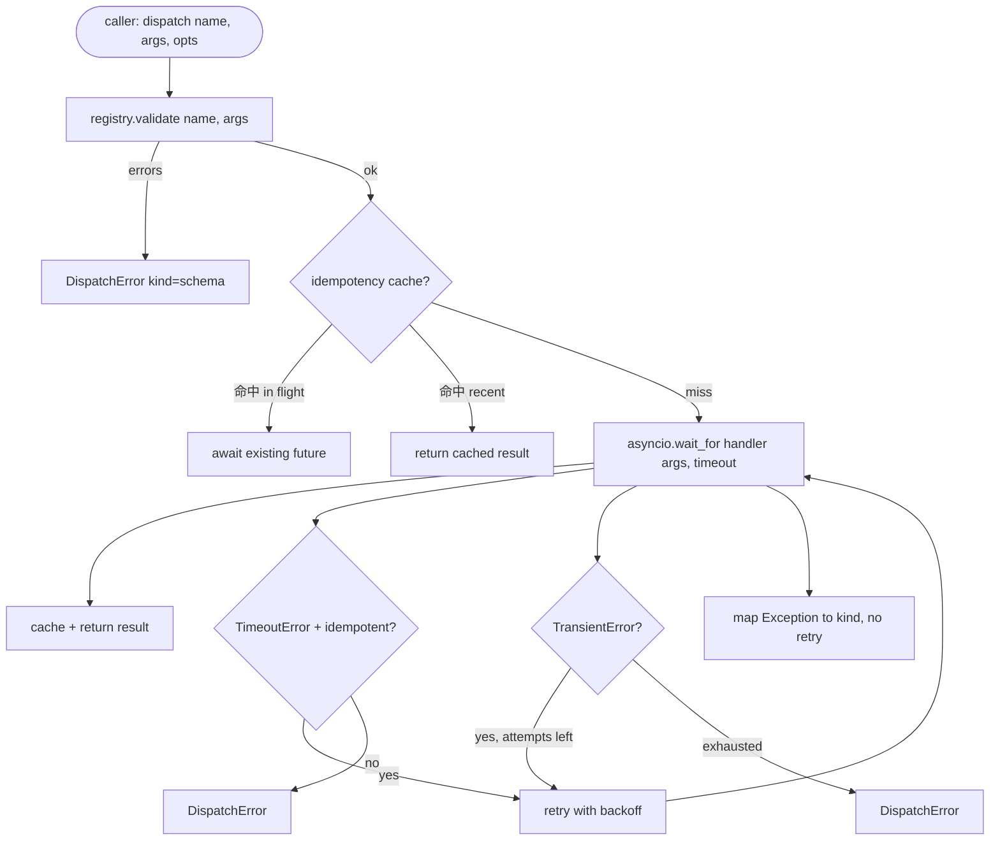

# Dispensador de chamadas de função

> O despachador é o arsenal para fazer um esquema em cada um dos locais de compra.

**Type:** Build
**Languages:** Python
**Prerequisites:** Phase 13 lessons 01-07, Phase 14 lesson 01
**Time:** ~90 minutes

## Objetivos de aprendizagem
- Use o timeout por chamada do gerenciador de ferramentas de embalagem, torná-lo de volta ao erro de digitação, em vez de deixar o loop pendurado.
- Aplicação de um retiro exponencial de tensão e maior número de tentativas.
- Baseado na chave de impotência para retestes, assim com o lento chamado original.
- Para lidar com exceções e falhas de transporte, o mapa é colocado no circuito de arneses, já compreendido.
- Usar o limite de concurência para despachar paralelamente, evitar quatro décadas de chamadas de ferramentas de fan-out


```figure
cf-dispatch-retry
```

## Onde o despachador está sentado

位于 harness loop(leção vinte) e registro de ferramentas(leção vinte e um) entre―transport(leção vinte e dois)向ループ 输入──loop 把 tool call 交给 dispatcher──dispatcher 调用 registro,运行处理器,并返回 result 或 JSON-RPC 形状的错误包──



O despachador é o único que sabe que há tempos, retiros e desemprego.

## Tempo de execução

Cada ferramenta tem um tempo de espera por defeito. Registo de registos.`timeout_ms`Quando o arnes 传入 per call override 时,dispatcher 会用它覆盖默认值──我们使用 `asyncio.wait_for` Out time 时, tarefa do administrador  会被取消,dispatcher 返回 `DispatchError(kind="timeout")`- Não.

Para ferramentas não idempotentes, o tempo de saída não é um erro retraiível.`db.write`Talvez já tenha sido enviado, talvez não.`idempotent`Bandera. Ferramentas idempotentes. Reprovar. Ferramentas não idempotentes.

## Retemps com retrocesso exponencial

Retry policy 最多三次尝试──Backoff é o retiro exponencial de jitter──

```text
attempt 1  -> delay 0
attempt 2  -> delay 0.1s * (1 + random[0..0.5])
attempt 3  -> delay 0.4s * (1 + random[0..0.5])
```

Só ...`timeout`和 `transient`Erros, vou tentar novamente.`schema`erro`not_found`Ou `internal`erro não vai retomar. Erros do esquema são definitivos. Retorno não vai alterar o resultado, apenas vai gastar orçamento.

Retry loop irá cumprir o orçamento dado. Se o orçamento do chamador estiver restante, o despachador vai falhar na primeira tentativa, e retornará.`kind="budget_exceeded"`- Não.

## Determinação da chave de impotência

Quando a chamada original está em voo, é um erro de produção real. Quando a chamada original está em voo, é um erro de produção real.`payments.charge`Já me puseste duas vezes.

Dispector  aceitação `idempotency_key`Se uma chamada chegar com a mesma chave está em voo, o emissor vai esperar o futuro em voo e retornar o resultado.

A chave é a responsabilidade do telefonista.`f"{step_id}:{tool_name}:{hash(args)}"`O despachador não vai criar a chave, porque só a partir de argumentos a chave de saída vai fazer duas chamadas diferentes semelhante.

## Envelope de erro

Despachar o defeito de volta a um único formato.

```text
DispatchError
  kind        : "timeout" | "transient" | "schema" | "not_found" | "internal" | "budget_exceeded"
  message     : str
  attempts    : int
  jsonrpc_code: int   （-32601、-32602、-32603 之一）
```

Loop do arame`kind`映射到下一个状态――`schema`和 `not_found`Entrar`on_error`Não me sinto bem.`timeout`和 `transient`Entrar`on_error`, , , também , , não , depende das tentativas .`budget_exceeded`触发 `on_budget_exceeded`- Não.

## Limite de concorrência para o desvio de ventiladores

`gather(*calls)`会同時运行所有 coroutines──四十工具通话意味着四十开插头或四十子处理管──大多数后台都不喜欢一个客户端发发发四十并行连接──

Dispector usando semáforo 包装 `gather`默认 concurrency limit is 八── cada chamada em despachamento  之前获得语音,并在完成时释放──调用者 看到的是 `gather`Output de forma, mas a programação real é de um certo nível.

## Flow para uma chamada



## Como ler o código

`code/main.py`Definindo`Dispatcher`- Não.`DispatchError`和 `TransientError` Dispensor em construção  Registro de recepção  Sincronização `dispatch(name, args, ...)`É o único ponto de entrada...`_run_with_retries`- Não .`asyncio.wait_for`Inline  aplicativo`gather_bounded(calls)`Em limite de concurência 运行多个发送──

`code/tests/test_dispatcher.py`覆盖 timeout 触发、transient 上的 retry、schema error 上不 retry、idempotency dedupe(dois chamadas simultâneas com a mesma chave 折叠为一次处理器调用), bem como limitando a concurência ((semaphore 生效) ⋅

Testes `asyncio.sleep(0)`E baseado em determinação`Counter`Os manipuladores, então eles serão concluídos em mil segundos, não dependem do tempo do relógio de parede.

## Vai mais longe

Os despachadores de produção vão adicionar duas expansões. Primeiro, em cada transição, realizar logging estruturado.`dispatch.attempt`和 `dispatch.retry`Eventos)── Segundo, interruptores de circuito: numa janela ocorrer N 次失败后, ferramenta  entrar em período de arrefecimento, remessas 会立即返回 `kind="circuit_open"`Não é um manipulador de tentativas.

Lição 24 Vai-te juntar ao agente de planejamento e execução, deixe-te ver quatro partes juntos.
