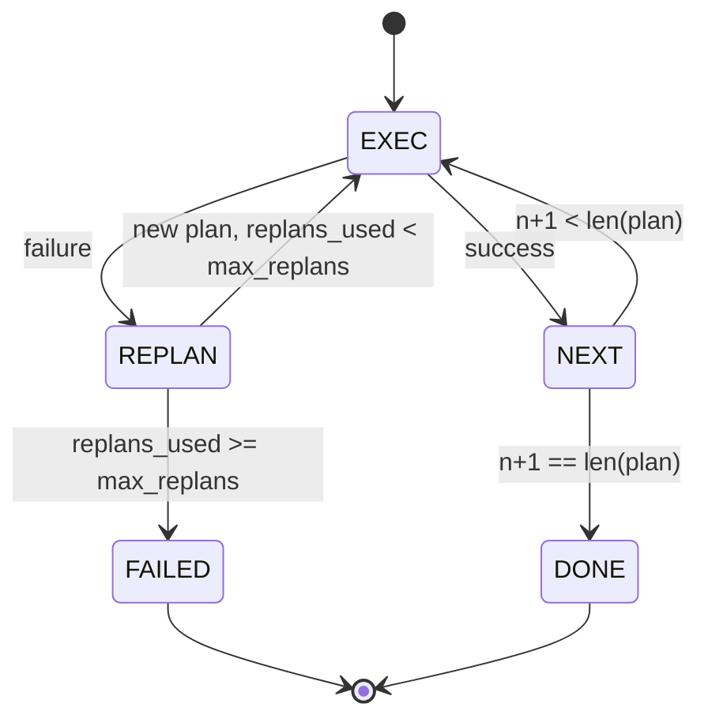

# Fluxo de controlo planeamento-execução

> O plano de incapacidade de suportar o fracasso é o script.

**Type:** Build
**Languages:** Python
**Prerequisites:** Phase 13 lessons 01-07, Phase 14 lesson 01
**Time:** ~90 minutes

## Objetivos de aprendizagem


```figure
cg-plan-replan
```
- O plano será exibido em uma lista de etapas tipografadas, permitindo que o executor possa avaliar o progresso e o resultado.
- 顺序执行 steps,并将 fail 受控地 handoff 回规划者──
- Do cursor atual  começar a replanar, e no contexto com o erro anterior, deixe o próximo plano  更有信息──
- Cada revisão emitir plano diferente, fazer o traçador de deslocamento ou UI 能展示 plan 为什么改变──
- 强制执行两个预算:硬性阶梯上限和硬性复制上限――

## Planejar e executar, em vez de ser uma cadeia de pensamento

Agente de cadeia de pensamento irá emitir tokens,并让loop 猜测 tool call 在哪里结束──plano-e-execute agente primeiro emitir um plano estruturado, então determinar e executar cada passo──plano é aproveitar dados introspectivos──execução é aproveitar 通过发送机运行这些数据──

两个部分──一个规划者 产生计划──一个执行者 运行计划──真正意义是执行者 遇到失败 时发生什么──三个选项:

```text
1. Abort         （返回 failed，暴露 error）
2. Skip          （将 step 标记为 failed，继续剩余部分）
3. Replan        （把 error 交给 planner，从 cursor 获取新 plan）
```

Replan é transformar o script em agente de opções.

## Forma do passo

```text
Step
  id              : int           （在一个 plan revision 内单调递增）
  tool_name       : str
  args            : dict
  expected_outcome: str           （planner 声明的 success condition）
  result          : Any | None
  error           : str | None
```

`expected_outcome`É um planejador e um passo em que um executor não força a inspeção. Ele tem dois usos: replanner em plano de revisão  quando lê-lo; evento fluxo emitir, deixe o rastreador pode mostrar este passo.

## Forma do planejador

```python
def planner(goal: str, history: list[Step], last_error: str | None) -> list[Step]:
    ...
```

Uma função pura.`goal`É o objetivo do usuário.`history`Já foram executados os passos ((realizados resultados e erros)`last_error`Durante a primeira chamada foi Nenhum, após cada chamada foi a última mensagem de falha. Planner retornou do cursor para o próximo plano.

Planeador Não sabe executor Não sabe retemptadas Não sabe datas Não sabe apenas produzir um plano

## Execução

Executor é uma pequena máquina de estado. Cada passo passa por um despachador. O resultado é: sucesso, falha, planeja-se.`FAILED`Resultado da sessão.



## Revisão 时的计划 diff

Quando o planejador falha, o executor vai emitir um que contém três segmentos.`plan.diff`Evento

```text
removed: 旧 plan 中存在但新 plan 中不存在的 step ids 列表
added  : 新 plan 中存在但旧 plan 中不存在的 step ids 列表
revised: tool_name 或 args 已改变的 step ids 列表
```

O tracer ou UI pode transformá-lo em um destaque de passos removidos, bem como em outros adicionados.

##  2 orçamento

`max_steps`limitar a sessão inteira de execuções de todos os passos, incluindo replans. 默认是十二──一线性的五步计划, se o replán 两次并且每次增加三步,将达到十六次执行,从而超过预算.

`max_replans`限制第一次计划 后规划师 被调用次数――默认是五――这是更重要的限制――一个连续五次回归同一个破碎的计划规划师,否则会一直循环,直到步骤预算 抓获它――限制重规划会让失败更快发生,原因也更清楚――

## Planador determinista do 本课中

Esta lição não utiliza modelo. Lição fornece um planejador determinista, baseado em`last_error`选择 plan──

```text
last_error is None    -> emit 一个 four-step plan
last_error matches X  -> emit 一个绕过 X 的 three-step plan
last_error matches Y  -> emit 一个优雅放弃的 two-step plan
otherwise             -> return []（表示没有内容可 replan）
```

Este é o teste executor em cada etapa de transição.

## Forma do resultado

```text
SessionResult
  status      : "completed" | "failed"
  reason      : str     ("goal_met" | "step_budget" | "replan_budget" | "no_plan")
  history     : list[Step]
  revisions   : list[PlanDiff]
  events      : list[Event]
```

lição vinte Lugar de arnesagem do meio pode ser lido diretamente Lição vinte e três do meio dispector executar cada passo Lição vinte e um do meio registro validar cada passo de arguments Lição vinte e dois do meio de transporte Vai através de JSON-RPC irá exposição ao fluxo inteiro do modelo cliente

## Como ler o código

`code/main.py`Definindo`PlanExecuteAgent`- Não.`Step`- Não.`PlanDiff`- Não.`SessionResult`E o planejador determinista é o executor.`run(goal)`Método, regresso `SessionResult`◊ plano diferença                                                                                                                                                                                                                                                                                                                                                                                                                                                                                                                         `(tool_name, args)`Duplos 计算。

`code/tests/test_agent.py`覆盖 linear success 一次中计划失败 后重计划 返回 `failed:replan_budget`De novo, o programa de programação é de um modo mais variado.

## Vai mais longe

连接到真实模型 后,你会需要两个扩展──第一,部分计划缓存:当一个计划的六个步骤 中前三个成功、后失败时,你不想重新运行前三个──执行者 已保留历史;planner 只需要读取它──第二, ramos paralelas:当前执行者是严格序列的──发行独立分支`gather_step`Não é?`next_step`O planejador pode viajar o despachador em simultâneo

 ambos aumentam a complexidade real  quando o executor é fixado, ambos são mais fáceis de adicionar  é isso que esta lição faz
