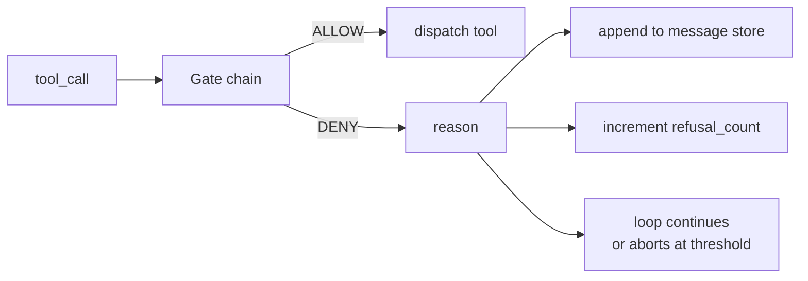
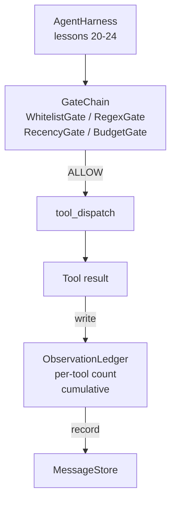

# Capstone 第 25 课: Portas de Verificação e Orçamento de Observação

>  não há nível de verificação de agente, apenas se divulga a vontade do exterior.  本课会构建确定性门链,用来决定是否允许一次工具调用 触发、代理可以看到多少输出,以及当代理 已读取太多内容时循环 何时必须停止── esta cadeia é composta por pequenos、名字的门加上观察账本 组成; ledger 会追踪已经显示给模型的每个代币──

**Type:** Build
**Languages:** Python (stdlib)
**Prerequisites:** Phase 19 · 20-24（Track A1：agent loop、tool registry、message store、prompt builder、model router），Phase 14 · 33（instructions as constraints），Phase 14 · 36（scope contracts），Phase 14 · 38（verification gates）
**Time:** ~90 minutes

## Objetivos de aprendizagem

- Construção com certeza `evaluate(call)`- Como é que é ?`VerificationGate`Protocolo
- O orçamento, a recência, a lista branca e os portões regex são compostos com uma cadeia de curto-circuitos.
-  através de ferramenta e virar  建索引 `ObservationLedger`- Segue-a a cada observação.
- Quando o orçamento acumulado de observação for ultrapassado, rejeite uma chamada de ferramenta.
-  expositória estruturada `GateDecision`registros,供下游 observabilidade 摄取──

## 问题

Quando o agente utiliza o modelo para liberar as ferramentas, três tipos de bugs aparecem na primeira hora de uso real.

Primeiro é a observação infinita. Em relação a um repo de 200.000 linhas, o grep executivo coloca a saída de 500.000 tokens para a próxima rodada.

Segundo tipo é o recente impasse. Uma tarefa de longo tempo em execução acumula 50 vezes as chamadas de ferramentas. O modelo coloca o primeiro arquivo de leitura da terceira rodada quando o estado de tempo real é relegido.

III. É um privilégio de se envolver.`web_search`Começou, depois não sei como é que funciona.`shell`, porque o modelo criou um nome de ferramenta, e aproveita o 默认宽松──等有人读取痕迹时,/tmp 里已经放一个垃圾文件,并且一次卷 已经打到了私有API──

A porta de verificação é o arneses, e é responsável por dizer que não é um componente.`(call, history, ledger)`A função de determinação, devolver ALLOW ou DENY, não acompanha razão.

## 概念



O portão é qualquer coisa que tenha .`evaluate(call, ctx) -> GateDecision`方法的对象──chain 是一个有序列表──evaluation 在第一次否定时短路──顺序很重要:便宜的结构性门 会先于昂贵的代币计数门 运行──

本课提供四门:

- `WhitelistGate` Os nomes permitidos das ferramentas são um conjunto manifesto. Qualquer conteúdo fora do conjunto será negado.
- `RegexGate`◊ Argumentos de ferramentas 会与 regex 匹配──适合拒绝包含 `rm -rf`As chamadas de shell, ou as chamadas HTTP de IP internas. Depende apenas da carga útil da chamada.
- `RecencyGate`◊ Modelo só pode ver observações recentes de N 轮 ◊ Observações mais antigas serão obstruídas ◊ O portal irá rejeitar os seus resultados e expandir uma janela de observação já expirada chamada de ferramenta ◊
- `BudgetGate` Modelo em toda a sessão, em conjunto, tokens de leitura têm um limite superior.

O livro de observação 负责记账―― cada vez que o instrumento é bem sucedido, o nome do instrumento, o turno, os tokens emitidos, o livro de notas responde duas perguntas: modelo total viu o quanto, bem como o quanto viu o instrumento X.


```figure
cg-gate-chain
```

## Arquitetura



Harness 会询链──链 要么点头,要么拒绝──如果它点头,工具会运行, ledger 会计数,结果将被添加到消息存储──如果它拒绝,模型将以系统消息形式获得拒绝,然后循环决定是重试还是停止──

## Você vai construir o que

                                                                                                                                                                                                                                                                                                                                                                                                                                                                                                                             `main.py`- Teste de saúde.

1. `Observation`和 `ToolCall`Classe de dados  define formas de fio。
2. `ObservationLedger` registos `(turn, tool, tokens)`linhas,并回答 `cumulative()`和 `per_tool(name)`- Não.
3. `GateDecision`- Não .`(allow, reason, gate_name)`- Não.
4. `VerificationGate`É um protocolo. Todos os portões foram implementados.`evaluate(call, ctx)`- Não.
5. `GateChain`Envolve uma lista de números. Reajusta cada porta e volta à primeira.
6. O processo de desenvolvimento de um novo sistema de gestão de dados é um processo de desenvolvimento de dados e de dados.

Contador de tokens , muito grosseiro .`len(text) // 4`Heurística. 本课重点是门管,而不是代币器.

## Por que a cadeia é importante

Uma vez negar, mais uma vez permitir, mais barato.`WhitelistGate`运行 $O(1)$- Não.`RegexGate`运行 $O(\text{pattern} \cdot \text{argv})$- Não.`RecencyGate`读取 mensagem loja de uma pequena fatia.`BudgetGate`读取整个账簿──你需要按成本升序排列它们,这样被拒绝的电话就能在执行昂贵的工作前短路──

Você também deve seguir o raio da explosão 排序──Whitelist 是最强的主张: este instrumento Não está no contrato 中──regex gate 其次: este argumento Não está no contrato 中──Recensão 仍然关心,但调用 在结构上是合法的──Budget 放在最后,因为按照定义,它只会在其他检查都通过后触发──

## Como é que ele se combina com o resto da pista A?

 O curso anterior já lhe deu um loop, registro de ferramentas, armazenamento de mensagens, construtor de águas-vivas e roteador de modelos.  O curso adicionou modelos e ferramentas entre as camadas.  O curso 26  O curso 26  O curso 26  O curso 26  O curso 26  O curso 27  O curso 27  O curso 27  O curso 27  O curso 27  O curso 27  O curso 27  O curso 27  O curso 27  O curso 27  O curso 28  O curso 28  O curso 28  O curso 28  O curso 28  O curso 28  O curso 28  O curso 28  O curso 28  O curso 28  O curso 28  O curso 28  O curso 28  O curso  O curso  O curso  O curso  O curso  O curso  O curso  O curso  O curso  O curso  O curso  O curso  O curso  O curso  O curso  O curso  O curso  O curso  O curso  O curso  O curso  O curso  O curso  O curso  O curso  O curso  O curso  O curso  O curso  O curso  O curso  O curso  O curso  O curso  O curso  O curso  O curso  O curso  O curso  O curso  O curso  O curso  O curso  O curso  O curso  O curso  O curso  O curso  O curso  O curso  O O O O curso  O O O curso  O O O O O O O O O O O O O O O O O O O O O O O O O O O O O O O O O O O O O O O O O O O O O O O O

## 运行方式

```bash
cd phases/19-capstone-projects/25-verification-gates-observation-budget
python3 code/main.py
python3 -m pytest code/tests/ -v
```

O teste de um novo portão de entrada, um curto-circuito de cadeia, e um circuito sintético de terminação a terminação, incluem:
