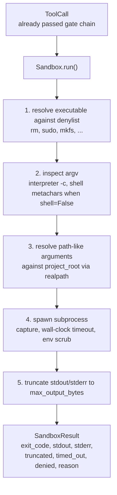
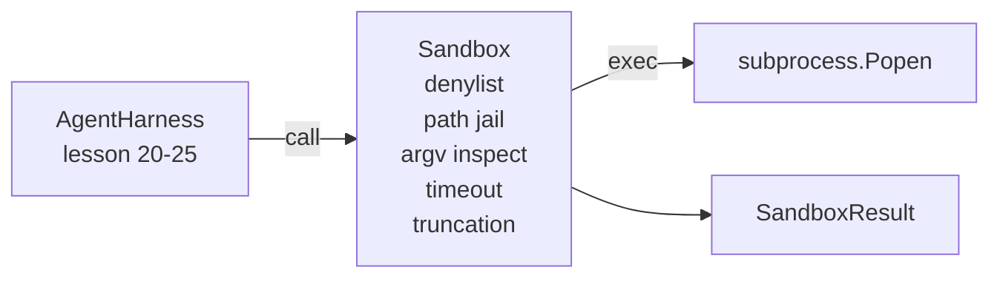

# Capstone 第 26 课:带 Denylist 与 Path Jail  Sandbox Runner

> O gate de verificação decide uma chamada de ferramenta se deve ser executado. O sandbox decide o que acontecerá quando ele for executado. Este curso fornece um subprocesso executável, que rejeitará executáveis perigosos, rejeitará formas de argv perigosas, irá limitar cada caminho de arquivo na raiz do projeto, cortar a saída de massa e, no tempo limite do relógio de parede, matar processos fugitivos.

**Type:** Build
**Languages:** Python (stdlib)
**Prerequisites:** Phase 19 · 25（verification gates and observation budget），Phase 14 · 33（instructions as constraints），Phase 14 · 38（verification gates）
**Time:** ~90 minutes

## Objetivos de aprendizagem

- Construir um pacote`subprocess.run`de `Sandbox`A classe, o tempo de espera, a captura e a truncadação.
- 按名称通过 denylist、按结构通过 argv inspector 拒绝命令──
- Rejeitar qualquer argumento de caminho fora da raiz do projeto do declarativo.
- Em modo shell 关闭时拒绝 shell metacharacters──
-  返回结构化   retornar à estruturação `SandboxResult`, , , , , , , , , , , , , , , , , , , , , , , , , , , , , , , , , , , , , , , , , , , , , , , , , , , , , , , , , , , , , , , , , , , , , , , , , , , , , , , , , , , , , , , , , , , , , , , , , , , , , , , , , , , , , , , , , , , , , , , , , , , , , , , , , , , , , , , , , , , , , , , , , , , , , , , , , , , , , , , , , , , , , , , , , , , , , , , , , , , , , , , , , , , , , , , , , , , , , , , , , , , , , , , , , , , , , , , , , , , , , , , , , , , , , , , , , , , , , , , , , , , , , , , , , , , , , , , , , , , , , , , , , , , , , , , , , , , , , , , , , , , , , , , , , , , , , , , , , , , , , , , , , , , , , , , , , , , , , , , , , , , , , , , , , , , , , , , , , , , , , , , , , , , , , , , , , , , , , , , , , , , , , , , , , , , , , , , , , , , , , , , , , , , , , , , , , , , , , , , , , , , , , , , , , , , , , , , , , , , , , , , , , , , , , , , , , , , , , , , , , , , , , , , , , , , , , , , , , , , , , , , , , , , , , , , , , , , , , , , , , , , , , , , , , , , , , , , , , , , , , , , , , , , , , ,

## 问题

能够 shell out 能够 shell out 能够在一轮内安装后门、外泄钥、损坏开发人员笔记本电脑,并产生云账单――成本最低的防御是不给它 shell――成本第二低的是一个会对精确的图案列表说不的沙盒――

Traços de agente 中反复出现三类失败──

Primeiro tipo são executáveis perigosos. Um está em caminho de reparação.`sudo`- Não.`chmod -R 777`- Não.`rm -rf`- Não.`mkfs`- Não.`dd` Estes não pertencem a um agente.

Segundo tipo de truques de argv. Um acusado não pode usar o modelo de shell, passando por um ataque de tubulação:`python3 -c "import os; os.system('rm -rf /')"`- Não.`bash -c '...'`- Não.`node -e '...'`- Não.`perl -e '...'`Sandbox precisa de saber, qualquer coisa assim.`-c`A execução do intérprete da bandeira é, na verdade, apenas um pouco mais de um chamamento de shell.

III. Classe é fuga de caminho.`./src/main.py`- Não, não.`../../etc/passwd`Sandbox 会通过`os.path.realpath`解析 cada argumento de caminho,并断言其前,从而将它们限制在监狱内──

Esta caixa de areia não é um limite de segurança no sentido do sistema operacional. Um atacante firme que possui execução de código ainda pode escapar. Esta caixa de areia é um guarda-roupa do tempo de desenvolvimento.

## 概念



Sandbox tem quatro eixos de recusa: nome,argv,pato,estrutura. Cada eixo são puras funções da chamada, neste momento ainda não há subprocesso.

`SandboxResult`Códigos de saída Utilize habitu例值:0 表示成功,非零表示失败,另外有三个哨码:denied (-100)、timed_out (-101) 和 truncated(exit code 是真实值,同时设置旗)。下游课程会读取这个结构化结果,而不是解析 stderr。


```figure
cg-path-jail
```

## Arquitetura



Denylist é um nome base executable.`/bin/rm`- Não.`/usr/bin/rm`)都会解析到相同的基名──argv inspector 了解解释器形:任何 argv[0] 是解释器 且后续任一 arg 以 `-c`Ou `-e`Quando o telefone for desligado, não há nenhuma solicitação.`;`- Não.`|`- Não.`&`- Não.`>`- Não.`<`- As mochilas.`$()`) levará a recusa¬¬¬¬¬¬¬¬¬¬¬¬¬¬¬¬¬¬¬¬¬¬¬¬¬¬¬¬¬¬¬¬¬¬¬¬¬¬¬¬¬¬¬¬¬¬¬¬¬¬¬¬¬¬¬¬¬¬¬¬¬¬¬¬¬¬¬¬¬¬¬¬¬¬¬¬¬¬¬¬¬¬¬¬¬¬¬¬¬¬¬¬¬¬¬¬¬¬¬¬¬¬¬¬¬¬¬¬¬¬¬¬¬¬¬¬¬¬¬¬¬¬¬¬¬¬¬¬¬¬¬¬¬¬¬¬¬¬¬¬¬¬¬¬¬¬¬¬¬¬¬¬¬¬¬¬¬¬¬¬¬¬¬¬¬¬¬¬¬¬¬¬¬¬¬¬¬¬¬¬¬¬¬¬¬¬¬¬¬¬¬¬¬¬¬¬¬¬¬¬¬¬¬¬¬¬¬¬¬¬¬¬¬¬¬¬¬¬¬¬¬¬¬¬¬¬¬¬¬¬¬¬¬¬¬¬¬¬¬¬¬¬¬¬¬¬¬¬¬¬¬¬¬¬¬¬¬¬¬¬¬¬¬¬¬¬¬¬¬¬¬¬¬¬¬¬¬¬¬¬¬¬¬¬¬¬¬¬¬¬¬¬¬¬¬¬¬¬¬¬¬¬¬¬¬¬¬¬¬¬¬¬¬¬¬¬¬¬¬¬¬¬¬¬¬¬¬¬¬¬¬¬¬¬¬¬¬¬¬¬¬¬¬¬¬¬¬¬¬¬¬¬¬¬¬¬¬¬¬¬¬¬¬¬¬¬¬¬¬¬¬¬¬¬¬¬¬¬¬¬¬¬¬¬¬¬¬¬¬¬¬¬¬¬¬¬¬¬¬¬¬¬¬¬¬¬¬¬¬¬¬¬¬¬¬¬¬¬¬¬¬¬¬¬¬¬¬¬¬¬¬¬¬¬¬¬¬¬¬¬¬¬¬¬¬¬¬¬¬¬¬¬¬¬¬¬¬¬¬¬¬¬¬¬¬¬¬¬¬¬¬¬¬¬¬¬¬¬¬¬¬¬¬¬¬¬¬¬¬¬¬¬¬¬¬¬¬¬¬¬¬¬¬¬

O caminho da prisão é a parte mais delicada.`project_root`                                                                                                                                                                                                                                                              `/`Ou seja, correspondente a documentos existentes) todos passam`os.path.realpath`归一化,然后与项目根的真实路比较──如果解析后的目标不在根下,则拒绝──Symlink escape attempts(project root 中指向外部的 symlink) será verificada realpath 阻止, em vez de verificar字面路径──

## Você vai construir o que

实现是 `main.py`Mais um teste.

1. `SandboxResult`dataclass:exit_code、stdout、stderr、truncated、timed_out、denied、reason、duration_ms。
2. `SandboxConfig`dataclass:project_root、max_output_bytes、timeout_secondes、denylist、interpreter_block。
3. `Sandbox`classe:`run(argv, *, shell=False, cwd=None)` Retorno `SandboxResult`- Não.
4. 内部 auxiliares de recusa:`_check_executable_denylist`- Não.`_check_argv_interpreter`- Não.`_check_shell_metachars`- Não.`_check_path_jail`- Não.
5. Truncation de saída,带清晰的 `truncated`bandeira e fluxo capturado
6. 底部 демо:一系列合法与反抗呼叫──cada chamada cidade irá mostrar o seu resultado──

caixa de areia 默认使用 `subprocess.run`且 `shell=False`- Não.`capture_output=True`△ Tempo de espera do relógio de parede `timeout`Argumento:`TimeoutExpired`O grupo de processo de assassinato da Sandbox e a composição de um resultado da Sandbox.

## Porque não é uma caixa de areia real ?

O "sandbox" do presente curso não usa espaços de nome, grupos, segmentos, segmentos, gVisor, Firecracker ou qualquer isolamento a nível de núcleo.

 para agentes de produção, você precisa sobrecarregar: em contêiner docker não privilegiado  em microVM  funcionalidades de drop  vai projeto raiz                                                                                                                                                                                                                                                                                                                                                                                                                                                                                     

## 运行方式

```bash
cd phases/19-capstone-projects/26-sandbox-runner-denylist
python3 code/main.py
python3 -m pytest code/tests/ -v
```

Demo 会 criar um diretório temporário, colocar em um arquivo de qualidade, então executar um grupo de chamadas.`denied=True`E o resultado da "Reflexão"`timed_out=True`❖ Truncation 会设置 `truncated=True`◊demo 会印结果的JSON table,并以零退出──

## Como é que ele se combina com o resto da pista A?

Seção 25 课产出门链. Seção 26 课课后运行 gate ALLOW. 后运行执行人. Seção 27 课后运行 gate ALLOW. 课后运行执行人. Seção 27 课后运行 gate ALLOW. 课后运行 gate ALLOW. 课后运行 gate ALLOW. 课后运行 gate ALLOW. 课后运行 gate ALLOW. 课后运行 gate ALLOW. 课后运行 gate ALLOW. 课后运行 gate ALLOW. 课后运行 gate ALLOW. 课后运行 gate ALLOW. 课后运行 gate ALLOW. 课后运行 gate ALLOW. 课后运行 gate ALLOW. 课后运行 gate ALLOW. 课后运行 gate ALLOW. 课后运行门后运行. 第 26 课后运行门后运行门门门门门门门门门门门门门门门门门门门门门门门门门门门门门门门门门门门门门门门门门门门门门门门门门门门门门门门门门门门门门门门门门门门门门门门门门门门门门门门门门门门门门门门门门门门门门门门门门门门门门门门门门门门门门门门门门门门门门门门门门门门门门门门门门门门门门门门门门门门门门门门门门门门门门门门门门门门门门门门门门门门门门门门门门门门门门门门门门门门门门门门门门门门门门门门门门门门门门门门门门门门门门门门门门门门门门门门门门门门门门门门门门门门门门门门门门门门门门门门门门门门门门门门门门门门门门门门门门门门门门门门门门门门门门门门门门门门门门门门门门门门门`Sandbox.run`- Não . - Não .`gen_ai.tool.execution`O programa de demonstração de 29 de curso vai colocar um agente de codificação real em ambos os níveis.
