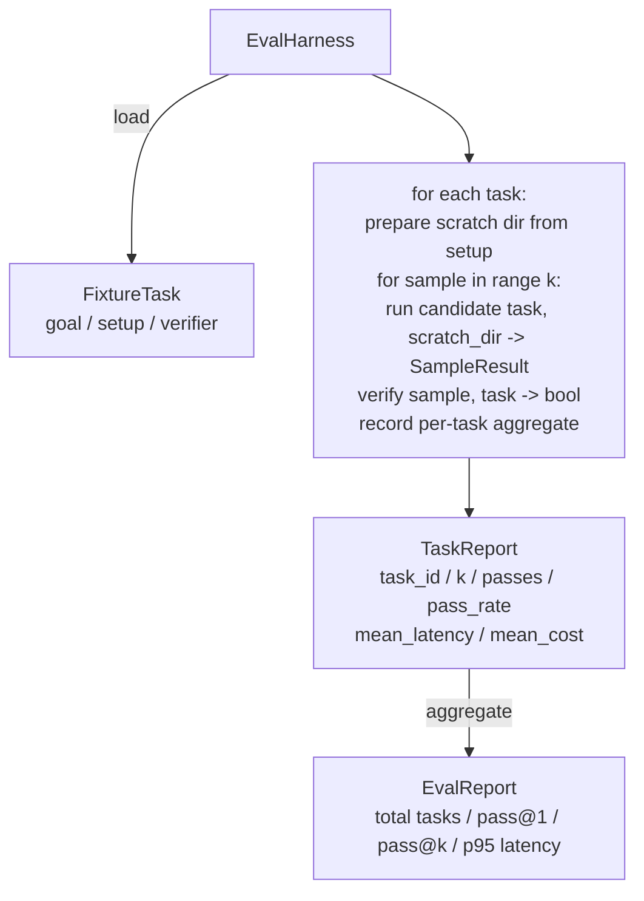

# Lição de Capstone 27: 带 Fixture Tasks of Eval Harness

> O nível de um agente de codificação depende do que você use para medir seu conjunto de tarefas. Este curso irá construir um arsenal de avaliação: ele recebe uma tarefa fixa.

**Type:** Build
**Languages:** Python (stdlib)
**Prerequisites:** Phase 19 · 25 (verification gates), Phase 19 · 26 (sandbox runner), Phase 14 · 30 (eval-driven agent development), Phase 14 · 19 (SWE-bench and GAIA benchmarks)
**Time:** ~90 minutes

## Objetivos de aprendizagem

- 将 fixture task 定义为目标、setup 和 verificador 的三元组──
- Para cada tarefa, várias vezes, a amostra corre 打分,并计算 pass@1 和 pass@k。
- A taxa de atraso e o custo são combinados para a média com as métricas de 95%.
- Será verificadores de determinação ((file diff、exit code、regex match)
- 输出结构化 JSON report,供回归跟踪脚本 摄取──

## O problema

 Sem valorizar, em termos de construção de agentes,  encontrará três tipos de falhas.

Primeiro é o passaporte não experimentado. O agente diz que ele corrigido o bug, humano, de uma vez diferente, coloca o conjunto em verde, três semanas depois do teste de regressão.

O segundo tipo é a regressão não detectada. Uma vez modificada a template de um instante, o agente aumenta 4% nas tarefas visíveis, mas cai 14% nas tarefas silenciosas.

O terceiro é a transferência de missões por missões. O primeiro utilizou 100 missões, o segundo utilizou apenas 95 delas, porque alguém renomeou 5 equipamentos.

Harness é um processo que transforma esses fracassos em fatos. Ele funciona em ordem repetível em cada fixação, e usa um verificador, que retorna a verdade ou falso, de acordo com a determinação.

## O conceito

```mermaid
flowchart LR
  F1[fixtures/task_001/<br/>task.json + expected/] --> Harness
  F2[fixtures/task_002/<br/>...] --> Harness
  Harness[Harness<br/>for each task:<br/>setup / run agent k samples /<br/>verify each sample /<br/>record latency, cost]
  Harness --> Report[EvalReport<br/>pass@1 / pass@k<br/>mean ms / p95 ms<br/>mean cost]
```

`FixtureTask`É um pequeno arquivo JSON, adicionado a um opcional.`expected/`目录──JSON 声明 `id`- Não.`goal`(给代理的提示)`setup`块(要放入 scratch dir 的文件) bem como `verifier`块──verifier 块指定 harness 块指定 harness 块指定 harness 块指定 harness 块指定 harness 块指定 harness 块指定 harness 块指定 harness 块指定 harness 块指定 harness 块指定 harness 块──verifier 块──verifier 块──verifier 块──verifier 块──verifier 块──verifier 块──verifier 块──verifier 块──verifier 块──verifier 块──verifier 块──verifier 块──verifier 块──verifier 块──verifier 块──verifier 块──verifier 块──verifier 块──verifier 块──verifier 块──verifier 块──verifier 块──verifier 块──verifier 块──verifier 块──verifier 块──verifier 块──verifier 块──verifier 块──verifier 块──verifier 块──verifier 块──verifier 块──verifier 块──verifier 块──verifier 块──verifier 块──verifier verifier 块──verifier verifier verifier verifier verifier verifier verifier verifier verifier verifier verifier verifier verifier verifier verifier verifier verifier verifier verifier verifier verifier verifier verifier verifier verifier verifier verifier verifier verifier verifier verifier verifier verifier verifier verifier verifier veri veri veri verifier veri veri veri veri veri verifier veri veri veri veri veri veri veri veri veri veri veri veri veri veri veri veri veri veri veri veri veri veri veri veri veri veri veri veri veri veri veri veri veri veri veri veri veri veri veri veri veri veri veri veri veri veri veri veri veri veri veri veri veri veri veri veri veri veri veri veri veri veri 

Três tipos de verificador 形态覆盖大多数有用任务――

A primeira é:`file_equals`◊ agente  após a execução, irá definir o arquivo com o conteúdo esperado comparar.

Segundo é:`regex_match`                                                                                                                                                                                                                                                              

Terceira é:`shell_exit_zero` Harness 运行一个 shell command(通过课26的沙盒),只有当命令以零 退出时才让任务通过──这能捕捉测试必须通过的任务──

Harness vai executar cada tarefa .`k`O que é isso?`1 - (1 - p)^k`, entre os quais p é a taxa de passagem da experiência;harness também relatar contagens brutas, facilita a sua descoberta de variação;;Latencia é o relógio de parede de cada amostra;;Cost é o conteúdo do relatório automático do agente;;contagem de tokens、USD, ou ambas);harness 会跨样本求和,并呈现逐任务和聚合数字;;

## Arquitetura



Candidato é um convocável:`Callable[[FixtureTask, str], SampleResult]` Arness  através `tempfile.mkdtemp()`创建草图目录,并把其路径作为普通字符串传入──harness 不关心候选人 如何工作──candidate 可以是确定性的补丁申请人(对harness自测 很有用)、真实LLM agent、fuzzer──契约是 SampleResult──

## O que você vai construir

`main.py`提供:

1. `FixtureTask`Classe de dados
2. `SampleResult`Dataclass:sucess_self_reported、latency_ms、cost_units、edits。
3. - Não .`to_dict()`de `TaskReport`- Não.`EvalReport`Classe de dados:
4. 将 verificador nome 映射到 função `VerifierRegistry` Verificadores de configuração:file_equals、regex_match、shell_exit_zero。
5. `EvalHarness`classe── usando um candidato 运行一个任务目录──返回 EvalReport──
6. 捆绑在 `tasks/`Câmara de Ministros
   - `fizzbuzz`O centro de fora-por-um
   - `factorial`中缺少 retorno
   - Mensagem de erro
   - 空 corpo de função
   - Links-list traversal 中的 off-by-one
7. Uma determinação de referência candidato`apply_known_fixes`),harness Usar ele para mostrar o pass@1 = 1,0。
8. Demo 打印 EvalReport JSON 并以零 退出──

tarefas de fixação 以 `tasks/`O formato JSON 文件形式捆绑,并配有 `tasks/<id>/buggy/`和 `tasks/<id>/expected/`O arsenal vai copiar o buggy até o zero, entregá-lo ao candidato, e conforme esperado, verificará-lo.

## Por que usar pass@k, não apenas pass@1

Os agentes de LLM verdadeiros são casuais.

Pass@k 会和 pass@1 一起报告,因为 pass@k 会掩盖真实失败: Se o modelo 二十次里只有一次得到正确答案,你没有一个有用的代理――harness 会同时展示两者――

## Como é que ele se combina com o resto da pista A?

Lição 25 产出门链――Leição 26 产出沙箱――harness对任何`shell_exit_zero`Verificador Utilize sandbox。Lessão 28 会把每次 harness run 包进 OTel trace。Lessão 29 针对其中一个捆绑固定 运行端到端演示,并断言参考候选人的 pass@1 = 1.0。

## 运行方式

```bash
cd phases/19-capstone-projects/27-eval-harness-fixture-tasks
python3 code/main.py
python3 -m pytest code/tests/ -v
```

Demo 以 JSON 打印 EvalReport, incluindo pass@1、pass@5、media latency 和逐任务 breakdown──exit code 为零──teses 覆盖 verificador funções、pass@k math、fixture loading, bem como harness 针对捆绑参考候选人的端到端 行为──

```figure
pass-at-k
```
