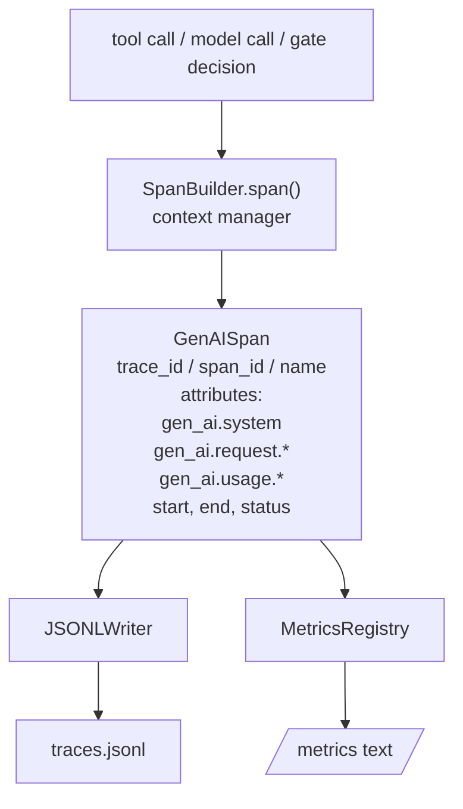
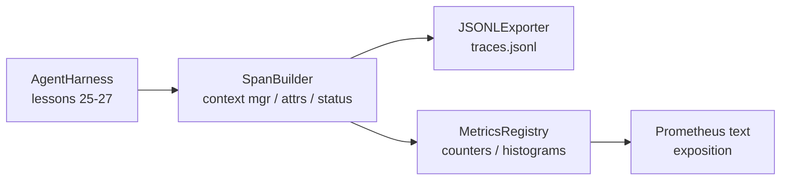

# Capstone Lesson 28: Utilize OTel GenAI Spans 和 Prometheus Metrics  Realizar Observabilidade

> 无可观察的代理harness 是一个会花钱的黑盒──本课会手写一个跨度构建器,发发出符合OpenTelemetry GenAI semântica convenções de registros,把它们写在JSON-Lines文件,每行一个跨度,并以Prometheus text format 暴露计和 histograms──整个实现都是Stdlib Python,并且可离线运行──

**Type:** Build
**Languages:** Python (stdlib)
**Prerequisites:** Phase 19 · 25 (verification gates), Phase 19 · 26 (sandbox), Phase 19 · 27 (eval harness), Phase 13 · 20 (OpenTelemetry GenAI), Phase 14 · 23 (OTel GenAI conventions)
**Time:** ~90 minutes

## Objetivos de aprendizagem

- 构建一个符合OpenTelemetry GenAI semântica convenções 形态的跨度数据类──
- 实现 um exportador JSONL, cada linha de escrita entra em um espaço de autoconhecimento.
- 构建带标签 和 Prometheus text-format exposition counters 与 histograms──
- Us span context manager 包装 arbitrária chamada, registro de duração、status 和 exceções。
- Os períodos de verificação emitidos podem ser transitados`json.loads`Viagem de ida e volta,并匹配 spec shape──

## O problema

Cada rodada de produção produz três tipos de artefatos: uma chamada de modelo, uma execução de ferramenta, bem como uma decisão de porta de verificação.

Primeiro tipo de padrão de fracasso é o rastro perdido. O único registro é um log de bate-papo de 500 páginas. Não há registro de qual ferramenta é executada.

Segundo tipo de padrão de fracasso é um rastro impercebível. Harness escreveu extensões, mas usou seus próprios nomes de campo ad hoc. Grafana, Honeycomb, Jaeger ou CLI locais não foram encontrados.

Você pode ver uma chamada de ferramenta muito lenta no rastreamento, mas não pode responder a chamada p95 de read_file na última hora.

OpenTelemetry GenAI convenções semânticas estão aqui e existem. Eles definem um grupo de atributos padrão, para os emissores de alcance de todos os tipos de frameworks LLM.

## O conceito



Harness em cada operação, todas as cidades geram um espaço.`gen_ai.chat`- Não.`gen_ai.tool.execution`)、 seguir os atributos das convenções da GenAI、 começo e fim de tempo, bem como o statusƒ

As convenções da GenAI  padronizaram estas chaves de atributos:`gen_ai.system`(Qual é o provedor, por exemplo `anthropic`- Não.`openai`)`gen_ai.request.model`(identificação do modelo)`gen_ai.request.max_tokens`- Não.`gen_ai.usage.input_tokens`- Não.`gen_ai.usage.output_tokens`- Não.`gen_ai.response.model`- Não.`gen_ai.response.id`- Não.`gen_ai.operation.name`, bem como chaves específicas de ferramentas `gen_ai.tool.name`和 `gen_ai.tool.call.id`- Não.

exportador 写 JSONL──每行一个 JSON对象──这是下游工具 可以流、grep 和进口的最简单格式──真实OTel exportador 会使用OTLP gRPC;本课的JSONL exportador 是离线等价,并且在每个工作站上都以零退出──

Metricas e vestígios não estão presentes.`tools_called_total{tool="read_file"}`◊ histograma 记录观察到的延迟:`tool_latency_ms{tool="read_file"}`◊ ◊ ◊ ◊ ◊ ◊ ◊ ◊ ◊ ◊ ◊ ◊ ◊ ◊ ◊ ◊ ◊ ◊ ◊ ◊ ◊ ◊ ◊ ◊ ◊ ◊ ◊ ◊ ◊ ◊ ◊ ◊ ◊ ◊ ◊ ◊ ◊ ◊ ◊ ◊ ◊ ◊ ◊ ◊ ◊ ◊ ◊ ◊ ◊ ◊ ◊ ◊ ◊ ◊ ◊ ◊ ◊ ◊ ◊ ◊ ◊ ◊ ◊ ◊ ◊ ◊ ◊ ◊ ◊ ◊ ◊ ◊ ◊ ◊ ◊ ◊ ◊ ◊ ◊ ◊ ◊ ◊ ◊ ◊ ◊ ◊ ◊ ◊ ◊ ◊ ◊ ◊ ◊ ◊ ◊ ◊ ◊ ◊ ◊ ◊ ◊ ◊ ◊ ◊ ◊ ◊ ◊ ◊ ◊ ◊ ◊ ◊ ◊ ◊ ◊ ◊ ◊ ◊ ◊ ◊ ◊ ◊ ◊ ◊ ◊ ◊ ◊ ◊ ◊ ◊ ◊ ◊ ◊ ◊ ◊ ◊ ◊ ◊ ◊ ◊ ◊ ◊ ◊ ◊ ◊ ◊ ◊ ◊ ◊ ◊ ◊ ◊ ◊ ◊ ◊ ◊ ◊ ◊ ◊ ◊ ◊ ◊ ◊ ◊ ◊ ◊ ◊ ◊ ◊ ◊ ◊ ◊ ◊ ◊ ◊ ◊ ◊ ◊ ◊ ◊ ◊ ◊ ◊ ◊ ◊ ◊ ◊ ◊ ◊ ◊ ◊ ◊ ◊ ◊ ◊ ◊ ◊ ◊ ◊ ◊ ◊ ◊ ◊ ◊ ◊ ◊ ◊ ◊ ◊ ◊ ◊ ◊    ◊ ◊ ◊   ◊                                                                         

```figure
trace-spans
```

## Arquitetura



O constructor de espaços é uma classe pequena,带有 `span(name, attrs)`método, retornar a um gerente de contexto. gerente de contexto em entrada 时记录 start time, em saída 时记录 end time, se for lançado uma exceção,

Registro de métricas é dois dictos.`{(name, frozen_labels): int}` Histogramas serão amostras brutas preservadas na lista de existência e em exposição 时序列化为Prometeus histogram buckets──

## O que você vai construir

`main.py`提供:

1. `GenAISpan`dataclass:trace_id、span_id、parent_span_id、name、attributos、start_unix_nano、end_unix_nano、status、status_message、events。
2. - Não .`span(name, attrs, parent=None)`Gestor de contexto `SpanBuilder`classe.
3. - Não .`export(span)`de `JSONLExporter`A classe, mais escreve.
4. `Counter`和 `Histogram`classes, bem como`MetricsRegistry`- Não.
5. 生成 texto-format de saída de `prometheus_exposition(registry)`- Não.
6. 发发出 span 并更新 métricas `wrap_tool_call(name)`Decorador.
7. Demo: sintetise uma vez completa invocação agente ((outils spans 外层包 gen_ai.chat span),写入 traces.jsonl,打印 Prometheus exposição,并以零 退出。

trace id é 16 bytes  值(32 个 hex 字符), span id é 8 bytes 值(16 个 hex 字符),都截取自随机的 `uuid4`Hex. Isto é conforme com o uso OTel de W3C Trace Context size.

Histograma tem um conjunto fixo de milímetros de latência de buckets: 5、10、25、50、100、250、500、1000、2500、5000、10000、+Inf。 é a versão mais curta do SDK OTel 默认边界的精简版,默认边界也包括 0、75、750 和 7500──Exemplos de lista 保存;exposition 会按需计算每个 bucket的数量──

## Por que escrever, em vez de usar o SDK de opentelemetria?

O OTel Python SDK é uma dependência real. Ele também tem milhares de linhas de código, um back-end de exportação de OTLP, bem como um custo de execução do orçamento de aula.

As convenções da GenAI em especial ainda são marcadas para desenvolvimento, e anteriormente alteraram o nome do atributo:`gen_ai.usage.prompt_tokens`- Não .`gen_ai.usage.input_tokens` Fixar as convenções semânticas que você emite   версия, e melhorar SDK 时检查它──

## Como é que ele se combina com o resto da pista A?

Lição 25 produziu cadeia de portas。Lessão 26 produziu sandbox。Lessão 27 produziu harness eval。Lessão 28 让这三者都可观测。Lessão 29 会把端到端演示的每一步都包进跨度,并在最后印印 Prometheus text。

## 运行方式

```bash
cd phases/19-capstone-projects/28-observability-otel-traces
python3 code/main.py
python3 -m pytest code/tests/ -v
```

Demo encontrou-se no trabalho de esta aula em um lançamento `traces.jsonl`(最后清理), então imprimir três períodos de amostra, reprimir contadores e histogramas de exposição Prometheus;. testes 验证 span 可回路序列化、canonical GenAI atributos 存在、counter 正确递增,并且 histograms exposition 包含预期桶 counts。
