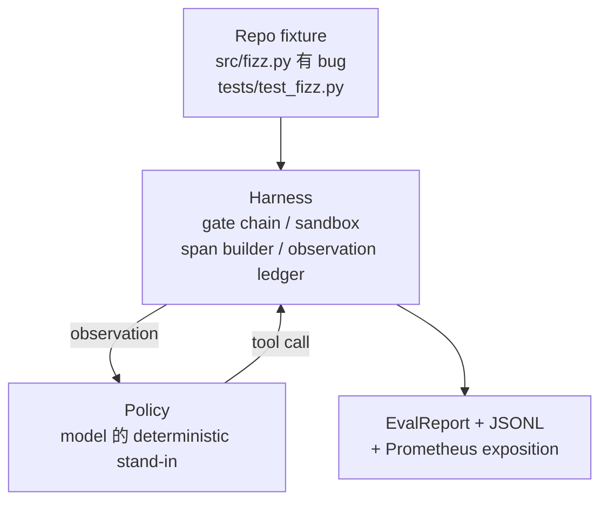
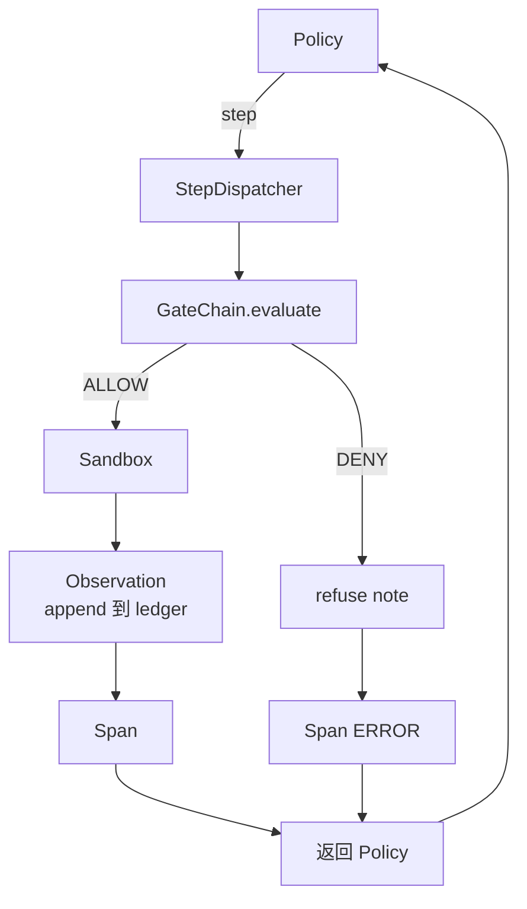

# Capstone  Curso 29: Harness Upper End to End Agente de codificação

> O resultado da pista A. O resultado do curso A.O. é que o programa A.O.E.E.E.E.E.E.E.E.E.E.E.E.E.E.E.E.E.E.E.E.E.E.E.E.E.E.E.E.E.E.E.E.E.E.E.E.E.E.E.E.E.E.E.E.E.E.E.E.E.E.E.E.E.E.E.E.E.E.E.E.E.E.E.E.E.E.E.E.E.E.E.E.E.E.E.E.E.E.E.E.E.E.E.E.E.E.E.E.E.E.E.E.E.E.E.E.E.E.E.E.E.E.E.E.E.E.E.E.E.E.E.E.E.E.E.E.E.E.E.E.E.E.E.E.E.E.E.E.E.E.E.E.E.E.E.E.E.E.E.E.E.E.E.E.E.E.E.E.E.E.E.E.E.E.E.E.E.E.E.E.E.E.E.E.E.E.E.E.E.E.E.E.E.E.E.E.E.E.E.E.E.E.E.E.E.E.E.E.E.E.E.E.E.E.E.E.E.E.E.E.E.E.E.E.E.E.E.E.E.E.E.E.E.E.E.E.E.E.E.E.E.E.E.E.E.E.E.E.E.E.E.E.E.E.E.E.E.E.E.E.E.E.E.E.

**Type:** Build
**Languages:** Python (stdlib)
**Prerequisites:** Phase 19 · 25 (verification gates), Phase 19 · 26 (sandbox), Phase 19 · 27 (eval harness), Phase 19 · 28 (observability), Phase 14 · 38 (verification gates), Phase 14 · 41 (workbench for real repos), Phase 14 · 42 (agent workbench capstone)
**Time:** ~90 minutes

## Objetivos de aprendizagem

- A partir de agora, a linha de entrada, a caixa de areia, o arneso e o constructor de espaços, são compostos por um único ciclo de agentes.
- 实现一个使用 read_file、run_tests 和 write_file 修复 fixture bug 的确定性政策──
- Durante o período de execução, o orçamento de cada etapa da organização e o orçamento de tokens de observação são obrigatórios.
- Para completar o seu funcionamento, lançar os traços completos da OTEL GenAI e das métricas Prometheus.
- Agente de verificação em menos de 12 passos dentro de resolver o problema, e ferramentas legais sem viagens de porta.

## O problema

A maioria dos agentes demo são isolados: um único armazém de areia, um único armazém de avaliação, um único emissor de espaço de tempo, não parecem problemas, assim que se juntam, os fios são expostos.

A cadeia de portas  deu permissão, mas caixa de areia, pois a cadeia  não tinha previsão de que a causa fosse rejeitada   arnesamento de arco  registro passar, mas OTel span  mostrar a porta  rejeitou o agente  alegadamente usado ferramenta  Prometheus counter 本应增加一次,但增加两次── observation budget 已经超出,但代理 继续运行,因为预算只在链中追踪,而沙盒 不知道──

Este curso é um teste de integração de toda a pista. O agente deve completar em ordem quatro coisas: ler o projeto, executar os testes, não conseguir identificar erros, escrever, corrigir os testes e então parar. Cada operação passa pela cadeia de portas.

## O conceito



A política do agente é uma máquina do Estado.

`SURVEY`:agent 读取 projeto listação。下一个状态是 RUN_TESTS。

`RUN_TESTS`Se os testes passarem, a máquina de estado é bem sucedida.

`INSPECT`O seguinte estado é FIXÃO.

`FIX`:agent 写入修正后的文件──下一个状态是 VERIFY──

`VERIFY`:agent 再次运行 test command──se os testes passarem, então parar o sucesso──否则 parar com o fracasso──

Cada estado responde a uma chamada de ferramenta. Cada chamada de ferramenta passa pela cadeia de portas. Se uma chamada de ferramenta for rejeitada, o agente encontra-se no rastreamento.

bug do dispositivo é `fizz.py`Por meio de regex de mensagem de falha de teste, detection é é lançado, e o arquivo de correção é lançado.


```figure
cg-harness-weave
```

## Arquitetura



Este curso é auto-conhecido. Todas as lições anteriores primitivas estão em`main.py`O programa de ensino de língua inglesa é um dos principais cursos de ensino de língua inglesa.

## O que você vai construir

`main.py`提供:

1. Últimas lições de arremesso, nome e lições 25-28`GateChain`- Não.`Sandbox`- Não.`ObservationLedger`- Não.`SpanBuilder`- Não.`MetricsRegistry`- Não.
2. `CodingAgentPolicy`classe: contém cinco estados de máquina de estado.
3. `Repo`Preparar um arranhão, incluindo um buggy fixado em conjunto.
4. `AgentRun`classe: política de accionamento, através do despacho de arnes,并返回 `AgentRunReport`- Não.
5. Uma fixação em conjunto`fixture_repo/`), contêm src/fizz.py、tests/test_fizz.py, bem como árvore/previsto/previsto para utilização no valor de avaliação
6. Demo:端到端运行 política, imprimir rastreamento passo a passo, afirmação passar,并印度

O sistema de fixação em conjunto com a lição 27 da estrutura de tarefas  forma igual: um arquivo de buggy 和 um arquivo de testes。 mensagem de falha do teste 包含足够信息,让确定性政策 能识别 fix──真实LLM 会做同样的工作,只是慢慢并拥有更广泛的回忆,但它不会改变利用的期望──

## Por que a política não é LLM

Real LLM  necessita de chave API  chamada de rede, bem como estocástica de não-verificação  harness 才是本课程关心的部分── substituir por política determinista 能让课程在任何开发者笔记本电脑 上运行,零外部依赖,并让测试套件 断言精确的步数──

Política do curso é o agente LLM que faz as coisas. Política 读取 repo, see failed test, identify对应行, then issue fix.

## Demo 会断言什么

端到端デモ 在退出时断言五件事,test suite também irá programar novamente.

Politica em menos de 12 passos dentro de resolver a fixação.

Orçamento de observação 从未超出──

Ferramentas legais 上触发了零次门拒绝──(agente 从未凭空发明一个被拒绝的工具名──)

Traces.jsonl em cada passo têm um período de tempo correspondente.

Exposição de Prometheus 包含一个 `tools_called_total{tool="read_file"}`Entrada 和一个 `tool_latency_ms`Histograma

## Como é que ele se combina com o resto da pista A?

Leção 26  redação sandbox。 Leção 27  redação eval harness。 Leção 28  redação observabilidade。 Leção 29  provar-los como um sistema 可以工作── real agent harness 从这里扩展:把确定性政策 换成模型,把捆绑式固定 换成真实复制任务,把 JSONL exporter 换成 OTLP。

## 运行方式

```bash
cd phases/19-capstone-projects/29-end-to-end-coding-task-demo
python3 code/main.py
python3 -m pytest code/tests/ -v
```

Demo 会打印 per-step trace、final evalu report 和 Prometheus exposition──退出码为零──tests 覆盖政策状态过渡、synthetic tool calls 上的 gate rejections、bundled fixation 上的 end-to-end run, bem como as invariantes de orçamento de fase──
