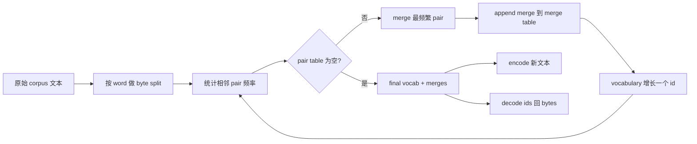
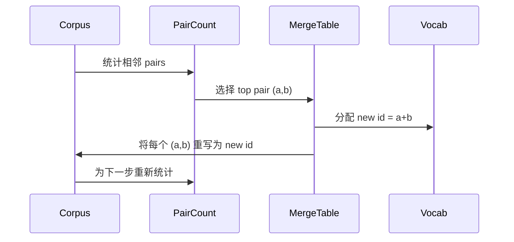

# Desde zero construção BPE Tokenizer

> 字节进, 出, 出, 再返回相同字节──构建每个现代文本模型仍然起步于此的Tokenizer──

**Type:** Build
**Languages:** Python
**Prerequisites:** Phase 04 lessons, Phase 07 transformer lessons
**Time:** ~90 minutes

## Objetivos de aprendizagem
- 通过反复 merge 最频繁的相邻符号对, 从原始文体 corpus 训练 Byte-Pair Encoding vocabulário。
- 实现 determinista merge table,并将其应用到新文本上,生成子词 ids 流──
- A entrada de UTF-8 será transformada em ids e não será recuperada.
- 保留并保护 tokens especiais`<|endoftext|>`- Não.`<|pad|>`), deixem-nos manter-se inalterados no treinamento e na decodificação.
- 推理为什么字节级字母是通用Tokenizer的正确下限──


```figure
cap-bpe-merge
```

## O quadro

O modelo de linguagem 永远看不到文本―― ele vê os números inteiros―把 string 映射为整数列并再映射回来来的东西,就是Tokenizer―这个层做错了,训练运行中每条 Loss curve都在衡量错误的东西―

O código de código de código de código de código de código de código de código de código de código de código de código de código de código de código de código de código de código de código de código de código de código de código de código de código de código de código de código de código de código de código de código de código de código de código de código de código de código de código de código de código de código de código de código de código de código de código de código de código de código de código de código de código de código de código de código de código de código de código de código de código de código de código de código de código de código de código de código de código de código de código de código de código de código de código de código de código de código de código de código de código de código de código de código de código de código de código de código de código de código de código de código de código de código de código de código de código de código de código de código de código de código de código de código de código de código de código de código de código de código de código de código de código de código de código de código de código de código de código de código de código de código de código de código de código de código de código de código de código de código de código de código de código de código de código de código de código de código de código de código de código de código de código de código de código de código de código de código de código de código de código de código de código de código de código de código de código de código de código de código de código de código de código de código de código de código de código de código de código de código de código de código de código de código de código de código de código de código de código de código de código de código de código de código de código de código de código de código de código de código de código de código de código de código de código de código de código de código de código de código de código de código de código de código de código de código de código de código de código de código de código de código de código de código de código de código de código de código de código de código de código de código de código de código de código de código de código de código de código de código de código de código de código de código de código de código de código de código de código de código de código de código de código de código de código de código de código de código de código de código de código de código de código de código de código

Vamos construir uma variante de nível de byte. O alfabeto é de 256 bytes brutos, em vez de pontos de código Unicode. Esta opção permite que o Tokenizer possa processar qualquer entrada UTF-8, sem necessidade de retroceder para Token desconhecido.

## O oleoduto



Se você mudar a ordem de fusão durante a inferência, você vai decodificar diferentes ids.

## O alfabeto byte

Antes de 256 个个IDs 保存给原字节 0x00到0xFF。 Isso garante que cada cadeia de entrada pode ser expressa com o vocabulário antes de qualquer fusão 发生.

Pre-tokenizer 会在训练 见体 之前,按白空间和点点边界 进行分裂──如果没有这个分裂,BPE merge step 会很乐意学习跨越词边界的合并,词汇会被常见整句短语填满──有这个分裂,会留在词内,结果也更能泛化──

## O ciclo de treinamento

Em cada etapa de treinamento, o ciclo faz três coisas. Ele percorre cada palavra do corpo, estatuando cada par de símbolos próximos ao presente. A frequência de surgimento, e a frequência de surgimento da palavra, aumenta a frequência de surgimento da palavra. Ele escolhe o número de pares mais altos.



Cada passo é o custo e o corpus são a lista de sequências de símbolos. Para um milhão de palavras e dez mil ids, o ciclo será concluído em poucos segundos, pois as sequências de símbolos serão encurtadas com a fusão.

## Encodificação de texto fresco

inferência Não é necessário usar o contador de fusão. É necessário fazer a mesma ordem de aplicação da tabela de fusão. Para uma nova palavra, o codificador de byte split 开始── é necessário fazer a análise da sequência atual, procurar o ranking da última combinação.

按排序 排序 按排序 排序 排序 排序 排序 排序 排序 排序 排序 排序 排序 排序 排序 排序 排序 排序 排序 排序 排序 排序 排序 排序 排序 排序 排序 排序 排序 排序 排序 排序 排序 排序 排序 排序 排序 排序 排序 排序 排序 排序 排序 排序 排序 排序 排序 排序 排序 排序 排序 排序 排序 排序 排序 排序 排序 排序 排序 排序 排序 排序 排序 排序 排序 排序 排序 排序 排序 排序 排序 排序 排序 排序 排序 排序 排序 排序 排序 排序 排序 排序 排序 排序 排序 排序 排序 排序 排序 排序 排序 排序 排 排 排 排 排 排 排 排 排 排 排 排 排 排 排 排 排 排 排 排 排 排 排 排 排 排 排 排 排 排 排 排 排 排 排 排 排 排 排 排 排 排 排 排 排 排 排 排 排 排 排 排 排 排 排 排 排 排 排 排 排 排 排 排 排 排 排 排 排 排 排 排 排 排 排 排 排 排 排 排 排 排 排 排 排 排 排 排 排 排 排 排 排 排 排 排 排 排 排 排 排 排 排 排 排 排 排 排 排 排 排 排 排 排 排 排

## Tokens especiais

Tokens especiais são bits de fluxo de IDs que nunca podem ser gerados.

- `<|endoftext|>`Durante o pre-treino, segure os documentos. Ele diz ao modelo: Um novo documento de aqui em diante, não deixe o contexto do documento anterior  entrar em fuga.
- `<|pad|>`Enchendo sequências curtas, deixe o lote ser tensor retangular. Perda de máscara.

Encoder  aceitar uma bandeira, para permitir que a entrada apareça em tokens especiais── quando a bandeira 关闭时,字符串 `<|endoftext|>`和 `<|pad|>`会按拼写它们的字节来标签化. Quando a bandeira abre, as cadeias literais serão mapeadas até suas identidades reservadas, e não participarão de nenhuma fusão.

## Garantia de ida e volta

Encodificação 后再解码 必须精确返回输入字节──decoder 会顺序拼接每个 id 的字节扩展──由于每个 id 要么是原字节,要么是两个以前已知 id 的连锁,反复扩展 总会终止于原字节──decodificação 随后返回这些字节 拼出的 UTF-8 string──

Esta série de testes de curso será em uma frase invisível, uma frase contendo um emoji Unicode, bem como uma frase contendo literal.`<|endoftext|>`A frase do token 上检查这个属性──

## O que esta lição não faz

Não irá construir o maior tipo de produção Tokenizers 风格的regex-driven pretokenizer── aqui o pretokenizer é um pequeno espaço branco e divisão de pontuação── ele vai produzir fusões razoáveis no pequeno corpo de treinamento, e com o contrato da cadeia de cursos 保持不变── 下一课将 Tokenizer como caixa preta,并在其上构建滑窗数据集──

Não paralelaliza o contador de pares. Em Python, o corpus de fazer um loop de fazer algumas mil palavras será feito em menos de um segundo. Para corpora maiores, a prática é de fazer uma lista de pares de cada palavra, e depois reduzir.

## Como ler o código

`main.py`Definir quatro objetos.`BPETokenizer`持有词汇库, 合并表 和 特殊标记表, 结合表 和 合并表 和 合并表 和 合并表 和 合并表 和 合并表 和 合并表`train`É um ciclo de treinamento.`encode`É o caminho da inferência.`decode`É uma concatenation de byte. A demo da parte inferior do corpo é um pequeno tokenizer.`code/tests/test_bpe.py`Os testes fixaram a propriedade de ida e volta, reserva de tokens especiais e ordens de fusão.

运行 demo──然后把 demo 中的目标词汇规模从300 改成600,观察 如何下降──那条曲线就是BPE compression curve──
