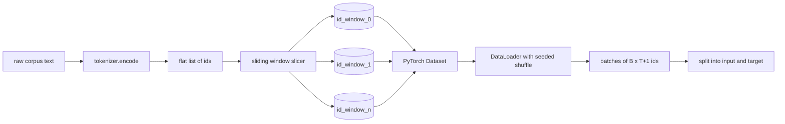
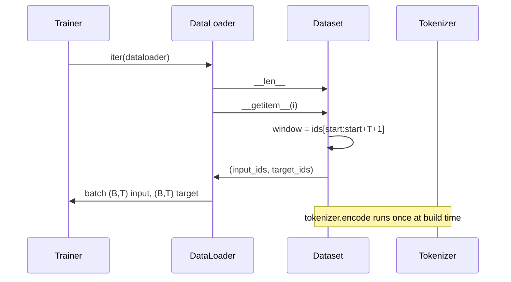

# Utilize Sliding Window's Tokenized Dataset

> Uma vez, um treinamento é executado, um é executado desde o Token IDs até a função do Gradiente.

**Type:** Build
**Languages:** Python
**Prerequisites:** Phase 04 lessons, Phase 07 transformer lessons, 本 phase 的 Lesson 30
**Time:** ~90 分钟

## Objetivos de aprendizagem


```figure
cap-sliding-window
```
- 通过只调用一次 Tokenizer,把原始 corpus 转换为 Token ids 流──
- Utilize o passo de sobreposição configurável, pegar o id 流切 into fixed length window.
- Construir um conjunto de dados PyTorch, para previsão de tokens próximos  retornar entrada 和 tensores alvo。
- Utilize DataLoader  embalar conjunto de dados,并使用按时 设定种的决定性混──
- 推理 step、冗余和有效数据集大小 之间的权衡──

## 框架

Uma vez, um grupo de tokens é criado para criar um novo padrão de identificação.`(B, T)`IDs de entrada 和 `(B, T)`IDs de destino, entre os quais o objetivo é a entrada 左移一位;; data pipeline 的工作, é de um possível número de GB no corpus do texto original, de acordo com a necessidade、determinista 且可复现地产生这个合同──

O Tokenizer de última aula irá transformar o texto em uma lista de ids planos muito longa. O Sliding Window irá cortar essa lista para fazer um treino de exemplos.

## 形状 contrato

LM causal 消费形状为 `(B, T)`De identificação, entre eles `B`É o tamanho do lote,`T`É a comprimento do contexto.`t`O alvo é a posição.`t+1`O que significa que cada exemplo de treinamento`T+1`个原始 ids──window step 控制相邻的例子 之间有多少重叠──



Slicer nunca atravessará as fronteiras do corpo. Se a última janela não tiver ids suficientes, preencha.`T+1`O cortador vai-o deixar.`<|pad|>`O preenchimento final também é uma opção válida, mas isso fará com que a mágica da perda se torne complexa.

## Por que usar Janela Deslizante

O pré-treinamento corpus é uma longa série de ids. Se o modelo só ver uma janela de treinamento não superada, cada exemplo de treinamento vai ensiná-lo o mesmo.`T`个边界――调整步骤 会移动这些边界,让模型 看到更多这样的预测-next-token 任务――

passo para`T`Vai haver uma janela que não se sobrepõe.`T // 2`O que é que é o que é o que é o que é o que é o que é o que é o que é o que é o que é o que é o que é o que é o que é o que é o que é o que é o que é o que é o que é o que é o que é o que é o que é o que é o que é o que é o que é o que é o que é o que é o que é o que é o que é o que é o que é?`1`O maior volume de dados será aumentado.`T`倍──代价是每时代 需要更多的计算──收益是边界多样性更高──大多数预训运行使用等于背景长度的步骤,因为 corpus 已经远大于模型 在一个时代内能跑完的规模,所以边界多样性的论点更弱──

## Classe de conjunto de dados

O conjunto de dados PyTorch tem dois métodos necessários.`__len__`返回 exemplos 数量──`__getitem__`Em forma de tensores, retorna um exemplo. Nosso conjunto de dados  armazém codificado                                                                                                                                                                                                                                                                                                                                                                                                                                                                                                        



O turno por turno acontece`__getitem__`内部── Dataset 返回 `(input, target)`, entre os `input = window[:-1]`- Não .`target = window[1:]`Os dois são tensores longos PyTorch.

## Interferência determinista

Utilização `shuffle=True`de DataLoader 会从 PyTorch random generator 读取──通过传入一个按时代 设定种子的显式 `torch.Generator`Quando você quer comparar duas operações de um único hiperparâmetro, esta propriedade é importante. Quando não há sementes, as duas operações serão realizadas em diferentes ordens.

O contrato de semente da lição é muito simples.`epoch_seed = base_seed + epoch_index` semente base em construção  índice de época Por treinador em cada época  crescimento  uso da mesma semente base 重新运行,总会在每个时代看到相同顺序──

## Amostragem de lote

A PyTorch's default sampler 会无放回地均随机选取索引──这正是预训练需要的──对小数据集做细节调整时,合同也一样──DataLoader 通过调用 通过调用 通过调用 通过调用 通过调用 通过调用 通过调用 通过调用 通过调用 通过调用 通过调用 通过调用 通过调用 通过调用 通过调用 通过调用 通过调用 通过调用 通过调用 通过调用 通过调用 通过调用 通过调用 通过调用 通过调用 通过调用 通过调用 通过调用 通过调用 通过调用 通过调用 通过调用 通过调用 通过调用 通过调用 通过调用 通过调用 通过调用 通过调用 通过`B`- Não .`__getitem__`Não se empilha para montar um lote. Porque cada exemplo é de tamanho igual, não é necessário um padding lógico.

Esta aula é simples e fácil de ver e manter.`num_workers=0` Durante a produção, os trabalhadores serão`__getitem__`Para o nosso pipeline, isto é basicamente não-op, porque o trabalho é apenas fazer uma fatia de tensor de memória, mas com a mesma API de conjunto de dados pode ser feito de forma eficaz para apoiar os trabalhadores.

## 计算 exemplos

对于长度为 `N`O que é o conteúdo?`T`和 passo `S`,exemplos 数量是 `max(0, 1 + (N - (T + 1)) // S)`本课把这个计算暴露在数据集上的静态方法上,这样教练可以不过代代就计算每时代的总步骤──

## 本课不做什么

Não vai do disco streaming. O corpus será completamente codificado na memória. Ele será usado como um único tensor.

Não trata de vários documentos. O corpus é visto como uma série de ids.`<|endoftext|>`IDs para codificar o próximo documento de fronteira.

## Como é que o meu nome é "Codex"

`main.py`Definiram duas classes e um ajudante.`SlidingWindowDataset`É o conjunto de dados PyTorch.`make_dataloader` Retorna a um DataLoader configurado, e não tem gerador semente`_encode_corpus_to_ids`É uma chamada de Tokenizer única. O processo consiste em criar um pequeno Tokenizer, codificar o corpus, criar um conjunto de dados e um carregador de dados, imprimir um lote, concluir um contrato de forma.`code/tests/test_dataset.py`Os testes de meio fixaram a fórmula de contagem de janelas shift-by-one 属性 deterministic shuffle 和 step trade-off──

运行 demo──然后把背景长度从16 改为 32,观察每个时代的例子 数量如何下降──这个数字就是你的时代步骤预算──
