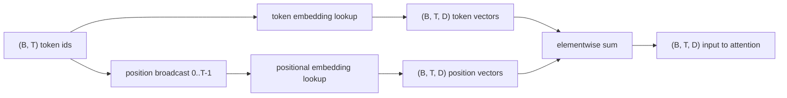
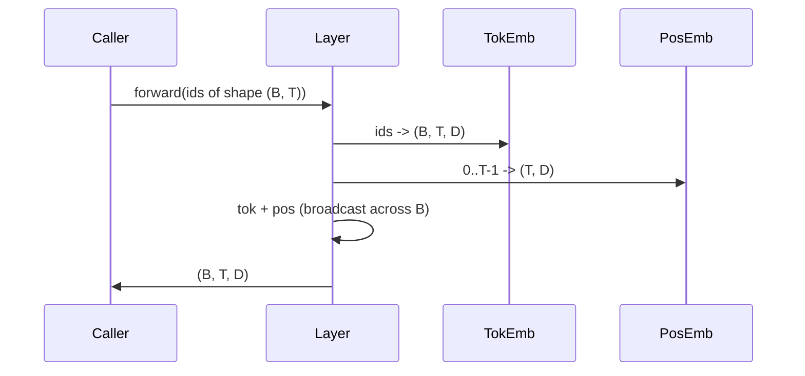

# Token e inserções posicionais

> Ids é um número inteiro. Modelo precisa de vetor.

**Type:** Build
**Languages:** Python
**Prerequisites:** Phase 04 lessons, Phase 07 transformer lessons, 本 phase 的 Lessons 30 和 31
**Time:** ~90 分钟

## Objetivos de aprendizagem


```figure
cc-embedding-lookup
```
- Construir uma tabela de busca de embedding de token,把 vocabulário ids 映射到密集向量──
- Construir uma tabela de busca por posição Index de inserção posicional aprendida 
- Construir um inserção posicional sinusoidal fixa sem parâmetros.
- Colocar Token e embutidos posicionais 组合成 Transformer bloco de entrada única。
- Relativamente ao aprendizado 和 sinusoidal embebimentos em generalização de comprimento 和 parâmetro contagem  上的差异──

## 框架

O primeiro contato do modelo com o token id, é realizado em uma Matriz de embedding de token. Esta Matriz Cada vocabulário id tem uma linha, cada modelo dimensão tem uma linha.

Identificadores de tokens Bestow não tem ordem. Modelo precisa de um segundo sinal, diz-lhe que a posição um é diferente da posição dezessete. Estas duas opções principais são a inserção posicional aprendida.`SinusoidalPositionalEmbedding`- Não .`max_context_length`预计算一张固定 table, seu `forward`Os dois módulos são obrigados a executar o máximo de comprimento do contexto. Mesmo que a tabela seja grande o suficiente para ser indicada, o modelo pode ainda ser executado em tempo de treinamento.

Esta aula irá construir os dois, e os integrar com o embedding token 组合成下一课注意区的单一输入──

## 形状 contrato

inserção de estágio de entrada é forma`(B, T)`De um conjunto de tokens de identificação.`(B, T, D)`O tensor, entre eles.`D`É a dimensão do modelo. Todos os elementos do lote têm a mesma comprimento do contexto.`T` Cada posição tem a mesma dimensão vetorial `D`- Não.



组合方式是 sum, não concatenation. 组合方式是 sum, não concatenation. 组合方式是 sum,不是 concatenation.`D`Em rede, manter-se inalterado, e deixar o modelo basear-se em cada característica para decidir o significado ou posição do token em cada camada.

## Marca de inserção Matrix

Embedding token é uma forma`(V, D)`de tensor de parâmetros, entre eles `V`É o tamanho do vocabulário.`nn.Embedding(V, D)`Exposição a ele. Introduções de um pequeno Gaussian 中抽取, para modelos em escala de transformador, tradicionalmente significa 为零, desvio padrão 约为`0.02`                                                                                                                                                                                                                                                              

Passar para a frente é uma operação de indexação.`(B, T)`ids int64 映射为 `(B, T, D)`flotas── passagem para trás  apenas vai colocar Gradiente  acumulado até passagem para frente em filas que foram tocadas── duas filas nunca apareceram no lote neste passo  receber até zero Gradiente──

Uma pequena detalhe: uma pequena porção de tokens embebidos e uma projeção de saída do modelo terminação de peso comum. Quando isso acontece, cada passagem para trás passa por um lado de saída.

## Embarcação posicional aprendida

Aprendi a inserir posições é o segundo.`nn.Embedding`, forma `(max_context_length, D)`❖ olhando  由 posição id `0, 1, 2, ..., T-1`Como chave... passagem para a frente...

A mesa aprendida é uma falha, se o modelo apenas se treinar para a posição.`T-1`Não pode consultar a posição.`T`那一行不存在──使用这种方案的生产 decoder-only models 会把最大的文本长度进入建筑,并拒绝处理更长输入──

## Embarcação sinusoidal posicional

Embebimento posicional sinusoidal é de posição para função de vetor.`p`O que é o problema ?`i` produzir:

```python
angle = p / (10000 ** (2 * (i // 2) / D))
emb[p, 2k]     = sin(angle)
emb[p, 2k + 1] = cos(angle)
```

Esta função não tem parâmetros. Cada posição tem um único vetor. A comprimento de onda atravessa as dimensões das características.

由同时选择 `sin`和 `cos`- O que é que se faz?`p + k`O vector é a posição.`p`处 Vector's linear function── isto fornece uma camada de atenção ▌ um simples caminho de aprendizagem de ofertas de posição relativa── modelo não precisa de um parâmetro individual para expressar 向后看五代币──

Este curso irá calcular a tabela sinusoidal completa durante a construção, uma vez, e avançar a seguir.

## 组合

pipeline de entrada 按顺序做三件事──读取 Token ids──查找 token vectors──加上 positional vectors──返回 sum──



Sum step 中的广播 会沿批量维度 复制 `(T, D)`Tensor de posição: PyTorch 会自動処理,因为 tensor de posição está em forma não comprimida`(1, T, D)`- Não.

## Análise comparativa

Este curso irá executar duas variantes em mesmos insumos, e imprimir dois diagnósticos.

Primeiro é o número de parâmetros. A variante aprendida aumentará em relação à incorporação de tokens.`max_context_length * D`个parametros──sinusoidal variante 增加零个──

O segundo é a semelhança cosínica entre as embaixadas de posições próximas. A variante sinusoidal tem uma decadência plana e previsível, pois a função é continuada. A variante aprendida tem uma semelhança quase casual na inicialização, porque as linhas são independentemente extraídas.

## 本课不做什么

Não constrói codificação posicional rotativa (RoPE) ou AliBi. Eles são a produção de Transformers.`(B, T, D)`de vetores  aplicam-se à transformação da posição), mas aplicam-se na etapa de projeção de atenção, em vez de entrada.

Não é um treino de incorporação. Treino requer perda.

## Como é que o meu nome é "Codex"

`main.py` definição de três módulos:`TokenEmbedding`包装 `nn.Embedding(V, D)`- Não.`LearnedPositionalEmbedding`包装 `nn.Embedding(L, D)`- Não.`SinusoidalPositionalEmbedding`预计算 table,并把它暴露为缓冲.`EmbeddingComposer`Colocar o embedding de símbolo e o embedding posicional                                                                                                                                                                                                                                                                                                                                                                                                                                                                                                                `code/tests/test_embeddings.py`Os testes de medição fixaram a forma, o comportamento de transmissão, o número de parâmetros e a fórmula sinusoidal.

运行 demo──然后把 modelo dimensão `D`De 64 改为 32, observar as bandas de comprimento de onda sinusoidais 如何变化──
