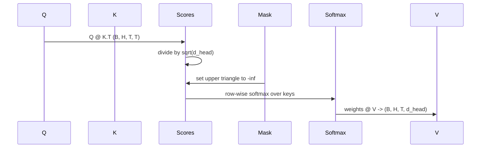

# Atenção à própria vida

> Uma projeção linear, três visões, uma cabeça, uma máscara.

**Type:** Build
**Languages:** Python
**Prerequisites:** Phase 04 lessons, Phase 07 transformer lessons, Lessons 30 through 32 of this phase
**Time:** ~90 minutes

## Objetivos de aprendizagem
- A projeção será realizada em um nível linear, e dividida em H 个 head.
- Utilize correct de regeneração e dtype 处理计算 escalada atenção ponto-produto。
- Aplicar máscara causal, prevenir uma posição em que se possa preocupar com a posição futura.
- 检查固定输入下 关注的内容,并推理每个头的关注内容. 检查固定输入下 关注的内容,并推理每个头的关注内容.
- Em tarefa de brinquedo 上训练一个小型注意区,观察 Loss 随着各头 专门化而下降──


```figure
cap-multihead-attention
```

## O quadro

A atenção é uma função, que permite que um token seja representado como um token que pode ser usado para obter informações de outros tokens da mesma sequência. A auto-atentação é uma função que permite que as perguntas, chaves e valores sejam representados como um único input.

O modo de implementação de alta eficiência é o uso de uma camada linear de`D`投影到  Projeção até`3 * D`, recorte em três visões, e depois remodele para H 个 cabeça, cada grande para `D // H`◊matmul·softmax 和加权求和都作为批量 tensor 操作执行, portanto, cada cabeça pode funcionar em acelerador

Este curso irá construir este bloco. Ele também irá incorporar a máscara causal, para que o mesmo código possa ser usado como um modelo de linguagem apenas para decodificadores.

## O contrato de forma

输入是 `(B, T, D)`                                                                                                                                                                                                                                                              `(B, T, D)`Mascarinha é`(T, T)`, ou pode ser transmitido até ele.`(B, H, T, d_head)`, entre os `d_head = D // H`约束条件是 `D % H == 0`- Não.

```mermaid
flowchart LR
    A["(B, T, D) 输入"] --> B[Linear D -> 3D]
    B --> C["拆分为 Q, K, V"]
    C --> D["reshape 为 (B, H, T, d_head)"]
    D --> E["scores = Q @ K.T / sqrt(d_head)"]
    E --> F[应用 causal mask]
    F --> G[对 keys 做 softmax]
    G --> H["context = weights @ V"]
    H --> I["reshape 为 (B, T, D)"]
    I --> J[输出 Linear D -> D]
    J --> K["(B, T, D) 输出"]
```



两个线性层(QKV projeção 和输出投影) é o único parámetro do bloco. Mascras,softmax,matmuls, reshapes e não há parámetros.

## A divisão do QKV

朴实实现将有三个独立线性层,分别用于 Q、K 和 V──高效实现只有一个层,输出 `3 * D`个特征并分分结果──二是数学上等价,因为三分别乘以 `(D, D)`Multiplicações de Matrix de peso, é igual a uma vez multiplicadas por elas.`(3D, D)`Multiplicação de Matriz de peso

A versão de alta eficiência é mais rápida, porque o acelerador só inicia uma vez matmul, em vez de três vezes. Também é mais fácil inicializar, porque a matriz de três filhos está no mesmo tensor de parâmetros, pode inicializar-se juntos.

## A cabeça remodela-se

Depois de separar, Q 、 K 、 V 、 V `(B, T, D)`Para transformá-lo em uma linha H, atenção, problema, nós remodelamos.`(B, T, H, d_head)`, re-transpor para`(B, H, T, d_head)` cabeça 维度现在位于 lot 维度旁边, portanto PyTorch 会把 per-head atenção 视为跨 `B * H`个独立实例的批量操作――

`d_head`A dimensão permanece no final, portanto, o resultado é matmul`Q @ K.transpose(-2, -1)`O resultado é que a sua dimensão se encolheu.`(B, H, T, T)`Os resultados da atenção por cabeça:

## Escalada

As pontuações serão de softmax`sqrt(d_head)`Se não houver esta escala, os produtos de ponto irão acompanhar.`d_head`增大而增大, 推推软max 推到一种几乎所有的质量都集中在一个条目上,其他条目都接近消失的状态――这种状态下 Gradiente 很小,学习会停滞――除以`sqrt(d_head)`Pode deixar as marcas de diferença em diferentes tamanhos de cabeça

## A máscara causal

Modelo de linguagem apenas para decodificador:`(T, T)`Matriz de pontuação Cada item acima das corners da linha será substituído por negativo infinito.



Quando construímos, colocamos a máscara registrada como buffer, por isso ela e o modelo estão no mesmo dispositivo, e não fazem parte do gráfico Gradiente. Mascara cobre este bloco.`(T, T)`Área:

## A projeção de saída

 obtêm por vectores de contexto de cabeça `(B, H, T, d_head)`后, nós transposamos 回 `(B, T, H, d_head)`, reformulação para`(B, T, D)`, e aplicou-se a última .`(D, D)`线性投影──output projection 让模型可以混合各个头――没有它,H个头只能通过后层重组,块会受到人为限制──

## Inspecção de peso de atenção

O curso está em frente passando`return_weights=True`Depois de configurar, o bloco vai voltar à forma de saída.`(B, H, T, T)`de peso de atenção por cabeça. O teste de teste é impresso em um pequeno input, para que você possa ver o triângulo causal e a estrutura de cada posição.

Em um bom modelo de treinamento, diferentes cabeças aprenderão diferentes modos. Algumas cabeças estarão preocupadas com o próximo Token. Algumas cabeças estarão preocupadas com a sequência de início. Algumas cabeças estarão preocupadas com a atenção quase uniformemente dispersa.

## A demonstração de treinamento

`main.py`A demonstração de baixo vai colocar o bloqueio de atenção em um pequeno cabeçalho de LM e repetir a tarefa de treinamento do modelo inteiro. Cada linha da entrada é uma id random, em toda a substituição.`log(64) ~ 4.16`) descendo a muito abaixo de `1.0`- Não.

O objetivo da demonstração não é treinar um modelo útil. O objetivo é confirmar que o gradiente pode fluir através de cada parte do bloco, e que cada cabeça pode aprender algo em uma pergunta de resposta óbvia.

## O que esta lição não faz

Não adiciona blocos de alimentação e avanço. A camada transformadora do modelo real é a atenção, seguindo as duas camadas de MLP, e em cada parte em torno tem conexão residual e a norma de camada.

Não realiza codificação rotativa ou posicional AliBi. Os dois são aplicados em um mesmo bloco de projeção QKV, mas são unidades de ensino independentes.

Não consegue inferir usando o cache KV. Em seguida, passa-se o cache de KV.

## Como ler o código

`main.py`Definindo`MultiHeadSelfAttention` Esta classe incluem duas camadas lineares e um registado de mascaras buffer── passagem para frente 会依次执行投影、重型、重型、重型、重型、重型、重型、重型、重型、重型、重型、重型、重型、重型、重型、重型、重型、重型、重型、重型、重型、重型、重型、重型、重型、重型、重型、重型、重型、重型、重型、重型、重型、重型、重型、重型、重型、重型、重型、重型、重型、重型、重型、重型、重型、重型、重型、重型、重型、重型、重型、重型、重型、重型、重型、重型、重型、重型、重型、重型、重型、重型、重型、重型、重型、重型、重型、重型、重型、重型、重型、重型、重型、重型、重型、重型、重型、重型、重型、重型、重型、重型、重型、重型、重型、重型、重型、重型、重型、重型、重型、重型、重型、重型、重型、重型、重型、重型、重型、重型、重型、重型、重型、重型、重型、重型、重型、重型、重型、重型、重型、重型、重型、重型、重型、重型、重型、重型、重型、重型、重型、重型、重型、重型、重型、重型、重型、重型、重型、重型、重型、重型、重型、重型、重型、重型、重型、重型、重型、重型、重型、重型、重型、重型、重型、重型、重型、重型、重型、重型、重型、重型、重型、重型、重型、重型、重型、重型、重型、重型`code/tests/test_attention.py`Testes de medição fixaram a propriedade de contrato de forma, propriedade de causalidade, propriedade de softmax, propriedade de divisão de cabeça e fluxo gradiente.

- Então, vamos lá.`n_heads`De 4  aumentar a 8                                                                                                                                                                                                                                                                                                                                                                                                                                                                                                                        `d_model=32`, portanto `d_head=4`), observar o mapa de calor 如何变化──
