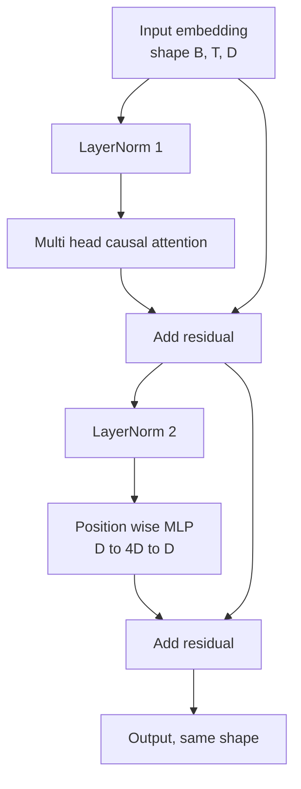
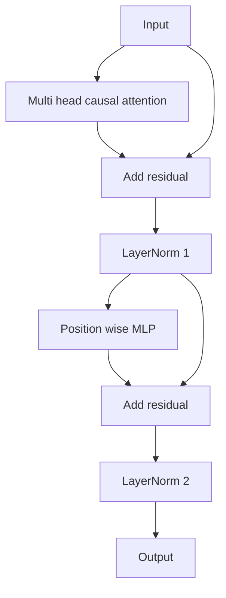

# Desde zero realçar o bloco de transformador

> Um bloco é a unidade básica de cada decodificador moderno LLM. Uma nova versão é a de um novo bloco.

**Type:** Build
**Languages:** Python
**Prerequisites:** Phase 19 lessons 30 to 33 (tokenizer, embeddings, attention math, batched data loader)
**Time:** ~90 minutes

## Objetivos de aprendizagem

- Desde quatro componentes de movimento construção PyTorch em bloco transformador:LayerNorm, multi-causação de atenção, conexões residuais, MLP por posição.
- Para definir as normas de camada, coloque-as em duas configurações: pré-LN e pós-LN, e explique por que uma delas não precisa de aquecimento, também pode ser treinada de forma estável.
- Em atenção múltipla, para realizar a mascaragem causal, fazer Token `i`Não posso ver Tokens `j > i`- Não.
- Seguindo uma pilha de 12 camadas entre dois variantes, o fluxo gradiente não depende da definição do resultado.
- Em 1.24 bilhões de parâmetros GPT, considere este bloco como um único elemento de reposição que pode ser substituído diretamente.

## O problema

transformador é repetir um bloco. Se esse bloco começar por errar, repetir 12 vezes, o modelo que você obtém será na primeira época, ou em disseminação, ou em todo o caminho, que precisa de aquecimento.

Assim que se percebe bem, a reparação é mecânica. Este bloco tem dois caminhos residuais e duas posições de normalização.

## O conceito

Cada decodificador só bloco transformador são uma função, ele recebe forma por `(batch, sequence, embedding)`do tensor,并返回相同形的 tensor──内部由两个子层 完成工作──



É o pré-LN 变体──LayerNorm 位于 residuais ramo 内部, em subcamada 之前── residuais conexão 会把未归一化的信号 向前传递──

pós-LN 变体会把 LayerNorm 移到残余添加 之后──



Forma 完全相同── 訓練行為 不相同──                                                                                                                                                                                                                                                          `3e-4`Abaixo, este Gradiente se encolheu suficientemente rápido, até que fosse necessário um cronograma de aquecimento. Pre-LN  Deixe o caminho residual  manter não registo, portanto, o Gradiente 能干净地传播到嵌入层──正因如此,GPT-2 后发布配置都使用 Pre-LN──

### Atenção multi- cabeças causal

Atenção subcamada irá colocar a entrada em três formas de projeção em query,key,valor tensors.`(B, T, D)`Reformulação até `(B, H, T, D/H)`, entre os `H`É o número de cabeças.`softmax(Q K^T / sqrt(d_k))`, colocar a máscara para cima, passar por softmax, aplicar a máscara, e depois multiplicar.`V`As cabeças vão ser juntas.`(B, T, D)`Tensor,并再次投影──masque é fazer um modelo ter uma causa única──masque esquecimento é treinar um modelo que vai fazer fraude──

### O MLP

posição sábio MLP 会把同一个两层网络独立应用到每个代币──隐藏宽是嵌入宽的四倍,激活是 GELU,并且在第二线线的后接落――MLP 内部没有代币相互交流──所有代币混合都发生在注意中──

### As conexões residuais fazem duas coisas.

Eles permitem que o caminho gradiente transversal de profundidade se torne uma forma de adição, mantendo assim a escala da norma gradiente através de 12 camadas. Eles também permitem que cada bloco aprenda a atualizar a representação no funcionamento, em vez de substituir completamente.


```figure
cc-transformer-block
```

## Construí-lo

`code/main.py`实现:

- `class LayerNorm`,带可学习的规模 和 shift、biased eps,并应用到每个代币矢量──
- `class MultiHeadAttention`,带 `num_heads`- Não.`head_dim = d_model // num_heads`、Fused QKV projeção、registrar a máscara causal、Attenção de abandono 和 residual de abandono。
- `class FeedForward`, contém duas camadas de ligação, ativação GELU e desistência.
- `class TransformerBlock`,带 `pre_ln`bandeira, utilizada para trocar entre dois variantes.
- Uma demonstração, construir 6 camadas de pré-LN stack e 6 camadas de post-LN stack, usando o mesmo entrada,并打印 (a) forma de saída,(b) Uma vez para trás passagem 后 Embedding 处的 Gradient norma。

- Não .

```bash
python3 code/main.py
```

输出: dois pilhas de forma de verificação, bem como as normas de graduação de并排.

## Estaca

- `torch`Usando tensores matemáticos, autogrado e`nn.Module`Instalação de encanamento
- Não uso`transformers`Não usem pesos pré-entrenados. Este bloco é de primitiva.

## Padrões de produção em silêncio

Três modos transformam o bloco da escola em algo que pode ser entregue.

**Fused QKV projection.**Três lançamentos do kernel e três matmulas.`3 * d_model`A linha de linha pode ser realizada em um único lançamento, e depois, ao longo do último eixo, o caminho de separação de saída e saída é mais rápido em cada acelerador, e é de acordo com as implementações de referência do GPT-2、LLaMA e Mistral.

**Registered causal mask buffer.**Mascara apenas depende da maior parte da duração do texto.`register_buffer`Se esqueça, a máscara se transforma em um ponto de alojamento.

**Dropout in two places, not three.**O abandono deve estar localizado na atenção softmax 后 ([[Attenção abandono]]), bem como na segunda linha do MLP 后 ([[Restaural abandono]]) 后 ([[Restaural abandono]]) 后 ([[Restaural abandono]]) 后 ([[Restaural abandono]]) 后 ([[Restaural abandono]]) 后 ([[Restaural abandono]]) 后 ([[Restaural abandono]]) 后 ([[Restaural abandono]]) 后 ([[Restaural abandono]]) 后 ([[Restaural abandono]]) 后 ([[Restaural abandono]] 后 ([[Restaural abandono]]) 后 ([[Restaural abandono]]) 后 ([[Restaural abandono]] 后]] 后 ([[Restaural abandono]] 后]] 后]] 后]] 后]] 后]] 后]] 后]] 后]] 后]] 后]] 后]] 后]] 后]] 后]] 后]] 后]] 后]] 后]] 后]] 后]] 后]] 后]] 后]] 后]] 后]] 后]] 后]] 后]] 后]] 后]] 后]] 后]] 后]] 后]] 后]] 后]]

## Usá-lo

- O bloco da lição pode ser modificado diretamente para inserir na lição 35 do GPT 组装──
- Pre-LN 变体是每个现代开权力 LLM 使用形式──post-LN 变体是 2017 原始注意论文使用形式──了解二者就足以阅读你会遇到的任何解码架构──
- Se você mudar o GELU para SiLU, você terá a ativação da série LLaMA. Se você mudar a LayerNorm para RMSNorm, você terá a normalização da série LLaMA.

## Exercícios

1. 给块 中每个线路 添加 `bias=False`flag──现代 open weights LLMs 发布时线性层 不带偏见──测量在12层、768 dim 模型中能节省多少参数──
2. Usando a mão RMSNorm  substituir `nn.LayerNorm`,并验证 forma de saída 不变──
3. Adicione uma bandeira, volte para a primeira cabeça de Atenção pesos, como `(B, T, T)`tensor── desenhar sobre o triângulo, confirmar softmax 后它为零──
4. Construir um teste de saúde mental,`(2, 16, 384)`Tensor em`H=6`下送进两个变体,并断言在权重初始化相同且 dropup 设为零时,前进输出 不同(例如 `not torch.allclose`)。

## Termos-chave

| Term | What people say | What it actually means |
|------|-----------------|------------------------|
| Pre-LN | "Pre norm" | LayerNorm 位于 residual branch 内部，在每个 sublayer 之前；residual 携带未归一化的 signal |
| Post-LN | "Post norm" | LayerNorm 位于 residual add 之后；这是 2017 年论文发布的形式，并且需要 warmup |
| Causal mask | "Triangle mask" | Attention logits 的上三角被设为负无穷，因此当 j 大于 i 时，Token i 不能读取 Token j |
| Fused QKV | "Combined projection" | 一个宽度为 3D 的 linear，而不是三个宽度为 D 的 linears；一个 kernel，一次 matmul |
| Residual stream | "Skip connection" | 自上而下流过每个 block 的未归一化 tensor；也是每个 block 添加到的对象 |

## Mais leitura

- Fase 7 lição 02 ((auto-atenção a partir do zero), entender este bloco 底层的注意数学──
- Fase 7 lição 05 ((transformador completo), compreender o codificador de decodificador da mesma estrutura 版本。
- Fase 10 lição 04 ((pre-treinamento mini GPT), compreender este bloco
- Fase 19 lição 35 ((esta faixa), vai colocar 12 blocos assim                                                                                                                                                                                                                                                                                                                                                                                                                                                                                                             
