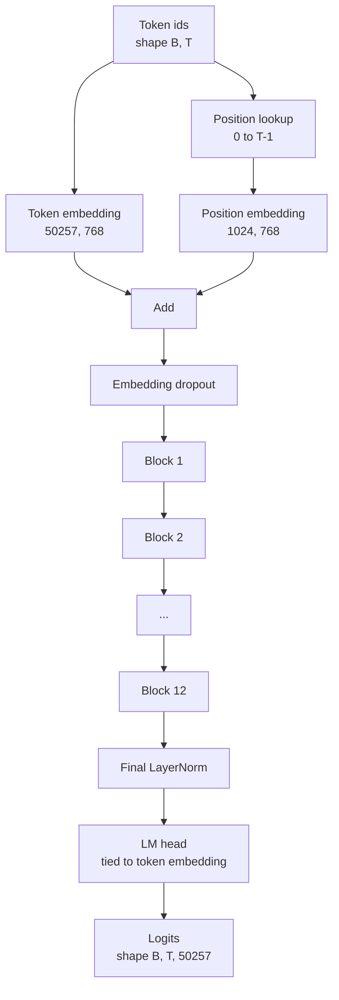
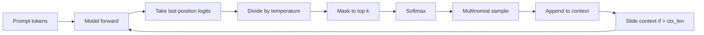

# GPT 模型组装

> 十二个块 堆叠,一个代币嵌入,一个学习得到的位置嵌入,一个最终 LayerNorm,以及一个权重绑定的语言模型头――这是一个完整的1.240亿参数 GPT模型――本课将这些组件组装成一个可运行的类,统计参数以确认模型匹配参考的124M形状,并使用多号样本,温度和顶-k 生成文本――

**Type:** Build
**Languages:** Python
**Prerequisites:** Phase 19 lessons 30 到 34
**Time:** ~90 分钟

## Objetivos de aprendizagem

- 将 lição 34 中的变压器块 组装成完整 GPT 模型:Token Embedding、Position Embedding、N 个块、最终 LayerNorm、language model head──
- 复现 1.24 亿参数配置:vocacab 50257 文本 1024 嵌入 768 十二个头十二层──
- Para o modelo de linguagem cabe 权重绑定到代币嵌入,并解释为什么这在此规模下可节省约3800万参数.
- Utilize multimolação de amostras, escala de temperatura e truncamento de topo de k, de imediato 生成文本,并用滑窗 保持 context length。
- Controle 124M  objetivos de medida parâmetro contagem 和 pass para frente 成本。

## O problema

O bloco transformador 单独存在时什么也做不了―― você precisa transformar ids de tokens 转变成向量,混入位置信息,让它们穿越堆,再投投回词汇逻辑――

模型的形状也很重要──参考 GPT-2 small 在上面的精确配置下是1.24亿参数──这些数字不神秘── Vocab 50257 乘以嵌入 768是代币表──Position 1024 乘以 768是位置表──十二个块,每个约700万参数,总数 8400──万最终头 通过重量绑定 复用代币表──把这些部分相加,你就得到1.24亿──构建模型如果数不匹配参数,通常说明你把某处连错了──

## O conceito



Os tokens ids  se transformam em vetores de tokens. Os tokens de posição  se transformam em vetores de posição. Os dois são adicionados para a pilha.

### A ligação de peso

Embedding de símbolo forma é `(vocab, d_model)`◊ cabeçalho de modelo de linguagem 需要从 `d_model`投影回  O que é que é isso ?`vocab` Eles são inter-transpostos.  Eles são ligados, literalmente, usando o mesmo tensor de parâmetro, usando duas vezes.  Em vocabulário 50257 e d_modelo 768 abaixo, esta matriz tem 3800 milhões de parâmetros.  Quando não está ligada, você deve pagar dois custos.  Depois de se ligar, você só paga uma vez o custo, e também vai obter um pouco mais limpo  sinal de gradiente, porque o embuxo e a cabeça são atualizados juntos.

### A inserção de posição é o que se consegue aprender, não é sinusoidal.

GPT-2 使用学习得到的位置嵌入式位置表 是一个形状为`(1024, 768)`O modelo em cada fase avançada procura a posição 0 até T-1,并把找结果加到 Token Embedding 上── é o mais simples esquema de posição (((RoPE、ALiBi、T5 relativa viés é um esquema alternativo), também é um esquema de 124M 参考模型使用──

### Geração: temperatura, top-k, multinomal

Geração é autoregressiva de. Em cada passo, o modelo retornará em cada posição ao vocabulário completo.



Três rotas, em relação a três diferentes comportamentos. A temperatura 接近零会退化成贪. A temperatura 为一时匹配模型的自然分布.


```figure
cc-gpt-assembly
```

## Construí-lo

`code/main.py`实现:

- `class GPTConfig`Classe de dados, com valor de referência de 124 M:`vocab_size=50257`- Não.`context_length=1024`- Não.`d_model=768`- Não.`num_heads=12`- Não.`num_layers=12`- Não.`mlp_expansion=4`- Não.`dropout=0.1`- Não.`use_bias=True`- Não.`weight_tying=True`- Não.
- `class GPTModel`, contendo Embedding Token, Embedding Posição, Embedding dropout, 12 `TransformerBlock`、 final LayerNorm, bem como em bandeira 打开时绑定到代币嵌入的 `lm_head`- Não.
- `count_parameters`assistente, retornar o único parâmetro contado (por isso, a taxa de peso é correcta)
- `generate`função, execução de temperatura, top-k, multimídia, e contexto de janela deslizante.
- Uma demonstração, construção de modelo, contagem de parâmetros de impressão e não com referência 124M para o controle, e depois de um prompt fixo produzir uma série curta, mostrando o pipeline 端到端可运行──

- Não .

```bash
python3 code/main.py
```

输出:parameter count 随 124M 参考值对照、随时随时 生成的代币 ids, bem como confirmação de armazenamento em conjunto de embutidos em embutidos em em embutidos em em embutidos em embutidos em embutidos em embutidos embutidos embutidos embutidos embutidos embutidos embutidos embutidos embutidos embutidos embutidos embutidos embutidos embutidos embutidos embutidos embutidos embutidos embutidos embutidos embutidos embutidos embutidos embutidos embutidos embutidos embutidos embutidos embutidos embutidos embutidos embutidos embutidos embutidos embutidos embutidos embutidos embutidos embutidos embutidos embutidos embutidos embutidos embutidos embutidos embutidos embutidos embutidos embutidos embutidos embutidos embutidos embutidos embutidos embutidos embutidos embutidos embutidos embutidos embutidos embutidos embutidos embutidos embutidos embutidos embutidos embutidos embutidos embutidos embutidos embutidos embutidos embutidos embutidos embutidos embutidos embutidos embutidos embutidos embutidos embutidos embutidos embutidos embutidos embutidos embutidos embutidos embutidos embutidos embutidos embutidos embutidos embutidos embutidos embutidos embutidos embutidos embutidos embutidos embutidos embutidos embutidos embutidos embutidos embutidos embutidos embutidos embutidos embutidos embutidos embutidos embutidos embutidos embutidos embutidos embutidos embutidos embutidos embutidos embutidos embutidos embutidos embutidos embutidos embutidos embutidos embutidos embutidos embutidos embutidos embutidos embutidos embutidos embutidos embutidos embutidos embutidos embutidos embutidos embutidos embutidos embutidos embutidos embutidos embutidos embutidos embutidos embu

Para fazer a demonstração manter a velocidade, o script também vai funcionar um pequeno configurador.`d_model=64`- Não.`num_layers=2`),并 inline 打印生成的代币序列──124M configuração 会被构建,但只执行参数计和一次前传──

## Estaca

- `torch`Utilizando matemática tensorial, autogrado e canalização de módulos.
- `code/main.py`Na localidade re-realização do mesmo padrão de bloco na lição 34.

## Padrões de produção em silêncio

Três modos determinam se um modelo só pode correr ou realmente entregar.

**把 residual projections 初始化得小一些。**A projeção de saída da atenção e a segunda linha de MLP entram diretamente no adicionamento residual. Se usarem desvios padrão similares a outros lineares, iniciam-se.`1 / sqrt(2 * num_layers)`缩放;residual stream 就能在十二层中保持合理范围──

**缓存 position id tensor，不要重复计算。** `torch.arange(T)`Vai-se distribuir o novo "in-registro"`__init__`Classificação de conteúdo de um grupo de dados

**在 parameter 层面 tie weights，而不只是 copy。** configuração `lm_head.weight = token_embedding.weight`会共享 tensor;copy 不会──optimizer 需要更新一个参数,自动化图也需要一次积累──如果你 copy,head 会从嵌入 漂走,权重绑定就没有任何收益──

## Usá-lo

- A forma do modelo desta classe é a mesma da seguinte classe que deve ser treinada.
- Empregar em posição em vez de RoPE, é possível obter a família LLaMA, sem necessidade de mudar o bloco ou a cabeça.
- Para substituir GELU por SiLU, para substituir LayerNorm por RMSNorm, é possível obter o restante da família LLaMA.
- Função de geração pode ser usada para qualquer logite Source, não apenas para este modelo. Você pode extrair logites do arquivo GPT-2 pré-treinado na lição 37.

## Exercícios

1. 解除 LM head 与 Token Embedding 的绑定并重新统计参数──验证差值为 50257 乘以 768 = 3800 万──
2. A posição embebida será substituída pela tabela sinusoidal de cálculo durante a construção.
3. Por geração 添加 `greedy=True`flag, saltar a amostragem 并选择 argmax── confirmação sequência em várias vezes em execução é determinista de──
4. 添加 `repetition_penalty`旋, antes de softmax , será prompt ou gerado no histórico logit de qualquer token exceto em um constante  Use o prompt fixo  demonstrar maior do que um valor irá reduzir o número de repetidas vezes na saída
5. Em`top_k`旁边添加 `top_p`(nucleus) amostragem── utilizando duas linhas de verificação para confirmar a probabilidade de reter tokens 之和超 `top_p`- Não.

## Termos-chave

| Term | What people say | What it actually means |
|------|-----------------|------------------------|
| Weight tying | “Tied embeddings” | LM head 和 Token Embedding 共享同一个 parameter tensor；节省 vocab times d_model 参数，并匹配 GPT-2 参考模型 |
| Position embedding | “Learned positions” | 一个单独的 table，形状为 (context length, d_model)，加到 token vectors 上；端到端学习得到 |
| Sliding window context | “Context cap” | 当 prompt 加生成 tokens 超过 context length 时，丢弃最旧的 tokens，让 active window 能放下 |
| Top-k sampling | “K truncation” | 保留值最高的 K 个 logits，把其余 logits mask 成 negative infinity，并在剩余项上 softmax |
| Temperature | “Sampling temperature” | 在 softmax 前用 T 除以 logits；T 小于 1 会变尖锐，T 等于 1 保持自然 distribution，T 大于 1 会变平坦 |

## Mais leitura

- Fase 19 lição 34, compreender o bloco do modelo em composição.
- Fase 19 lição 36, compreender a utilização de perda de entropia cruzada 驱动本模型的训练循环──
- Fase 19 lição 37, saber como colocar pesos pré-treinados GPT-2 加载到这个精确建筑 中──
- Fase 7 lição 07 ((GPT modelagem de linguagem causal), compreender a próxima previsão simbólica de matemática。
- Fase 10 lição 04 ((pre-treinamento mini GPT), compreender a mesma arquitetura 上的原始训练过程──
