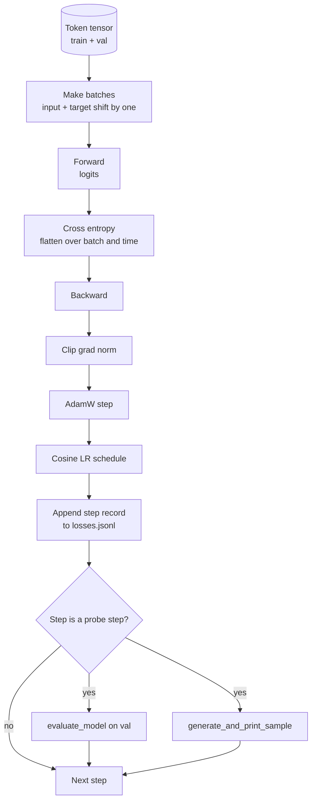

# Loop de formação e avaliação

> Não medir o ciclo é mentir.`calc_loss_batch`Assistente ∼ em mantido dados  `evaluate_model`Passe cada K                                                                                                                                                                                                                                                                                                                                                                                                                                                                                                                          `generate_and_print_sample`A sonda de determinação, bem como o log de perda JSONL que pode ser desenhado depois, podem treinar cada um dos decodadores que você irá construir depois.

**Type:** Build
**Languages:** Python
**Prerequisites:** Phase 19 lessons 30 到 35
**Time:** ~90 分钟

## Objetivos de aprendizagem

- Construir um loop de treinamento, para a próxima previsão de token Use correct input e alinhamento de alvos para calcular a perda de entropia cruzada.
- Configurar o AdamW, fazer decadência de peso  aplicado a tensores de peso, não aplicado a tensores de LayerNorm ou de bias 
- 实现带线性变暖和宇宙衰退的学习率时间表,并读取 LR 随时间的变化──
- Utilização `evaluate_model`Em comparação com os resultados da avaliação, a perda de avaliação pode ser comparada.
- Cada passo`generate_and_print_sample`Formar uma amostra de determinação, para capturar a divergência na curva de perda antes de mostrar.
- Para que o JSONL possa ser recarregado, desenhar, e colocar o registro de treinamento como entregue.

## O problema

Um script de treinamento que imprime apenas perda e que tudo que não faz é um fracasso em três aspectos. Não pode dizer-lhe se a perda é devido à causa correta de sua queda.

O ciclo de instrução é usado de três formas para medir a perda de cada passo no lote de treinamento.

## O conceito



O que é mais evidente é o alinhamento de perdas e a divisão de decomposição de AdamW.

### Alinhamento de perdas

模型在每个位置预测下一个代币―― Se o lote de entrada é de tokens `[t0, t1, t2, t3]`Então o lote-alvo deve ser`[t1, t2, t3, t4]`❖ Entropia cruzada em forma plana `(batch * seq, vocab)`上计算,并对照 plano alvo `(batch * seq,)`❖ Esquecer a mudança, então treinaremos o modelo para a sua própria previsão; isto receberá perdas zero, mas não aprenderá a fazer nada útil.

### A divisão de decomposição de AdamW

Desintegração de peso irá regularizar tensores de peso, mas não regularizar escalas de normalização ou viéses. Decaimento  colocar em escala LayerNorm  上,会慢慢把 scale 推向零,并破坏 normalization  把 decay 放在偏向 上在数学上无害,但浪费周期──标准分是:matrix shaped tensors(linear weights、embedding tables) Use decay, anything looks like scale 或 shift 的参数不用──

### Calor e horário de cosin

O aquecimento irá transformar a taxa de aprendizagem de zero em algumas centenas de etapas, de rampas para valores-alvo, permitindo que o estado de otimização tenha tempo para preencher. O declínio do cosinho irá reduzir a taxa de aprendizagem em etapas restantes, tornando a fase final um pouco menor do que o peso de uma pequena escala. Esta combinação é a mais comum no programa de treinamento de LLM em pesos abertos, pois elimina a maioria dos momentos fracos dos primeiros mil passos e dos últimos mil passos.

### Avaliação realizada

`evaluate_model`A partir da validação, o número de lotes é dividido em batches, perdas acumuladas, divididas em batches, e depois retornar. Não há nenhum gradiente. Não há nenhum abandono.

### Amostragem qualitativa como sinal precoce

Uma perda de treinamento, baixou muito bem, mas as amostras geradas são todas do mesmo token. O modelo é ruim. Uma curva de perda parece plana, mas as amostras geradas tornam-se progressivamente um modelo de palavras que estão aprendendo.


```figure
cap-training-loop
```

## Construí-lo

`code/main.py`实现:

- `make_batches(token_ids, batch_size, context_length)`, vai ser uma longa token tensor faixa 成 entrada e pares de alvo.
- `calc_loss_batch(model, inputs, targets)`, executa a entropia de cruzamento escalar, e retorna a entropia de cruzamento escalar.
- `evaluate_model(model, val_loader, max_batches)`, em nenhum grau, baixos números de validação fixados,并 retornar a perda média.
- `generate_and_print_sample(model, prompt, max_new_tokens)`, em instante fixo 上运行 lição 35 de geração função 并印结果──
- `build_param_groups(model, weight_decay)`,生成两组 AdamW lista de parâmetros
- `cosine_with_warmup(step, warmup_steps, total_steps, max_lr, min_lr)`, voltando para o passo determinado de LR──
- `train(...)`, , , , , , , , , , , , , , , , , , , , , , , , , , , , , , , , , , , , , , , , , , , , , , , , , , , , , , , , , , , , , , , , , , , , , , , , , , , , , , , , , , , , , , , , , , , , , , , , , , , , , , , , , , , , , , , , , , , , , , , , , , , , , , , , , , , , , , , , , , , , , , , , , , , , , , , , , , , , , , , , , , , , , , , , , , , , , , , , , , , , , , , , , , , , , , , , , , , , , , , , , , , , , , , , , , , , , , , , , , , , , , , , , , , , , , , , , , , , , , , , , , , , , , , , , , , , , , , , , , , , , , , , , , , , , , , , , , , , , , , , , , , , , , , , , , , , , , , , , , , , , , , , , , , , , , , , , , , , , , , , , , , , , , , , , , , , , , , , , , , , , , , , , , , , , , , , , , , , , , , , , , , , , , , , , , , , , , , , , , , , , , , , , , , , , , , , , , , , , , , , , , , , , , , , , , , , , , , , , , , , , , , , , , , , , , , , , , , , , , , , , , , , , , , , , , , , , , , , , , , , , , , , , , , , , , , , , , , ,`outputs/losses.jsonl`,并每 `eval_every`Passo 打印 avaliação perda 和 sample。
- Uma demonstração, em dados sintéticos, para treinar um modelo pequeno, pequenos passos, escrever o JSONL log, e em pontos de pesquisa, imprimir a perda de avaliação e a amostra.

- Não .

```bash
python3 code/main.py
```

输出: cada passo perdida 行、 cada passo da sonda de perda de avaliação、 cada passo da sonda de amostra gerada, bem como final `outputs/losses.jsonl`- Podes usar .`json.loads`- Não, não.

## Estaca

- `torch`Utilizado em autograd, Optimizer e módulos.
- `main.py`Em minha terra re-realizar a lição 35 `GPTModel`E apoiam os módulos.

## Padrões de produção em silêncio

Três modos transformam o ciclo de livros em algo que pode ser executado durante a noite.

**Gradient norm clipping 不可协商。**Uma série de dados anormais, um pico de LR, um número de valores, uma situação de limite de valor, produzirá um enorme resultado de treinamento.`backward`Depois,`step`之前调用 `torch.nn.utils.clip_grad_norm_(params, max_norm=1.0)`, permite que o Optimizador  mantenha em segurança ⋅ clipping valor é um paramétrio livre; 1 ⋅ é o valor padrão da maioria das configurações ⋅

**可恢复的 JSONL logging，而不是 pickled state。**Registros de perdas por cada passo`{"step": int, "train_loss": float, "lr": float}`行写入 JSONL é resistente: qualquer crash 城市留下可读的文物, você pode pegar, pode usar trinta linhas Python 绘图, também pode passar por ler o último passo para recuperar o treinamento.

**Eval batches 来自固定 slice。**Tokens de validação são cortados em batches ao iniciar o script, em vez de gerar em modo ativo.

## Usá-lo

- O ciclo neste curso é o mesmo que o treinamento em dados reais do modelo 124M.`datasets`Carregador de cargas, circuito,
- JSONL log é transformar a execução de treinamento em evidência de entregable.
- A sonda de amostra está em perda escalar, insubstituível.

## Exercícios

1. 添加 `weight_decay_groups()`Testes unitários, confirmar escala e parâmetros de viés 落入 no decadência grupo, enquanto que lineares 和 embutidos pesos 落入 decadência grupo。
2. Use um pequeno texto em um arquivo de bits  substituir tokens aleatórios sintéticos, deixe a demonstração em leitura de conteúdo 
3. Por um horário cosinês 添加一个 `min_lr`piso, valor `max_lr`de 10%,并重新绘图──
4. Além do JSONL log.`eval_every`Passo 保存一个检查点──添加 `resume_from`bandeira para recarregar o estado do modelo 和 Otimizer estado
5. Em perda, registar o rendimento de tokens por segundo, confirmando que ele permanece em uma área estável.

## Termos-chave

| Term | What people say | What it actually means |
|------|-----------------|------------------------|
| Loss alignment | “Shift by one” | Input tokens 位于 positions 0..T-1，target tokens 位于 positions 1..T；cross entropy 在 flattened shapes 上计算 |
| Decay split | “Two groups” | AdamW 接收带 weight decay 的 matrix shaped tensors，以及不带 decay 的 scale 或 bias tensors |
| Warmup | “Ramp” | learning rate 在固定步数内从零爬升到目标值，让 Optimizer state 可以填充 |
| Eval batches | “Held out batches” | validation token tensor 的一个固定 slice，在 script 启动时 slice 一次，并在每个 probe 中相同使用 |
| Qualitative probe | “Sample print” | 每 K steps 从固定 prompt 打印一次短 generation，用于捕捉单靠 loss 会隐藏的 failure modes |

## Mais leitura

- Fase 19 lição 35, compreender este ciclo 驱动的模型──
- Fase 19 lição 37, aprender como colocar pesos pré-entrenados em um modelo.
- Fase 10 lição 04 ((pre-treinamento mini GPT), compreender o processo de dados verdadeiros
- Fase 10 lição 10 ((avaliação), compreender a perda de entropia cruzada  além de mais ampla superfície de avaliação。
