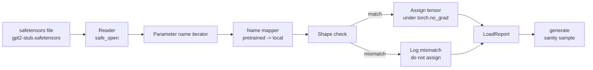

# Carrega Peso Pré-Exercitado

> A partir de zero treinamento um modelo de 124 milhões de parâmetros é a decisão orçamental; carga um ponto de controle aberto 则是日常操作。本课会将安全感器文件中预训练的GPT-2风格重量加载到课35的同一个建筑中,逐段讲解参数名映射,并通过智能生成一个延续来证明加载成功──无网络、无第三方加载者、无不透明魔法──

**Type:** Build
**Languages:** Python
**Prerequisites:** Phase 19 lessons 30 to 36
**Time:** ~90 minutes

## Objetivos de aprendizagem

- Utilização `safetensors`Python biblioteca 读取 safetensors arquivo,并检查 tensor nomes 和 formas。
- Vai cada nome de parâmetro pré-treinado 映射到课 35 GPT modelo 内部一个参数──
- 处理 publicado GPT-2 pesos e este modelo de pista   entre diferentes dois conjuntos de nomes约定:`wte/wpe/h.N.attn.c_attn/c_proj`和 `mlp.c_fc/c_proj`, , , , , , , , , , , , , , , , , , , , , , , , , , , , , , , , , , , , , , , , , , , , , , , , , , , , , , , , , , , , , , , , , , , , , , , , , , , , , , , , , , , , , , , , , , , , , , , , , , , , , , , , , , , , , , , , , , , , , , , , , , , , , , , , , , , , , , , , , , , , , , , , , , , , , , , , , , , , , , , , , , , , , , , , , , , , , , , , , , , , , , , , , , , , , , , , , , , , , , , , , , , , , , , , , , , , , , , , , , , , , , , , , , , , , , , , , , , , , , , , , , , , , , , , , , , , , , , , , , , , , , , , , , , , , , , , , , , , , , , , , , , , , , , , , , , , , , , , , , , , , , , , , , , , , , , , , , , , , , , , , , , , , , , , , , , , , , , , , , , , , , , , , , , , , , , , , , , , , , , , , , , , , , , , , , , , , , , , , , , , , , , , , , , , , , , , , , , , , , , , , , , , , , , , , , , , , , , , , , , , , , , , , , , , , , , , , , , , , , , , , , , , , , , , , , , , , , , , , , , , , , , , , , , , , , , , , , , , , , , , , , , , , , , , , , , , , , , , , , , , , , , , , , , , , ,`tok_embed/pos_embed/blocks.N.attn.qkv/out_proj`和 `mlp.fc1/fc2`- Não.
- Em qualquer atribuição de peso 发生前,检测并拒绝形状不匹配,并给出清晰错误──
- Utilize pesos carregados 生成一个短续航,并确认代币 来自加载分布,而不是随机初始分布──

## O problema

Pesos publicados não são para sua arquitetura 打包的. Eles carregam o nome original implement use.`(2304, 768)`de `transformer.h.0.attn.c_attn.weight`O seu modelo                                                                                                                                                                                                                                                                                                                                                                                                                                                                                                                           `(2304, 768)`de `blocks.0.attn.qkv.weight`(É a mesma Matrix, apenas convenção de layout diferente), ou o seu modelo de uso `nn.Linear`, será transformado em forma de armazenamento Matrix. O mesmo parâmetro aparecerá com três diferentes detalhes de identidade.

 blind copy loader  blind copy loader  blind copy loader  blind copy loader  blind copy loader  blind copy loader  blind copy loader  blind copy loader  blind copy loader  blind copy loader  blind copy loader  blind copy loader  blind copy loader  blind copy loader  blind copy loader  blind copy loader  blind copy loader  blind copy loader  blind copy loader  blind copy loader  blind copy loader  blind copy loader  blind copy loader  blind copy loader  blind copy loader  blind copy loader  blind copy loader  blind copy loader  blind copy loader  blind copy loader  blind copy loader  blind copy loader  blind copy loader  blind copy loader  blind copy loader  blind copy loader  blind copy loader  blind copy loader  blind copy loader  blind copy loader  blind copy loader  blind copy loader  blind copy loader  blind copy loader  blind copy loader  blind copy loader  blind copy loader  blind copy loader  blind copy loader  blind copy loader  blind copy loader  blind copy loader  blind loader  blind copy loader  blind loader  blind loader  blind loader  blind loader loader loader loader loader loader loader loader loader loader loader loader loader loader loader loader loader loader loader loader loader loader loader loader loader loader loader loader loader loader loader loader loader loader loader loader loader loader loader loader loader loader loader loader loader loader loader loader loader loader loader loader loader loader loader loader loader loader loader loader loader loader loader loader loader loader loader loader loader loader loader loader loader loader loader loader loader loader loader loader loader loader loader loader loader loader loader loader loader loader loader loader loader loader loader loader loader loader loader loader loader loader loader loader loader loader loader loader loader loader loader loader loader lo`LoadReport`Uma série de acertos, falhas e desajustes de forma, deixe-te ler o que aconteceu.

## O conceito



O nome do mapeador  meramente uma função de string para string.`torch.no_grad()`内部, portanto, autograd não seguirá o processo de carga.

### Convenção de denominação GPT-2

Pesos publicados GPT-2 使用如下名称:

| Pretrained name | Shape | Meaning |
|-----------------|-------|---------|
| `wte.weight` | (50257, 768) | Token Embedding |
| `wpe.weight` | (1024, 768) | Position Embedding |
| `h.N.ln_1.weight` | (768,) | block N 的 LayerNorm 1 scale |
| `h.N.ln_1.bias` | (768,) | block N 的 LayerNorm 1 shift |
| `h.N.attn.c_attn.weight` | (768, 2304) | 融合 QKV linear weight |
| `h.N.attn.c_attn.bias` | (2304,) | 融合 QKV linear bias |
| `h.N.attn.c_proj.weight` | (768, 768) | Attention output projection |
| `h.N.attn.c_proj.bias` | (768,) | Attention output projection bias |
| `h.N.ln_2.weight` | (768,) | LayerNorm 2 scale |
| `h.N.ln_2.bias` | (768,) | LayerNorm 2 shift |
| `h.N.mlp.c_fc.weight` | (768, 3072) | MLP fc1 weight |
| `h.N.mlp.c_fc.bias` | (3072,) | MLP fc1 bias |
| `h.N.mlp.c_proj.weight` | (3072, 768) | MLP fc2 weight |
| `h.N.mlp.c_proj.bias` | (768,) | MLP fc2 bias |
| `ln_f.weight` | (768,) | Final LayerNorm scale |
| `ln_f.bias` | (768,) | Final LayerNorm shift |

Há dois pontos inesperados que precisam de ser tratados.`c_attn`- Não.`c_proj`- Não.`c_fc`Estes lineares de Matrix armazenamento de modo, em relação a`nn.Linear.weight`期望方式是转置的. Loader 会在任务时转置. LM head 完全不在文件中;模型依赖与 `wte`de peso, assim que `wte`- Não, não. - Não, não.

### A convenção local de nomeação

本 track 的模型 使用描述性名称:

| Local name | Meaning |
|------------|---------|
| `tok_embed.weight` | Token Embedding |
| `pos_embed.weight` | Position Embedding |
| `blocks.N.ln1.scale` | block N 的 LayerNorm 1 scale |
| `blocks.N.ln1.shift` | LayerNorm 1 shift |
| `blocks.N.attn.qkv.weight` | 融合 QKV |
| `blocks.N.attn.qkv.bias` | 融合 QKV bias |
| `blocks.N.attn.out_proj.weight` | Attention output projection |
| `blocks.N.attn.out_proj.bias` | Output projection bias |
| `blocks.N.ln2.scale` | LayerNorm 2 scale |
| `blocks.N.ln2.shift` | LayerNorm 2 shift |
| `blocks.N.mlp.fc1.weight` | MLP fc1 |
| `blocks.N.mlp.fc1.bias` | MLP fc1 bias |
| `blocks.N.mlp.fc2.weight` | MLP fc2 |
| `blocks.N.mlp.fc2.bias` | MLP fc2 bias |
| `final_ln.scale` | Final LayerNorm scale |
| `final_ln.shift` | Final LayerNorm shift |

Mapear é uma função fixa.

### O aparelho de estúdio

GPT-2 real pesa aproximadamente 0,5 GB。 Demo não vai baixá-los; ele vai gerar um pequeno dispositivo de segurança quando executado pela primeira vez, adotando a mesma convenção de nomeação GPT-2, e usando para o modelo de 12 blocos、d_modelo 192 em vez de formas de 768.


```figure
cc-weight-remap
```

## Construí-lo

`code/main.py`实现:

- Uma lição 35 .`GPTModel`De pequeno em pequeno, faz o curso se incluir.
- `make_pretrained_to_local(num_layers)`,展开每层条目──
- `load_safetensors(model, path)`,代名字、映射名字、检查形、转置 conv1d-style weights, e `torch.no_grad()`A missão seguinte.`LoadReport`- Não.
- `make_stub_safetensors(path, cfg)`, gerar um arquivo de fixação de convenção de nomeação pré-treinada de adopção.
- Uma demonstração: primeira vez em funcionamento`outputs/gpt2-stub.safetensors`, construir um modelo novo, capturar random init 生成 uma continuação, carregar stub, re capturar outra continuação, imprimir二者,并验证两者不同(加载确实改变了模型) 

运行:

```bash
python3 code/main.py
```

Output:fix path ∆ nome de cada log de carga ∆`LoadReport`Resumo 、carga anterior 、continuação após a carga, bem como um único tensor ruim injetado na fixação  provocando desajuste de forma, para cobrir o caminho de falha。

## Estaca

- `safetensors`Utilizado em formato de disco e leitor de streaming.
- `torch`Utilizado em modelo e matemática de tarefa.
- Não uso`transformers`, Não utiliza`huggingface_hub`Não faça chamadas de rede.

## Padrões de produção em silêncio

Três padrões podem fazer com que o carregador seja confiável em relação aos pesos que você não criou.

**始终在任何 assignment 前验证 file。**打开文件,列出每个 tensor name 及其dtype 和形,运行完整映射和形检查,只有在成功后才开始分配──半加载模型 是静默失败机器──

**每次 assignment 都记录 source name 和 destination name。**Quando algo parece errado, o log vai dizer-te qual tensor está no seu caminho.`LoadReport`Dataclass 会跟踪 `loaded`- Não.`missing`- Não.`unexpected`和 `shape_mismatch`Lista, e final imprimir resumo.

**LM head 是 weight tying alias，不是单独 copy。**Carrega`tok_embed`后设置 `model.lm_head.weight = model.tok_embed.weight`É um padrão de regulamentação.`lm_head.weight`Parâmetro 会破坏 ties,并让参数数 翻倍──

## Usá-lo

- Loader 适用于任何使用预训命名公约的安全感器文件──真实GPT-2文件(small / medium / large / xl)无需代码变化 即可工作;只有模型配置 不同──
- Uma vez que o mapa de nome é atualizado, o mesmo padrão pode ser expandido para LLaMA、Mistral、Qwen pesos。Cheques de forma 和 relatório 保持不变。
- A geração de sanidade após a carga é um portal rápido: se as amostras pós-carga parecem como amostras de pré-carga, a carga não altera o modelo, também significa que o mapeamento está silenciosamente perdido cada tensor.

## Exercícios

1. Por carregador 添加 `dtype`Argumento, durante a atribuição  vai cada tensor lançado para o tipo de alvo d(`bfloat16`- Não.`float16`- Não.`float32`)。 confirmação `float32`O modelo pode ser abaixado até`bfloat16`Ainda não se pode gerar.
2. 添加 `expected_layers`Argumento, rejeição de carga`h.N`Indices e modelo de`num_layers`Não correspondem pontos de controlo.
3. Colocar o carregador 接入 lição 35 função de geração,并生成两个并排样本: um proveniente de init aleatório, um proveniente de fixação carregada。
4. 添加出口路径:使用预训练命名公约 将当前模型状态 写入一个新的安全感器文件──轮回旅行载荷器 并确认报告 中形状不一致 为零──
5. 扩展 `NAME_MAP`以處理 LLaMA naming convention ((無偏見、RMSNorm、fused qkv layout), e em você gerar esteb LLaMA fixação 上重新运行 loader。

## Termos-chave

| Term | What people say | What it actually means |
|------|-----------------|------------------------|
| Name map | "Key remapping" | 从 pretrained tensor names 到 local parameter names 的 function；通常是一个 literal dict，每个 layer index 一个 entry，并在 loop 中展开 |
| Shape mismatch | "Bad shape" | Pretrained tensor 存在于 mapped name 下，但其 dimensions 与 local parameter 不一致；loader 会拒绝 assignment 并记录这对 name |
| Transpose-on-load | "Conv1d layout" | Published GPT-2 将 Attention 和 MLP projections 存储为 nn.Linear 期望形式的转置；loader 会在 assignment 时转置 |
| Weight tying alias | "Shared LM head" | 设置 model.lm_head.weight = model.tok_embed.weight，让 head 和 Embedding 共享 storage；正因为如此，head 不在 file 中 |
| Load report | "Coverage summary" | 一个小型 dataclass，跟踪 loaded、missing、unexpected 和 shape_mismatch lists；打印它可以判断加载是否成功 |

## Mais leitura

- Fase 19 lição 35: Arquitetura de pesos de recepção.
- Fase 19 lição 36: gerar um ciclo de treinamento de um ponto de controlo de forma igual.
- Fase 10 lição 11 ((quantização): memória 紧张时如何处理载重――
- Fase 10 lição 13 ((construção de um pipeline completo de LLM):carga e inferência 周边的完整生命周期──
