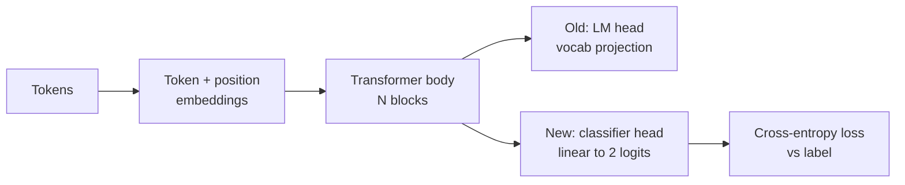
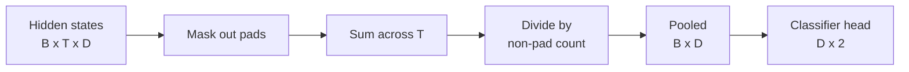
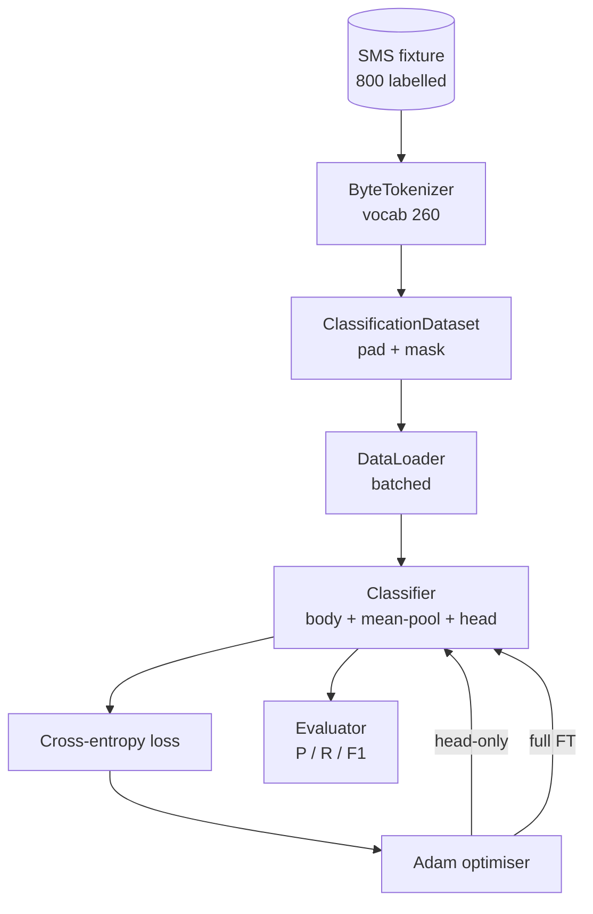

# Capstone Lesson 38: através de Head Swap  Classificador de Fine-Tuning

> O primeiro capstone da faixa B。 O modelo de linguagem treinada é um superposição de blocos de auto-atenção, o fim é a cabeça de previsão de token。 Quando você quer fazer spam vs ham 时, a cabeça é errada, mas o corpo 基本是对的。本课会拆掉头,把一个两类线线层 接到集成表示 上,并使用两种方式训练类分类器:final-layer only 和 full fine-tuning。Eval Using held-out split 上的精度、recall 和 F1。 Você aprenderá a trazer cada tipo de estratégia、代价是什么──

**Type:** Build
**Languages:** Python (torch, numpy)
**Prerequisites:** Phase 19 lessons 30-37 (NLP LLM track: tokenizer, embedding table, attention block, transformer body, pre-training loop, checkpointing, generation, perplexity)
**Time:** ~90 minutes

## Objetivos de aprendizagem

- Em caso de não reinicialização do corpo, substituir o cabeçalho do modelo de linguagem por cabeçalho de Classificação.
- 实现两种训练模式:body freeze (só cabeças) e full fine tuning,并共享同一个训练循环──
- Construir um pipeline de dados consciente do tokenizador, responsável pelo enchimento, enchimento de máscaras, fazer um pooling em relação à saída da atenção.
- A partir de logs brutos  calcular precisão ∞ record ∞ F1 ∞ Matrix de confusão ∞
-                                                                                                                                                                                                                                                               

## O problema

Você já está no corpus genérico  um pequeno transformador ⋅ cabeça de saída ⋅ vai colocar o último estado oculto ⋅ projeção até o vocabulário de 1000 tokens ⋅ agora você tem 800 ⋅ 条 marcadas para spam ou ham de mensagens de SMS, esperando construir um classificador binário ⋅ aqui há três opções ⋅

错误选择是基于800 个例从零训练一个新类型器――教练模型的体体已经编码了有用结构:word identity、position、简单 co-occurrence――丢失它就是浪费构建它时消耗的计算――

两个正确选择是头交换 后结身体,以及头交换 后让身体可训练――Head-only training 快速,memory 几乎免费,在这么少的数据上也不太容易过──Full fine-tuning 更慢,在小数据上可能过,但当下游域 偏离预训体时可以达到更高的精度──

Esta aula irá construir os dois, deixando-te em um mesmo encontro.

## O conceito



Modelo é uma função:`f_theta(tokens) -> hidden_states`- A cabeça é uma função:`g_phi(hidden) -> logits`"Capa de troca" significa "reserva".`theta`E substituí-lo`g_phi`Os parâmetros do corpo são uma parte cara. A cabeça é apenas uma camada linear.

Há dois grupos de parâmetros treinables  muito importante:

- `theta`Cada bloco de atenção tem milhares de pesos.
- `phi`(cabeça):`hidden_dim * num_classes`Pesos adicionados a um viés.

Em treinamento só com a cabeça, você é alvo.`phi`计算 gradientes,并让 `theta`Os gradientes são os seguintes:`requires_grad=False`Para fazer isso, otimizar, ver a cabeça, o corpo, ficar congelado.

Em plena sintonia, você permite que os gradientes voltam a passar por toda a pilha. Os pesos do corpo vão mudar para o objetivo da classificação.

## A questão da unificação

Classificador  precisa de cada sequência um vetor, em vez de cada token um vetor.

- **Mean pool**Mas mas mas mas mas mas mas mas mas mas mas mas mas mas mas mas mas mas mas mas mas mas mas mas mas mas mas mas mas mas mas mas mas mas mas mas mas mas mas mas mas mas mas mas mas mas mas mas mas mas mas mas mas mas mas mas mas mas mas mas mas mas mas mas mas mas mas mas mas mas mas mas mas mas mas mas mas mas mas mas mas mas mas mas mas mas mas mas mas mas mas mas mas mas mas mas mas mas mas mas mas mas mas mas mas mas mas mas mas mas mas mas mas mas mas mas mas mas mas mas mas mas mas mas mas mas mas mas mas mas mas mas mas mas mas mas mas mas mas mas mas mas mas mas mas mas mas mas mas mas mas mas mas mas mas mas mas mas mas mas mas mas mas mas mas mas mas mas mas mas mas mas mas mas mas mas mas mas mas mas mas mas mas mas mas mas mas mas mas mas mas mas mas mas mas mas mas mas mas mas mas mas mas mas mas mas mas mas mas mas mas mas mas mas mas mas mas mas mas mas mas mas mas mas mas mas mas mas mas mas mas mas mas mas mas mas mas mas mas mas mas mas mas mas mas mas mas mas mas mas mas mas mas mas mas mas mas mas mas mas mas mas mas mas mas mas mas mas mas mas mas mas mas mas mas mas mas mas mas mas mas mas mas mas mas mas mas mas mas mas mas mas mas mas mas mas mas mas mas mas mas mas mas mas mas mas mas mas mas mas mas mas mas mas mas mas mas mas mas mas mas mas mas mas mas mas mas mas mas mas mas mas mas mas mas mas mas mas mas mas mas mas mas mas mas mas mas mas mas mas mas mas mas mas mas mas mas mas mas mas mas mas mas mas mas mas mas mas mas mas mas mas mas mas mas mas mas mas mas mas mas mas mas mas mas mas mas mas mas mas mas mas mas mas mas mas mas mas mas mas mas mas mas mas mas mas mas mas mas mas mas mas mas mas mas mas mas mas mas mas mas mas mas mas mas mas mas mas mas mas mas mas mas mas mas mas mas mas mas mas mas mas mas mas mas mas mas mas mas mas mas mas mas mas mas mas mas mas mas mas mas mas mas mas mas mas mas mas mas mas mas mas mas mas mas mas mas mas mas mas mas mas mas mas mas mas mas mas mas mas mas mas mas mas mas mas mas mas mas mas mas mas mas mas mas mas mas mas mas mas
- **CLS pool**:前置一个特殊代币,并只使用它的输出――这是BERT的做法──
- **Last-token pool**Usar o último token não padgando. É a prática dos classificadores da classe GPT.

O método de ponderação de massa de atenção é simples, em diferentes comprimentos de sequência, para fornecer um sinal estável, e não requer um token CLS pré-treino.



## Os dados

800 SMS, 400 spam e 400 ham, tudo está pronto.`code/main.py`Produzir geradores de dados real. Utilizando sementes fixas, selecionar modelos e substituir preenchimentos de slots, emitir mensagens de 5 a 25 tokens.

Dados 按 80/20 split:640 train,160 test。 Splits 使用 stratified, therefore test set 保持 50/50 balance。 一个 balance 已知的 held-out set 能让精度 和回忆 被当作可信数字 解读。

## As métricas

Classificação binária 中 classe 1 é classe positiva(spam)。计数如下:

- `TP`Previo: Previo para spam, na verdade é spam.
- `FP`O que é que é spam?
- `FN`Previo: Previo para o presunto, na verdade é spam.
- `TN`Previo: Previo: Previo: Previo: Previo: Previo: Previo: Previo: Previo: Previo: Previo: Previo: Previo: Previo: Previo: Previo: Previo: Previo: Previo: Previo: Previo: Previo: Previo: Previo: Previo: Previo: Previo: Previo: Previo: Previo: Previo: Previo: Previo: Previo: Previo: Previo: Previo: Previo: Previo: Previo: Previo: Previo: Previo: Previo: Previo: Previo: Previo: Previo: Previo: Previo: Previo: Previo: Previo: Previo: Previo: Previo: Previo: Previo: Previo: Previo: Previo: Previo: Previo: Previo: Previo: Previo: Previo: Previo: Previo: Previo: Previo: Previo: Previo: Previo: Previo: Previo: Previo: Previo: Previo: Previo: Previo: Previo: Preço: Preço: Preço: Preço: Preço: Preço: Preço: Preço: Preço: Preço: Preço: Preço: Preço: Preço: Preço: Preço: Preço: Preço: Preço: Preço: Preço: Preço: Preço: Preço: Preço: Preço: Preço: Preço: Preço: Preço: Preço: Preço: Preço: Preço: Preço: Preço: Preço: Preço: Preço: Preço: Preço: Preço: Preço: Preço: Preço: Preço: Preço: Preço: Preço: Preço: Preço: Preço: Preço: Preço: Preço: Preço: Preço: Preço: Preço: Preço: Preço: Preço: Preço: Preço: Preço: Preço: Preço: Preço: Preço: Preço: Preço: Preço: Preço: Preço: Preço: Preço: Preço: Preço: Preço: Preço: Preço: Preço: Preço: Preço: Preço: Preço: Preço: Preço:

Três métricas principais:

- `precision = TP / (TP + FP)`◊ Em mensagens marcadas como spam, qual é a percentagem real de spam?
- `recall = TP / (TP + FN)`◊ Em spam real, qual é a proporção de modelos marcados?
- `F1 = 2 * P * R / (P + R)`◊ 2 - Meio harmonico dos participantes

Matriz de confusão 会把四个计数打印为2x2 grid。Demo 会把两种训练模式的结果都写到stdout。


```figure
cap-classifier-head-swap
```

## Arquitetura



O corpo é um transformador muito pequeno: vocabulário 260 ̊ oculto 64 ̊4 cabeças ̊ 2 blocos ̊ sequência máxima 32 ̊. É pequeno o suficiente, pode ser treinado em 90 segundos na CPU para a convergência ̊.`pretrain_quick`O assistente vai estar no mesmo texto do mesmo período de treinamento de LM, fazendo com que o corpo tenha um ponto de partida extraordinário.

## O que você vai construir

Implementação é um `main.py`Adição de um módulo de teste`code/tests/test_main.py`)。

1. `ByteTokenizer`:把字节 映射到 ids,并保留一个pad id──
2. `Block`: 带 Multi-Head Attention 和 feed-forward layer 的变压器块──Pre-norm──
3. `LMBody`:Token + posição Embeddings 加上一叠块──返回隐藏状态──
4. `MeanPool`: ao longo do eixo da sequência fazer média ponderada mascarada。
5. `Classifier`O corpo em diferentes regimes é o mesmo exemplo.
6. `freeze_body`和 `unfreeze_body`: mudança de parâmetros do corpo  上 的`requires_grad`- Não.
7. `train_classifier`: um ciclo de partilha;. modelo de recepção 和 um para o grupo de parâmetros treináveis atuais 配置的优化器。
8. `evaluate`:运行 test set 并返回 `Metrics(precision, recall, f1, confusion)`- Não.
9. `run_demo`Primeiro, um corpo de preparação, depois, um corpo de preparação, depois, um corpo de preparação, depois, um corpo de preparação, depois, um corpo de preparação, depois, um corpo de preparação, depois, um corpo de preparação, depois, um corpo de preparação, depois, um corpo de preparação, depois, um corpo de preparação, depois, um corpo de preparação, depois, um corpo de preparação, depois, um corpo de preparação, depois, um corpo de preparação, depois, um corpo de preparação, depois, um corpo de preparação, depois, um corpo de preparação, depois, um corpo de preparação, depois, um corpo de preparação, depois, um corpo de preparação, depois, um corpo de preparação, um corpo de preparação, e depois, um corpo de preparação, e depois, dois relatórios, e depois, um corpo de preparação, um corpo de preparação, e depois, um corpo de preparação, um corpo de preparação, e depois, um corpo de preparação para a avaliação, e depois, um corpo de zero, um corpo de eliminação.

## Por que a comparação é importante

Regime de cabeça-somente normalmente treinamento mais rápido,并以更平滑的方式不适. Em esta fixação, treinamento de cabeça-somente 后二十个时代, você normalmente verá precisão 接近0.9、回忆 接近0.85。

O livro não escolhe vencedor. Ele ensina-te a entender os números e o custo. O livro é um livro de 800 exemplos e um corpo pequeno.`train_classifier`Função 处理两种情况,together 只是一次调用──

## Objetivos de desenvolvimento

- Adicione o terceiro regime, apenas descongelar o último bloco. Isto é chamado de ajuste fino parcial.
- 添加学习率调节器──对头 用 cosine schedule,并对身体 使用更小的常率,是常见生产设置──
- Use o pool de atenção aprendida  substituir o pooling médio: um带有一个学习查询 的小注意层── em seqüências mais longas 上它通常优于平均 pool──

Implementação  dá-te ganchos. Teste  fixa contrato. Números por ti continuar a avançar.
