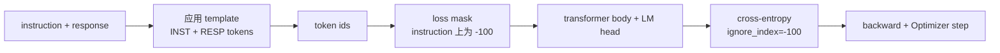
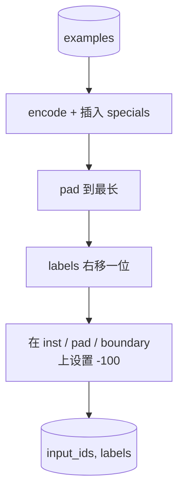
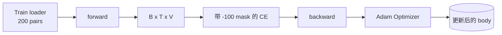

# Capstone 课程 39: através de Supervisão de Ajuste Feio  realizar Ajuste de Instruções

> Modelo base pré-treinado pode prolongar uma sequência, mas não pode seguir uma instrução. O ajuste fino supervisionado é a menor mudança desta correção: para modelo através de instrução 和 expectativa resposta 配对组成的样本,并训练主体来预测响应代币.`ignore_index=-100`屏蔽 instrução tokens,在 200 个 instrução-resposta pares 上训练,并使用精确匹配在持久的分分上评估──

**Type:** Build
**Languages:** Python (torch, numpy)
**Prerequisites:** Phase 19 lessons 30-37 (NLP LLM track: tokenizer, embedding table, attention block, transformer body, pre-training loop, checkpointing, generation, perplexity)
**Time:** ~90 minutes

## Objetivos de aprendizagem

- O conjunto de dados de instrução-resposta será formado em uma única sequência causal de tokens de fronteira visíveis.
- Construir uma função de collage, proteger os tokens de instrução, fazer a entropia cruzada apenas calcular os tokens de resposta.
- Em SFT objetivo, você pode treinar um pequeno corpo transformador, e observar as mudanças em métricas de avaliação.
- 实现 avarice 和 geração de temperatura-sampulado,并遵守反应-start boundary──
- Para completar a produção, calcular a correspondência exata.

## O problema

Usar a previsão do próximo token  o modelo base do treinamento Não sei o que é instrução `"What is the capital of France?"`, continuará com o problema, ou irá criar uma nova frase.

O contrato SFT é um modelo de string. Cada treinamento se transforma em uma sequência única que contém três regiões:

```text
<INST> What is the capital of France? <RESP> The capital of France is Paris.
```

Tokens de fronteira são tokens especiais que são mantidos durante o treino.`<RESP>` Tudo depois é resposta, e a resposta  é apenas parte da avaliação  O próximo token objetivo do modelo base  ainda é aplicável; é apenas treinado em cada exemplo 

Mas aqui há uma armadilha. Se você colocar toda a sequência em perda de entropia cruzada normal, você também está em treinamento.

## O conceito



`ignore_index`Sim `torch.nn.functional.cross_entropy`Qualquer posição-alvo é igual a `ignore_index`Cidade Contribuição Zero Perda 和零 Gradiente。PyTorch 中的惯例是 `-100`◊ função de collagem para cada exemplo construção de dois tensores:`input_ids`(Précédito completo)`labels`(`input_ids`de vice-presidente, entre os quais as posições de instrução foram cobertas por`-100`)。

模型在前进传递 期间看整个序列;Attention 可以参加到指示――Loss 只计算响应代币――这正是你想要的:condition on the instruction, predict the response──

## Os dados

`main.py`Na determinação gerada, foram gerados 200 pares de instruções-resposta.

- O que é que é o "Simple Shot" (X 的首都)
- Aritmética
- Extração de listas
- Resumo de uma frase
- código(impressão, classificação)
- definição

Cada tarefa tem uma instrução templada e uma resposta determinista. É um design simples.

Divisões para 160 treinos  40 testes  test set                                                                                                                                                                                                                                                                                                                                                                                                                                                                                                                

## Tokenização e empolgação

O tokeniser é de nível de byte, e tem três reservantes especiais:

- `INST_ID = 256`: 标记 instrução região 的开始──
- `RESP_ID = 257`O limite entre instrução e resposta 
- `PAD_ID = 258`: para uso em lotes de comprimento variável

O processo é`[INST] inst_bytes [RESP] resp_bytes [PAD]*`Função de colágeno:

1. Tokenises Cada um deles.
2. Para cada um dos casos de batches, a pad deve ser a maior sequência de batches.
3. Construção`labels`= 右移一位的 `input_ids`(alvo de LM causante), e:
   - 将 instrução região 替换为 `-100`- Não.
   - 将 region de empolgação 替换为 `-100`- Não.
   - - Não .`RESP_ID`posição de limite 本身替换为 `-100`(你不训练模型预测 boundary token; é o que significa que você está fazendo isso)



O truque causal é o seguinte:`input_ids`da posição `i`预测 posição `i+1`, portanto `labels[i] = input_ids[i+1]`(entrada 丢弃最终位置, target 丢弃第一个位置) mask 在转变 后应用,以落在正确位置上──

## Formação



loop é padrão PyTorch SFT loop。Adam, taxa de aprendizagem 约3e-4到1e-3,在这个固定上训练十到二十个时代,不使用时间表──模型足够小(隐藏 96、2块、最大长度64),可以在两分钟内内在CPU上训到收──

Cada cinco épocas, o loop irá estar em conjunto, executando um pequeno teste de avaliação e imprimindo uma correspondência exata. Veja a correspondência exata.

## Geração

eval 时,模型获得 instrução prefixo `[INST] inst_bytes [RESP]`,并生成 tokens, até:

- 序列 atingir `max_len`, ou
- 模型触发一个特殊停止 heurística:连续两个句子结束的字节(`.`- Não.`!`- Não.`?`)。

Este curso fornece decodificação gananciosa,并附带一个可选温度样本.

## Avaliação de correspondência exata

A correspondência exacta é a métrica de texto mais rigorosa. A cadeia de resposta de previsão será normalizada (minúsculas, espaços brancos de faixa, duplos espaços de colapso), e comparada com a mesma resposta de referência normalizada.

Os verdadeiros canais SFT vão usar o nível de token F1 ((leção 41) e o modelo de juiz  complementar a correspondência exata―Exact-match  ainda é útil, pois não tem diferença; se ele mostra 0,7, significa que 70% das instruções de teste  por caracteres geram resposta de ouro―


```figure
cc-sft-loss-mask
```

## O que você vai construir

                                                                                                                                                                                                                                                                                                                                                                                                                                                                                                                             `main.py`- Os testes são compostos.

1. `InstructionTokenizer`:带 reserved specials 的字节级编码编码说明前或全对──
2. `make_dataset`O processo de produção de sementes estável é realizado através de um conjunto de 200 pares de seis tipos de tarefas.
3. `SFTDataset`Para cada caso, volte.`(input_ids, labels)`E já está pronto para a máscara.
4. `sft_collate`: padding dinâmico, construção tensor de lote, em instrução 和 pad posições 上设置 `-100`- Não.
5. `TinyGPT`O corpo do transformador 加 ligado ou não ligado cabeça LM
6. `train_sft`:SFT loop,带 per-epoch eval hooks。
7. `generate`A partir do prefixo  realizar decodificação causal, ganancioso ou amostragado,并带 stop heuristic。
8. `exact_match`:comparar as linhas normalizadas, retornar `[0, 1]`Flutuar em interior.
9. `run_demo`: Construir dados, treinar vinte épocas, avaliar, imprimir por categoria,并成功时以零 退出──

## Por que a máscara importa

没有面具,Loss 会把指示令牌当作目标――模型会学习预测指示―― é um objetivo diferente,并将从两方面产生更差的模型―― Primeiro, a capacidade do modelo é desperdiçada para reedificar os insumos fornecidos pelo usuário 总会―― segundo, na maioria dos lotes de tokens de instrução, a quantidade de tokens de resposta é maior, portanto, a resposta perda é menor na parte Gradiente 总和中占比较小; Optimizer em seu verdadeiro interesse parte é mais baixa em relação à expectativa――mask não é polido; é o objetivo――

## Objetivos de desenvolvimento

- Adicionar o aquecimento da taxa de aprendizagem, em seguida, usar a decadência do cosino.
- 添加 per token Loss logging,并绘制训练过程中的 Loss curve──注意早期时代 由模板代币(`<RESP>`、prefixos comuns) 主导,后期 épocas 由真实答案代币 主导。
- O valor será expanso para BLEU-1 ou chrF.
- Adicione um modelo de chat com formato multi-turn e contém um conjunto de acompanhamentos.

实现会给你格式合约、mask 和 loop── de modelo base para seguidor de instrução 变化,就是一个拼接函数──
