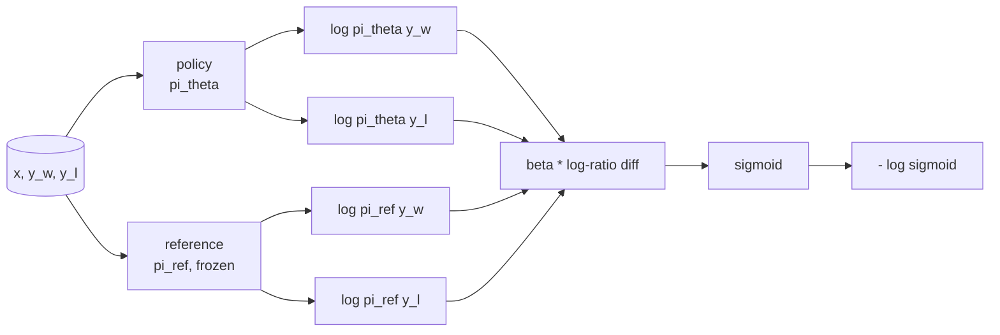
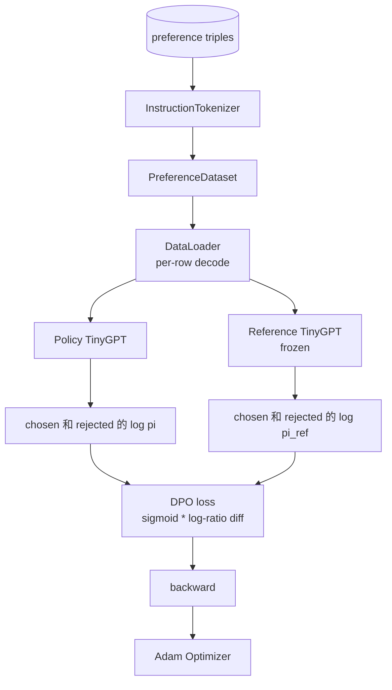

# Capstone  Curso 40: Desde zero começar a implementar a otimização de preferências diretas

> Modelos de recompensa 和 PPO é clássico RLHF stack。DPO vai comprimir esta stack  em uma perda supervisionada, diretamente com pares de preferências    políticaƒ 本课会从奖励差异身份 推导 DPO perda,提供可工作的参考模型 加政策模型,计算每代币日志-概率,并在一个由选和拒绝完成的 组成的偏好固定 上训练小变压器──Tests Fix Loss math 和 Gradient direction,让你知道与文件实现 一致

**Type:** Build
**Languages:** Python (torch, numpy)
**Prerequisites:** Phase 19 lessons 30-37 (NLP LLM track: tokenizer, embedding table, attention block, transformer body, pre-training loop, checkpointing, generation, perplexity)
**Time:** ~90 minutes

## Objetivos de aprendizagem

- O DPO perdeu o seu valor de valor, e o segmoide está ligado à recompensa implícita.
- Construir um modelo de referência + par de modelos de política, entre os quais a referência congelada, a política formável¬
- Em dois modelos, calcula as probabilidades de log em nível de sequência,并 mask prompt tokens。
- Em`(prompt, chosen, rejected)`Triple 上訓練政策,并观察 escolhido log-prob relativa rejeitada 上升──
- Utilize tests fix Loss math、Gradient sign 和 reference invariance 的行为──

## O problema

Você tem um modelo SFT. Ele vai seguir as instruções, mas a saída não está estável. Algumas conclusões 清晰,有些冗长或错误. Você também tem um pequeno conjunto de dados de pares de preferências: para o mesmo prompt, humanos vão escolher uma conclusão, outro será rejeitado.

经典 RLHF 答案是两阶段管道――先用偏好――训练奖励模型――再用 PPO 根据奖励 优化政策―― 这可行,但成本很高:PPO 期间内存中有两个模型,需要 KL control来让政策 接近参考,且当奖励模型 脆弱时会出现奖励黑客――

DPO utiliza uma perda supervisionada  substituir estas duas fases. O modelo de recompensa                                                                                                                                                                                                                                                                                                                                                                                                                                                                                                           

## O conceito

O modelo Bradley-Terry começou.`x`E duas conclusões.`y_w`(eleito)`y_l`(rejeitado), humanos preferência `y_w`A probabilidade é

```math
P(y_w > y_l \mid x) = \sigma\big( r(x, y_w) - r(x, y_l) \big)
```

Entre eles `r`É uma função de recompensa latente.`r`, e depois a política de treinamento .`pi`, com o âncora KL maximizar `r`- Não .

```math
\max_{\pi} \; \mathbb{E}_{x, y \sim \pi} \big[ r(x, y) \big] - \beta \, \mathrm{KL}(\pi \,\|\, \pi_{\text{ref}})
```

O DPO recomenda observar que, neste objectivo, a política óptima`pi*`Pode ser usado.`r`写成 forma fechada:

```math
\pi^*(y \mid x) = \frac{1}{Z(x)} \, \pi_{\text{ref}}(y \mid x) \exp\!\left( \frac{r(x, y)}{\beta} \right)
```

Para o`r`重新整理:

```math
r(x, y) = \beta \big( \log \pi^*(y \mid x) - \log \pi_{\text{ref}}(y \mid x) \big) + \beta \log Z(x)
```

`log Z(x)`项对 `y_w`和 `y_l`É assim que depende.`x`- Não .`y`), portanto, na calculação da diferença de preferência 时会抵消:

```math
\begin{aligned}
r(x, y_w) - r(x, y_l) = \beta \big( &\log \pi_\theta(y_w \mid x) - \log \pi_{\text{ref}}(y_w \mid x) \\
&- \log \pi_\theta(y_l \mid x) + \log \pi_{\text{ref}}(y_l \mid x) \big)
\end{aligned}
```

代入Bradley-Terry sigmoid,并对偏好对取负记录概率:

```math
\begin{aligned}
L_{\text{DPO}}(\theta) = -\mathbb{E}_{(x, y_w, y_l)} \Big[
  \log \sigma\big( \beta \big( &\log \pi_\theta(y_w \mid x) - \log \pi_{\text{ref}}(y_w \mid x) \\
  &- \log \pi_\theta(y_l \mid x) + \log \pi_{\text{ref}}(y_l \mid x) \big) \big)
\Big]
\end{aligned}
```

É o caso de um sigmoide de um log-probabilidade, que é calculado por quatro log-probabilidades. Não há um modelo de recompensa único. Não há PPO.



## O sinal do gradiente

Antes de qualquer treinamento, há um teste de saúde mental útil.`log pi_theta(y_w | x)`求 Gradiente:

```math
\frac{\partial L_{\text{DPO}}}{\partial \log \pi_\theta(y_w \mid x)} = -\beta \big(1 - \sigma(z)\big)
```

Entre eles `z`É o argumento de Sigmoide.`z`Por isso, o resultado é um aumento da política de log-probabilidade da conclusão escolhida, reduzindo as perdas.`log pi_theta(y_l | x)`O Gradiente 为正: melhorar a probabilidade de log rejeitado 会增加 Loss── treinamento 将将将将选取 往上推,把将将拒绝 往下推── referência é congelada; não se moverá──

## Os dados

Esta aula oferece 12 triplos de preferência.`(prompt, chosen, rejected)` escolha de conclusão 短且精确── rejeitada 冗长、偏题或错误── estes pares 覆盖与课39 相同的任务族(capital、arítmico、lista), portanto, a partir da base da SFT 开始的政策会有一个合理起点──

O DPO em produção irá usar milhares de pares; o foco aqui é Loss math 和 loop 能够在小数据集上端到端运行,并且选择对拒绝日志-prob gap 会显然增加──

## Invariância de referência

O DPO   deve realizar um tratamento detalhado do modelo de referência                                                                                                                                                                                                                                                        

- Parâmetros de referência nunca recebem gradientes.
- As probabilidades de registro de referência em épocas nunca mudarão.
- Política de referência Comparado aos pesos 开始──(óptima `theta`É referência, adicionada a actualização aprendida; será uma política inicialmente orientada para referência, que será um início bem definido.

 Implementar através dos seguintes métodos:

- Passos adiantados 期间用 `torch.no_grad()`- Não.
- Para cada parâmetro de referência  configuração `requires_grad=False`- Não.
- Em referência, construção, através.`policy.load_state_dict(reference.state_dict())`- Política de construção.


```figure
cap-dpo-preference
```

## Arquitetura



模型与课39 中使用的TinyGPT 相同(descóder-only、causal、byte tokeniser) ⋅referência 和 política arquitetura de partilha; pesos de políticas durante o treinamento  derivação de referência 发生发生,而参考 保持固定──

## O que você vai construir

                                                                                                                                                                                                                                                                                                                                                                                                                                                                                                                             `main.py`- Os testes são compostos.

1. `InstructionTokenizer`:带 `INST`和 `RESP`especials ⋅ byte tokeniser ⋅ forma / lição 39 ⋅ 相同──
2. `TinyGPT`A forma é igual à lição 39, por isso, você está saltando acima de 39, e também está se mantendo independente.
3. `make_preferences`- Não .`(prompt, chosen, rejected)`Três vezes.
4. `sequence_log_prob`:给定 model、prompt prefix 和 completion, return completion 上 next-token log-probabilities 的总和(不包含 prompt-position contribution) 』
5. `dpo_loss`:接收四个日志概率 和 `beta`, retornar tensor de perda por exemplo e delta de recompensa implícita para registro.
6. `train_dpo`:per-epoch loop, em política 和 referência 下计算 escolhido Com rejeitado log-probs, aplicada Loss,并执行 Adam step。
7. `evaluate_margins`: в любое время возвращение política Abaixo média margem de probabilidade de registro rejeitada escolhida.
8. `run_demo`A partir de um pequeno aquecimento pré-treino construir referência 和 política, copiar pesos, treinar trinta etapas, imprimir por passo Perda 和 margem,并成功时以零 退出──

## Por que funciona a DPO

Em modelo de preferência Bradley-Terry, abaixo, o DPO em matemática é igual ao RLHF, apenas diferença de remuneração parametrização.`r(x, y) = beta * (log pi(y|x) - log pi_ref(y|x))`Pode ser identificado entre as preferências, mais ou menos um sobre `x`A função, enquanto que ela vai ser em diferença de valor, é uma política de forma fechada, que permite que você salte o modelo de recompensa.`pi`Comparado`pi_ref`Qualquer desvio de qualquer ponto pode fazer com que a relação de log-varia, enquanto a sigmoide se altera, de modo a que a política de um gradiente húmido de tempo muito longo seja a sua rede de segurança.

## Objetivos de desenvolvimento

- Dado o log-probabilidade soma  adicionar normalização de comprimento: exceto para a comprimento de conclusão.
- 添加 Loss of IPO variante: 用`(z - 1)^2`替代 sigmoid + log──比较它在固定上的融合──
- Adicionar um parâmetro de suavização de rótulos, em rótulo rejeitado e uniforme de 0,5.
- Utilize ainda menor 风格)

实现会给你 Loss、reference invariance 和 training loop──math is the core of this lesson──code 让数学 具体化──
