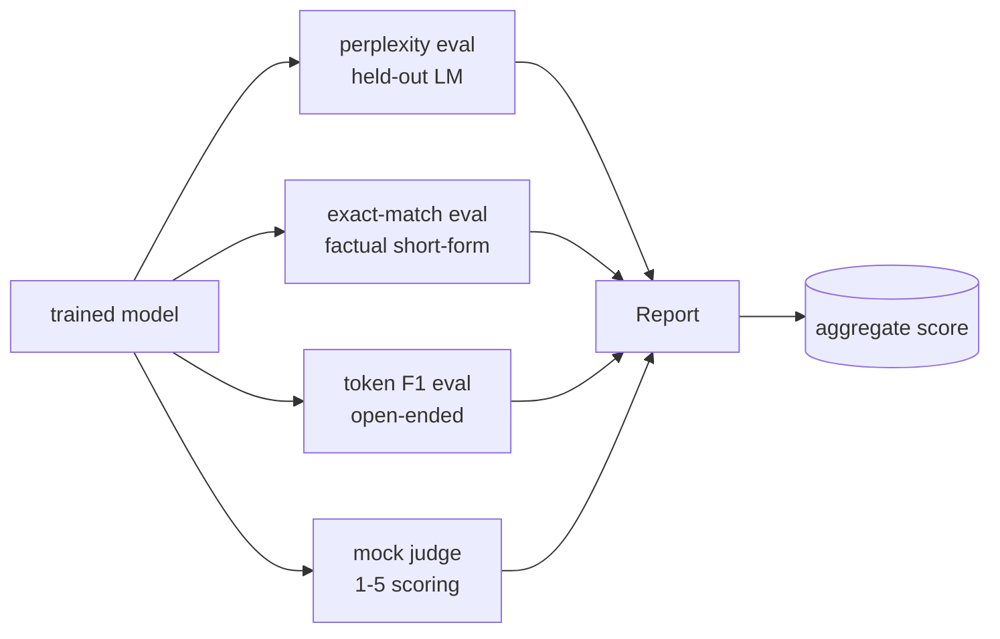
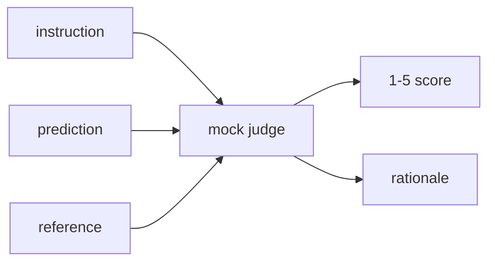
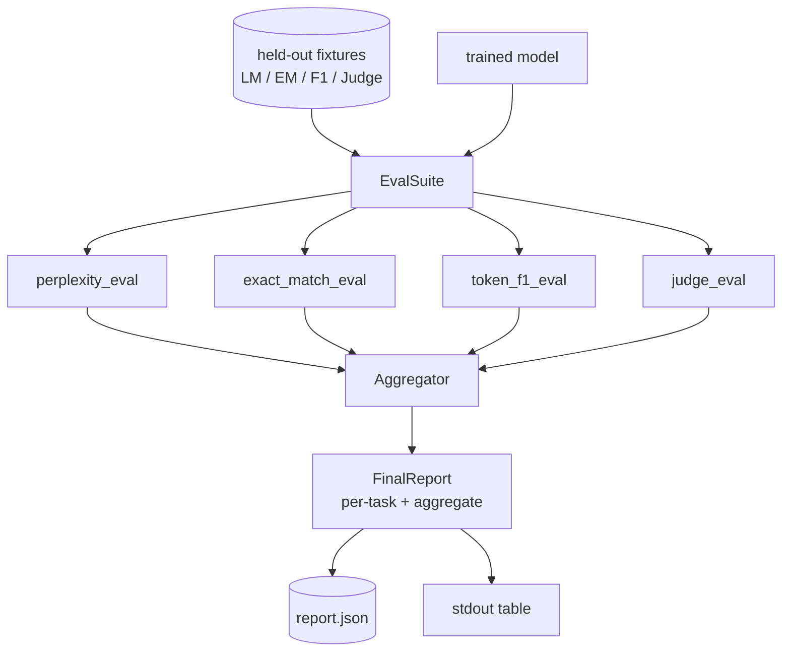

# Capstone Lesson 41: 完整 Pipeline de Avaliação

> O treinamento é uma parte de controle de perdas. A avaliação é uma parte que você deve projetar. Este curso irá construir um pipeline de avaliação unificada: ele recebe um bom modelo de linguagem treinado, em que executa quatro diferentes avaliações, irá reunir os resultados para um relatório de desmantelamento de tarefas, e fornecer um local de simulação LLM como juiz, para que todo o ciclo 无需网络也能运行.

**Type:** Build
**Languages:** Python (torch, numpy)
**Prerequisites:** Phase 19 lessons 30-37 (NLP LLM track: tokenizer, embedding table, attention block, transformer body, pre-training loop, checkpointing, generation, perplexity)
**Time:** ~90 minutes

## Objetivos de aprendizagem

- Em um pequeno transformador, usando símbolos mascarados, calcula a perplexidade.
- Em breve, ele vai fazer uma avaliação de correspondência exata.
-  através da normalização 计算预测与参考 字符串之间的令牌级 F1──
- Construir um LLM local simulado como juiz, com 1-5 porções para dar resultados de modelo 打分──
- Crie quatro avaliações e compõe um relatório único de atribuições, dividido por tarefa.

## O problema

单一指标 永远无法描述一个语言模型――Perplexity 说明模型对语言分布的适应程度,但不说明它是否能回答问题――Exact-match 说明模型 是否产出金字符串,但会惩罚正确的改写――Token F1 会宽容抛词,但可能被错误内容中的词典重叠 欺骗――LLM-as-judge 能捕捉定性维度,但成本高且随机性――

Você realmente quer que o pipeline simultaneamente possuam essas quatro capacidades. Cada avaliação cobre outras avaliações.

Esta aula vai ser construída num documento de ponta a ponta.

## O conceito



Cada avaliação é uma das melhores .`(model, dataset) -> EvalResult`Os resultados contêm um valor métrico, detalhes por exemplo de verificação, bem como o nome do agregado.

## Perplexidade, devidamente contada

Perplexidade é`exp(mean negative log-likelihood per token)`❖ Realização de duas armadilhas:

- mean must basear-se em posições de tokens reais, e não em sequências de loteamento  padding tokens must excluir do denominador, caso contrário a perplexidade 会看起来比实际更好──
- modelo 预测下一个 Token,所以位置 `i`Of logits 预测位置 `i+1`O que é que é que é que é que é que é que é que é que é que é que é que é que é que é que é que é que é que é que é que é que é que é que é que é que é que é que é que é que é que é que é que é que é que é que é que é que é que é que é que é que é que é que é que é que é que é que é que é que é que é que é que é que é que é que é que é que é que é que é que é que é que é que é que é que é que é que é que é que é que é que é que é que é que é que é que é que é que é que é que é que é que é que é que é que é que é que é que é que é que é que é que é que é que é que é que é que é que é que é que é que é que é que é que é que é que é que é que é que é que é que é que é que é que é que é que é que é que é que é que é que é que é que é que é que é que é que é que é é que é que é é que é que é que é que é que é é que é que é que é que é que é que é que é que é que é que é é que é que é que é que é que é que é que é que é que é que é que é que é que é que é que é que é que é que é que é é que é que é que é que é que é que é que é que é que é que é que é que é que é que é que é que é que é que é que é que é que é que é é que é que é que é que é que é que é que é que é que é que é que é que é que é que é que é que é que é que é que é que é que é que é que é que é que é que é que é que é que é que é que é que é que é que é que é que é que é que é que é que é que é que é que é que é que é que é que é que é que é que é que é que é que é que é que é que é que é que é que é que é que é que é que é que é que é que

O avaliar irá por lote  calcular posições não pad        `-log p(token)`总和与Token count,最后再相除──这比平均每批复杂性更数值安全后者会低估短序列的权重),并且符合教科书的定义──

## A correspondência exacta com a normalização

Harness 会在比较前 normalize prediction 和 referência:

- 转为小写
- Para que não se esqueça de um espaço branco.
- O espaço interno continuará a ser um espaço único.
- Se os dois lados só por causa da pontuação diferem, então desapareça o final da pontuação.`.`- Não.`!`- Não.`?`)。

Normalização 让 exacta-match 在实践中有用──model说 `"Paris"`É verdade.`"Paris."`Também é para; dizer `"  paris  "`Também é para o que. Esta métrica ainda exige normalização.

## Token F1, para o caminho certo

O token F1 é baseado na precisão de cálculo e recall do meanharmônico de sacos de tokens.

1. Normalizar a previsão 和 referência((com correspondência exata 相同规则)
2. 将每个字符串分为代币列表 (tokuenação de espaço em branco)
3. 统计 multiset intersecção。
4. Precision = `intersection_count / len(pred_tokens)`❖ Recall = `intersection_count / len(ref_tokens)`◊ F1 = média harmonica

Se a previsão e a referência estiverem em vão, F1 é uma combinação vazio. Se apenas um lado estiver em vão, F1 é um zero. Este modelo corresponde à referência de avaliação do SQuAD, não pode ser usado em parafrases para produzir números estáveis.

## Local Falso LLM como Juiz

O verdadeiro juiz é o modelo de fronteira da API 后面的法法法法法法法法法法法法法法法法法法法法法法法法法法法法法法法法法法法法法法法法法法法法法法法 é um marcador determinista, ele recebe instruções、 modelo de previsão 和 referência,并返回 `{1, 2, 3, 4, 5}`Uma pontuação e uma linha de raciocínio.

- Se a previsão normalizada é igual a referência normalizada, é 5
- Se a previsão e o token de referência entre F1 pelo menos 0,8, então é 4..
- Se o token F1 estiver localizado`[0.5, 0.8)`, , é para 3 .
- Se o token F1 estiver localizado`[0.2, 0.5)`, , é para 2 .
- 其他情况为 1──

Não é um juiz real, mas tem uma interface correta. Depois, basta substituir uma função que pode ser conectada ao modelo real.



## Agrupamento

O agregado é a média ponderada das pontuações normalizadas de avaliação.`[0, 1]`Número do meio:

- Perplexidade: normalização 为 `1 / (1 + log(perplexity))`Perplexidade 为 1 映射到 1,infinity 映射到 0──
- - Sim , sim .`[0, 1]`- Não.
- F1: já está`[0, 1]`- Não.
- Juez: "Beixa de 5"...

Pesos pode ser configurado. 默认组合是0.2 perplexity. ̊0.3 exact match. ̊0.3 token F1. ̊0.2 judge. ̊ Pesos de escolha é uma decisão de produto. ̊本课暴露这个键,方便你实验. ̊


```figure
cg-eval-quadrant
```

## Arquitetura



`EvalSuite`É um orquestrador muito pobre. Cada avaliação independente é uma função livre, recebe.`(model, tokenizer, dataset, config)`Não voltei .`EvalResult`- Não.`Aggregator`收集结果并生成最终 report──demo 会打印表格,并写入一个JSON copy,供下游CI ingest──

## O que você vai construir

                                                                                                                                                                                                                                                                                                                                                                                                                                                                                                                             `main.py`- Teste de saúde.

1. `TinyGPT`:leções 38-40 中使用的同一个解码式架构,内置在本课中以便独立运行──
2. `InstructionTokenizer`:带 INST / RESP / PAD especials 的字节代码符号化器──
3. Quatro equipamentos: LM corpus, EM conjunto, F1 conjunto, e juiz conjunto,
4. `perplexity_eval`: Returns contendo valor de perplexidade 和 per-token perda histograma de `EvalResult`- Não.
5. `exact_match_eval`: retornar média EM 和 registros por exemplo。
6. `token_f1_eval`: Retorno média de tokens F1 和 registros por exemplo.
7. `mock_judge`和 `judge_eval`A pontuação por exemplo é proporcional à razão, bem como a pontuação média do conjunto acima.
8. `Aggregator.normalise`:regra de normalização por período:
9. `Aggregator.aggregate`: média ponderada 和 组装后的报告──
10. `run_demo`O que é que você precisa fazer?

## Leitura do relatório

O relatório tem três níveis. O nível superior é o resultado agregado. Abaixo são quatro números por eval. O resultado negativo é o resultado negativo.

JSON dump Use stable keys, let CI dashboard pode atravessar versões para traçar tendências linhas──pretty-printed table 面向训练运行后着终端 的人类──

## Objetivos de desenvolvimento

- Adicionar calibração eval:probabilidades de softmax do modelo se correspondem à sua precisão?
- 添加强度 eval:给每个例子 标注 perturbation(typo、paraphrase、distractor),并报告每类 perturbation 的度数下降──
- Utilize HTTP chamada 后面的真实模型 替换假判定──函数签名 不变──
- 添加 per-task weight learning: não usar pesos fixos, mas sim basear-se nos modelos 拟合体重

Este é o resultado de uma análise de dados que permite que você perceba que o valor de um valor é superior a um valor de um valor de um valor.
