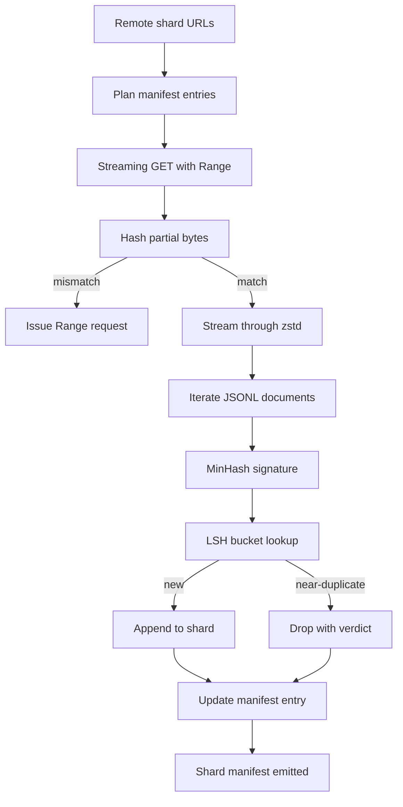

# Grande Descarregador de Corpus

> 訓練語言模型 早在第一次前進通過 之前就開始了──corpus 必須落到磁盘上,完成解壓縮、除複製,并且可地址;在网络 4% 处断掉之前, resume story 就已经要设计好──本课会构建一个流媒体下载器:它拉取压缩片,使用Zstandard 边下边解压缩,通过 MinHash加局域敏感哈希为近复制生成指纹,并写片表,让管道的其余部分可以信任──

**Type:** Build
**Languages:** Python
**Prerequisites:** Phase 19 lessons 30-37
**Time:** ~90 minutes

## Objetivos de aprendizagem

- Utilização `urllib`fluxo de fragmentos remotos,并用 `zstandard`Descompõe, evitando que o buffer do arquivo entere na memória.
- para verificação de byte de compensação 发起 HTTP `Range`pedidos, para retomar os downloads parciais;;
- Para cada documento, construímos a assinatura do MinHash, e usamos o LSH, fazendo com que duplicados próximos se choquem.
- 输出包含内容 hash、byte size、document count 和 dedup verdict 的 shard manifest──

## O problema

A primeira vez no corpo de 200 GB durante o treinamento, a rede foi cortada em 41%, o script foi cortado.`urllib`A segunda vez que está em 78% está interrompido. Chegou a 99, já escreveu o ciclo novamente três vezes.`requests.get`- Chama-me.

Resume é um problema HTTP.`Range`, o cliente  deve ser verificado em conformidade com o registro no disco , acompanhar o offset verificado , e o offset verificado  deve ser mantido no processo após a morte                                                                                                                                                                                                                                                                                                                                                                                                                                                                                    

A deduplicação é uma assinatura. O problema é que a deduplicação exacta do hash irá perder duplicados próximos: o mesmo artigo da Wikipédia com três diferentes caldeiras de caldeira.

## O conceito



### A transmitir com `urllib`

Biblioteca padrão `urllib.request.urlopen`                                                                                                                                                                                                                                                                                                                                                                                                                                                                                                                             `zstandard.ZstdDecompressor().stream_reader`Em meio,bytes apenas vão de rede 流经解压缩机, re-entrar no iteração do documento, totalmente não precisa de materializar em memória o fragmento comprimido ou o fragmento descomprimido―. O único custo de memória é o line buffer、 a assinatura MinHash do documento em curso, bem como o índice LSH―.

### Resume com `Range`

Downloader para cada fragmento  escrever dois arquivos: fragmento`.partial.json`ponto de controlo. ponto de controlo.`verified_bytes`- Não.`expected_size`- Não.`sha256_prefix`(basado em `verified_bytes`bytes 计算) e URL de origem.`sha256_prefix`, e apenas em hash 匹配 匹配 时才恢复──如果 hash 错误,partial 会被丢弃,download 从字节零 重新开始──因为 verificado bytes são verificados em vez de serem hipotetizados, então a corrupção silenciosa não é possível ocorrer──

### MinHash mais LSH

MinHash utilizou o espaço fixo para estimar a similaridade de dois conjuntos de Jaccard. Para o documento, este conjunto é o seu texto.`k`个最小 hash valores, cada um provém de uma função de hash independente.`s`Os documentos, em qualquer componente individual da assinatura, são de probabilidade de concordância.`s`- Não.

                                                                   `k`个 componentes 分为 `b`Bandas, cada banda tem`r`- As linhas, entre elas.`k = b * r`◊ probabilidade de colisão entre dois documentos em pelo menos uma faixa é `1 - (1 - s^r)^b`- Não , não .`(b, r)`调优的   调优的`s`值近形成尖门──典型 corpus dedup                                                                                                                                                                                                                                                        `s = 0.8`, literatura de pesquisa da L.S.H.`k = 128`- Não.`b = 32`- Não.`r = 4`Chegar a este ponto.

### Manifesto de fragmentos como contrato

Downloader  única saída durável é manifestar. Manifest 按 shard 保存 URL、decompressed byte count、document count、dedup 后的独特文件数,以及最后的 shard file sha256。downstream Tokenization 读取 manifest,而不是目录列表──如果某个 shard 缺失或其 sha256 错误,manifest 会告诉下一阶段拒绝启动──manifest 是 data 已下载与 data 已下载和可验证 之间的决定性边界──


```figure
cap-corpus-downloader
```

## Construí-lo

`code/main.py`实现:

- `ShardPlanner`- 读取 shard URLs 列表并生成 planejado manifestos entradas。
- `StreamingDownloader`- 打开带 opcional `Range`de `urllib`fluxo, escrever arquivo temporário, em cada pedaço  update `.partial.json`ponto de controlo, e em seguida, resume o prefixo sha256
- `ZstdDocIterator`- Vai ser como um arquivo de fluxo 包在 `zstandard.ZstdDecompressor`No meio,并逐行 yield a document.
- `MinHasher`- Utilize sementes de hash fixa família para cadeia de produção `k`- assinatura do componente.
- `LSHIndex`- 按带对签名 分桶并报告碰撞──
- `Dedup`- 组合 hasher 和 index, irá marcar cada documento`keep`Ou `near_duplicate`,并附带相匹配碎片 id──
- `ManifestWriter`- Recolher estatísticas por parcela e escrever`manifest.json`- Não.

A demo do fundo do documento vai ser feita no disco para construir um pequeno corpo sintético, com`zstandard`- Não. - Não.`file://`URL Download, execute deduplicado,并打印 manifesto

- Não .

```bash
python3 code/main.py
```

script 以 zero 退出并印印 manifesto resumo。

## Padrões de produção

Quatro padrões podem ser expostos para corporações reais.

**Checkpoint before write.** `.partial.json`必須在字節 追加到 shard 之前完成 `fsync`△否则 power loss 会颠倒顺序:shard bytes 在磁盘上,checkpoint 中没有它们,下一次再起 认为验证字节比实际更少,翻译后尾字节 会损坏文件──先检查点,再写──这与写前日记是同一个学科──

**Sharded LSH index.**Em 200 GB, cobrir todo o corpus de um único índice LSH 放不进 RAM。 segundo o primeiro índice LSH hash dividido por banda, as partições vão existir no disco, e só procurar uma nova assinatura  会落入的分区── custo é cada documento uma vez extra de leitura no disco; benefício é o índice LSH não mais é o limite de memória dura──

**Tombstone, not delete.**Duplicados abandonados serão julgados .`near_duplicate`O Tombstone mantém o rastro de auditoria, e não deixa passar o fluxo de baixo, para que possa mudar a decisão do limite.

**Per-shard sha256 in the manifest, plus a manifest sha256.**manifest 自身也会获得内容 hash──下流阶段 会在信任 per-shard entries 之前验证 manifest hash──没有这个机制,manifest 就是沉默攻击表面:能编辑单个文件的攻击者 可以破坏整个管道──

## Usá-lo

Padrões de produção:

- **Resume on every CI run.**Os executores CI são efêmeres. O downloader deve assumir que cada vez que executar, o disco é novo, e não é recuperado de caché ou remoto.`--cache-dir`É uma bandeira de primeira classe.
- **Dedup before tokenization.**Tokenization 很昂贵──在同一文件上运行两次,为了相同损失曲线 支付两倍成本──Dedup 位于 Tokenization 上游,而不是下游──
- **Manifest as merge gate.**O treinamento é executado a partir de um comitê fixado 读取 manifest sha256― nova versão do conjunto de dados 需要新的 manifest commit―code与数据 之间的链接是 git,而不是口口相传―.

## Envia-o

`outputs/skill-corpus-downloader.md`Em real projeto, descrever quais URLs fornecer downloader checkpoint directório como se organizar dedup usar o que o tamanho da telha e`(k, b, r)`Triple, bem como manifestar em posição no controle de versão.

## Exercícios

1. 添加 `--shingle-width`flag,并测量 dedup verdict 在宽度 3、5、9 下如何变化──为选择的默认值辩护──
2. 通過嗅探魔法字节,在 zstd 旁边添加 gzip 支持──下载器 不应要求调用者 指定代码──
3. 添加 `--resume-only`modo: Se não encontrar o checkpoint, então recusar começar um novo download.
4. Transferir o índice LSH para a prateleira ou o arquivo de barra,并测量 throughput与in-memory variant的差异──
5. Quando o disco é iniciado, adicione o manifesto sha256 para verificar se o manifesto do disco está em contato com o`manifest.lock`O manifestante hash não coincide, o downloader deve ser fechado.

## Termos-chave

| Term | What people say | What it actually means |
|------|-----------------|------------------------|
| Shard | “一个 file” | corpus 的一个自包含 slice，拥有自己的 sha256，并作为 resume 和 dedup 的单位 |
| MinHash signature | “Fingerprint” | 一个 set 的 `k`-component sketch，其中每个 component 是该 set 上一个 independent hash 的最小值 |
| LSH band | “Bucket” | 一组 `r` 个 signature components，用作 collision detection 的单个 bucket key |
| Verified bytes | “Resume offset” | disk 上 sha256 prefix 与 checkpoint 匹配的 bytes；唯一安全的 resume offset |
| Manifest | “The index” | downloader 产出的单一 durable record，包含 content hashes |

## Mais leitura

- [RFC 7233](https://datatracker.ietf.org/doc/html/rfc7233)- Requistas de intervalo HTTP, isto é, protocolo de resumindo
- [Zstandard format specification](https://datatracker.ietf.org/doc/html/rfc8478)- 让流解压缩安全的框架格式
- [MinHash](https://en.wikipedia.org/wiki/MinHash)- 本课使用的 assinatura família
- [Locality-sensitive hashing](https://en.wikipedia.org/wiki/Locality-sensitive_hashing)- limite de dedup 背后的带制方案
- Fase 19 · 43 - corpus tokenizado HDF5 do download 供给的
- Fase 19 · 44 - Programa de treinamento do cosino no corpo
- Fase 19 · 45 - 消耗该时间的 AMP loop
