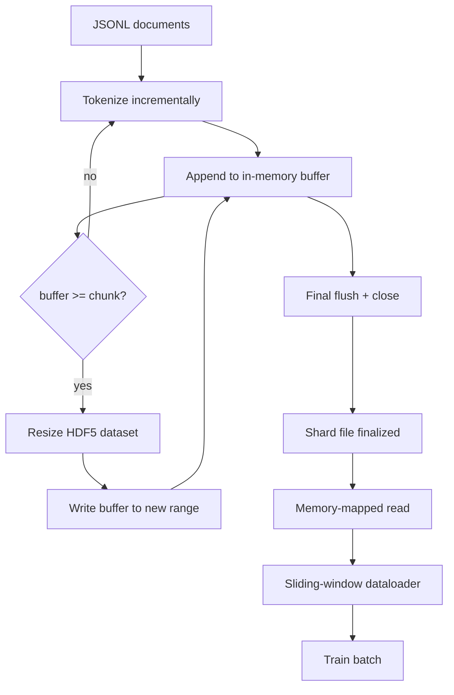

# HDF5 Tokenized 语料库

> O JSONL no disco não habita 16 trabalhadores de carregador de dados. Com o HDF5 pode ser usado para construir uma tokenização de fluxo até o HDF5 de grandeza.

**Type:** Build
**Languages:** Python
**Prerequisites:** Phase 19 lessons 30-37
**Time:** ~90 分钟

## Objetivos de aprendizagem

- 将文档流式写入一个带决定性分断的可调整大小 HDF5 integer dataset──
- O que é que você vai fazer?
- 通过 HDF5 支的页面缓存 支的分块布局 读回代币,使数据加载器只在批次时间 复制到批次缓冲──
- 实现 um carregador de dados de janela deslizante, usando pacotamento expresso 规则发发出固定长度训练序列──

## O problema

现代语言模型训练运行 会在数十名工人上以每秒数十万样本的速度读取代码. JSONL no disco em primeira vez faltas de página de caché faltas 时就会崩: JSON parser 很慢,文档边界无法寻址,而寻到"样本 4,217,884" 需要扫描文件──即使压缩效果很好.$O(1)$acesso aleatório de 平 token stream.

HDF5  Adaptado, é porque ele fornece um conjunto de dados fragmentado, ajustável, grande e pequeno, apenas para números inteiros, seus pedaços em leitura em cache de página amigo amigo.`tokens[3,200,000 : 3,200,8192]`A slice, o HDF5 vai colocar o requisito de hiperlabro de cache de página copiar para uma nova distribuição de array NumPy ⋅ custo é cada trabalhador um manuseio de arquivo aberto, bem como um pedaço de grande página de cache de pegada; em comparação com o custo de JSONL, que pode ser ignorado ⋅

Construção de problemas está em fazer o seu sistema de dados ser real.                                                                                                                                                                                                                                                                                                                                                                                                                                                                                                             

## O conceito



### É o que eu faço.

conjunto de dados de token `maxshape=(None,)`E está determinado.`chunks=(chunk_size,)`创建──写入时,将代币 缓存在长度为 `chunk_size`de NumPy array 中──当缓冲 填满时,数据集 精确地按 `chunk_size` expandir,并把缓冲 写入新范围──在 shard 结束时,剩余缓冲 会写入最后一个部分范围──除了最后一次写入外,每次写入都是连接的和分别的;读者会根据 shard 的 HDF5属性 中记录的`token_count`- É a última vez que escrevo.

### Escrito em pedaços

单个 HDF5 文件是单点故障──管道 会并行写入 shards:Fase 19 lição 42`shards.json`Index 会按碎片 记录文件路径、代币计数、文件计数,以及代币的 sha256──trainer 读取 `shards.json`Para calcular os offsets globais e verificar os dados.

### Leitura em memória

                                                                                                                                                                                                                                                              `swmr=True`modo 打开自己负责的 HDF5 arquivos,并请求 `tokens[start:stop]`△ uma vez que o pedaço 变热, o layout do pedaço do HDF5 就会让它成为页面缓存支持的读物──worker 永远不会实现整个文件:slice 会被复制到数据载机的批量缓冲,之后数据载机在批量时间将其复制到固定记忆训练 Tensor──hot path 在每次块过渡时有一个系统调用; 其余是 RAM访问──

### Carregador de dados de janela deslizante

DataLoader é o único que sabe o tempo de treinamento. Ele está no fluxo global de tokens.`window_size + 1`- Os tokens, depois voltem.`(input, target) = (tokens[:-1], tokens[1:])`Não é obrigatório observar as fronteiras dos documentos: uma janela pode atravessar dois documentos, no meio há uma clara`boundary_token_id`,让模型学会使用分区. É a regra de embalagem padrão; é também uma regra que os iniciantes facilmente esquecem, a última biblioteca de linguagem que obtém se transforma em 8% de tokens de fronteira de treinamento e 92% de texto natural.


```figure
cc-hdf5-corpus
```

## Construí-lo

`code/main.py`实现:

- `Tokenizer`- Um tokenizer determinista de nível de byte, para demo 足足好──接口是 `encode(text) -> list[int]`和 `vocab_size`- Não.
- `HDF5ShardWriter`- Open um conjunto de dados inteiros ajustáveis de grande, vai tampão de tokens para o tamanho do pedaço, fixa grandeza de passo pequeno, e escrever, em fechamento `token_count`和 `sha256`记录为 HDF5 atributos。
- `ShardedTokenizationPipeline`- atravessar os documentos de entrada, os viajar até o escritor,并输出 `shards.json`índice
- `MmapTokenStore`- 打开 shard files  conduzir leituras de memória-mapeado, calcular compensações globais, exposição individual `get_slice(start, stop)`- A.P.I.
- `SlidingWindowDataloader`- Do fluxo global 中选择随机窗口,并 yield `(input_ids, target_ids)`Arrays NumPy

文件底部的演示会构建一个很小的内存库,代码到两个片段,通过内存地图打开它们,运行数据载体10批,并打印每个批的形和检查数――

运行:

```bash
python3 code/main.py
```

脚本以 0 退出并印批次检查量──

## Padrões de produção

O padrão pode ser ampliado para a realização de treinamento real.

**Chunk size 等于典型读取大小。**Treinador Cada amostra 读取 `window_size + 1`个 tokens──把 HDF5 porção 设置为 `window_size`O número de vezes, a leitura está alinhada.

**Token count 放在 attributes 中，而不是 dataset 中。**O final do conjunto de dados pode não ser completamente preenchido, porque o tamanho do pedaço não é necessariamente o limite do documento.`token_count`Como atributo HDF5 existência do conjunto de dados 上,并让读者在该值处截断──否则读者 会越过真实末尾读到零填补的代币,模型也会学会预测零──

**带 parallel verification 的 sharded sha256。**Cada fragmento tem seus próprios bytes de token sha256― treinador pode fazer o treinamento antes de começar e verificar todos os fragmentos― erro de sha256  vai fazer correr 提前失败, em vez de 106.

**两侧都使用 `swmr=True`，writer 使用 `libver="latest"`。**Modo de escritora única-reitor múltipla  requisitos de escritora 以 `libver="latest"`打开, pré-crear cada conjunto de dados, e depois definir `file.swmr_mode = True`                                                                                                                                                                                                                                                              `dataset.flush()`, assim usá-lo`swmr=True`Os leitores de trabalho estão abertos para ver os dados.`libver="latest"`, ou em estrutura alterada após reiniciar SWMR, é "arquivo bloqueado" 失败的常见来源──

## Usá-lo

Padrões de produção:

- **每个 source shard 一个 HDF5。**Downloader(leção 42) cada URL 输出一个片段;tokenization(本课) cada shard fonte 输出一个 HDF5──1:1 mapeamento 让恢复 和部分故障恢复 变得简单──
- **Boundary token id。**O token de fronteira é parte do vocabulário do tokenizer, também é o único token que o dataloader ingere. Se o modelo deve ignorá-lo, a perda de treinamento irá mascarar o token de fronteira; caso contrário, o modelo vai usá-lo como separador de sequências.
- **`shards.json` 是 source of truth。**Adicionar um novo shard significa escrever em HDF5 計算它的 sha256,并添加一条入──trainer 在启动时读取该文件一次,之后永远不碰目录列表──

## Envia-o

Em um projeto real,`outputs/skill-hdf5-tokenized-corpus.md`Descrevem qual é o tokenizer, qual é o formato do treinador,`shards.json`Em controle de versão, onde colocar, bem como os trabalhadores do carregador de dados  como atravessar arquivos 分片──本课交付引擎──

## Exercícios

1. 给 HDF5 writer 添加 `--compression gzip`flag, e em corpus demo 上测量吞吐成本──为所选默认做出辩护──
2. 给滑窗数据加定性种子,并验证相同种子的两次运行 会产生相同批量──
3. 添加 `--validate`modo, read取每个 shard,重新计算其代币的 sha256,并与 `shards.json`Para comparar, os CI devem começar a treinar antes de executá-lo.
4. Em comparação com os tamanhos de peças, é o tamanho da janela, metade do tamanho da janela, duas vezes o tamanho da janela, o carregador de dados é o resultado de um efeito de caché de página.
5. 添加 `--max-document-tokens`A lei de direito da União Europeia (UE) de 15 de dezembro de 2006 sobre a aplicação da lei de direito da União Europeia (UE) de 15 de dezembro de 2006 sobre a lei de direito da União Europeia (UE) de 15 de dezembro de 2006 sobre a lei de direito da União Europeia (UE) de 15 de dezembro de 2006 sobre a lei de direito da União Europeia (UE) de 15 de dezembro de 2006 sobre a lei de direito da União Europeia (UE) de 15 de dezembro de 2006 sobre a lei de direito da União Europeia (UE) de 15 de dezembro de 2006 sobre a lei de direito da União Europeia (UE) de 15 de dezembro de 2006 sobre a lei de direito da União Europeia (UE) de 15 de dezembro de 2006 sobre a lei de direito da União Europeia (UE) sobre a lei de direito da União Europeia (UE) sobre a lei de direito da União Europeia (UE) de 15 de dezembro de 2006 sobre a lei de 15 de dezembro de 2006 sobre a lei de 15 de 2010 sobre a lei de direito da União Europeia (UE)

## Termos-chave

| Term | What people say | What it actually means |
|------|-----------------|------------------------|
| Resizable dataset | "Append-only" | 一个带 `maxshape=(None,)` 的 HDF5 dataset，通过按 chunk 大小 stride 调用 `resize` 增长 |
| Chunked layout | "How HDF5 stores it" | 固定大小的 on-disk pages，kernel 可 memory-map，dataloader 可连续读取 |
| `swmr` mode | "Read-while-write" | Single-Writer-Multiple-Reader mode，使 dataloader workers 能安全共享文件 |
| Shard index | "shards.json" | 包含 offsets 和 content hashes 的所有 token shards 的 durable index |
| Sliding window | "Training sample" | global token stream 的固定长度 slice，trainer 会把它与 shift-by-one target 配对 |

## Mais leitura

- [HDF5 chunking documentation](https://docs.hdfgroup.org/hdf5/v1_14/)- 本课使用的碎片化数据集布局
- [h5py user guide](https://docs.h5py.org/en/stable/)- HDF5 Python ligações
- [NumPy memory mapping](https://numpy.org/doc/stable/reference/generated/numpy.memmap.html)- HDF5  através de h5py 暴露的读侧原始
- Fase 19 · 42 - 输出由本课 Tokenize do download
- Fase 19 · 44 - 消费这个数据包的 cosine schedule
- Fase 19 · 45 - 包裹 training step of AMP loop
