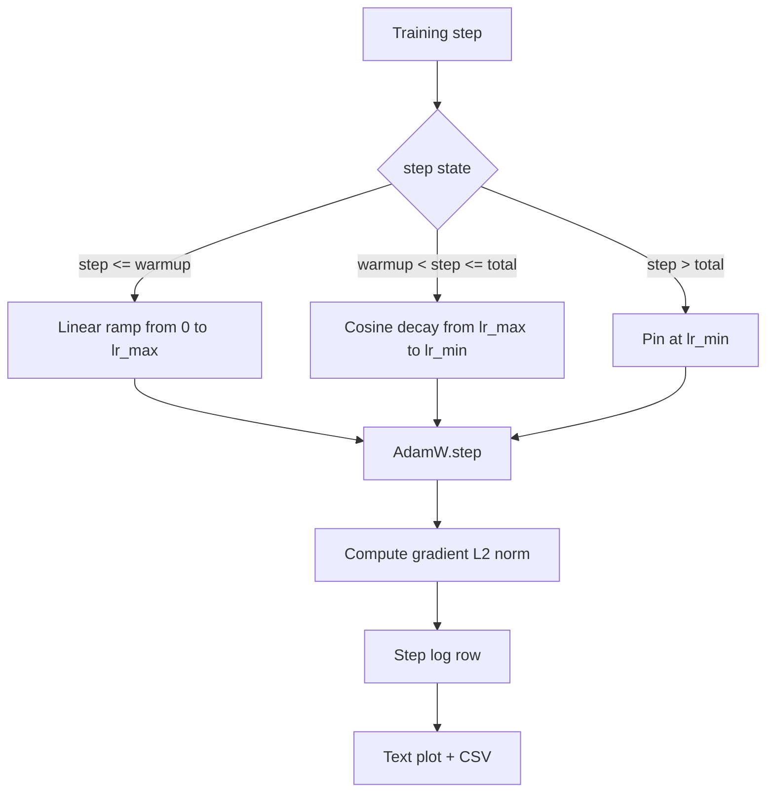

# 带 Linear Warmup 的 Cosine LR

> O programa de taxa de aprendizagem é apenas segundo a segunda decisão importante da Função de Perda. AdamW é a escolha moderna de modelo de treinamento de linguagem, porque permite que o modelo veja um menor tamanho de passo eficaz em atualizações fracas anteriores mil vezes, subisse gradualmente até o pico da configuração, e depois planeje a queda de volta perto de zero.

**Type:** Build
**Languages:** Python
**Prerequisites:** Phase 19 lessons 30-37
**Time:** ~90 分钟

## Objetivos de aprendizagem

- 实现 um AdamW Optimizer,并接入带线性变暖的共性学习率时间表──
- Em qualquer passo 精确计算时间表的值, evitar trans-run 出现浮点漂移──
- A norma de gradiente L2 e a taxa de aprendizagem e a registo de resultados, permitindo que o estado de saúde do treino seja observado.
- O programa irá incluir um gráfico de texto para leitura e qualquer ferramenta que seja de uso público.

## O problema

Antes de 1000 vezes, os modelos de treinamento são mais ou menos pesados. Ainda está perto de inicialização. Otimizador de execução de segunda-momento estimativa ainda não está está estabelecida. A norma gradiente também é mais barulhento. Se a taxa de aprendizagem está no pico entre essas atualizações, o modelo deve divergir diretamente, ou cair em um plano de perda que não pode escapar para sempre.

O calendário de cosinagem com aquecimento tem três regiões.`warmup_steps`, taxa de aprendizagem de zero linear redução ao pico de configuração `lr_max` 〜 `warmup_steps`Até`total_steps`,a taxa de aprendizagem  seguir a curva cosínica                                                                                                                                                                                                                                                                                                                                                                                                                                                                                                               `lr_max`                                                                                                                                                                                                                                                                                                                                                                                                                                                                                                                             `lr_min`- Não.`total_steps` depois, a taxa de aprendizagem   fixa  `lr_min`Um treinador de confusão assim não vai sair de um horário tão silencioso.

Construção de problemas em horários  fácil de surgir fora por um-de-um Off-by-one Oficácia de aprendizagem 6 horas após o treino Oficácia de aprendizagem Oficácia de aprendizagem Oficácia de aprendizagem Oficácia de aprendizagem Oficácia de aprendizagem 

## O conceito



### Formulário de aquecimento

Para o`warmup_steps > 0`时位于 `[0, warmup_steps]`de `step`, taxa de aprendizagem é `lr_max * step / warmup_steps` Descentralizado`warmup_steps = 0`caso é visto como "sem aquecimento":ordagem em fase zero  diretamente desde `lr_max`Começa, não entra em decomposição cosina. Alguns testes vão entrar.`warmup_steps = 0`, para o cronograma de inspecção  ainda pode gerar curva disponível。

### Formulário de cosina

Para o`(warmup_steps, total_steps]`Em meio`step`, taxa de aprendizagem é `lr_min + 0.5 * (lr_max - lr_min) * (1 + cos(pi * progress))`, entre os `progress = (step - warmup_steps) / max(1, total_steps - warmup_steps)`- Não.`step = warmup_steps`,cosine 求值为 `cos(0) = 1`- Não .`lr_max`, com o ponto final de aquecimento 精确匹配──在 `step = total_steps`,cosine 求值为 `cos(pi) = -1`- Não .`lr_min`, com o ponto final de decomposição 精确匹配──

A continuidade dos dois pontos terminais não é acidental. Por isso, o cronograma foi realizado para um propósito.`step`de função única, em vez de três diferentes funções 拼接在一起──拼接的时间表 在第一次变化 `lr_max`Quando eu perderia uma fronteira.

### Pavimento após os degraus totais

Para o`step > total_steps`, taxa de aprendizagem  manter `lr_min`O contrato é evidente: o horário não é informado, nem extrapolado; está fixado no chão, e deixa o treinador registar o aviso.`total_steps`Não é o que se passa.

### Registros de norma e taxa de graduação

O programa é um estado de saúde de treino de uma metade. A norma gradiente é a outra metade. O ciclo de treino de cada passo.`step, lr, grad_l2_norm, loss`O CSV é o único registro duradouro.


```figure
cap-cosine-warmup
```

## Construí-lo

`code/main.py`实现:

- `CosineWithWarmup`- Uma função sem estado, forma-se baseado em cronograma de configuração `lr(step) -> float`- Não.
- `TrainState`- O que é que é?`AdamW`Otimizador e cronograma 封装成单一步函数──
- `TrainState.step`- 运行一次前进过渡一次倒退过渡,记录梯度 L2 norma,并把 `lr(step)`Aplicação para o Optimização.
- `plot_schedule_ascii`- O programa de texto para leitura
- `write_schedule_csv`- Para cada passo, a taxa de aprendizagem é elevada.

A demo do fundo do arquivo vai construir um muito pequeno .`nn.Linear`模型, em lote de entrada fixa 上训练 20 passos,并印每一步的学习速度、渐进标准 和损失──schedule 也将被染为文本图,用于视觉智能检查──

运行:

```bash
python3 code/main.py
```

脚本以 0 退出,并印每步训练日记 和时间表图──

## Padrões de produção

Quatro padrões podem aumentar o horário para artefactos de produção.

**Schedule 放在 config 中，而不是 code 中。**treinador de enviar para git de YAML ou JSON configuração 读取 `warmup_steps`- Não.`total_steps`- Não.`lr_max`- Não.`lr_min`O cronograma é reprodutivo, pois a configuração é contêin-dada; o cronograma é auditável, porque a configuração é parte da diferença de relações públicas.

**Step counter 是 monotonic，并与 epochs 解耦。**Quando o conjunto de dados foi fragmentado ou o carregador de dados reiniciado, alguns quadros serão reajustados a um passo e a uma época.`global_step`, em vez de contador local 读取──resumido executar 会在正确的时间表位置 继续,因为 passo contador é um eixo durável──

**Schedule plot 放在 run directory 中。**Cada treinamento é feito por uma cidade .`outputs/lr_schedule.png`(ou plot de texto no livro) escrever no seu diretório de execução.

**Log row schema 固定。** `step, lr, grad_l2_norm, loss`,顺序如此──下游 notebook 或仪表板 会读取这个方案;不弹版本就重新命名列,会让所有现有仪表板失效──

## Usá-lo

Padrões de produção:

- **先 sweep peak，再 sweep 其他任何东西。** `lr_max`É o mais sensível do giro. Primeiro, um modelo pequeno, depois, o que é óptimo.`lr_max`Com a escalação do modelo grande  muito fraca, então varrer de modelo pequeno é um forte prioridade 
- **Warmup 是 total steps 的 fraction，不是绝对 count。**Uma corrida de 200 milhões de passos Se apenas 2.000 passos de aquecimento, quase que alcançamos o pico; uma corrida de 20.000 passos com o mesmo número, então aquecerá 10 por cento──把 aquecimento 配置为分数 ((典型:1-3%)),让时间表随训时长缩放──
- **`lr_min` 非零是有意的。**Um por um .`lr_max`10% do piso, permitirá que o Optimizer continue a aprender em Long Tail.`lr_min = 0`O programa vai ter uma curva de treinamento bem bem vista no gráfico, bem como um modelo de treinamento praticamente não concluído.

## Envia-o

Em um projeto real,`outputs/skill-cosine-warmup.md`É preciso descrever qual é o cronograma de configuração, o contador global, o passo de treinador e o que é.`lr_max`- O que é o valor de produção?

## Exercícios

1. Adicionar o cronograma de variante inversa-raiz quadrada, e executar treinamento de brinquedo em 200 passos 上对比──哪条曲线 产生更低的最终损失?
2. 添加 `--restart`bandeira, em`total_steps / 2`Aumentar o segundo aquecimento. Para reiniciar o aquecimento.
3. Adicionar uma unidade de teste o calendário de verificação é contínuo: para`[0, total_steps]`Em cada passo, diferença.`|lr(step+1) - lr(step)|`Recebido`lr_max / warmup_steps`- Não.
4. Vai marcar o horário`torch.optim.lr_scheduler.LambdaLR`, fazer com que o código frame 组合──本课使用简单步骤函数;包装 改变了什么?
5. 添加 `--plot-png`bandeira, através de `matplotlib`写出真实图片──为本课的文本图片 和 PNG 哪个更适合合作为CI runs 的默认做出辩护──

## Termos-chave

| Term | What people say | What it actually means |
|------|-----------------|------------------------|
| Warmup | "Slow start" | 在前 `warmup_steps` 次 updates 中，从 zero 到 `lr_max` 的 linear ramp |
| Cosine decay | "Smooth drop" | 在剩余 steps 中，从 `lr_max` 到 `lr_min` 的上半段 cosine curve |
| Floor | "After training" | schedule 在超过 `total_steps` 后固定的 `lr_min` 值 |
| Gradient norm | "L2 of grads" | 拼接后的 gradient vector 的 Euclidean norm，每 step 记录 |
| Global step | "Schedule axis" | 一个能跨 restart 保留的 monotonic step counter，用于驱动 schedule |

## Mais leitura

- [Loshchilov and Hutter, SGDR: Stochastic Gradient Descent with Warm Restarts (arXiv 1608.03983)](https://arxiv.org/abs/1608.03983)- papel de referência do cronograma cosino
- [Loshchilov and Hutter, Decoupled Weight Decay Regularization (arXiv 1711.05101)](https://arxiv.org/abs/1711.05101)- O documento de referência de AdamW
- [PyTorch torch.optim.lr_scheduler](https://docs.pytorch.org/docs/stable/optim.html#how-to-adjust-learning-rate)- funções de fase como combinar com os agendadores-quadro 组合
- Fase 19 · 42 - 产出此表 所消费语料的下载器
- Fase 19 · 43 - Com este calendário  Desenvolvimento comum do carregador de dados
- Fase 19 · 45 - corte de gradiente 和 AMP,也就是循环的下一层
