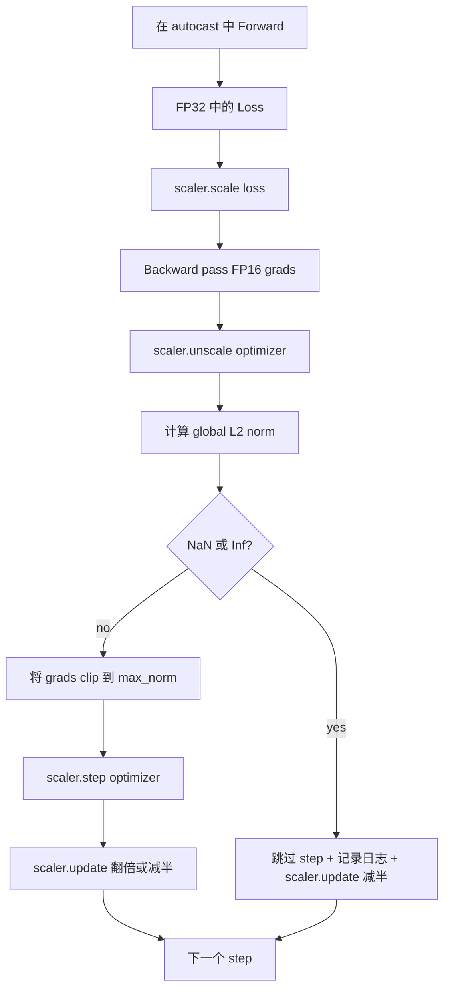

# Clipagem Gradiente e Precissão Misturada

> Otimizador e cronograma da primeira aula  supunha que o gradiente é normal. Eles geralmente não são normais. Um lote ruim já pode fazer a norma de gradiente subir a três níveis numéricos. Treinamento de precisão misturada será realizado no lado de perda.

**Type:** Build
**Languages:** Python
**Prerequisites:** Phase 19 lessons 30-37
**Time:** ~90 minutes

## Objetivos de aprendizagem

- 計算所有参数梯度的全球 L2 norma, e excede a configuração 值时原地 clip──
- Usar o carregador automático, GradeScaler, embala o treino, faz com que o FP16 avance e o FP16 volte para trás.
- 检测 Loss 或 Gradient 中的 NaN 和 Inf, saltar o passo de otimização,并记录 this skip──
- Cada passo  relatório de escalagem do GradScaler, deixando continuamente um grande número de saltar 能立刻可见──

## O problema

ontem também pode fazer uma corrida de treinamento em funcionamento, em passo 8.217 时 时 亏损曲线突然垂直上升──罪祸首是一个批,它的梯度标准 达到4,200,是此前峰值的二十倍──没有剪辑时,Optimizer 会执行一次步骤,把模型前一小时学到的一切全部重置──使用标准 1.0 的全球 L2 clip 后,同批只贡献单元标准更新;Loss 保持在趋势线;运行 活存下来──

O treinamento de precisão mista  através do FP16  calcular o passagem para frente 和 a maior parte do passagem para trás, vai aumentar a produção de 2-3 倍──代价是 FP16's exponente range 很窄── um Gradiente típico de sobreflow em FP16 vai se transformar em Inf, e se espalhar para NaN na subsequente camada, levando à próxima etapa de otimização Colocar cada peso em NaN── GradScaler do PyTorch 通过在后转通过一个很大的扩展因子乘以损失,并在优化步前使用同一个因素除除了 Gradient来解决这个问题── Se em unscale 时任何 gradient 是 Inf 或 NaN问题, o escalador vai saltar e escalar 半; Se colocar N个个小径, o escalador vai colocar 倍倍倍因素在训练过程中,将这个变化因子的高值在 F16 间找到最高的净因子.

Construção de problemas está em correcto ligação. Prime clip Reconsider unscale, value on will work on scaled gradients 上; Prime unscale Reconsider clip, GradeScaler 上's operation sequence Importante Prime clip Reconsider unscale, value on will work on scaled gradients 上; Prime unscale Reconsider clip, GradeScaler 上's operation sequence Prime clip Reconsider unscale, value on will work on scaled gradients 上; Prime unscale Reconsider clip, GradeScaler 上's operation sequence Important Prime clip Reconsider unscale, value on scale gradients 上; Prime unscale Reconsideres on scale gradients 上; GradeScaler 上's operation sequence Prime on scale Prime order Prime correct sequence is:`scaler.scale(loss).backward()`, então`scaler.unscale_(optimizer)`, então`clip_grad_norm_`, então`scaler.step(optimizer)`, finalmente `scaler.update()`Qualquer outra ordem produz um ciclo de silêncio.

## O conceito



### Norma global de L2

A norma global L2 é a norma euclidiana do vetor de gradiente posterior, e não a norma de parâmetro por parâmetro.`torch.nn.utils.clip_grad_norm_(parameters, max_norm)` Esta função retorna à norma pré-clip, por isso esta aula pode simultaneamente registrar o valor natural e o valor cortado, o que é necessário para o diagnóstico de que cada passo está sendo cortado.

### autocast e GradScaler

`torch.amp.autocast(device_type)`É um gerente de contexto, irá seleccionar com o FP16 运行符合条件的操作 (a maioria das operações de matmul 类) `torch.amp.GradScaler(device_type)`É um ajudante, vai estar em retrospectiva, Perda de escala anterior, e em passo de otimização, Gradiente de escala inversa anterior.

Esta aula usa o autocast da CPU, porque é o conteúdo que funciona no CI; o mesmo padrão pode ser passado por `device_type="cpu"`改为 `device_type="cuda"`Originalmente, o GradScaler do CPU é um stub (autocast do CPU está em conformidade com o BF16), mas o curso contém esses sites de chamadas, que permitem que o cablagem seja totalmente em conformidade com o loop da GPU.

### Detecção de NaN e Inf

O teste acontece em duas posições. Primeiro, a perda de vida é retrógrada.`torch.isfinite`检查;Inf or NaN Loss não vai produzir Gradiente útil, vai entrar em Optimização 前被跳过;;`scaler.unscale_(optimizer)`Depois, o curso será usado.`has_non_finite_grad(...)`扫描未扩展梯度,并把任何inf或NaN视为跳转―― Estes dois controles juntos cobrem o avanço-pass e o atraso-pass 两类失败模式――

### Diagnosticismo de fatores de escalagem

O fator de escala é o estado interno do GradScaler.`scaler.get_scale()`, e colocá-lo com a taxa de aprendizagem e a norma de gradiente, um registro.`2^17`Ou `2^18`附近和── 行为异常的运行 会显示因素 在高值和低值之间振荡,这说明模型的渐进 有时在范围内, 有时不在──不记录日志,这个诊断信号就是不可见的──


```figure
grad-clip-monitor
```

## Construí-lo

`code/main.py`实现:

- `clip_global_l2_norm`- Para o meu .`torch.nn.utils.clip_grad_norm_`O envelope, retornar a norma pré-clip e pós-clip.
- `has_non_finite_grad`- 扫描 Gradiente 中 NaN 和 Inf de assistente。
- `AmpTrainState`- Envolve um modelo.`AdamW`Otimizador, um GradScaler, e um dispositivo de lançamento automático.`step(inputs, targets)`,运行完整的剪裁,扩展和跳-on-NaN pipeline.
- `StepLog`和 `SkipLog`- Registo por etapa de estruturamento:
- Uma demonstração, treinar um pequeno.`nn.Linear`Modelo 20 个 步骤, em 5 步向 Gradient 注入 Inf 以触发跳路,并印得到的日志──

运行:

```bash
python3 code/main.py
```

脚本以 0 退出,并印每步日记,每行标记为 `STEP`Ou `SKIP`• pelo menos uma das linhas é`SKIP`- Não.

## Padrões de produção

Quatro padrões podem transformar este ciclo em um estágio de formação de produção.

**Skip counter 应该是 alert，而不是一行 log。**Cada fase de treinamento 跳过少量步骤是健康的── cada fase de execução 百次跳是硬警报: o modelo entrou na FP16 无法承载的区域, enquanto o loop está em estado de quietude fracassado──本课跟踪 1,000-step rolling skip rate; durante a produção, se a taxa 超过 5%, é necessário que o ciclo seja publicado.[12]

**Clip threshold 放在 config 中。** `max_norm = 1.0`É o valor de referência do treinamento de modelo de linguagem moderno. Primeiro, varrer no modelo pequeno; um limiar maior 让模型能从真正困难的批中恢复; menor limiar 会约束最坏情况,但代价是损失曲线更杂── esse limiar 应该和课44的时间表 位于同一个YAML或JSON配置中──

**Norm log 和 schedule 一起进入 CSV。**Colunas CSV `step, lr, grad_l2_pre_clip, grad_l2_post_clip, loss, skipped, skip_reason, scaler_scale` Reviewer 打开文件后, pode ver na mesma linha o cronograma  Gradient 的故事、scaling factor, bem como o resultado de saltar 含原因)  Puser estas colunas 拆分多个文件, é a forma de fazer err err err err err err err 位分析──

**`scaler.update()` 每个 step 都运行，即使 skip 也一样。**Em fase de limpeza, escalador 读取它的无inf counter,递增,并可能把因素 翻倍──在跳过步骤上, escalador 把因素 减半并重置计量──忘记在跳过路上调用`update()`, é a produção de um fator de escalação de bugs não modificados.

## Usá-lo

Padrões de produção:

- **Autocast device 匹配 optimizer device。**Formação de GPU `torch.amp.autocast(device_type="cuda")`; CPU 使用 `torch.amp.autocast(device_type="cpu")`◊ O dispositivo de conexão irá produzir um erro de tipo silencioso, na superfície é a curva de perda parece normal, mas o modelo não aprendeu ◊
- **Backward 前检查 Loss。** `torch.isfinite(loss).all()`É uma redução de tensor; o custo pode ser ignorado, enquanto a NaN Loss 上省 é um passo completo de treinamento.
- **`zero_grad` 中使用 `set_to_none=True`。**将 Gradiente 设为 `None`Em vez de zero, deixe o Optimizer saltar o cálculo do grupo de parâmetros não afetados. Esta configuração é de alta produção gratuita, também pode reduzir um pouco a superfície de bugs.

## Envia-o

`outputs/skill-clip-amp.md`Em real projeto, descrever a etapa de treinamento Usar qual clipe praga e dispositivo de transmissão automática, por passo CSV em posição no controle de versão, bem como o limite de alerta de produção de salto de taxa é o que.

## Exercícios

1. Use real spike de perda  substituir sintetizado Inf 注入(把某一批的目标 乘以 1e8),并验证跳路 会触发。
2. - Adicione um .`--bf16`modo, vai autocast 切到BF16 em vez de FP16;;BF16 gama exponente do FP16 mais amplo, geralmente muito pouco precisa de perda de escala;验证同一个demo 上跳率 降至零;;
3. Adicione um teste unitário, verificação em nenhum clipping ocorre quando, o envelope de clipe gradiente 会正确返回 pre-clip 和 post-clip normação。
4. 添加滚窗跳率 计算,以及一个CLI flag:如果率 连续 100 个步 超过配置值,就让运行 失败――
5. Vai loopar para CSV canônico`step, lr, grad_l2_pre_clip, grad_l2_post_clip, loss, skipped, skip_reason, scaler_scale`) escrever, e passar por cada linha depois de flush  confirmar o arquivo pode ser reservado em Ctrl-C                                                                                                                                                                                                                                                                                                                                                                                                                                                                                                 

## Termos-chave

| Term | What people say | What it actually means |
|------|-----------------|------------------------|
| Global L2 norm | "Clip target" | 所有可训练 parameter 的拼接 gradient vector 的 Euclidean norm |
| autocast | "Mixed precision" | 在 `with` block 内，对符合条件的 operation 选择性执行 FP16（或 BF16） |
| GradScaler | "Loss scaler" | 在 backward 前乘以 Loss，并在 optimizer step 前 inverse-scale Gradient 的 helper |
| Skip | "Bad step" | 因为 Gradient 或 Loss 是 non-finite 而拒绝执行的 optimizer step；scaler 会将 factor 减半 |
| Scaling factor | "Scaler state" | GradScaler 当前的 multiplier；干净区间后翻倍，每次 skip 时减半 |

## Mais leitura

- [Micikevicius et al., Mixed Precision Training (arXiv 1710.03740)](https://arxiv.org/abs/1710.03740)- Proposta inicial de escala de perdas
- [Pascanu, Mikolov, Bengio, On the difficulty of training recurrent neural networks (arXiv 1211.5063)](https://arxiv.org/abs/1211.5063)- Gradiente Clipping  referência论文
- [PyTorch torch.amp.GradScaler](https://docs.pytorch.org/docs/stable/amp.html)- 本课包裹的 scaler API
- [PyTorch torch.nn.utils.clip_grad_norm_](https://docs.pytorch.org/docs/stable/generated/torch.nn.utils.clip_grad_norm_.html)- 本课使用的剪裁原始
- Fase 19 · 42 - Por loop  fornecer corpus de download
- Fase 19 · 43 - ciclo 消耗的数据 load
- Fase 19 · 44 - Programação de um ciclo
