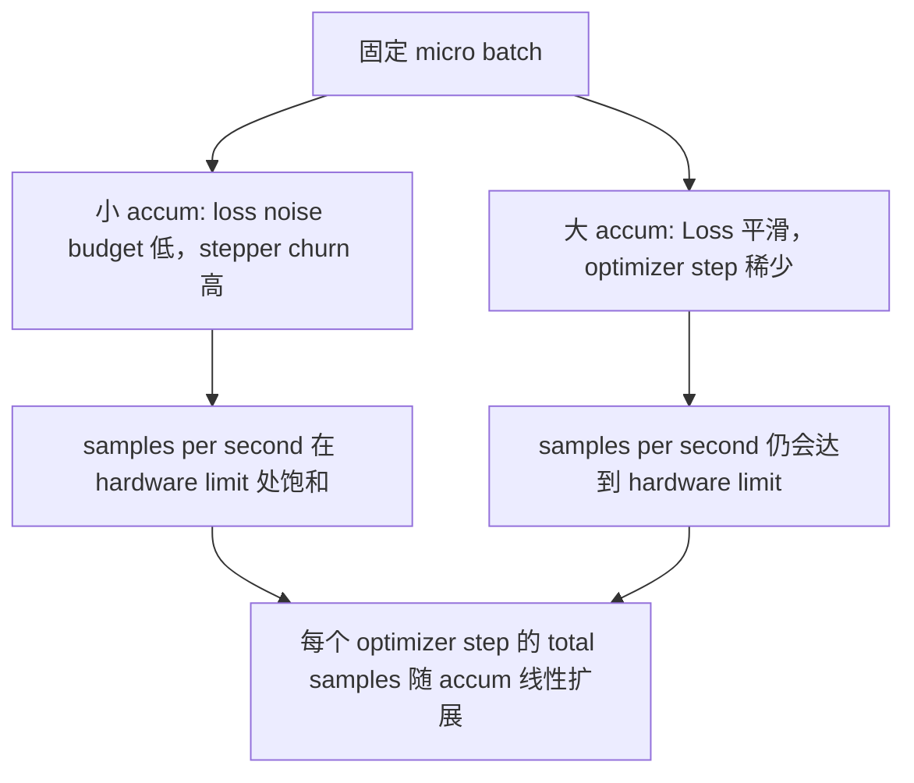

# Acumulação gradual

> Usar um micro-batch, treinar para o seu custo de carga não levantar batch eficaz. Perda de escala, passo de otimização de tempo, fazer Gradiente acumula-se.

**Type:** Build
**Languages:** Python
**Prerequisites:** Phase 19 lessons 42 to 45
**Time:** ~90 minutes

## Objetivos de aprendizagem

- 推导 lote efetivo 恒等式:`effective_batch = micro_batch * accum_steps`- Não.
- ¢¢¢¢¢¢¢¢¢¢¢¢¢¢¢¢¢¢¢¢¢¢¢¢¢¢¢¢¢¢¢¢¢¢¢¢¢¢¢¢¢¢¢¢¢¢¢¢¢¢¢¢¢¢¢¢¢¢¢¢¢¢¢¢¢¢¢¢¢¢¢¢¢¢¢¢¢¢¢¢¢¢¢¢¢¢¢¢¢¢¢¢¢¢¢¢¢¢¢¢¢¢¢¢¢¢¢¢¢¢¢¢¢¢¢¢¢¢¢¢¢¢¢¢¢¢¢¢¢¢¢¢¢¢¢¢¢¢¢¢¢¢¢¢¢¢¢¢¢¢¢¢¢¢¢¢¢¢¢¢¢¢¢¢¢¢¢¢¢¢¢¢¢¢¢¢¢¢¢¢¢¢¢¢¢¢¢¢¢¢¢¢¢¢¢¢¢¢¢¢¢¢¢¢¢¢¢¢¢¢¢¢¢¢¢¢¢¢¢¢¢¢¢¢¢¢¢¢¢¢¢¢¢¢¢¢¢¢¢¢¢¢¢¢¢¢¢¢¢¢¢¢¢¢¢¢¢¢¢¢¢¢¢¢¢¢¢¢¢¢¢¢¢¢¢¢¢¢¢¢¢¢¢¢¢¢¢¢¢¢¢¢¢¢¢¢¢¢¢¢¢¢¢¢¢¢¢¢¢¢¢¢¢¢¢¢¢¢¢¢¢¢¢¢¢¢¢¢¢¢¢¢¢¢¢¢¢¢¢¢¢¢¢¢¢¢¢¢¢¢¢¢¢¢¢¢¢¢¢¢¢¢¢¢¢¢¢¢¢¢¢¢¢¢¢¢¢¢¢¢¢¢¢¢¢¢¢¢¢¢¢¢¢¢¢¢¢¢¢¢¢¢¢¢¢¢¢¢¢¢¢¢¢¢¢¢¢¢¢¢¢¢¢¢¢¢¢¢¢¢¢¢¢¢¢¢¢¢¢¢¢¢¢¢¢¢¢¢¢¢¢¢¢¢¢¢¢¢¢¢¢¢¢¢¢¢¢¢¢¢¢¢¢¢¢¢¢¢¢¢¢¢¢¢¢¢¢¢¢¢¢¢¢¢¢¢¢¢¢¢¢¢¢¢¢¢¢¢¢
- Em último micro-batch  antes saltou sincronização de otimização
- 读取 throughput contra a curva de lote efetiva,并解释 decrescente retorno。

## O problema

Você quer usar batch 512  treinar eficaz, porque a curva de perda 更平滑, Optimizer passo em esta escala é mais razoável. Acelerador na mesa em agotação de memória 前只能容纳 32 个例.

风险在于,Loss 不再是大批时的同数值──将16 mini-batch cross entropy 直接相加,将是一个全批Loss 16倍──没有扩展时,Gradiente direção é correta, mas amplitude é errada, Optimização passo 会大16倍──修复方法只有一次除法──修复也很容易忘了──

## O conceito


Contrato 很短:

- Cada micro-parcela de perdas em `backward()`Antes de`accum_steps`O PyTorch reconhece que o gradiente é um aumento.`param.grad`No meio, esta separação vai trazer a soma corrente para a medida correta.
- Passo de otimização Cada lote eficaz 触发一次,在最后一个微批后――中途步会扭曲后续整个运行所依赖的每个参数――
- Otimizador de estado (momentum buffer, Adam moments) cada passo eficaz avança uma vez, em vez de cada micro-parcelamento avança uma vez, senão as médias móveis exponenciais verão a frequência de erro, e não gastar o cronograma.
- Em um único dispositivo, é apenas contabilidade. Em um grupo de vários ramos, o mesmo padrão seria o micro-batch final.`no_sync`No contexto, saltar Gradiente todo-reduzir; o último micro-batch 会 uma vez reduzir  completa acumulada Gradiente, em vez de pagar N 次网络成本──

### A prova de equivalência no código

```python
loss = criterion(model(x_full), y_full)
loss.backward()
opt.step()
```

É o preço

```python
for x, y in chunks(x_full, y_full, n):
    scaled = criterion(model(x), y) / n
    scaled.backward()
opt.step()
```

Além da ordem de somação de pontos flutuantes, a diferença é que o buffer de gradiente acumulado no final do loop é igual ao tensor que ocorre em um lote completo para trás.`equivalence_check`O que é que é o que é o que é o que é o que é o que é o que é o que é o que é o que é o que é o que é o que é o que é o que é o que é o que é o que é o que é o que é o que é o que é o que é o que é o que é o que é o que é o que é o que é o que é o que é o que é o que é o que é o que é o que é?

### Onde vai o custo

Cada micro-parceito precisa de uma vez para frente e outra para trás.`outputs/accum-curve.json`A curva de rendimento média mostra o que acontece no micro-parceito fixo abaixo do lote efetivo:



Não há almoço livre.`accum_steps`翻倍,会让每个优化步的墙时间 翻倍――变化是渐进估计的变化:在相同的墙预算下,你执行的优化步更少,但每次都在更多样本上平均──文献把大批和小批视为不同的优化问题;本课关注的是机械,而不是统计──


```figure
cc-grad-accumulation
```

## Construí-lo

`code/main.py`É um artefato que pode ser transportado.

### Passo 1: Verificação da equivalência

`equivalence_check()`Usar a mesma semente construir duas duplicadas da mesma rede ∙ um em uma passagem avançada vê 16 parcela de amostra ∙ outro vê quatro parcela de 4 amostra, e faz perda ∙`max_abs_diff < 1e-4`- Não.

### Passo 2: padrão de sincronização no último passo

`train_one_optimizer_step`Todos os micro-partidos, exceto o último, entrarão.`no_sync_context(model)` Em um processo único, este contexto é não-op; em DDP, aqui vai saltar Gradiente tudo-redução.`sync_counter`记录我们离开 no_sync scope 的次数; para N 个微批, contagem é cada passo eficaz 一次, em vez de N 次。

### Passo 3: a curva de transmissão

`sweep_effective_batches`Utilize fixação de micro-parcela 和一组 acumulação de passos 运行同一个模型──每个设置都会记录:

- `samples_per_sec`: 看到的 total de amostras exceto em tempo de parede
- `median_step_ms`: Cada passo eficaz de 50 percentil
- `sync_calls`: 被触发的集体点: Pontos coletivos
- `avg_loss`: varrer de medidas de otimização 平均值

                                                                                                                                                                                                                                                                                                                                                                                                                                                                                                                             `outputs/accum-curve.json`,并可从笔记本 复用──

运行:

```bash
python3 code/main.py
```

脚本先打印等式差,再打印扫表,最后打印 JSON path──Exit code zero──

## Usá-lo

Em formação de produção, acumulação de gradientes 藏在一个扣 后面──PyTorch's pattern is `accumulation_steps = effective_batch // (micro_batch * world_size)`△ Aqui não permite o uso de estrutura 会包裹同一个循环, mas passo é igual: Loss de escala, saltar micros não finais 上的同步,积累,步一次──

实践中三个模式:

- Micro-parcela de tamanho é escolhido para a memória do dispositivo.
- Batch efetivo do calendário de taxa de aprendizagem 中选择──Grandes batches efetivas 需要规模化学习率和升温; é essa a regra de escalação linear que foi discutida desde 2017.
- A contagem de acumulação é o único ponto de ligação entre os dois, e é também o único que pode ser usado no tempo de execução.

## Envia-o

`outputs/skill-gradient-accumulation.md`Capturar esta receita, deixe o companheiro pode colocá-la em novo repo:`accum_steps`Perda de escala, em micros não finais 上跳过优化器同步, cada lote eficaz Apenas passo Optimização uma vez,把吞吐量对有效批 以 JSON 记录,让交易可见──

## Exercícios

1. - Não .`--num-steps 100`重新运行扫描,并绘制样本每秒对有效批次――曲线在哪里变平?
2. 添加一个错误扩展变异 (不做除法),并展示 时相对参考的参数差──
3. Para transformar SGD em AdamW, e confirmar o estado do optimizador Cada passo eficaz avança uma vez, em vez de cada micro-parcela avança uma vez.
4. 引入真实  Introdução real`DistributedDataParallel`embalagem,并把 `no_sync_context`路由到它的方法── confirmar sinc_calls Cada lote eficaz  reduzir N-1──
5. Modificar a verificação de equivalência, em relação a duas diferentes micro-divisões ((2 por 8 vs 4 por 4),并解释你需要放宽的任何容忍──

## Termos-chave

| Term | What people say | What it actually means |
|------|-----------------|------------------------|
| Micro batch | 你 forward 的 batch | 单次 forward pass 中能放进 memory 的 slice |
| Accum steps | 每个 step 的 backward pass 数 | 在一次 optimizer step 前累加的 backward 数量 |
| Effective batch | 这个 batch | Micro batch 乘以 accum steps，再乘以 data parallel world size |
| Loss scaling | 除以 N | Per-micro-batch division，使 summed gradients 匹配 full batch |
| Sync on last | 跳过其余部分 | 只在 window 中最后一次 backward 上运行 Gradient collective |

## Mais leitura

- PyTorch docs 中关于 `DistributedDataParallel.no_sync`技巧的制作 版本── 技巧的制作 版本── 技巧的制作 版本── 技巧的制作 版本── 技巧的制作 版本── 技巧的制作 版本──
- Goyal et al., 2017, sobre a escalação linear do treinamento de grandes lotes, é uma das principais razões para o batch eficaz.
- PyTorch Tracker de problemas 中关于 Gradient Accumulation与混合精度不扩展的交互──
- Fase 19 lições 42 a 45 覆盖本课所假设的模型、数据 loader、优化器 和教练架架──
- Fase 19 lição 47                                                                                                                                                                                                                                                                                                                                                                                                                                                                                                                        
