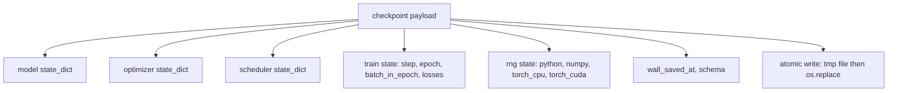
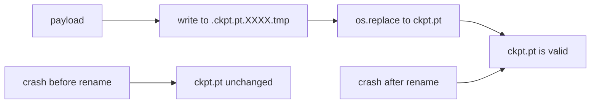
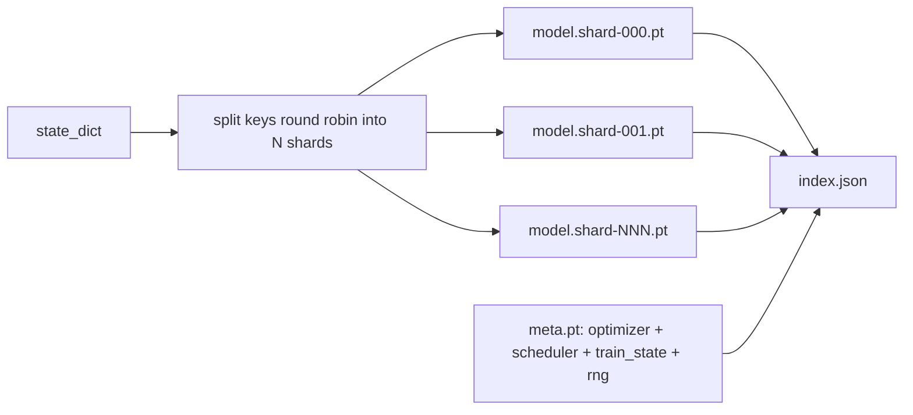

# Ponto de controlo 保存与恢复

> 训练中断会杀死运行;checkpoint 让它们可以继续;; 原子化保存模型、优化、调度器、Loss history、step counter 和 RNG state,这样任何时刻被终止时,磁盘都将留下一个有效文件──

**Type:** Build
**Languages:** Python
**Prerequisites:** Phase 19 lessons 42 to 45
**Time:** ~90 minutes

## Objetivos de aprendizagem

- Capturar o estado de treinamento completo em uma única carga útil, para que possa ser recarregada em um novo processo.
- Usar um método de renomeamento de tempo para conseguir salvar o átomo, garantir que o crash nunca deixe de ser escrito até metade do arquivo.
- 恢复 Python、NumPy 和 PyTorch's RNG state, fazer reiniciar 后后的损失 匹配未中断的基线──
- Para não ser capaz de colocar em um modelo de um único arquivo, construir um layout de checkpoint fragmentado, contendo hash verificação de fragmentos e um índice JSON.

## 问题

Você configurou uma missão de treinamento, prevendo que ela funcionará 18 horas. O relógio de parede está no limite de 4 horas. O cluster reinicia, porque alguém com mais salário do que você aprovou a atualização do kernel.

O artefato verdadeiro é um único documento, no qual se conserva tudo o que é necessário para continuar treinando:parâmetros do modelo, estado do optimizador, estado do cronógrafo, estado de utilização para desenhar o histórico de perdas, passo em andamento e época, além de contadores batch-in-epoca, há cada aleatoriedade fonte de estado de RNG.

Atomic save é a outra metade deste contrato. Nome do arquivo final significa que o acidente ocorreu no meio da escrita; resume vai ler para o lixo.

## 概念



### 5 baldes do estado

| Bucket | 为什么重要 |
|--------|------------|
| Model | Weights 和 buffers；也就是 model 本身。 |
| Optimizer | Momentum 和 adaptive moments；没有它们，下一步就是另一个 Optimization 问题。 |
| Scheduler | Learning rate 在 curve 上的位置；cosine schedules 尤其在意这一点。 |
| Train counters | Step、epoch、batch-in-epoch，以及绘制 dashboard 的 Loss history。 |
| RNG state | 为 dropout、data shuffling，以及 model 内部的任何 sampling 提供 determinism。 |

### Salvo atômico



两条规则──第一, temporário documento deve estar localizado no mesmo catálogo do alvo localizado, assim renomear 才会停留在同一个文件系统内; trans dispositivo rename 不是原子的──二, temporário nome para cada tentativa são obrigatórias, evitar dois escritores 相互覆盖──

### Pontos de controlo em fragmentos

Quando o modelo 变大时, a carga útil de um único arquivo vai ficar muito grande, carregando não suficientemente rápido, a verificação não é fácil, e também em partilha de rede 读取中途动时非常痛苦── a solução é separar os parâmetros em fragmentos, e escrever em um pequeno índice, conectá-los juntos──



Index  record shard count 、 cada shard ≠ sha256, bem como sha256 ≠ metafile ⋅ Quando qualquer hash não se encaixa, o carregador irá claramente falhar ⋅ Shards podem cair em diferentes discos físicos; meta  muito pequeno, irá primeiro ler ⋅

### Resumo de From Epoch Midway Continu

Para começar, vai-se perder de minutos a dias diferentes.`(epoch, batch_in_epoch)`Adição RNG estado. Depois, o ciclo de treinamento irá gerar números aleatórios.`batch_in_epoch`Continuar. Este código de aula concluiu com precisão este ponto; afirmação é que a trajetória de perda posterior de resumo irá corresponder à linha de base de não interrupção no âmbito de 1e-4.


```figure
cc-atomic-checkpoint
```

## Construí-lo

`code/main.py`- Eu tenho quatro primitivas e um driver de demonstração.

### Passo 1: Captura e recuperação do estado de RNG

`capture_rng_state`返回一个字句,包含Python 的 `random.getstate`Numero de pessoas.`np.random.get_state`, bem como CPU PyTorch e CUDA RNG bytes`restore_rng_state`O tensor do CPU é um buffer de 8 bytes, o RNG do PyTorch sabe como consumir.

### Passo 2: Salvo atômico

`atomic_save`Vai carregar o cartão de destino no arquivo temporário, e depois usar`os.replace`A sua transformação em nome final.`atomic_write_json`Para o índice fragmentado  Execução da mesma operação 

### Passo 3: 完整检查站回路

`save_checkpoint`Otimizador, cronógrafo, estado do trem, RNG, um modelo, um modelo, um sistema de treinamento, um sistema de treinamento, um sistema de treinamento, um sistema de treinamento, um sistema de treinamento, um sistema de treinamento, um sistema de treinamento, um sistema de treinamento, um sistema de treinamento, um sistema de treinamento, um sistema de treinamento, um sistema de treinamento, um sistema de treinamento, um sistema de treinamento, um sistema de treinamento, um sistema de treinamento, um sistema de treinamento, um sistema de treinamento, um sistema de treinamento, um sistema de treinamento, um sistema de treinamento, um sistema de treinamento, um sistema de treinamento, um sistema de treinamento, um sistema de treinamento, um sistema de treinamento, um sistema de treinamento, um sistema de treinamento, um sistema de treinamento, um sistema de treinamento, um sistema de treinamento, um sistema de treinamento, um sistema de treinamento, um sistema de treinamento, um sistema de treinamento, um sistema de treinamento, um sistema de treinamento, um sistema de treinamento, um sistema de treinamento, um sistema de treinamento, um sistema de treinamento, um sistema de treinamento, um sistema de treinamento, um sistema de treinamento, um sistema de treinamento, um sistema de treinamento, um sistema de treinamento, um sistema de treinamento, um sistema de treinamento, um sistema de treinamento, um sistema de treinamento, um sistema de treinamento, um sistema de treinamento, um sistema de treinamento, um sistema de treinamento, um sistema de treinamento, um sistema de treinamento, um sistema de treinamento, um sistema de treinamento, um sistema de treinamento, um sistema de treinamento, um sistema de treinamento, um sistema de com ação, um sistema de treinamento, um sistema de com ação, um sistema de treinamento, um sistema de com ação,`load_checkpoint`Reverso recuperá-lo,并返回一个 `TrainState`◊ campo de esquema é gancho de atualização: futurformatschanger会递增版本string, enquanto o carregador irá realizar o envio.

### Passo 4: variante em fragmentos

`save_sharded_checkpoint`Em forma rotunda, distribuir as chaves de parâmetros em N 个 shards, usando o seu próprio armazenamento atômico, escrever em cada shard, escrever em um metá-filo que contém o optimizador, cronista e estado de trem, e escrever em um índice JSON de shard sha256.`load_sharded_checkpoint`Vai-se juntar a cada pedaço.

### Passo 5: Demo de resumados

`run_resume_demo`Vai ser um pequeno modelo .`total_steps`, em `interrupt_at`保存点检查,然后继续运行――第二个过程 会恢复点检查并运行剩余步骤――该函数 返回断点 之后两条损失轨迹最大绝对差――有RNG恢复,差异为零或浮点噪音――

- Não .

```bash
python3 code/main.py
```

单文件和碎片的演示 都断言最大差小于 1e-4──摘要会写入 `outputs/resume-demo.json`- Não.

## Usá-lo

O sistema de controle de dados é o mesmo: modelo + optimizador + agendador + contadores + RNG, com formato atômico   書き込み,并按ステップ 命名,便于找到最新文件──Layouts Shared 通过平行阅读 支持大型模型加载;`index.json`É só fazer com que isto aconteça.

Para obrigatoriamente executar três modos:

- **Schema 是 payload 中的一个 string。**Migrações, de acordo com as suas ramificações. Sem elas, você não pode evoluir em condições que não destroem o antigo sistema operacional.
- **对每个 shard 计算 Sha256。**O download é o pior bug do carregador, ou é um rápido falha, ou é um falha tarde.
- **让 checkpoint cadence 保持诚实。**Cada passo salvar uma vez, e cada minuto de um relógio de parede salvar uma vez, tirar mais curto.

## Envia-o

`outputs/skill-checkpoint-save-resume.md`É qualquer novo script de treinamento: forma de carga de pagamento, escrita atômica, captura de RNG, índice de armazenamento.`save_checkpoint`, em arranque            `load_checkpoint`- Não, não.

## Exercícios

1. Use por grupo de parâmetros 分片 substituir rotund-robin sharding(以 `.weight`结尾的层 vs `.bias`O que é que cada layout é mais adequado?
2. Expandir o ciclo de salvação, manter os últimos K 个 checkpoints, e limpar os mais antigos.
3. - Adicione um .`--ckpt-every-seconds`bandeira, segundo o intervalo do relógio de parede 触发保存, não apenas segundo o número de passos.
4. Adicione um caminho de verificação da soma de checksum, em startup 运行, cada ponto de verificação no catálogo de busca,并报告哪些已腐败──
5.                                                                                                                                                                                                                                                                                                                                                                                                                                                                                                                              `migrate_v1_to_v2`função, para carga útil 添加一个新字段,并递增方案字符串──让载 同时兼容两个版本──

## Termos-chave

| Term | 人们常说 | 实际含义 |
|------|----------|----------|
| Atomic save | “写入然后祈祷” | 写入同一目录中的 temp file，然后用 os.replace 放入 target name |
| State dict | “Weights” | Model parameters 和 buffers，按 parameter name 作为 key |
| Sharded checkpoint | “大 model file” | 多个文件，每个 shard 一个，加上一个 meta file 和一个包含 sha256 的 JSON index |
| RNG state | “Random seed” | python random、numpy、torch CPU、torch CUDA 的捕获状态；不只是 seed |
| Mid-epoch resume | “Restart” | 快进 RNG，并从同一 epoch 中的下一个 batch 继续 |

## Mais leitura

- POSIX `rename`semântica, para`os.replace`A alegação de dependência da atomização:
- PyTorch  Sobre `torch.save`和 `torch.load`Dos arquivos, incluindo para restauração de dispositivos cruzados`map_location`- Não.
- A lição 46 da fase 19 abrange a acumulação de gradientes que podem ser preservados através da carga útil do ponto de controlo desta lição.
- A fase 19 lição 48 abrange o formato de ditado de estado que este programa é adequado para os envelopes distribuídos de tratamento.
- Núcleo Linux `fsync`Documentação, para explicar a renomeação atômica 背后的耐久性保证──
