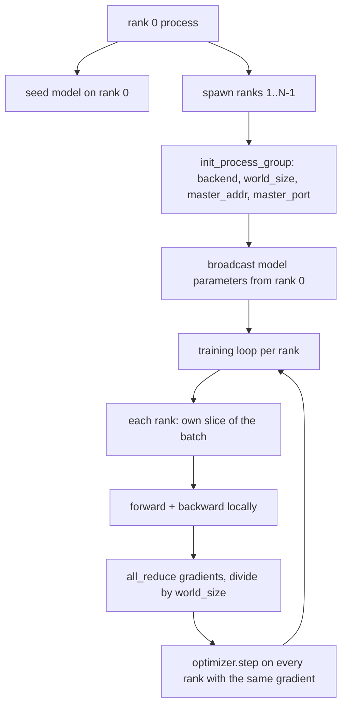
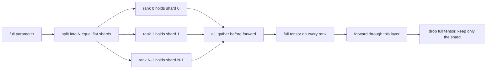

# Desde zero construção de dados distribuídos paralelamente e FSDP

> O treinamento de vários graus é um conjunto de regras e regras.

**Type:** Build
**Languages:** Python
**Prerequisites:** Phase 19 lessons 42 to 45
**Time:** ~90 minutes

## Objetivos de aprendizagem

- Utilização `gloo`backend  iniciação através de N 个 rango de grupo de processos, não precisa de hardware especial.
- 实现 um mínimo de envelope DDP, em construção 时播参数, e em retrospectiva 后 后 完全降低梯度──
- prova de gradientes por ranking de todos reduzir 匹配 concatenado entrada 上的单进程梯度──
- 勾勒 FSDP parâmetro fragmentação: cada classificação 持有一个片,前进通过 时收集全 tensor,后落──

## 问题

模型能放进一个设备──数据设置 放不下──Optimização orçamento 要求你在每秒钟内 看到N 倍样本──第一杆是数据平行:每个级别在批次不同片上运行同一个模型,然后在优化步骤前平均梯度──第二杆是FSDP:模型本身也放不进一个设备,所以每个级别都持每个参数的一部分,并通过 期间逐层重建全 tensors──

Se os parâmetros forem desviados entre as fileiras, esta vez vai ser um erro. Se você tiver gradientes médios, mas não tiver perdas médias, o painel de trabalho vai mentir. Se o backend colectivo não conseguir chegar a um acordo, a corrida vai ficar sempre pendurada.

O que é que é que é?`gloo`Backend 随着每个 PyTorch build 一起提供,并接受 `torch.multiprocessing`trabalhadores; a mesma parte do código foi trocada para um nó de GPU múltipla`nccl`时, estrutura não precisa mudar.

## 概念



###  Dois colectivos importantes

| Collective | 做什么 | 何时使用 |
|------------|--------------|------|
| `broadcast` | 将一个 tensor 从一个 rank 复制到所有其他 rank | Parameter init、scheduler state、任何 one-to-all sync |
| `all_reduce` | 在所有 rank 间对一个 tensor 求和（或 mean、或 max），每个 rank 都得到结果 | Backward 后的 Gradient averaging |
| `all_gather` | 每个 rank 贡献一个 tensor，每个 rank 都得到 concatenation | Logits collection、FSDP parameter unshard |

O contrato de DDP é construção`broadcast`- Para trás.`all_reduce`Esboço do FSDP em cada camada para frente passagem 前加入`all_gather`- Não.

### Gradientes médias 匹配 gradiente de processo único

Em N 个级 上使用B 个样本的批量 训练的模型,必须产生与单进程在N*B的批量 上训练相同的梯度──是对每级梯度 求和并除以N,将得到平均损失梯度,这正是中减的交叉 Entropia在全批量 上会产生的结果──Lesson code 会在手动全减梯度和参考单进程梯度 之间断定`max-abs-diff < 1e-3`- Não.

### Esboço do FSDP



A memória ganha é precisa: por-ranqueamento memória parâmetro  baixar para 1/N。 preço é reunir, cada passagem avançada têm que ser pagada。 Produção FSDP 会 irá reunir com a sobreposição com o computador de nível superior, por isso custo do relógio de parede 比朴核算预测的小得多。 本课对每个参数做回路,并声称重建与原始比特等──

### CPU com o backend negro

CUDA é o alvo de produção, mas a CPU também existe os mesmos caminhos de código.`gloo`É o backend coletivo da CPU.`nccl`Lente vários níveis numéricos, mas a superfície da API é completamente igual.`backend="gloo"`Ini始化,并用 `torch.multiprocessing`As filas de reprodução, em vez de `torchrun`Os dois, finalmente, vão usar o mesmo.`torch.distributed` Em nós multi-GPU, a única variação é `backend="nccl"`Tensores de dispositivo, bem como usos`torchrun`- Começando.


```figure
cg-allreduce-ring
```

## Construí-lo

`code/main.py`É um artefato que pode ser transportado.

### Passo 1: Grupo de inicialização do processo

```python
os.environ["MASTER_ADDR"] = "127.0.0.1"
os.environ["MASTER_PORT"] = str(port)
dist.init_process_group(backend="gloo", rank=rank, world_size=world_size)
```

`MASTER_ADDR`和 `MASTER_PORT`É um encontro: cada classificação está conectada ao mesmo host.

### Passo 2: construção 时 transmissão

`MinimalDDP.__init__`穿历每个参数 和缓冲,并调用 `dist.broadcast(tensor, src=0)` O valor do rank 0 se torna canônico init── sem este passo, cada rank irá usar sua própria semente inicial, rank de primeiro passo começar divergência──

### Passo 3: retrocesso 后 todos os gradientes reduzir

```python
def all_reduce_grads_(module, world_size):
    for p in module.parameters():
        if p.grad is None:
            p.grad = torch.zeros_like(p.data)
        dist.all_reduce(p.grad.data, op=dist.ReduceOp.SUM)
        p.grad.data.div_(world_size)
```

Cada ranking, finalmente, obtém o mesmo gradiente médio. O passo de otimização agora está em cada ranking, baseado na mesma entrada de função, e é por isso que os parâmetros continuam sincronizados durante toda a execução.

### Passo 4: demonstração de igualdade de preços

`manual_all_reduce_matches_single_process`Em nível 0 , construção do mesmo modelo, e-o gradiente pós-todo-redução com o processo único em entrada concatenação , o gradiente calculado  comparar ∼max-abs-diff ∼1e-8。

### Passo 5: Viagem de ida e volta do FSDP

`fsdp_round_trip_sketch`Aplanem cada parâmetro, pad até`world_size`de múltiplas, de corte, de todo, de novo, de novo, de novo. Cada linha de reconstrução é igual ao original.

运行:

```bash
python3 code/main.py
```

默认 tamanho do mundo é 2──2 processos CPUs, através `gloo`互通信,并以零 退出──输出 `outputs/ddp-demo.json`捕获每个级别的参数总数、全部减少后的梯梯规则、FSDP round-trip result,以及手动对参考梯梯差──

## Usá-lo

Estacas de formação de produção 调用相同原始人──PyTorch 的 `DistributedDataParallel`增加了:post-backward gradient hooks, para ser todo-reduzido e sobreposição para trás;bucketed todo-reduzido, será vários pequenos gradientes 合并为一次集体;以及教案 46 使用过的 `no_sync`contexto.

O FSDP do PyTorch aumentou: cada nível uma visão de parâmetro plano, deixando cada rank ▌ter um buffer contíguo; o nível inferior não dividido com a sobreposição do cálculo do nível anterior; bem como a descarga de CPU de fragmentos selecionáveis。

Forma manter inalterada: iniciação da transmissão, retrocidação                                                                                                                                                                                                                                                                                                                                                                                                                                                                                                             

## Envia-o

`outputs/skill-distributed-fsdp-ddp.md`携带新训练脚本 的配方: 用 `gloo`Iniciar o grupo de processos da CPU, us`nccl` inicia o grupo de processo da GPU, vai o modelo 包 em DDP shell, em construção  em transmissão não está em retrospectiva                                                                                                                                                                                                                                                                                                                                                                                                                                                                                           

## Exercícios

1. Utilização `--world-size 4`运行,并确认整个运行 中参散 保持在 1e-3 以下。
2.  将 manual média  substituir `dist.all_reduce(op=dist.ReduceOp.AVG)`Não há diferença de tempo.
3. Dei ao envelope DDP  adicione um gancho pós-retro, deixe tudo reduzir com o resto do atraso sobrepondo; Messa o relógio de parede  melhorar。
4. 实现 FSDP re-shard step:forward pass 后, novamente usando shard local  substituir tensor completo。 confirmar memória por rank 下降。
5. Em CUDA 机器上将后端 换为 `nccl` registar quais variáveis ambientais  alterar, quais manterem-se 

## Termos-chave

| Term | 人们的说法 | 实际含义 |
|------|-----------------|------------------------|
| Backend | "gloo or nccl" | 实现 collective ops 的 library；gloo 是 CPU，nccl 是 GPU |
| World size | "Total ranks" | group 中的 process 数量；group 是 collectives 操作的 unit |
| Rank | "Worker id" | group 内的 process identifier，从零开始索引 |
| All-reduce | "Sum the grads" | 在所有 rank 间对一个 tensor 求和，每个 rank 最终得到相同结果 |
| Unshard | "Gather the params" | 通过 all_gather 从 per-rank slices 重建 full tensor |

## Mais leitura

- PyTorch `torch.distributed`Documentação, compreender a semântica coletiva de base do curso.
- `gloo`Lista coletiva de bibliotecas, sua forma e apoiada pela CUDA `nccl`Primitivos é o mesmo.
- Fase 19 lição 46, compreender DDP total-reduzir 包在 `no_sync`Modelo de acumulação de gradientes do meio:
- Fase 19 lição 47, compreender o layout do checkpoint existente no DDP e no FSDP.
- PyTorch FSDP documentação, conheça aqui esquema de parâmetros de fragmentação de implementação de produção.
