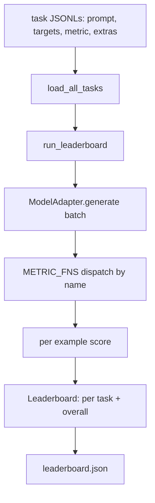
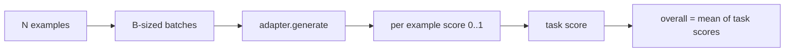

# 语言模型评测 Arnes

> Se um modelo se apresenta bem em tarefas que você não pode definir, então é apenas um acaso que funciona bem.

**Type:** Build
**Languages:** Python
**Prerequisites:** Phase 19 lessons 42 to 45
**Time:** ~90 minutes

## Objetivos de aprendizagem

- Para definir uma tarefa como JSONL 文件, cada exemplo 包含 `prompt`- Não.`targets`- Não.`metric`, e opções `extras`- Não.
- 实现五个指标:exact match、rouge-l F1、executable check、multiple choice 和 substring contém。
- Construir um corredor, por tarefa  processar exemplos em lote,并分发给可替换的模型适配器──
- 输出 leaderboard JSON, contendo a pontuação de cada tarefa, a latência, bem como a média geral de repetição.

## 问题

A questão da honestidade é: em que aspectos se apresenta bem? A resposta honesta é o ranking que você escreveu, porque o ranking do vendedor é o que eles melhoraram.

Se o seu repo não tiver arsenal, você só pode comparar dois modelos. Se tiver arsenal, você pode compará-los em um conjunto de tarefas fixo, fixa métrica, e obter uma saída JSON diferente.

陷是让harness 过适合单个模型──修复方式是让所有模型特定的选择都留在harness 之外:harness 小到十五分钟能读完,任务小到可以随随随随随随随随随随随随随随随随随随随随随随随随随随随随随随随随随随随随随随随随随随随随随随随随随随随随随随随随随随随随随随随随随随随随随随随随随随随随随随随随随随随随随随随随随随随随随随随随随随随随随随随随随随随随随随随随随随随随随随随随随随随随随随随随随随随随随随随随随随随随随随随随随随随随随随随随随随随随随随随随随随随随随随随随随随随随随随随随随随随随随随随随随随随随随随随随随随随随随随随随随随随随随随随随随随随随随随随随随随随随随随随随随随随随随随随随随随随随随随随随随随随随随随随随随随随随随随随随随随随随随随随随随随随随随随随随随随随随随随随随随随随随随随随随随随随随随随随随随随随随随随随随随随随随随随随随随随随随随随随随随随随随随随随随随随随随随随随随随随随随随随随随随随随随随随随随随随随随随随随随随随随随随随随随随随随随随随随随随随随随随随随随随随随随随随随随随随随随随随随随随随随随随随随随随随随随随随随随随随随随随随随随随随随随随随随随随随随随随的随随随随随随随随随随随随随随随随随随随随随随随

## 概念



### Especificações de tarefas

Cada exemplo é uma linha JSONL:

```json
{"id": "arith-00", "prompt": "compute: 2 + 2", "targets": ["4"], "metric": "exact_match"}
```

对于需要得分助手的指标,`extras`携带旁路 payload:

```json
{
  "id": "code-00",
  "prompt": "python: write a function f that doubles its input",
  "targets": ["ok"],
  "metric": "code_exec",
  "extras": {"io_pairs": [[1, 2], [3, 6]]}
}
```

Uma tarefa é:`outputs/tasks/`Uma das seguintes .`.jsonl`文件──文件名就是任务名── 一文件中的所有例子 共享同一个计量──

### 五个 fixing tasks

| Task | Metric | 测试内容 |
|------|--------|---------------|
| arithmetic | exact_match | 对确定性答案的 Token 级正确性 |
| summary | rouge_l | 针对单行 reference summary 的 longest common subsequence F1 |
| code-exec | code_exec | 可执行测试：预测出的 function 必须满足一组 input-output pairs |
| multiple-choice | multiple_choice | prediction 的首字母必须匹配允许的 letter |
| generation | substring_contains | Free-form text 必须包含至少一个 target substring |

### Contrato métrico

Cada métrica é uma função:`(prediction, targets, extras) -> float in [0.0, 1.0]`❖ Aproveitar para obter pontuações por exemplo 取平均得到任务得分,再对任务得分 取平均得到整体──Fungsi métricas 都很小:

- `exact_match`Transformado em: 转小写、折叠 white space、判断 equality──
- `substring_contains`: igual normalização, fazer substring test
- `multiple_choice`Tome a primeira personagem e não se transforme em grande escrita.
- `rouge_l`:LCS comprimento Além de previsão e comprimento de referência, calculação de precisão e recall de F1。
- `code_exec`: em confinado namespace 中 Execute prediction, para cada par de entrada-saída 调用 `f(x)`, Estatísticas coincidências.

code_exec metric 会在精简后的内置名空间 中运行预测──本课的测试 断言 `import os`Vai perder, porque...`os`Não está no espaço de nomes; você não pode prever o código para acessar o sistema de arquivos.

### Modelo de adaptador

```python
class ModelAdapter(Protocol):
    def generate(self, prompts: Sequence[str]) -> List[str]: ...
    @property
    def name(self) -> str: ...
```

Adaptador é o ponto de contacto.`ToyAdapter`, é um padrão de determinação de correspondência, vai ter cinco tarefas fixas entre cada prompt  retornar resposta correcta。 adaptador real 会调用模型并返输出。 Harness não importa qual é。

### Corredor

`run_task`Cada lote de tratamento`batch_size`个 prompts,并分发给 métrica função。`run_leaderboard`穿越每一个任务并求平均──`write_leaderboard`输出带 schema string 的 JSON,这样未来格式 变化不会静默破坏仪表板──




```figure
eval-harness-matrix
```

## Construí-lo

`code/main.py`É um artefato que pode ser transportado.

### Passo 1: tarefas de fixação de sementes

`seed_fixture_tasks(target_dir)`- Não .`.jsonl`文件──第一次运行 `main.py`Se o catálogo estiver vazio, vai semear estes documentos.

### Passo 2: tarefas de carga

`load_all_tasks(task_dir)`读取每个 `.jsonl`,并返回从任务名到 `Example`registros 列表的 dict──以`#`As linhas de comentários e as linhas em branco serão saltadas, para que os contribuintes possam comentar estes documentos.

### Passo 3:implementação de métricas

Cada métrica é uma pequena função, e tem teste unitário.

### Passo 4: Escrever o corredor

`run_task`代 lotes,并生成一个 `TaskResult`, que contêm pontuação, contagem correta, contagem total e latência.`run_leaderboard`遍历所有任务,并生成带整体平均的 `Leaderboard`- Não.

### Passo 5: Emite JSON

`write_leaderboard`Conselho de Administração`--include-per-example`A bandeira irá exportar registros por exemplo, assim, quando as pontuações mudarem, você pode fazer previsões diferentes da primeira vez que você fez.

- Não .

```bash
python3 code/main.py
```

脚本第一次运行时会种子装置,用玩具适配器 (tô de adaptação) 打分,并写入`outputs/leaderboard.json` Usar adaptador de brinquedos 时 pontuação geral é de 1.0;`test_main.py`O teste do adaptador de estúdio mostrou que o adaptador não respondeu quando o mesmo arnesamento produzia 0,0

## Usá-lo

Para entrar no modelo real, escreva um adaptador.

```python
class HttpAdapter:
    name = "vendor.v1"

    def __init__(self, endpoint, api_key):
        self.endpoint = endpoint
        self.api_key = api_key

    def generate(self, prompts):
        out = []
        for prompt in prompts:
            response = http_post(self.endpoint, prompt, self.api_key)
            out.append(response["text"])
        return out
```

Em`main()`- Não.`ToyAdapter`替换成 `HttpAdapter`❖ Arranjos, tarefas, métricas e quadro de liderança foram mantidos inalterados.

Quando o arsenal é lançado em um projeto real, é necessário executar três modos:

- **Pin task files。**leaderboard.json Você deve levar conteúdo de tarefa hash-pinned, você deve levar JSONLs; senão, o arquivo de tarefa um resultado de mudança vai mudar, e você não pode julgar qual é o que mudou.
- **Diff predictions，不只是 diff scores。** `--include-per-example`A bandeira pode deixar-te ver a pontuação.
- **限制 batch size。**Os adaptadores verdadeiros têm limites de taxa.

## Envia-o

`outputs/skill-lm-eval-harness.md`携带配方:JSONL task spec、五个指标、可替换适配器、批发运行员、带方案字符串的排名表 JSON。`outputs/tasks/`Os arquivos de tarefas do meio são fixtures; colocá-los em duplicação no projeto real como ponto de partida.

## 练习

1. Adicione a sexta tarefa, e use métricas personalizadas que você escreve a partir de zero, como sobreposição de BLEU, como pontuação de referência de BLEURT, ou qualquer contrato, como algo claro)
2. 扩展 `code_exec`, capturar o estudo,并 aceitar um conjunto de estudo esperados 作为目标──
3. Adicionar um comando de diferença de classificação:`leaderboard.json`Documentos, impressões, quais as tarefas que tiveram lugar e a magnitude das alterações.
4. Limitar a latência de cada exemplo. Usar o timeout para o pacote de chamada de adaptador.`timeouts`Coluna:
5. No quadro de liderança, use o conteúdo de tarefas sha256 pin, para que os leitores futuros possam verificar que eles avaliam as mesmas tarefas.

## 关键术语

| Term | 人们的说法 | 实际含义 |
|------|-----------------|------------------------|
| Task spec | “eval format” | JSONL 文件，每个 example 包含 prompt、targets、metric 和可选 extras |
| Metric | “你怎么打分” | 从 (prediction, targets, extras) 到 [0, 1] 内 float 的函数 |
| Adapter | “model client” | 带有 generate(prompts) -> list[str] method 的对象；唯一的模型特定代码 |
| Leaderboard | “scoreboard” | 包含 per-task scores、total counts、latency 和 overall average 的 JSON |
| Code exec metric | “运行它并检查” | 在受限 namespace 中执行 prediction，并与 input-output pairs 比较 |

## 延伸阅读

- Origins Lm-Evaluation-Harness 可作为生产级参考,规模大得多,但形状相同──
- A luz do HuggingFace é outra forma de realizar o mesmo contrato.
- Fase 19 lição 46                                                                                                                                                                                                                                                                                                                                                                                                                                                                                                                        
- A fase 19 lição 47 abrange o formato de checkpoint dirigido a seus assessores; pin hash de checkpoint no ranking.
- Fase 19 lição 48 covered gerar um modelo de treinamento distribuído 
