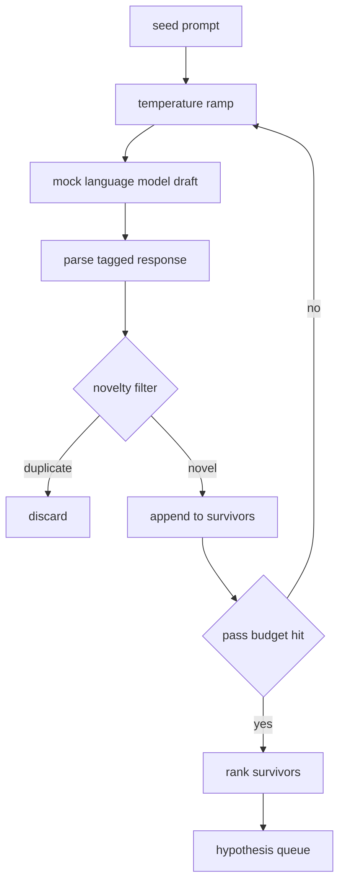

# Gerador de hipóteses

> Se um agente de pesquisa perguntar duas vezes a mesma questão, é um desperdício. O que é importante é forçar cada projeto a chegar a uma nova posição.

**Type:** Build
**Languages:** Python
**Prerequisites:** Phase 19 Track A lessons 20-29
**Time:** ~90 分钟

## Objetivos de aprendizagem
- A partir do semente de prompt drive sampleler, e transformar a sua saída 转带类型的假设记录──
- Em cada passagem, eleva a temperatura da amostra, fazendo o próximo rascunho mover-se mais longe do que o anterior.
- Use um modelo de inserção pequeno e um limiar de distância cosínea 过近似重复项──
- Utilize a função de pontuação de novidade, especificidade e testabilidade combinada para a classificação de projetos de conservação.
-  Deixe cada passo manter a certeza, para que a mesma semente  sempre gerar a mesma fila

## Por que o senhor, mais uma vez?

Um planejador  convocar um modelo  uma vez, só obterá uma hipótese  Este é um exemplo de trabalho para não causar problemas  Mas para o ciclo de pesquisa para obter forma não é contra  O ciclo  precisa de uma fila de classificação com profundidade, para que quando a primeira hipótese   fracassar, o corredor  já esteja pronto para o próximo, sem precisar pagar novamente o custo de uma passagem de amostragem completa 

O primeiro é a temperatura de cada vez que o amostragem o tempo de aumentar a temperatura, deixando o projeto seguinte mais fácil de fazer. O segundo é o filtro de novidade: cada projeto, o gerador mede a distância de inserção de cada sobrevivente anterior, e rejeita qualquer coisa que esteja dentro do cluster.

Este curso fornece um modelo de linguagem simulada, que irá ser dirigido a um prompt fixo  retornar a sequência de tokens de escrita ⋅ esta simulação 足以跑完整条路径:seed prompt 输入, aplicando rampa de temperatura, resolver candidato,运行新奇过器,输出排列列──

## Hipótese 形状

```text
Hypothesis
  id             : int           (monotonic within a run)
  text           : str           (the claim)
  variables      : list[str]     (what changes between conditions)
  metric         : str           (what the runner will measure)
  baseline_ref   : str | None    (which paper or run the comparison cites)
  draft_pass     : int           (which sampler pass produced this)
  temperature    : float         (the sampler setting at draft time)
  novelty_score  : float         (distance from prior survivors, 0..1)
  rank_score     : float         (weighted sum used for ordering)
```

`variables`和 `metric`Não é livre texto. O cursor vai ler diretamente estes passagens.

`baseline_ref`É opcional, mas recomendação de fornecimento. O avaliador da terceira classe precisa de uma linha de base para fazer comparação. Se a hipótese for omitida, o avaliador retornará à mesma métrica da última corrida.


```figure
cg-novelty-ramp
```

## Arquitetura



O ciclo é muito direto. É claro que cada caixa tem um contrato rigoroso.

## Rampada de temperatura

De`t_min`Começa, até.`t_max`结束, passo 为 `(t_max - t_min) / (n_passes - 1)` Cada passagem é feita com a temperatura de corrente`GeneratorConfig.schedule()` produzir `n_passes`个均间隔的值──mock model 通过在一小组按 `(prompt, temp_bucket)`索引的脚本化反应 之间切换来遵守温度──bucket 是开区间, portanto, uma pequena variação na temperatura seleciona um bucket diferente, e produz um projeto diferente──`temperature=t`- Não.

默认 agenda é de `0.2`Até`1.2`O que é que é o que é o que é o que é o que é o que é o que é o que é o que é o que é o que é o que é o que é o que é o que é o que é o que é o que é o que é o que é o que é o que é o que é o que é o que é o que é o que é o que é o que é o que é o que é o que é o que é o que é o que é o que é o que é o que é o que é?`0.2`时,model 会复述 seed──高于 `1.2`时,resposta 往往偏离主题并导致 parser 失败──

## Filtro de novidade

Cada projeto é resolvido, o gerador irá incorporar texto,并与每个已接受的假设比较──embedding é um pequeno saco hashed de tokens de palavras,并正常化到单位长度──两单位向量 之间的 cosinus distance 是`1 - dot(a, b)`Se o projecto chegar a qualquer sobrevivente anterior, a distância mínima é maior que`novelty_threshold`, é que é por lá.`0.25`- Não.

Embedagem hash não é alta. É definida e depende de zero, e é capaz de capturar situações evidentes: dois projetos.

## Ponto de classificação

```text
rank_score = w_novelty * novelty_score
           + w_specificity * specificity_score
           + w_testability * testability_score
```

Três sub-escores.`novelty_score`É a menor distância de inserção do sobrevivente anterior.`specificity_score`É uma hipótese de que a quantidade de variável específica é dividida pela quantidade de objetivo.`testability_score`Na hipótese, sim, especificando métrica 和 linha de base 时为一, apenas especificando métrica 时为二分之一, senão为零──

默认权重是 `0.4`- Não.`0.3`- Não.`0.3` O peso está localizado na configuração do gerador, portanto, o curso pode ajustar-os, sem precisar de forjar o código 

## Modelo de linguagem falsa

```python
class MockLLM:
    def sample(self, prompt: str, temperature: float, seed: int) -> str:
        ...
```

- Não .`(prompt, temperature, seed)`Triplo, o amostragem é de certeza.`(prompt_signature, temperature_bucket)`Tabela de resposta scripturizada de índice. Se a tabela não tiver uma entrada de chave, o amostragem retornará a uma que fará com que o parseiro falhe.

Semente vai entrar em resposta, portanto, com um `(prompt, temperature)`Em par 配上不同种子 会产生不同草案──测试中我们固定种子,以保持结果可复现── Em implementação real, a semente 会 provém do relógio do sistema ou do contador──

## Cota de saída

输出是按 `rank_score`降序排序                                                                                                                                                                                                                                                                                                                                                                                                                                                                                                                         `Hypothesis`registro Listação. █████████████████████████████████████████████████████████████████████████████████████████████████████████████████████████████████████████████████████████████████████████████████████████████████████████████████████████████████████████████████████████████████████████████████████████████████████████████████████████████████████████████████████████████████████████████████████████████████████████████████████████████████████████████████████████████████████████████████████████████████████████████████████████

A fila é limitada. Quando estiver em aberto, o orquestrador pode expandir o gerador de sementes e voltar a operar, ou parar de relatar o orçamento esgotado.

## Como é que o meu nome é "Codex"

`code/main.py` definição `Hypothesis`- Não.`MockLLM`- Não.`HypothesisGenerator`E um gerador de demonstração de determinação`run(seed_prompt)`Método, retornar ao ranking da fila; passar a contagem de `GeneratorConfig.n_passes`读取,而不是作为一个论点 传入──embedding 是一个单独的函数──排名分数 是一个单独的函数──没有什么依赖──`numpy`• integrar matemática é um simples estudo, portanto, o curso deve ser portátil.

`code/tests/test_generator.py`覆盖 linear path、duplicate rejection path、parser failure path、temperatura rampa boundary 和 ranking。

## Está ligado a onde?

第五十二课取 queue 第五十一课取 queue 第五十二课取 queue 第五十二课取 queue 第五十二课取 queue 第五十二课取 queue 第五十二课取 queue 第五十二课取 queue 第五十二课取 queue 第五十二课取 queue 第五十二课取 queue 第五十三课取 queue 第五十三课取 queue 第五十三课取 queue 第五十三课取 queue 第五十三课取 queue 第五十三课取 queue 第五十三课取 queue 第五十三课取 queue 第五十三课取 queue 第五十三课取 queue 第五十三课取 queue 第五十五课取 queue 第五十五课取 queue 第五十五课取 queue 第五十五课取 queue 第五十五课取 queue 第五十五课的首首首首首首首首首首首首首首首首首首首首首首首首首首首首首首首首首首首首首首首首首首首首首首首首首首首首首首首首首首首首首首首首首首首首首首首首首首首首首首首首首首首首首首首首首首首首首首首首首首首首首首首首首首首首首首首首首首首首首首首首首首首首首首首首首首首首首首首首首首首首首首首首首首首首首首首首首首首首首首首首首首首首首首首首首首首首首首首首首首首首首首首首首首首首首首首首首首首首首首首首首首首首首首首首首首首首首首首首首首首首首首首首首首首首首首首首首首首首首首首首首首首首首首首首首首首首首首首首首首首首首首首首首首首首首首首首首首首首首首首首首首首首首首首首首首首首首首首首首首首首首首首首首首首首首首首首首首首首
