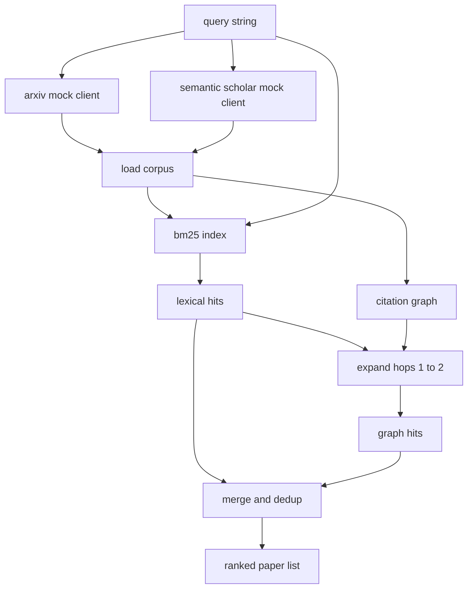

# 文献检索

> Uma hipótese é muito barata. Saber se alguém já provou isso é uma parte cara. Construir uma camada de recuperação, antes de um corredor iniciar uma caixa de areia, responder a essa pergunta.

**Type:** Build
**Languages:** Python
**Prerequisites:** Phase 19 Track A lessons 20-29
**Time:** ~90 分钟

## Objetivos de aprendizagem
- Use loop 下游会读取的字段, para um pequeno registro de papel 建模──
- Apenas usar a estrutura de dados, em resumos, para construir o índice BM25
- 遍历 citação gráfico,浮现 λεξικό αναζήτηση 遗漏的论文──
- 通過稳定纸 id,对词典 和图 两轮命中结果去重──
- Para fazer duas APIs externas simuladas  empacotadas em um único cliente   atrás, assim endpoints verdadeiros  conectando,                                                                                                                                                                                                                                                                                                                                                                                                                                                                                               

## Por que é que é preciso uma recuperação de duas rotas?

Para resumos fazer pesquisa de palavras-chave, retornará com consulta. Isso cobre a maior parte das situações de nível superior. Mas ele vai perder dois tipos de situações. Primeiro tipo é papel fundamental usando diferentes palavras-chave; por exemplo, pesquisa "atenção pouca" vai perder um artigo intitulado "seleção de blocos no roteamento de transformadores". Segundo tipo é papel relacionado é citando um conhecido ancoramento de sucessos; encontrar ancoramento recorrido para a frente, em comparação com força bruta pesquisar todo o conjunto abstrato mais alta eficiência.

本课会构建这两轮──摘要 上的 BM25 捕获词语 hits──引用图穿越从种子集合 出发,向前和向后扩展一到两跳──二者的并集按纸 id 去重,并用一个小型组合分数排序──

## Papel 形状

```text
Paper
  id          : str           (稳定 identifier，mock corpus 中为 "p001")
  title       : str
  abstract    : str
  year        : int
  authors     : list[str]
  references  : list[str]     (这篇 paper 引用的 paper ids)
  citations   : list[str]     (引用这篇 paper 的 paper ids)
  source      : str           (提供它的 mock api，"arxiv" 或 "s2")
```

Referências e citações 字段形成有向引用图── duas falsas APIs 返回的字段有重叠但不完全相同,因此 corpus loader 会按 `id`Para os fazerem.


```figure
cg-citation-hops
```

## Arquitetura



Cliente de recuperação 拥有这两轮和 merge──caller 传入一个查询,并拿回一个排名列表; cada um deles 条目都携带每纸分数 字段(`bm25_score`- Não.`graph_distance`- Não.`recency_score`- Não.`final_score`), para explicar a sequência.

## Desde zero para alcançar o BM25

实现使用标准 Okapi BM25,默认参数为 `k1=1.5`- Não.`b=0.75`index é dois dicionários:`term -> doc_frequency`和 `term -> list of (doc_id, term_count)`△ comprimento do documento é abstracto de Token número。 comprimento médio do documento em índice 构建时计算一次。对查询 打分时,会对查询条款 求和:`idf * tf_norm`, entre os `tf_norm`É padrão BM25 长度归一化术语频率──

O tokeniser é primeiro .`lower`, re-pós-separado por caracteres digitais não-letro. Não faz referências.

```text
idf(t)      = log((N - df + 0.5) / (df + 0.5) + 1.0)
tf_norm(t)  = (f * (k1 + 1)) / (f + k1 * (1 - b + b * dl / avgdl))
score(d, q) = sum over t in q of idf(t) * tf_norm(t)
```

## Transversalidade do gráfico de citações

Gráfico 会从 corpus 构建一次──Edges Forward 从一篇论文指向它的引用──Edges Backward 从一篇论文指向它的引用──transversal é a primeira pesquisa de largura, com os primeiros hits BM25 para a semente, maxima dos dois saltos──

两跳是刻意设置的上限──一跳太浅;agent 常常需要直接祖先或后裔──三跳会让连接图上的结果规模膨胀,并且易偏离主题──本课把跳限 暴露为一个配置键,这样下游循环可以收紧它──

## Dedup e classificação

两轮会回重叠集合――merge Use paper id 作为关键―― cada artigo do papel é um agregado de poder mix――

```text
final_score = w_bm25 * bm25_score_norm
            + w_graph * graph_score
            + w_recency * recency_score
```

`bm25_score_norm`É a pontuação BM25 exceto a maior pontuação BM25 do conjunto combinado.`graph_score`Para hits directos de léxico`0.6`, 两跳为 `0.3`,否则为零──`recency_score`É a rampa linear entre o corpus, o menor ano de zero a maior ano de um ano.

默认 pesos é `0.5`- Não.`0.3`- Não.`0.2`Os pesos são config; o tema antigo pode reduzir a recência, enquanto o tema que muda rapidamente o irá melhorar.

## Fim de corpus

Corpus tem cem artigos, de`build_corpus()`生成──每篇篇都有一个手写标题和摘要,主题来自五类之一:attention sparsity、retrieval augmentation、low rank adapters、dataset distillation 和 evaluation harnesses──Referências 和 citações 已连线,让每个主题都形成一个连接的子图,并带有少量跨主题边缘──

两个假 API clientes(`ArxivMockClient`- Não.`SemanticScholarMockClient`O estudo tem como objetivo identificar os resultados dos estudos e os resultados dos estudos realizados no âmbito da investigação e da investigação.

## Lições 52 e 53

lição 52 - Corredor do meio 会读取 `paper.id`- Não.`paper.title`, bem como as três primeiras frases do abstracto, como contexto do experimento.`paper.year`和 `paper.references`,将基线归因到某篇具体文件──

Cliente de recuperação  retornar um `RetrievalResult`, que também contém lista classificada 和 por métricas de consulta: contagem de sucessos, pontuação média, pontuação superior, tempo total de parede, para que o corredor possa registrar esses conteúdos, assim, o passe de observabilidade pode ser desenhado com o tempo de mudança de qualidade.

## Como é que o meu nome é "Codex"

`code/main.py`Definindo`Paper`- Não.`ArxivMockClient`- Não.`SemanticScholarMockClient`- Não.`BM25Index`- Não.`CitationGraph`- Não.`RetrievalClient`O sistema de transmissão de dados é um método.

`code/tests/test_retrieval.py`覆盖 лексический path、graph path、merge、dedup 和 empty query──

## Está em que posição?

Lição cinquenta  produzir uma hipótese. Lição cinquenta e um  pesquisa literatura, julgar essa hipótese se não já tem um determinado teorê­mo. Se não houver, Lição cinquenta e dois 运行实验. Lição cinquenta e três 读取检查结果 和实验指标,写出判决.
