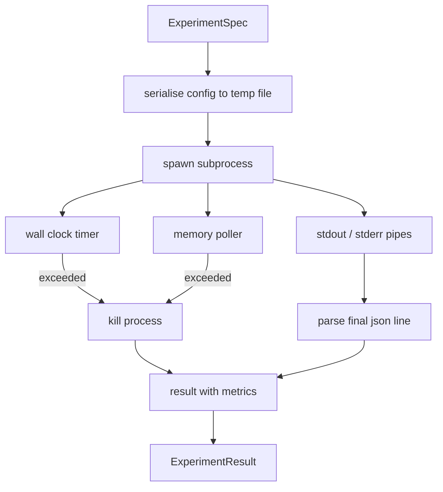

# Corredor de Experimento

> A quantidade de integridade do loop depende de suas medições.

**Type:** Build
**Languages:** Python
**Prerequisites:** Phase 19 Track A lessons 20-29
**Time:** ~90 分钟

## Objetivos de aprendizagem
- Codificar o experimento para uma especificação tipográfica, o corredor pode seriá-lo para um subprocesso.
- Inicie um subprocesso com um tempo limite de tempo de parede rígido e um capô de memória macia, e vai expô-los a condições terminais.
- A partir de agora, o sistema de dados de dados é mais fácil de obter.
- Construir uma tabela de ablação, em especificação base fixa, uma vez mais, varrer um botão de configuração.
-  quando se dá uma semente determinada, deixe cada resultado manter-se determinista, de modo que o avaliador veja o mesmo número em várias operações

## Por que usar subprocesso

Loop de pesquisa 会运行不信的代码――hypothesis 来源样本,实验脚本也 来源同一路径;把其中任一当作安全的过程中的代码,都等待一次会拖管弦乐器的崩――Subprocesses são o mais simples isolamento da linguagem própria: um processo independente、 um espaço de endereço independente, bem como o comando de sinal do lado parental―

Aqui o corredor  não realiza sandboxing completo. Não há cgroup, não há seccomp filter, nem remapping namespace. Ele possui um tempo limite de relógio de parede, usado para verificar o crescimento da memória, bem como um caminho de matança no limite de terminação do processo.

## ExperimentoEspec 形状

```text
ExperimentSpec
  spec_id        : str            (stable id，"exp_001")
  hypothesis_id  : int            (链接回 lesson 50 中的 queue)
  script_path    : str            (要运行的 python script 路径)
  config         : dict           (作为一个 json arg 传给 script)
  seed           : int            (experiment 的 deterministic seed)
  wall_timeout_s : float          (hard timeout，超出则 kill)
  memory_cap_mb  : int            (soft cap，轮询；超出则 kill)
  metric_keys    : list[str]      (evaluator 会读取的字段)
```

script existe no disco; runner 会把 config 写入一个临时文件路径,script 再读取它──script 应该在 stdout 上打印单个 json line,其键是`metric_keys`O superconteúdo do estudo acima será capturado, mas o parseiro de métricas irá ignorá-los.


```figure
cg-runner-limits
```

## Arquitetura



runner é uma classe, com um método principal. Poller é um pequeno fio, cada intervalo de votação separado.`psutil`equivalente; quando a plataforma não a expõe, a retomada não é opção.

## Por que é a tampa de memória macia

Capas de memória rígida 需要 `resource.setrlimit`, e apenas em POSIX 上工作。 Este curso oferece uma abordagem portátil: do tamanho do conjunto de residentes da plataforma de consulta, se exceder o limite, é fácil eliminar o subprocesso。 o limite é suave, porque o pesquisador tem um intervalo não-zero; o processo pode aumentar até o limite entre as duas sessões de consulta, e depois voltar para baixo。 o corredor irá registrar o máximo de RSS observado, assim o avaliador pode ver que a execução 离限 tem mais perto。

Em sistemas sem suporte de inspeção de processo, o pesquisador irá registrar um aviso único e não se desativar.

##  Capture stdout 和 stderr

runner 会在完成时读取并排空两条管──Stdout 会逐行扫描; último capaz de resolver para json 且包含所有必需的`metric_keys`de linha 会被视为指标blob──更早的json线 会保留在结果中作为 `intermediate_metrics`O avaliador pode usá-los para desenhar curvas de aprendizagem.

Stderr 会原样捕获到结果 中──runner 永远不会因为非零出口代码而升高;它将将代码记录在结果中──任何非零出口都标记为`"crash"`Mesmo que o script imprima as métricas, o avaliador assume que as operações são parcialmente falhas.

## Tabela de ablação

```python
def ablate(base: ExperimentSpec, knob: str, values: list[Any]) -> list[ExperimentSpec]:
    ...
```

给定基标和按名,该辅助会返回每个值对应一个标,并覆盖 `config[knob]`Cada espécie de cidade vai ter uma vida.`spec_id`(`f"{base.spec_id}_{knob}_{value}"`)―runner 提供一个 `AblationRunner`, em ordem de execução destas especificações, e retornar um valor de botão como chave de `AblationTable`- Não.

Por que uma vez só mudar um botão. Escarpas fatoriais completas.

## Determinismo

Cada especificação leva uma semente. O corredor vai configurar o comando para a transferência do semente para o script.`config["__seed"] = spec.seed`)。`code/experiments/`Lição 53 - O avaliador do meio depende disso; sem determinismo, a chamada "regressão" pode ser apenas uma inicialização aleatória diferente.

## Escrito de experimento falso

Este curso oferece um script experimental:`code/experiments/sparsity_experiment.py`△ É um script real, vai ler o seu próprio arquivo de configuração, usar um passe aleatório num num num num num num num num num num num num num num num num num num num num num num num num num num num num num num num num num num num num num num num num num num num num num num num num num num num num num num num num num num num num num num num num num num num num num num num num num num num num num num num num num num num num num num num num num num num num num num num num num num num num num num num num num num num num num num num num num num num num num num num num num num num num num num num num num num num num num num num num num num num num num num num num num num num num num num num num num num num num num num num num num num num num num num num num num num num num num num num num num num num num num num num num num num num num num num num num num num num num num num num num num num num num num num num num num num num num num num num num num num num num num num num num num num num num num num num num num num num num num num num num num num num num num num num num num num num num num num num num num num num num num num num num num num num num num num num num num num num num num num num num num num num num num num num num num num num num num num num num num num num num num num num num num num num num num num num num num num num num num num num num num num num num num num num num num num num num num num num num num num num num num num num num num num num num num num num num num num num num num num num num num num num num num num num num num num num num num num num num num num num num num num num num num num num num num num num num num num num num num num num num num num num num num num num num num num num num num num num num num num num num num num num num num num num num num num num num num num num num num num num num num num num num num num num num num num num num num num num num num num num num num num num num num num num num num num num num num num num num num num num num num num num num num`sleep_s`botão Usado para testar timeouts, também apoiar `allocate_mb`botão Usato para testar o polsor de memória

Simulação não realmente treinar qualquer coisa. É um cálculo numérico, em forma de ciclo de treinamento: curva de perda, perplexidade final, tempo de parede.

## Resultado 形状

```text
ExperimentResult
  spec_id              : str
  hypothesis_id        : int
  exit_code            : int
  terminal             : "ok" | "timeout" | "oom" | "crash"
  wall_time_s          : float
  peak_rss_mb          : float | None
  metrics              : dict
  intermediate_metrics : list[dict]
  stdout_tail          : str
  stderr_tail          : str
```

O avaliador 会先读取 `metrics`和 `terminal`Se o terminal não é`"ok"`, experimento contabilidade por falha execução, veredicto do avaliador irá gerar automaticamente.

## Como é que o meu nome é "Codex"

`code/main.py`Definindo`ExperimentSpec`- Não.`ExperimentResult`- Não.`ExperimentRunner`- Não.`AblationRunner`和一个决定性示范――子进程管理 是一个类――memory poller 是一个小线──ablation helper 是一个单独函数──

`code/experiments/sparsity_experiment.py`É testes utilizando o mock experimentar. É de argv 读取 config file path, e quando completado escrever uma única linha de métricas json.

`code/tests/test_runner.py`覆盖成功路径、timeout路径、crash path、ablation table, bem como check determinism of跨两次运行──

## Está em que posição?

Lição cinquenta 生成 hipóteses。Lessão cinquenta e uma 过掉文献 已解决的内容──Lessão cinquenta e dois 针对剩余部分运行实验──Lessão cinquenta e três 读取结果,运行意义测试,并写出管弦乐师 存储到假设 id 上的判决──
