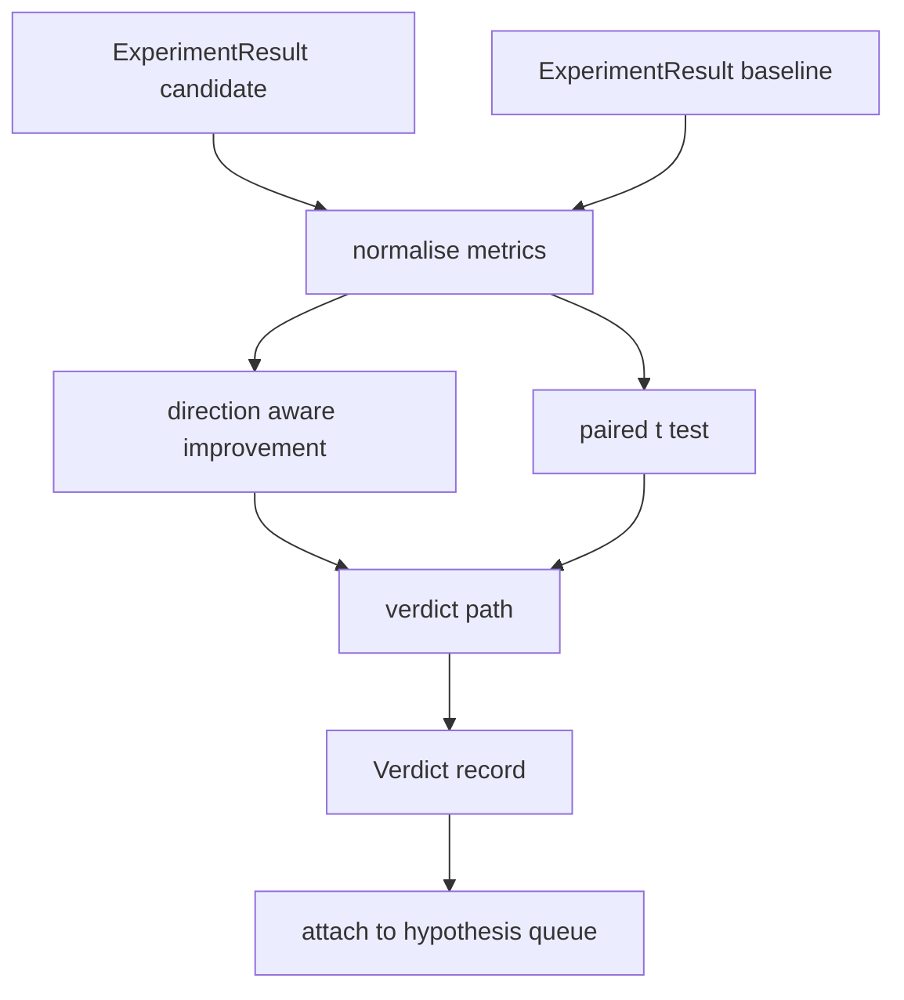

# 结果评估器

> runner 产出数字──evaluator 判断这些数字代表改进,回归,还是噪音──构建一条判决 路径,把 metrics 转换成一句结论──

**Type:** Build
**Languages:** Python
**Prerequisites:** Phase 19 Track A lessons 20-29
**Time:** ~90 minutes

## Objetivos de aprendizagem
- Utilizações de direção de melhoria e fixação do limiar, candidato corrida com a linha de base  fazer comparação 
- A partir do primeiro em cada semente de métricas de cima de um teste de paragem,并读取得到的p值──
- Para registar métricas em escala normal, deixe o relatório abaixo pode misturá-las com métricas lineares.
- 输出每一个假设的判决,让乐队主持人可以将其添加到第五十课的队列中.
- Que cada passo se mantenha puro, para que a mesma entrada sempre produz o mesmo veredicto.

## Por que um teste em par

Os números individuais dados pelo corredor não podem explicar se a mudança é real. A mesma configuração em uma semente vai obter uma perplexidade diferente. A mudança pode ser apenas ruído.

O curso é um teste de realização.`scipy.stats`Matemática é pequena, uma tela pode ler.

```text
diffs    = [a_i - b_i for i in seeds]
mean     = sum(diffs) / n
variance = sum((d - mean) ** 2 for d in diffs) / (n - 1)
t_stat   = mean / sqrt(variance / n)
df       = n - 1
p_value  = two_sided_p(t_stat, df)
```

Utilize uma função beta regularmente incompleta.

## Melhoria da consciência de direcção

Algumas métricas 变大时表示改进(precisão、output) ・・・ Outros 变小时表示改进(loss、perplexity、wall time) ・・・ avaliador 在每个 métrica 上携带一个 `direction`- Não.

```text
if direction == "higher_is_better":
    improvement = (candidate - baseline) / abs(baseline)
elif direction == "lower_is_better":
    improvement = (baseline - candidate) / abs(baseline)
```

Melhoria é um símbolo de. Para mais alto é melhor métrica, melhoramento negativo é um símbolo de melhoramento.

Um limiar fixo`improvement_threshold=0.02`, %s de 2) decide se a variação é grande o suficiente, pode-se dar um julgamento.


```figure
cg-paired-verdict
```

## Arquitetura



evaluador 运行三个独立计算,并在判决 路径中把它们合并──每个计算都是没有共享状态的纯函数──

## Normalização do registro

Perplexidade em relação à perda é uma relação de índice. Perde diminuiu em 0,1%, fazendo com que a perplexidade apareça em maior diminuição.

Este curso vai para o`scale`字段为 `"log"`Qualquer métrica em cálculo melhoramento Antes de obter log.o natural. limiar.`log(32) = 3.466`Em relação a`log(28) = 3.332`在低是更好的表表 上,相对改善 是 `(3.466 - 3.332) / 3.466 = 0.039`, superou o limiar de 2% .

```text
if scale == "log":
    a = log(candidate)
    b = log(baseline)
else:
    a = candidate
    b = baseline
```

`scale="linear"`(默认) das métricas irá saltar esta transformação.

## Ensaios em paragem por semente

第五十二课的跑者会为每次跑 输出一个最终计量分点――对于对测试,评估员需要候选人 每种种子 一种种子,基线 每种种子 一种子 一种子――orchestrator 会在一组种子 上面使用两个配置运行相同实验,然后把两组`ExperimentResult`Registros 交给评价者──

avaliador 按种子 配对(semente 位于 `result.metrics["seed"]`), depois percorrer as métricas de solicitação. Se as sementes dos dois grupos da lista não coincidirem, o avaliador irá jogar fora.`PairingError`O orquestrador deve voltar a trabalhar.

## A forma do veredicto

```text
Verdict
  hypothesis_id          : int
  metric                 : str
  direction              : "higher_is_better" | "lower_is_better"
  scale                  : "linear" | "log"
  candidate_mean         : float
  baseline_mean          : float
  improvement            : float       (signed, fraction; see direction rules)
  p_value                : float | None  (None if n < 2)
  significance_threshold : float
  improvement_threshold  : float
  verdict                : "improved" | "regressed" | "noise" | "failed"
  rationale              : str
```

Veredicto 路径 é uma pequena tabela de decisões:

```text
1. If any candidate result has terminal != "ok": verdict = "failed"
2. else if |improvement| < improvement_threshold:  verdict = "noise"
3. else if p_value is None or p_value > significance: verdict = "noise"
4. else if improvement > 0:                          verdict = "improved"
5. else:                                             verdict = "regressed"
```

A razão é uma frase legível para o homem, a orquestra pode fazê-lo segundo a hipótese id 记录到 log。

## Como ler o código

`code/main.py`Definindo`MetricSpec`- Não.`Verdict`- Não.`Evaluator`、t estatística 和 incompleta beta auxiliares, bem como um testemememotest determinista. 、t teste usando matemática pura ∞ ∞ ∞ ∞ ∞ ∞ ∞ ∞ ∞ ∞ ∞ ∞ ∞ ∞ ∞ ∞ ∞ ∞ ∞ ∞ ∞ ∞ ∞ ∞ ∞ ∞ ∞ ∞ ∞ ∞ ∞ ∞ ∞ ∞ ∞ ∞ ∞ ∞ ∞ ∞ ∞ ∞ ∞ ∞ ∞ ∞ ∞ ∞ ∞ ∞ ∞ ∞ ∞ ∞ ∞ ∞ ∞ ∞ ∞ ∞ ∞ ∞ ∞ ∞ ∞ ∞ ∞ ∞ ∞ ∞ ∞ ∞ ∞ ∞ ∞ ∞ ∞ ∞ ∞ ∞ ∞ ∞ ∞ ∞ ∞ ∞ ∞ ∞ ∞ ∞ ∞ ∞ ∞ ∞ ∞ ∞ ∞ ∞ ∞ ∞ ∞ ∞ ∞ ∞ ∞ ∞ ∞ ∞ ∞ ∞ ∞ ∞ ∞ ∞ ∞ ∞ ∞ ∞ ∞ ∞ ∞ ∞ ∞ ∞ ∞ ∞ ∞ ∞ ∞ ∞ ∞ ∞ ∞ ∞ ∞ ∞ ∞ ∞ ∞ ∞ ∞ ∞ ∞ ∞ ∞ ∞ ∞ ∞ ∞ ∞ ∞ ∞ ∞ ∞ ∞ ∞ ∞ ∞ ∞ ∞ ∞ ∞ ∞ ∞ ∞ ∞ ∞ ∞ ∞ ∞ ∞ ∞ ∞ ∞ ∞ ∞ ∞ ∞ ∞ ∞ ∞ ∞ ∞ ∞ ∞ ∞ ∞ ∞ ∞ ∞ ∞ ∞ ∞ ∞ ∞ ∞ ∞ ∞ ∞ ∞ ∞ ∞ ∞ ∞ ∞ ∞ ∞ ∞ ∞ ∞ ∞ ∞ ∞ ∞ ∞ ∞ ∞ ∞ ∞ ∞ ∞ ∞ ∞ ∞ ∞ ∞ ∞ ∞ ∞ ∞ ∞ ∞ ∞ ∞ ∞ ∞ ∞ ∞ ∞

`code/tests/test_evaluator.py`覆盖 verbeterde 路径、regressed 路径、ruído 路径(小改善) 噪音 路径(低 n) 、failed terminal 路径、log normalized 路径、与已知参考值对比的 t test,以及对对错──

## Onde esta entrada

第五十二课产 出了假设队列──第五十一课过掉文献 已有定论的内容──第五十二课在多种种上用候选人和基线 配置运行实验──第五十三课读取这些 runs 并写出判决──orchestrator 把四者合在一起:

```text
for hypothesis in queue:
    literature = retrieval.search(hypothesis.text)
    if literature_settles(hypothesis, literature):
        attach(hypothesis, verdict="settled")
        continue
    candidates = runner.run_all(specs_for(hypothesis))
    baselines  = runner.run_all(baseline_specs_for(hypothesis))
    metric_spec = MetricSpec("perplexity", direction=LOWER, scale=LOG)
    verdict = evaluator.evaluate(hypothesis.id, metric_spec, candidates, baselines)
    attach(hypothesis, verdict)
```

Este orquestrador não está no curso; este curso passa por classes de dados definidas por si mesmas, não precisa de qualquer cola extra.
