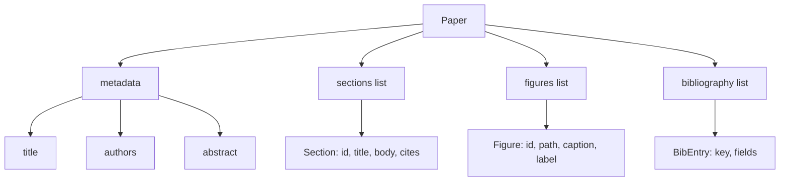
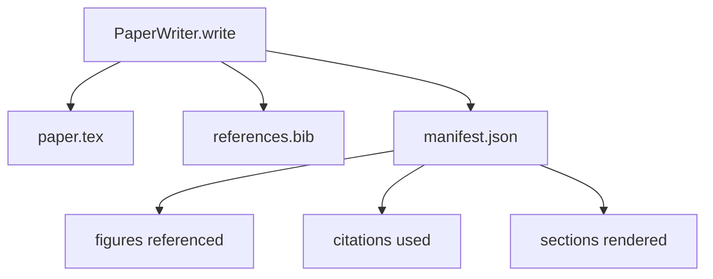

# 论文写作器

> O esqueleto LaTeX é um contrato entre pesquisador e tipógrafo. Se o contrato for destruído, o documento não poderá ser compilado e o fracasso será evidente.

**Type:** Build
**Languages:** Python
**Prerequisites:** Phase 19 lessons 50-53
**Time:** ~90 minutes

## Objetivos de aprendizagem

- O artigo de pesquisa será visto como um artefato estruturado de um gráfico de seção conhecido, em vez de um documento de forma livre.
- Antes de escrever qualquer prosa, gerar uma declaração abstracta, secções, espaços de figuras e chaves de bibliografia do esqueleto LaTeX.
-  através do mecanismo de slot determinista, os resultados do experimento  (paths 和 captions) figuras  (injected into skeleton)
- Conecte um gerador de prosa ridicularizado, ele preenche cada seção de um esboço estruturado, deixe o arsenal ser testado sem um modelo.
- 输出单个 `paper.tex`Um.`references.bib`, adicionar um listagem de cada figura referenciada e cada citação usada do manifesto.


```figure
ch-paper-skeleton
```

## Por que um esqueleto primeiro

Desde o início da prosa, o projeto de dívidas estruturais foi acumulado. Introdução: um número de páginas foi citado antes de ser definido.

Esqueleto 会反转这一点──strução 先以数据 形式声明──Seções são com nomes 和序的槽──Figures are with ids 和 captions的槽──Bibliografia chaves 在顶部声明,并带有它们指向的条目──Prose 会一次一个槽 地生成进去──harness 可以在写任何散文 之前验证: cada figura 都有槽, cada citação 都有条目, cada seção 都出现在内容表 中──

Esta é aplicada aos planos, ferramentas e chamadas e traços da disciplina acima.

## A forma do papel



Cada campo são dados comuns Python.`Paper`Até a função pura da cadeia LaTeX.`\cite{key}`Todos estão em conformidade.`BibEntry`- Não.

## O contrato de renderização

O renderizado garante três propriedades. Primeiro, cada espaço num esqueleto.`\begin{figure}`Bloco,并带有稳定标签,格式为 `fig:<id>`Segundo, cada seção tem um.`\section{}`,并带有稳定标签,格式为 `sec:<id>`, assim, as referências cruzadas podem trabalhar.`\bibliography`Bloco,其 `references.bib`精确包含文件 上声明的条目,不多也不少──

违反任何一条都是报错,而不是警告;;;;;;;;;;;;;;;;;;;;;;;;;;;;;;;;;;;;;;;;;;;;;;;;;;;;;;;;;;;;;;;;;;;;;;;;;;;;;;;;;;;;;;;;;;;;;;;;;;;;;;;;;;;;;;;;;;;;;;;;;;;;;;;;;;;;;;;;;;;;;;;;;;;;;;;;;;;;;;;;;;;;;;;;;;;;;;;;;;;;;;;;;;;;;;;;;;;;;;;;;;;;;;;;;;;;;;;;;;;;;;;;;;;;;;;;;;;;;;;;;;;;;;;;;;;;;;;;;;;;;;;;;;;;;;;;;;;;;;;;;;;;;;;;;;;;;;;;;;;;;;;;;;;;;;;;;;;;;;;;;;;;;;;;;;;;;;;;;;;;;;;;;;;;;;;;;;;;;;;;;;;;;;;;;;;;;;;;;;;;;;;;;;;;;;;;;;;;;;;;;;;;;;;;;;;;;;;;;;;;;;;;;;;;;;;;;;;;;;;;;;;;;;;;;;;;;;;;;;;;;;;;;;;;;;;;;;;;;;;;;;;;;;;;;;;;;;;;;;

## Injecção de figuras de experiências

Este curso apresenta a seguinte forma de fazer o experimento:`Figure`registos


injeção é determinista de──Figura ids De nome do experimento 加上 monótono contador 派生──Capitções de manifesto──Paths 会相对纸的输出目录做正常化,因此即使实验输出位于磁盘其他位置,LaTeX 也能编译──

## O generador de prosa ridicularizado

Este curso não vai utilizar o modelo.`MockProseGenerator`读取概略形,并决定性 地输出散文──概略形 是每个节 一条短字符串──generator 会将该字符串扩展成两个短段落,并把节标题 编织进去──生成的散文 只会在概略 声明时名字-drop figuras 和引用──

É o que significa que o gerador de prosa declara o valor de chamada: o gerador de teste, a produção, a mudança de modelo, a produção, a produção, a produção, a produção, a produção, a produção, a produção, a produção, a produção, a produção, a produção, a produção, a produção, a produção, a produção, a produção, a produção, a produção, a produção, a produção, a produção, a produção, a produção, a produção, a produção, a produção, a produção, a produção, a produção, a produção, a produção, a produção, a produção, a produção, a produção, a produção, a produção, a produção, a produção, a produção, a produção, a produção, a produção, a produção, a produção, a produção, a produção, a produção, a produção, a produção, a produção, a produção, a produção, a produção e a produção, a produção, a produção, a produção e a produção, a produção, a produção e a produção, a produção e a produção, a produção e a produção, a produção e a produção, a produção e a produção, a produção e a produção, a produção e a produção, a produção e a produção e a produção, a produção e a produção, a produção e a produção e a produção, a produção e a produção, a produção e a produção e a produção, a produção e a produção, a produção e a produção e a produção, a produção e a produção, a mais mais mais, a mais, a mais, a mais, a mais, a mais, a mais mais, a mais mais mais mais, mais, mais, mais mais mais mais, mais mais, mais, mais, mais mais mais, mais, mais mais mais, mais, mais mais, mais, mais mais, mais, mais, mais, mais mais, mais, mais, mais, mais mais, mais, mais, mais, mais mais mais mais mais, mais, mais, mais, mais mais, mais, mais mais, mais, mais, mais mais, mais mais, mais mais, mais mais mais mais mais mais, mais, mais, mais, mais mais mais mais mais, mais mais, mais mais mais, mais mais, mais mais mais mais, mais mais, mais, mais mais mais, mais, mais mais mais, mais mais mais, mais mais mais mais mais, mais mais mais mais, mais, mais mais mais, mais, mais

## A saída manifesto

writer 会向输出目录 输出三个文件──



O manifesto é um evaluador ou um loop crítico 读取的内容──它不解析 LaTeX;它读取 manifest── 下一课批判循环 会将这个 manifesto 作为输入,并产生反表──这就是为什么 manifesto是合同的一部分,而 LaTeX 不是──

## Portas de validação

escritor 在写入任何文件 之前运行四个门──

1. O papel de cada figura é único.
2. Cada seção de`cites`字段引用的图书馆关键都已在纸上声明──
3. abstracto não está em aberto.
4. título 非空──

O portão de derrota vai ser abandonado .`PaperValidationError`,并给出精确原因──harness 将该原因作为失败模式 暴露出来──没有部分写:要么输出全部三个文件,要么一个也也输出──

## Como ler o código

`code/main.py`Definindo`Paper`- Não.`Section`- Não.`Figure`- Não.`BibEntry`- Não.`PaperValidationError`- Não.`MockProseGenerator`- Não.`PaperWriter`, e um .`render_latex`função.`write`método 接收 output directory,并输出 `paper.tex`- Não.`references.bib`和 `manifest.json`- Não.`read_experiment_manifest`assistente 会将 experimentar manifesta lista 转换为 `Figure`registos

`code/tests/test_paper_writer.py`覆盖: no seções 时的骨格 render、带两个部分和两个数字的完整 render、missing-citation gate、duplicate-figure-id gate、manifest content,以及 LaTeX-string contract(cada seção 输出一个 `\section{}`, cada figura        `\begin{figure}`)。

## Vai mais longe

Realmente realizará duas extensões. Primeiro, multi-format render:同一个.`Paper`forma pode ser compilada para o bloco de artigos de uso de Markdown, bem como a pré-visualização de HTML utilizadas.`Paper`estratégia. Segundo, enriquecimento de citações: given determin本地 DOI cache,writer from citation key  get BibTeX entries── ambos têm valor, também podem ser adicionados em caso de contrato de esqueleto não toque──

O esqueleto é esta vez abaixo. Seções, figuras e citações, dados e declarações, prosa, expressão, expressão, expressão, expressão, expressão, expressão, expressão, expressão, expressão, expressão, expressão, expressão, expressão, expressão, expressão, expressão, expressão, expressão, expressão, expressão, expressão, expressão, expressão, expressão, expressão, expressão, expressão, expressão, expressão, expressão, expressão, expressão, expressão, expressão, expressão, expressão, expressão, expressão, expressão, expressão, expressão, expressão, expressão, expressão, expressão, expressão, expressão, expressão, expressão, expressão, expressão, expressão, expressão, expressão, expressão, expressão, expressão, expressão, expressão, expressão, expressão, expressão, expressão, expressão, expressão, expressão, expressão, expressão, expressão, expressão, expressão, expressão, expressão, expressão, expressão, expressão, expressão, expressão, expressão, expressão, expressão, expressão, expressão, expressão, expressão, expressão, expressão, expressão, expressão, expressão, expressão, expressão, expressão, expressão, expressão, expressão, expressão, expressão, expressão, expressão, expressão, expressão, expressão, expressão, expressão, expressão, expressão, expressão, expressão, expressão, expressão, expressão, expressão, expressão, expressão, expressão, expressão, expressão, expressão, ou expressão, expressão, ou expressão, ou expressão, ou expressão, ou expressão, ou expressão, ou expressão, ou expressão, ou expressão, ou expressão, ou expressão, ou expressão, ou expressão, ou expressão, ou expressão, ou expressão, ou expressão, ou expressão, ou expressão, ou expressão, ou expressão, ou ou ou ou ou ou ou ou ou ou ou ou ou ou ou ou ou ou ou ou ou ou ou ou ou ou ou ou ou ou ou ou ou ou ou ou ou ou ou ou
