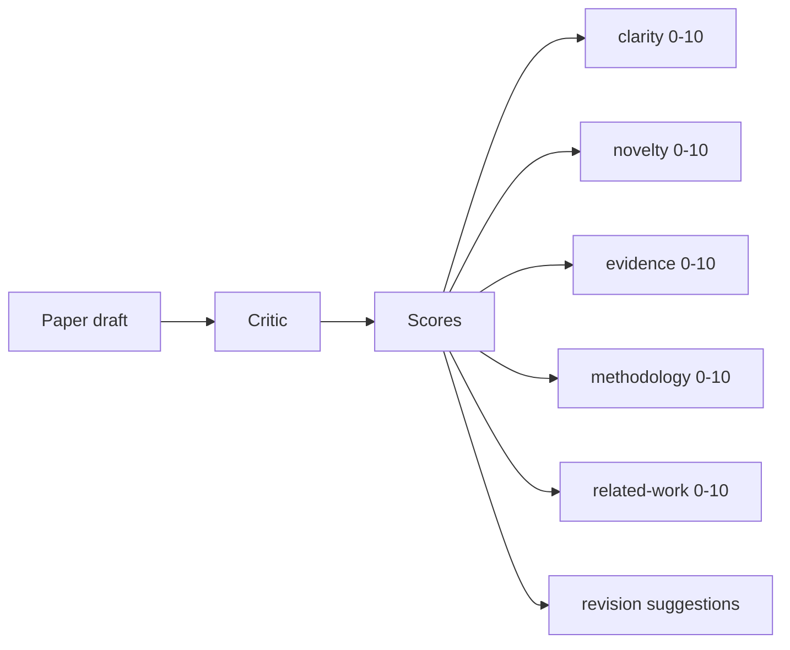
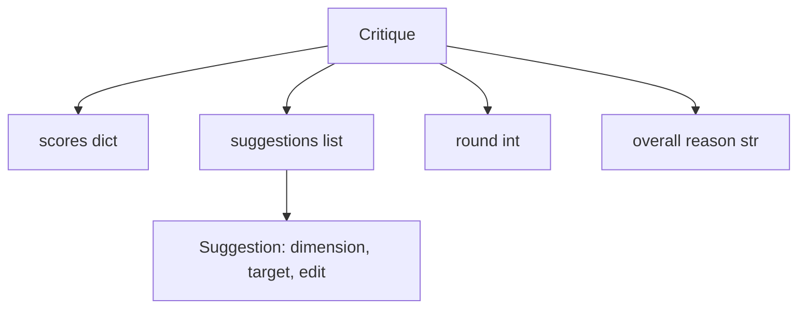
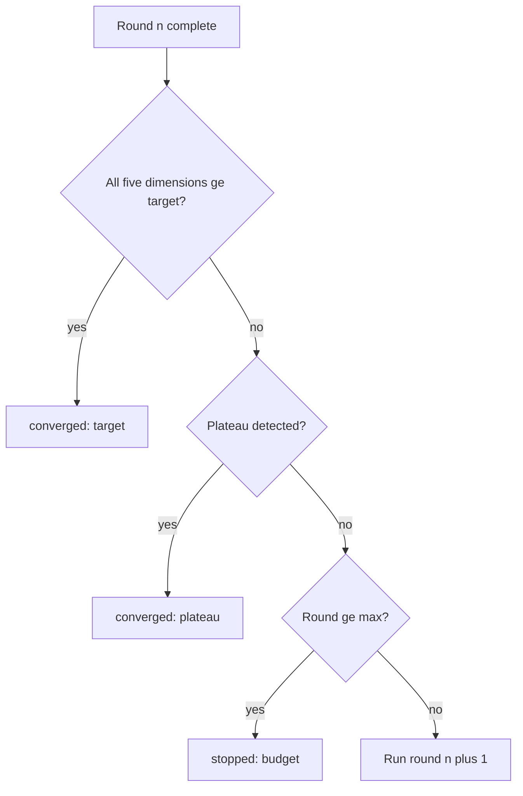
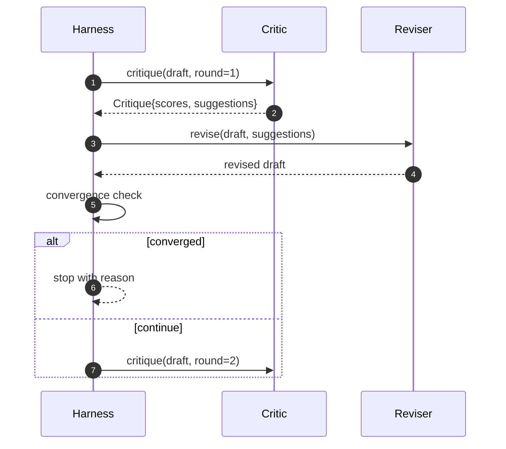

# Loop crítico

> A primeira vez que retornar um crítico que "parece bom" é ruim. Sempre retornará um crítico que "necessita de trabalho". Também é ruim.

**Type:** Build
**Languages:** Python
**Prerequisites:** Phase 19 lessons 50-53
**Time:** ~90 minutes

## Objetivos de aprendizagem


```figure
ch-critic-converge
```

- 按五个固定维度为论文草稿打分:clarity、novelty、evidence、methodology、related-work──
- A partir daí, o texto será publicado em uma página da revista "Criticism" (Criticism) e será publicado em uma página da revista "Criticism".
-                                                                                                                                                                                                                                                               
- Usar o máximo de reiterados orçamentos limitar o número de rotas, evitar não receber críticos 永远运行──
- 输出轮标,让仪表板或下一阶段可以染分数轨迹──

## Por que usar cinco dimensões fixas

A liberdade de forma crítica é um modelo de retorno de um parágrafo sugerido. A revisão seguinte irá considerar este parágrafo como um ambiente.

Cinco dimensões para o arame.



O número é um vetor. O arness vai observar cada dimensão em mudanças em volumes. Um aumento da clareza, mas deixe a evidência de uma revisão de grande escala, a evidência de regressão, de convergência, verificação de alta.

## Crítica 结构



Cada sugestão tem uma seção de dimensões e objetivos melhorados, bem como um revisor que pode ser aplicado.`edit`O instructor também é um revisor de determinação. O instructor também é um revisor de determinação.

## Convergência 规则,按顺序执行

Localização de um ciclo crítico.



O objectivo é a situação mais rigorosa: cada uma das cinco dimensões (claridade, novidade, evidência, metodologia, trabalho relacionado) deve ser atingida.`>= target_score`(默认 `8.0`),loop 才会回归成功──平均值很高但有一个弱度不够──板块检测会比较当前轮平均值和上轮平均值──如果连续两轮改善 低于`plateau_epsilon`(默认 `0.1`),loop 会以 `plateau`O orçamento é o limite de duração do número de rotas.`5`),并以 `budget`- Não.

順序很重要──目標 優先於高原,高原 優先於預算──如果第三轮在同一时间代中既达到目标又将触发高原,结果是`target`Não é .`plateau`- Não.

## Por que detecção de planalto 跨两轮运行

O plano de rotas é ruído. O verdadeiro crítico, mesmo face a um projeto fixo, também retornará com um pequeno número de pontos diferentes, porque a pontuação de determinação ainda depende das sugestões aplicadas e da ordem de aplicação.

## O estudo foi concluído em outubro de 2015.

O livro não é um modelo de convenção. O crítico fornecido é um chamado, será baseado em três sinais para o projeto.`originality_tag`O revisor sabe como fazer cada número de notas.

```text
clarity      在平均 section 正文长度增加时增长
novelty      在 originality_tag 设置为 "high" 时增长
evidence     在某个 section 的 figure_refs 非空时增长
methodology  在存在标题为 "Method" 且有正文的 section 时增长
related-work 在存在标题为 "Related Work" 且有正文的 section 时增长
```

O revisor vai colocar cada sugestão em um ciclo de conclusões, que irá reduzir a diferença.

## 完整 loop 契约



Harness 拥有圆计, 追踪 和 趋近检, 批判 拥有分点, 审核员 拥有差点, 三者都不会触碰彼此的状态,

## Trace 输出

Cada rodada irá emitir um evento de rastreamento, contendo número redondo, vector de pontuação, contagem de sugestões e veredicto de convergência, o rastreamento completo, o esboço final, o rascunho de um regresso, o painel de controle pode ser programado para cada rodada.

## 防止坏批判的预算 防止坏批评 的预算

Um crítico que produz sugestiões que nunca podem aumentar o número de pontos, vai colocar o ciclo bloqueado para a máxima iteração acima limite.`budget` O usuário o interpretará como um bug crítico, e não como um bug de projeto.

## Como é que o meu nome é "Codex"

`code/main.py`Definindo`Critique`- Não.`Suggestion`- Não.`Critic`Protocolo`Reviser`Protocolo`CriticLoop`, e um .`make_deterministic_critic_pair`fábrica, ele vai voltar a criticar a determinação e a revisar a correspondência.`Paper`结构,让本课可以独立运行――

`code/tests/test_critic_loop.py`覆盖: primeira rodada de modificações individuais, projecto de ajuste, convergência de objectivos, detecção de planícies, não há sugestão de melhorias, exaustão orçamental, revisor da aplicação da sugestão e estrutura de rastreamento.

##  explorar mais

O real desenvolvimento vai precisar de duas expansões. Primeiro, pesos de dimensão: workshop 论文会更重视新奇而不是方法;journal 则相反──convergence check 会变成加权平均值── segundo, pares de críticos: um crítico 负责打分, segundo crítico 修正者 在看看建议 之前对它们做决── ambos têm valor, e podem ser combinados em um mesmo.`Critique`结构之上──

关键注是分点向量──一旦批判被结构化,所有其他改进,融合规则,仪表板,对批评,都可以在不改变循环的情况下接入──
