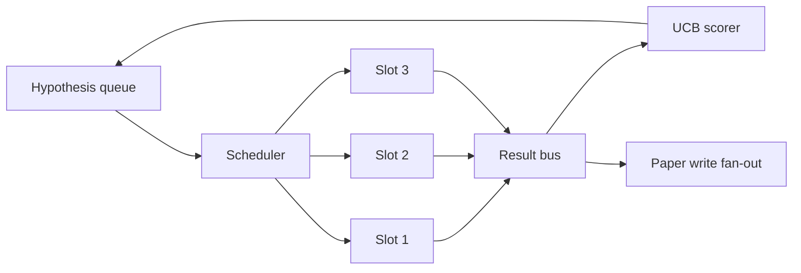
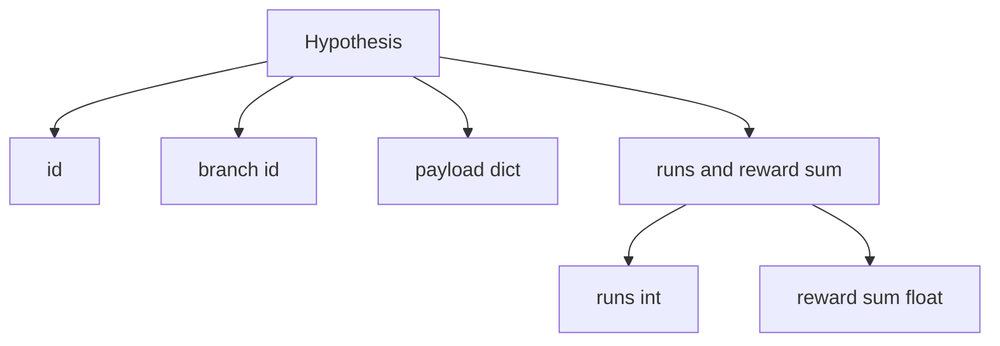
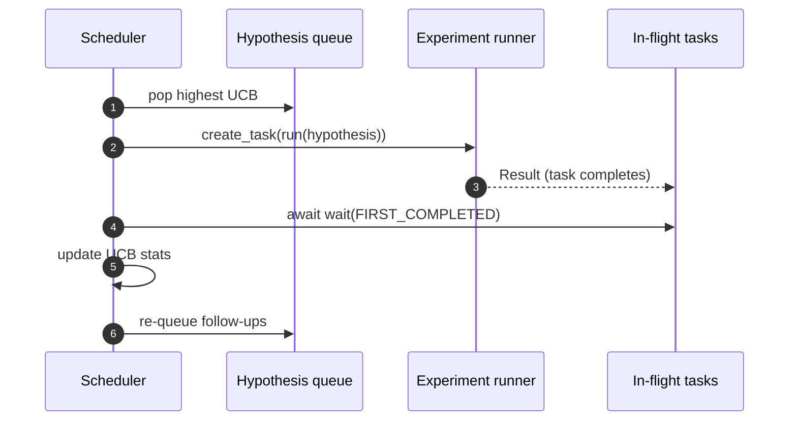

# Programação de Iteração

>  sem cronista, é uma fila de pesquisa com ilusões  o cronista é um ciclo que decide parar de explorar o que está em lugar, e essa decisão é o núcleo do jogo inteiro 

**Type:** Build
**Languages:** Python
**Prerequisites:** Phase 19 lessons 50-53
**Time:** ~90 minutes

## Objetivos de aprendizagem


```figure
ch-ucb-scheduler
```

- Para que o fluxo de trabalho de pesquisa seja construído em uma fila de hipóteses, ele vai dar espaços de experiência e o resultado vai voltar a entrar.
- Usando o mesmo e executando várias experiências, deixe o programador manter todos os slots ocupados.
- Utilize UCB para cada ramo da hipótese 打分, deixe o cronista pode em não abandonar a exploração em caso de poda 低产出 ramos。
- Os resultados completados vão se espalhar para a fase de escrita e a fase de re-fileira, fazendo com que a produção de ramificação produzam hipóteses de acompanhamento.
- 暴露逐代代代代代代代代代代代代代代代代代代代代代代代代代代代代代代代代代代代代代代代代代代代代代代代代代代代代代代代代代代代代代代代代代代代代代代代代代代代代代代代代代代代代代代代代代代代代代代代代代代代代代代代代代代代代代代代代代代代代代代代代代代代代代代代代代代代代代代代代代代代代代代代代代代代代代代代代代代代代代代代代代代代代代代代代代代代代代代代代代代代代代代代代代代代代代代代代代代代代代代代代代代代代代代代代代代代代代代代代代代代代代代代代代代代代代代代代代代代代代代代代代代代代代代代代代代代代代代代代代代代代代代代代代代代代代代代代代代代代代代代代代代代代代代代代代代代代代代代代代代代代代代代代代代代代代代代代代代代代代代代代代代代代代代代代代代代代代代代代代代代代代代代代代代代代代代代代代代代代代代代代代代代代代代代代代代代代代代代代代代代代代代代代代代代代代代代代代代代代代代代代代代代代代代代代代代代代代代代代代代代代代代代代代代代代代代代代代代代代代代代代代代代代代代代代代代代代代代代代代代代代代代代代代代代代代代代代代代代代代代代代代代代代代代代代代代代代代代代代代代代代代代代代代代代

## Porquê é um cronista, e não uma lista de trabalho?

平 工作列表 会按提交顺序运行工作──当每个工作都独立时,这没有问题──研究不是独立的:实验三的发现 会改变实验四和五的优先级──一个会读取结果粉丝-in 并重排队列的时间表,可以在单位计算内完成更有用的工作──

Há um sistema de seleção de design que permite a seleção de pontos.

## 系统结构



fila  guarda hipóteses。 cronista em slot  liberação  escolha a melhor hipótese UCB。 cada slot                                                                                                                                                                                                                                                                                                                                                                                                                                                                                                   

## Hipótese 结构



`branch`É a chave das estatísticas da UCB. Muitas hipóteses podem ser compartilhadas em um ramo.`runs`É o número de experimentos concluídos,`reward_sum`É um prêmio acumulado.

## Ponto de pontuação da UCB

本课使用的 UCB公式是经典 UCB1──

```math
\text{ucb}(\text{branch}) = \text{mean\_reward}(\text{branch}) + c \sqrt{ \frac{\ln(\text{total\_runs})}{\text{runs}(\text{branch})} }
```

`total_runs`É o total de todos os ramos 上已完成的实验.`c`É o peso da exploração;`sqrt(2)`- Correrá para zero.`+inf`, por isso, os ramos não tentados 总是先被调调度──平均奖励 高的分支会保持高分,直到其他分支 追上;运行很多次但奖励 不高的分支会被运行次数更少的替代品超过──

Portão de poda com picador separar-se.`prune_after_runs`Próximos testes`3`) 后平均回报 低于绝对 floor (em inglês) 默认`0.2`) , quando o corte vai transferir o ramo da programação futura.

## Use asyncio's并行 slots

programação 使用 `asyncio.create_task`驱动实验──每个任务 运行实验 runner(一个 `async def`chamada),并返回一个 `Result`△ Loop principal `asyncio.wait(..., return_when=asyncio.FIRST_COMPLETED)`Espera para as tarefas de voo 集合, e cada vez que completado 触发得分更新──



Três slots e lançamento de operações. O ciclo principal nunca se bloqueará em um único experimento.

## Fender-out: desencadeadores de papel

Quando um ramo de recompensa média                                                                                                                                                                                                                                                                                                                                                                                                                                                                                                                        `paper_threshold`(默认 `0.7`), e este ramo  ainda não foi produzido                                                                                                                                                                                                                                                                                                                                                                                                                                                                                                                   `paper.trigger`Fã de evento até lista de saída.

## Propagação: hipóteses de seguimento

Quando o resultado for elevado, o cronista pode utilizar o que o usuário oferece.`expander`, no mesmo ramo , para gerar uma ou mais hipóteses de acompanhamento.`Result`Até`list[Hypothesis]`O curso oferece um expansor de determinação, que irá compensar qualquer recompensa                                                                                                                                                                                                                                                                                                                                                                                                                                                                                                            

## Orçamentos

O orçamento irá proteger o cronógrafo, evitar os ciclos fugitivos.

```text
max_experiments    : 跨所有 branches 运行的 experiments 总数
max_seconds        : wall-clock cap (asyncio time)
```

Quando um momento de toque, o programador vai parar de ajustar novas tarefas, esperar para que as tarefas de voo sejam completadas, e retornar ao rastro final.`stop_reason`- Não.

## Trace e relatório final

Cada decisão de agendamento (pick, dispatch, result, prune, fan-out) todos emitirão um evento.

## Como é que o meu nome é "Codex"

`code/main.py`Definindo`Hypothesis`- Não.`Result`- Não.`BranchStats`- Não.`IterationScheduler`, e um .`make_deterministic_runner`fábrica, ele vai voltar com uma recompensa previsível de experimentos de não-sincronização.`delay_ms`(默认 `5ms`), fazer a concurrença 可观察──

`code/tests/test_scheduler.py`覆盖:UCB 优先选择未尝试分支,平行槽占用,跨越门时的纸引发,低产出试验, 后后的分支剪, fan-out follow-up hypotheses,以及预算出口,实验计和墙钟,两者)

##  explorar mais

O real-estar das sessões requer três expansões. Primeiro, através das sessões de permanência estatísticas UCB: actual estatísticas exist内存里; verdadeiro cronista 会チェックポイント 它们,让重启保留已花掉的探索预算── segundo, pontuação multi-objetiva: cada resultado não mais produz uma recompensa escalar, mas produz um vetor, UCB 变成Pareto-style picker── terceiro, bandidos contextuais:picker 基于假设特征长度(、复杂性) realizar condicionamento,让相似假设共享探索──

O cronista é um local de pesquisa que supera a lista de trabalho. Uma vez que a UCB recebe os slots e corre a funcionar, todas as outras melhorias podem ser superadas.
