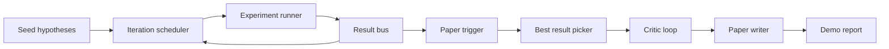
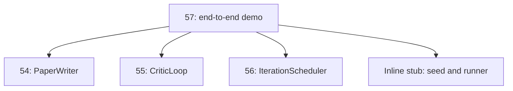
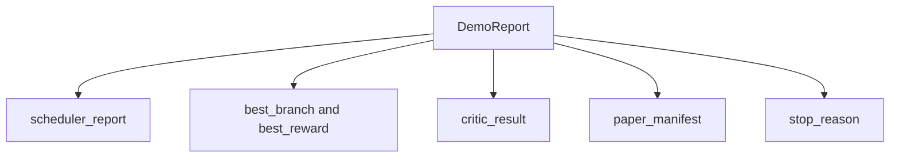

# End-to-End estudo Demo

> Demo é onde cada contrato que você escreveu antes tem que ser combinado.

**Type:** Build
**Languages:** Python
**Prerequisites:** Phase 19 lessons 50-53
**Time:** ~90 minutes

## Objetivos de aprendizagem


```figure
ch-research-pipeline
```

- O que é que se passa com o "Sex" é que o "Sex" é um "Sex" que é um "Sex" que é um "Sex" que é um "Sex" que é um "Sex" que é um "Sex" que é um "Sex" que é um "Sex" que é um "Sex" ou um "Sex" que é um "Sex" ou um "Sex" que é um "Sex" ou um "Sex" ou um "Sex" ou um "Sex" ou "Sex" ou "Sex" ou "Sex" ou "Sex" ou "Sex" ou "Sex" ou "Sex" ou "Sex" ou "Sex" ou "Sex" ou "Sex" ou "Sex" ou "Sex" ou "Sex" ou "Sex" ou "Sex" ou "Sex" ou "Sex" ou "Sex" ou "Sex" ou "Sex" ou "Sex" ou "Sex" ou "Sex" ou "Sex" ou "Sex" ou "Sex" ou "Sex" ou "Sex" ou "Sex" ou "Sex" ou "Sex" ou "Sex" ou "Sex" ou "Sex" ou "Sex" ou "Sex" ou "Sex" ou "Sex" ou "Sex" ou "Sex" ou "Sex" ou "Sex" ou "Sex" ou "Sex" ou "Sex" ou "Sex" ou "Sex" ou "Sex" ou "Sex" ou "Sex" ou "Sex" ou "Sex" ou "Sex" ou "Sex" ou "Sex" ou "Sex" ou "Sex" ou "Sex" ou "Sex" ou "Sex" ou "Sex" ou "Sex" ou "Sex" ou "Sex" ou "Sex" ou "Sex"
- 通过普通 Python importa 组合前四节 Track D 课程中的原始, não através do framework。
- 运行循环 Till自行终止,并输出一个列出每个阶段 输出单一 Demo report──
- 保持 Demo deterministic, fazer a série de testes pode afirmar forma final.
- Quando qualquer fase do contrato é destruída, expõe o modo de falha, evite a próxima fase.

## O que é que está aqui?



六个阶段──seed 是三条条假设的列表──scheduler Using three parallel slots 在它们之间运行六个实验──bus 报告一个或多个纸引发器──picker 选择单个最佳结果──critical loop 基于该结果 构建的草案 进行代──纸作家 输出最终的 LaTeX、BibTeX 和 manifesto──

## Por que importa, em vez de copiar

Cada aula da pré-escola será entregue com uma série de dados e funções públicas.`main.py`◊ Demo 通过调整 `sys.path`Até o diretório de cada aula para importá-los. Não é um sistema de fixação de estrutura; é o mesmo que os arquivos de teste que já foram usados na aula anterior.



Stub inline  representando o número 50 até o número 53 课: 一个小型种子假设生成器 和 一个同步奖励函数──用户可以通过调整两个进口,将 inline stub 替换为那些课程中的真实原始人──

## Determinismo 保证

Demo em construção é determinista. Experimento runner Utilize seeded NumPy. Revisionador do loop crítico em ordem fixa através das dimensões.

给定相同种子,Demo 会输出相同报告――test 通过运行Demo 两次并比较 manifest 来断这个属性――

## Forma do relatório de demonstração



Cada campo vem de um estágio de alta corrente. O demo não transforma qualquer saída. É apenas um conjunto deles.

## Modo de falha 处理

Cada etapa tem de ser bem sucedida, tem de ser um erro de digitação.

```text
Scheduler ........ returns SchedulerReport with stop_reason
                   in {queue_empty, max_experiments, deadline}
Best-result pick . raises NoTriggerError if no paper trigger fired
Critic loop ...... returns LoopResult with status converged or stopped
Paper writer ..... raises PaperValidationError on contract break
```

任意阶段的失败 都会使用类型例外短路演示.`test_no_triggers_raises_typed_error`和 `test_best_picker_raises_when_no_triggers`Quando não houver ramo, o picador vai subir.`NoTriggerError`- Não .`BestResultError`E o escritor nunca será usado.

## Selector de melhor resultado

agendador 会按分支 输出纸触发器──picker 选择所有触发器 中中 mean reward 最高的分支──ties 按分支 id 的字母顺序打破,使Demo deterministic──picker 是一个小型纯函数;test 使用固定的 agendador report 固定它的行为──

## 串接 critica loop

第 55 课中的批判循环 作用于`MiniPaper`❖ Demo  através da ramificação escolhida 构建一个 `MiniPaper`: Use branch id fill abstract,seed 两个部分(Introdução 和 Results),并根据 branch 设置 `originality_tag`(Se `>= 0.8`Para cima, se`>= 0.6`Por meio, por baixo)

O revisor vai redigir o projeto 代到融合──output 会进入 paper writer──

## 串接 escritor de papel

§ 54                                                                                                                                                                                                                                                                                                                                                                                                                                                                                                                            `Paper`Forma... Demo`mini_to_full_paper`升级 convergido `MiniPaper`, ele vai para a filial selecionada  adicionar uma figura, e de acordo com o critico  recomendação de citação chaves  conjugar construção de uma pequena bibliografia sintética.

## Como é que o meu nome é "Codex"

`code/main.py`Definindo`BestResultError`- Não.`NoTriggerError`- Não.`DemoReport`- Não.`pick_best_branch`- Não.`build_mini_paper`- Não.`mini_to_full_paper`和 `run_demo`◊ As importações do topo do país serão ajustadas uma vez`sys.path`, e tiraram-no de seus cursos .`PaperWriter`- Não.`CriticLoop`和 `IterationScheduler`- Não.

`code/tests/test_e2e.py`覆盖:Demo 端到端运行并输出一个五个字段 全部填充的报告;两次运行之间的确定性;没有分支 过了门时的 NoTriggerError;作者合同 破坏时的 PaperValidationError;纸质表 包含选定的分支的数字;以及安排器停止理由是预期值之一――

## Continuar a expandir

Quando a demonstração 变绿后,有三个值串连的扩展──第一,persistent state: cada fase 写入一个小型JSON store,使重启可以不重新运行便宜的阶段就恢复──第二,dashboard:scheduler 和 critic loop 的追踪事件 染为单一时间线──第三,真实模型调用:将嘲笑散文生成器 和决定主义评论员 替换为模型驱动的版本;线程不需要改变──

A tarefa da demonstração é provar a composição é a arquitetura, cinco lições, quatro importações, um relatório, uma fase, um fio, apenas uma linha.
