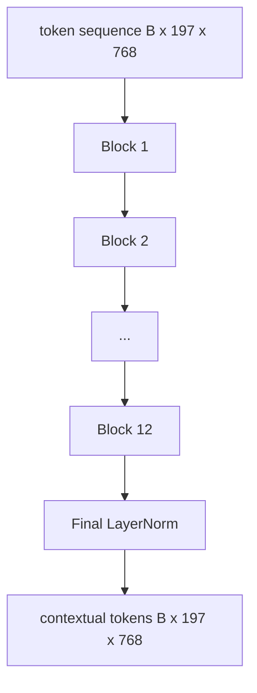

# 视觉 Transformer 编码器

> 补丁单独看不到──具有 12 个注意头的 12 层预 LN Transformer irá transformar o sequência de complementos em sequência de downtoken, em que o token CLS em seu estado oculto final irá acumula toda a imagem.

**Type:** Build
**Languages:** Python
**Prerequisites:** 第19期第30-37课（B轨基础）
**Time:** ~90 分钟

## Objectivo de aprendizagem

- 实现具有多头自注意和前子层的预 LN Transformer块──
- 堆叠 12 个具有 12 个头的块, formar ViT-Base编码器.
- A correção no 58o curso está ligada ao redator e executada para transmitir.
- Verifique se o token CLS reuniu todas as informações de cada correção.

## 问题

O padrão de inserção gera uma série de 197 tokens, cada token é um veículo, não sabe quaisquer outros patins. Uma imagem de gato precisa de cada padrão para saber quais patins contêm o cabelo, quais contêm o contexto, quais contêm o olho. O transformador é um mecanismo de criação desta consciência, uma vez uma camada de atenção.

O formato padrão é de 12 blocos de profundidade, 12 de largura, com uma camada pré-plaçada, GELU  ativado e 4 vezes anterior  expandido. O formato é CLIP ViT-L, SigLIP, DINOv2  Quen-VL série, InternVL e todos os outros pilares de código de peso de visão aberto para 2025-2026 anos. O formato é suficientemente estável para que você possa ler qualquer um desses artigos e assumir a forma do bloco, a menos que eles tenham uma explicação clara.

## 概念




### LN 前与 LN 后

O LayerNorm é uma versão usada para cada modelo de linguagem visual moderna, pois não requer aprendizagem de um ritmo de precoce ou de um treino estável. A diferença é que a linha de um caminho de frente é um fluxo de gradiente de 12+ de profundidade, que é de noite e de dia.

### Muitos pensamentos

Cada cabeça vai mostrar um volume projetado para sua própria dimensão.`head_dim = hidden / num_heads`de `(query, key, value)`Três grupos.`hidden = 768`和`heads = 12`- Todos os homens .`dim = 64` 12 cabeças estão participando, e depois as suas saídas estão ligadas a 768 维并通过输出投影──  O ponto importante de várias cabeças é que uma cabeça pode aprender a prestar atenção aos olhos do gato, enquanto a outra cabeça pode aprender a prestar atenção ao contexto sem interferência.

### Por que fazer 4 vezes a expansão?

FFN `hidden -> 4 * hidden -> hidden`,GELU 位于中间──因子 4 é experiencial, desde 2017 tem sido aplicado em linguagem e visãoTransformer──较小 (2x) 缺合;过度适合固定数据预算下较大 (8x) MLP é onde o modelo armazena a maior parte dos fatos aprendidos, enquanto a parte mais ampla do meio é onde eles se encontram──

|组件| ViT-Base 规模的参数 |
|-----------|------------------------------|
|每个块的 qkv 投影 | `3 * 768 * 768 = 1.77M` |
|每个块的输出投影| `768 * 768 = 590K` |
|每块 FFN（4 倍扩展）| `2 * 768 * 4 * 768 = 4.72M` |
|每块的 LayerNorm | `4 * 768 = 3K` |
|每块总计 |约 710 万 |
| 12 块 |约85M |
|加前端|总计约86M |

ViT-Base é um 86M 参数编码器── de acordo com o padrão de 2026, este valor é muito pequeno(SigLIP-So400M é 400M, Qwen-VL ViT é 675M), mas a estrutura em largura e profundidade é a mesma──

### Não há papel?

Vision Transformer  apenas contém um codificador e é binário de:token `i`Pode participar de qualquer token .`j` Não há tecido.  No capítulo 61  , a atenção intercalará com o conceito de causa, mas no interior do visual, a atenção está totalmente conectada.

### O CLS Token aprendiu o que é que é

O token CLS começa com os parâmetros de aprendizagem, sem seu próprio conteúdo de correção, e passa pela atenção de cada bloco para acumular informações. Até a última camada, o CLS é o resumo de veículos da imagem inteira; o título do curso abaixo projetará esse único veículo para a classe lógica, em relação ao embuxo ou no código de texto em um conjunto de notas.


```figure
ch-cls-funnel
```

## Construí-lo

`code/main.py`实现:

- `MultiHeadSelfAttention`, `qkv`E o que é que é o que é o que é o que é o que é o que é o que é o que é o que é o que é o que é o que é o que é o que é o que é o que é o que é o que é o que é o que é o que é o que é o que é o que é o que é o que é o que é o que é o que é o que é o que é o que é.
- `FeedForward`,4 倍扩展 GELU MLP。
- `Block`, um bloco de LN prévio, composto por atenção e com o resto de
- `ViT`,12 blocos de acumulação, com a última LayerNorm.
- `VisionEncoder`, vai ser`VisionFrontEnd`Desde o 58o                                                                                                                                                                                                                                                                                                                                                                                                                                                                                                                          `ViT`堆,并公开返回上下文序列和池化 CLS 量向量 `forward()`- Não.
- Uma demonstração, através de um codificador completo 运行合成的224x224 fixture 图像,并每隔一层打印输入形状、输出形状、参数计数和 CLS 范数──

- Não .

```bash
python3 code/main.py
```

输出:fixing 编码为`(1, 197, 768)`张量──CLS 范数 随着层的组合向上漂移,然后稳定在最终 LayerNorm──总参数报告约为86M──

## Use-o

O codificador definido aqui é o mesmo em largura e profundidade que o bloco de montagem de VLM de peso aberto para cada ano 2025-2026.

- **宽度和深度。**ViT-Large `hidden=1024, depth=24, heads=16`; SigLIP So400M é `hidden=1152, depth=27, heads=16`O mesmo bloco.
- **池化头。**CLS池(本课) 与平均池(SigLIP) 与注意力池(后来的VLM)
- **位置处理。**固定正弦曲线 (第 58 课) 与学习的 1D、ALiBi与 2D RoPE──块数学没有变化──
- **注册token。**DINOv2 前置 4 个额外学习的代码.

O bloco será montado em um bloco de bases.

## 测试

`code/test_main.py` abrangendo:

- 单块保留形状并且对于输入批量大小不变
-                                                                                                                                                                                                                                                               
- 剩余路径已连接(零输入 ainda através do token CLS produzir não-零输出)
- 4 camadas de acumulação anterior para a passagem produzir forma correta
- 梯度 de CLS 输出流向面片投影

运行它们:

```bash
python3 -m unittest code/test_main.py
```

## 练习

1. Adicionar um token de registro (CLS) (CLS) (CLS) (CLS) (CLS) (CLS) (CLS) (CLS) (CLS) (CLS) (CLS) (CLS) (CLS) (CLS) (CLS) (CLS) (CLS) (CLS) (CLS) (CLS) (CLS) (CLS) (CLS) (CLS) (CLS) (CLS) (CLS) (CLS) (CLS) (CLS) (CLS) (CLS) (CLS) (CLS) (CLS) (CLS) (CLS) (CLS) (CLS) (CLS) (CLS) (CLS) (CLS) (CLS) (CLS) (CLS) (CLS) (CLS) (CLS) (CLS) (CLS) (CLS) (CLS) (CLS) (CLS) (CLS) (CLS) (CLS) (CLS) (CLS) (CLS) (CLS) (C) (C) (C) (C) (C) (C) (C) (C) (C) (C) (C) (C) (C) (C) (C) (C) (C) (C) (C) (C) (C) (C) (C) (C) (C) (C) (C) (D) (C) (C) (C) (C) (D) (C) (C) (D) (C) (C) (C) (D) (D) (C) (C) (D) (C) (D) (C) (C) (D) (D) (C) (C) (D) (D) (C) (C) (D) (D) (D) (D) (D) (D) (D) (D) (D) (D) (D) (D) (D) (D) (D) (D) (D) (D) (D) (D) (D) (D) (D) (D) (D) (D) (D) (D) (D) (

2. Para o desenvolvimento de um sistema de classificação de forma, o LN deve ser substituído por um LN posterior, e o LN deve ser substituído por um sistema de classificação de forma sintética.

3. O efeito da imposição será`attn_mask`Para que o mesmo bloco possa ser reutilizado como bloco de descifrador.`(seq, seq)`,下三角形──

4. Utilização `torch.profiler`Análise de volume de massa em 1⁄8⁄64 de transmissão em direção à frente. MLP Layer domina o tempo de parede, em vez de atenção.

5. Usar o LoRA de baixo nível  Adaptador para substituir um Q-k-v  Projeção de cabeça de atenção, 结其余部分,并验证梯度仅在您的期望位置流动──

## 关键术语

|术语 |这意味着什么 |
|------|---------------|
|预 LN | LayerNorm 应用在每个子层之前而不是之后 |
|自我关注 |每个token都以相同的顺序关注其他所有token |
|多头|隐藏的dim分布在 `H` 独立注意头中 |
| FFN 扩展 |前馈层在收缩之前加宽至 `4 * hidden` |
| CLS 池 |使用第一个token 的最终隐藏状态作为图像摘要 |

##  weiterlesen

- Para a configuração do codificador, uma imagem vale 16x16 palavras-chave.
- DINOv2 (2023) Utilizadas para registrar tokens e auto-inspecção
- SigLIP (2023), para utilização no n.o 62                                                                                                                                                                                                                                                                                                                                                                                                                                                                                                                 
