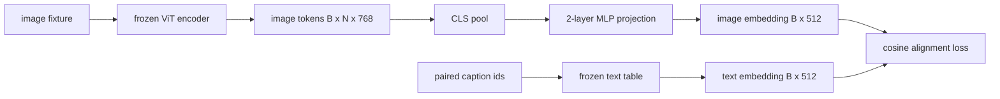

# Utilizando um modelo de projeção de nível

> O visual editor gera imagens de tokens. O texto resolve o texto consumindo text tokens. Os dois vivem em diferentes vectores de espaço. Um pequeno MLP de duas camadas projetará o símbolo de imagem no espaço de inserção do texto, e, em relação ao conjunto de títulos, o restante de cordas para a perda de conjunto mantém os dois espaços em harmonia. Esta projeção é a parte menor do modelo de linguagem visual, também a parte mais importante para a migração.

**Type:** Build
**Languages:** Python
**Prerequisites:** 第19期第30-37课（B轨基础）
**Time:** ~90 分钟

## Objectivo de aprendizagem

- Construir um MLP de duas camadas, projetar, irá mapear as características do quadro para o texto em um espaço embuído.
- 构建一个模拟文本嵌入表(没有预训练的分词器,没有真正语料库) ⋅
- 計算投影图像token和配对标题嵌入之间的余弦对齐损失──
- Utilize结视觉编码器和结文本表单独训练投影──

## 问题

 Você tem um visual editor ((第 58-59 课),可生成维度 `vision_hidden = 768`O que é que você quer fazer?`text_hidden = 512`之上 (任何其他数字也同样合理) ――解码器需要文本形的代币──图像代币不是文本形的:它们存在于编码器在仅视觉预训期间学习的基础中,与解码器的词量没有关系──

两层 MLP 投影(线性、GELU、线性) compensou esta diferença── é suficientemente pequeno(大约`768 * 1024 + 1024 * 512 = 1.3M`参数), pode ser treinado em um único GPU em poucos minutos, e é a única parte que precisa ser aprendida em uma fase completa.

## 概念



### 投影前池化

O visual editor emite 197 tokens. O texto tem um único título embutidos. Para combiná-los, cada modelo precisa de um volume de imagem. O CLS é o mais simples: obter o primeiro token do editor e projetá-lo.

### Porque é que é de duas camadas e não de uma?

A projeção de um único tipo linear pode girar e se redimensionar, mas se as duas curvas espaciais não coincidem, não pode ser fixada. GELU entre duas camadas lineares fornece uma curva não linear para a projeção, o que na experiência é suficiente para integrar as características do estilo CLIP e o modelo de linguagem em conjunto.

|层|形状|参数|
|-------|-------|------------|
| FC1 | `(vision_hidden, projection_hidden)` | `768 * 1024 + 1024` |
|激活|格鲁| 0 |
| FC2 | `(projection_hidden, text_hidden)` | `1024 * 512 + 512` |

Um .`768 -> 1024 -> 512`Há cerca de 1,3 milhões de parâmetros.

### O que é que é isso?

Não significa que`image_emb == text_emb`- É o que significa.`image_emb`Em关节空间中与`text_emb`Indicações para a mesma direcção`1 - cos_sim(image, text)`O curso de formação irá ser desenvolvido em cada categoria para os grupos de 0, e cada imagem deve ser mais próxima do seu próprio título do que qualquer outro título do grupo.

### 结编码器是门

O visual editor tem 86M parâmetros. O texto apresenta ainda vários milhões de outros. Todos estes elementos são impossíveis de serem treinados na base de modulação. O resultado é que os parâmetros 1.3M da projeção são únicos em mudança e são feitos em conjunto com algumas centenas de passos para reduzir os perdas.


```figure
ch-projection-bridge
```

## Construí-lo

`code/main.py`实现:

- `MLPProjector(in_dim, hidden_dim, out_dim)`, com GELU  activa de dois níveis linear MLP
- `MockTextEmbedding(vocab_size, dim)`, um conjunto de tabelas embutidas, com inicialização de determinação proveniente da semente.
- `make_pair(seed, vocab_size)`, sintetizando um para (图像,标题) sample;;标题是短 id 序列;标题嵌入是对代币嵌入进行平均值池化;;
- `cosine_alignment_loss(image_emb, text_emb)`, cada um`1 - cos_sim`Óculos.
- Um ciclo de treinamento, em 32 fases de síntese contra o ciclo, executado em 200 fases de projeção, vídeo e texto, e imprimido uma perda por cada 25 fases.

- Não .

```bash
python3 code/main.py
```

输出: training report em 200 passos de perda inicial de cerca de 1,07 abaixo de cerca de 0,80, indicando que apenas com base em projeção pode ser o token de imagem traído para o espaço textual.

## Use-o

Cada VLM com o mesmo padrão de peso:

- **LLaVA 1.5.**Desde CLIP-ViT-L 隐藏到LLaMA 嵌入的两层 GELU MLP 投影──结视觉编码器,结 LLM,仅训练投影(然后在第二阶段解 LLM) 
- **BLIP-2.**Q-Former 通过针对图像代币的交叉关注获取32 学习查询代币,然后投投到LLM 嵌入dim;; Q-Former 最后投投头类似本课的MLP;;
- **MiniGPT-4.**Desde BLIP-2 Q-Former 输出到Vicuna 嵌入dim的单线性投影──
- **Qwen-VL.** tem vários níveis de intersecção de atenção adaptador, mas o último bloco ainda é até LM  embutidos em mim projeção

As formas são diferentes, mas o papel é o mesmo:

## 测试

`code/test_main.py` abrangendo:

-  projector de forma e configuração de saída `out_dim`匹配
- 结文本嵌入表的 `requires_grad`参数为零
- O perdão de restante é de 0 no mesmo eixo, 2 no eixo de contra-peso.
- Transmissão de um instrumento de projeção
- O ciclo de treinamento reduziu as perdas entre os passos 0 e 200

运行它们:

```bash
python3 -m unittest code/test_main.py
```

## 练习

1. A equipe de pesquisa de dados de um patch foi substituída por 196 patch tokens, comparando a perda final de um patch com a média de um patch de 196 patches.

2. A temperatura de um sinal de um sinal de um sinal de um sinal de um sinal de um sinal de um sinal de um sinal de um sinal de um sinal de um sinal de um sinal de um sinal de um sinal de um sinal de um sinal de um sinal de um sinal de um sinal de um sinal de um sinal de um sinal de um sinal de um sinal de um sinal de um sinal de um sinal de um sinal de um sinal de um sinal de um sinal de um sinal de um sinal de um sinal de um sinal de um sinal de um sinal de um sinal de um sinal de um sinal de um sinal de um sinal de um sinal de um sinal de um sinal de um sinal de um sinal de um sinal de um sinal de um sinal de um sinal de um sinal de um sinal de um sinal de um sinal de um sinal de um sinal de um sinal de um sinal de um sinal de um sinal de um sinal de um sinal de um sinal de um sinal de um sinal de um sinal de um sinal de um sinal de um sinal de um sinal de um sinal de um sinal de um sinal de um sinal de um sinal de um sinal de um sinal de um sinal de um sinal de um sinal de um sinal de um sinal de um sinal de um sinal de um sinal de um sinal de um sinal de um sinal de um sinal de um sinal de um sinal de um sinal de um sinal de um sinal de um sinal de um sinal de um sinal de um sinal de um sinal de um sinal de um sinal de um sinal de um sinal de um sinal de um sinal de um sinal de um sinal de um sinal de um sinal de um sinal de um sinal de um sinal de um sinal de um sinal de um sinal de um sinal de um sinal de um sinal de um sinal de um sinal de um sinal de um sinal de um sinal de um sinal de um sinal de um sinal de um sinal de um sinal de um sinal de um sinal de um sinal de um sinal de um sinal de um sinal de um sinal de um sinal de um sinal de um sinal de um sinal de um sinal de um sinal de um sinal de um sinal de um sinal de um sinal de um sinal de um sinal de um sinal de um sinal de um sinal de um sinal de um sinal de um sinal de um sinal de um sinal de um sinal de um sinal de um sinal de um sinal de um sinal de um sinal de um sinal de um sinal de um sinal de um sinal de um sinal de um sinal de um sinal de`cos / tau`) 中,并观察当 `tau`Too pequeno Too grande Too grande Too grande Too grande Too grande Too grande Too grande Too grande Too grande Too grande Too grande Too grande Too grande Too grande Too grande Too grande Too grande Too grande Too grande Too grande Too grande Too grande Too grande Too grande Too grande Too grande Too grande Too grande Too grande Toooooooooooooooooooooooooooooooooooooooooooooooooooooooooooooooooooooooooooooooooooooooooooooooooooooooooooooooooooooooooooooooooooooooooooooooooooooooooooooooooooooooooooooooooooooooooooooooooooooooooooooooooooooooooooooooooooooooooooooooooooooooooooooooooooooooooooooooooooooooooooooooooooooooooooooooooooooooooooooooooooooooooooooooooooooooooooooooooooooooooooooooooooooooooooooooooooooooooooooooooooooooooooooooooooooooooooooooooooooooooooooooooooooooooooooooooooooooooooooooooooooooooooooooooooooooooooooooooooooooooooooooooooooooooooooooooooooooooooooooooooooooooooooooooooooooooooooooooooooooooooooooooooooooooooooooooooooooooooooooooooooooooooooooooooooooooooooooooooooooooooooooooooooooooooooooooooooooooo

3. Substituir duas camadas de MLP por uma única camada linear e quantificar a diferença de perda.

4. Em projector de peso adicionar um pequeno L2 惩罚, observe como ele se interage com o restringido em conjunto.

5. Manter o peso do projeto, depois recarregar e executar o processo, sem necessidade de um programador de vídeo para a posterior transmissão, para verificar a implantação, apenas o projeto é necessário.

## 关键术语

|术语 |这意味着什么 |
|------|---------------|
|模态对齐 |使图像和文本嵌入在一个共享空间中具有可比性的行为 |
|投影头|将一个空间映射到另一个空间的小模块，通常是 2 层 MLP |
|余弦相似度 |点积除以 L2 范数的乘积 |
|冻结编码器|视觉（或文本）模型的所有参数均带有 `requires_grad=False` |
|模拟语料库|使用合成对，因此训练不依赖于数据集下载 |

##  weiterlesen

- Utilizado em duas fases de treinamento de LLaVA 论文(projeto, em seguida, resolver LM) ⋅
- Q-Former's BLIP-2 论文作为可学习的投影替代方案──
- O relatório técnico Qwen-VL, será usado para projetos mais profundos.
