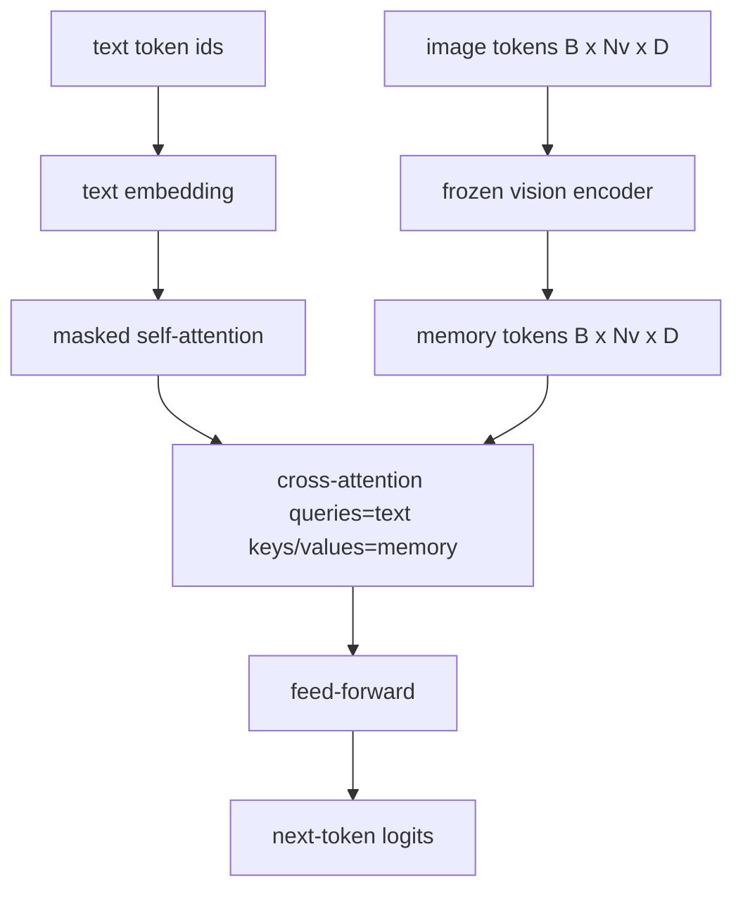
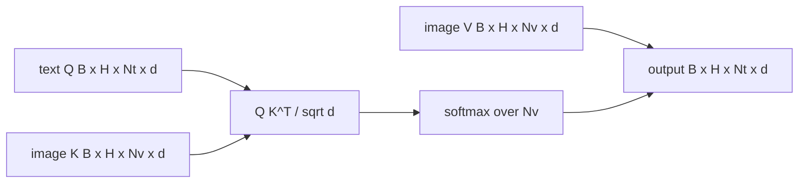

# 交叉注意力融合

> A camada de projeção irá comparar um veículo de imagem com um veículo de título. O verdadeiro desmantelador de linguagem visual precisa que cada texto seja participado em cada um dos patinótons, de modo que o modelo pode colocar cada palavra em uma região.

**Type:** Build
**Languages:** Python
**Prerequisites:** 第19期第30-37课（B轨基础）
**Time:** ~90 分钟

## Objectivo de aprendizagem

- 实现多头交叉注意力, em que o fluxo de consulta é texto, o key/value stream é visual.
- 组成解码器块:因果自注意力+交叉注意力+前──
- 获得正确的掩模形: para a ocultação de efeitos da auto-atenção, para a ocultação de efeitos da atenção transversal.
- Utilize batch textbooktoken e fixas imagemtoken池运行前向传递。

## 问题

A ligação de tokens de imagem e de texto a uma sequência é uma forma de combinação de opções ([[Figuração inicial]] , [[Chameleon]] e [[Emu]]                                                                                                                                                                                                                                                                                                                                                                                                                                                                                  

O segundo é que o fluxo de imagens é calculado uma vez e é repetido em cada fase de decodificação, de modo que, mesmo para um título longo, a geração é muito fácil.

## 概念





### 面具形状

Os dois blocos de dados precisam de duas formas diferentes de ocultar:

|注意|查询长度 |密钥长度|面膜|为什么 |
|-----------|--------------|------------|------|-----|
|自我关注 | `Nt`（文本）| `Nt`（文本）|因果：下三角 `(Nt, Nt)` |自回归期间文本token可能不会向前看 |
|交叉注意力| `Nt`（文本）| `Nv`（愿景）|没有口罩|整个图像对每个文本位置都是可见的 |

Este curso inclui uma função de formação, por isso mistura-as como `ValueError`O erro, não a perda da linha de destruição silenciosa.

### Por que o esforço não se esconde?

Antes de gerar qualquer texto, primeiro observe completamente a imagem.`t`Pode-se concentrar em qualquer correção de imagem; blocos de imagem não têm ordem de tempo. Alguns variantes flamingos adicionam o padrão de ocultação de cada amostra quando se misturam várias imagens e fragmentos de texto, mas para uma imagem individual, adicionada ao título, a atenção de intersecção pode ver tudo.

### 键/值缓存

图像键和值在解码开始时计算一次并存存储中──每个新文本代码都使用缓存而无需重新计算──这是推理时字幕快速运行的原因:重型 ViT 运行一次;交叉注意力在每一步中重用其键和值──本课程公开缓存并测试缓存中路径──

### 块组成

解码器块运行:预 LN -> 自注意力 -> 残差 -> 预 LN -> 交叉注意力 -> 残差 -> 预 LN -> 前 -> 残差──三子层, cada sub层有自己的层Norm。 Flamingo 论文在交叉注意力上添加了一个可学习的门,初始化为零,因此结的语言模型一开始保持不变,训练也保持稳定;规范基线在此使用)没有门──

```python
class DecoderBlock:
  def forward(self, text_tokens, image_tokens, text_mask, cross_mask):
      text_tokens = text_tokens + self.self_attn(self.ln1(text_tokens),
                                                 mask=text_mask)
      text_tokens = text_tokens + self.cross_attn(self.ln2(text_tokens),
                                                  image_tokens,
                                                  mask=cross_mask)
      text_tokens = text_tokens + self.ffn(self.ln3(text_tokens))
      return text_tokens
```


```figure
ch-crossattn-fan
```

## Construí-lo

`code/main.py`实现:

- `CrossAttention(hidden, heads)`, com um único`q`和 `kv`投影的多头交叉注意力──
- `CausalSelfAttention(hidden, heads)`, de um padrão de descifrador de proteção auto-attenção.
- `DecoderBlock`, usando o pre-LN restante composto por três sub-liquidos.
- `VisionLanguageDecoder`, quadrilateral de código fornecido por modelos de vídeo de código de saída e de pequeno texto embutidos de tabela.
- `causal_mask(length)` Retorno `(length, length)`Não é o que se passa?
- Uma demonstração, ele fornece dois sequências de textos de 10 longitudes em um lote de memória de imagens de 197 longitudes, e imprime a forma de saída, a forma de auto-atenção e o número de saída de atenção de cada posição.

- Não .

```bash
python3 code/main.py
```

输出:解码器产生 `(2, 10, text_vocab)`logits 张量──面罩形为`(10, 10)`◊ KV 缓存重用检查确认缓存和未缓存路径之间的相同逻辑──

## Use-o

交叉注意力 aparece em duas séries de produção:

- **Flamingo 和 IDEFICS。**Cada K 个语言模型块插入一个交叉注意力层,并使用结的 LM──视觉语言适配器是交叉注意力块及其门──
- **BLIP-2.**Q-Former Utilize de um conjunto de 32 tokens de consulta fixas para transferir atenção para a imagem, e então irá fazer uma projeção de consulta para o espaço em LM.

A forma do bloco neste curso é diretamente mapeada para os dois.

## 测试

`code/test_main.py` abrangendo:

- O resultado oculta é a forma do triângulo inferior e corresponde à forma do buraco esperada.
- Não importa a sua duração, a sua forma de saída é muito diferente.`(B, Nt, hidden)`
- KV  Cachem de rota e não Cachem de rota correspondência em diferença de capacidade de flutuação
- A forma de não-conformidade entre o texto e o fluxo de imagens provocou uma evidência.`ValueError`
-  Completo decodificador anterior para transmitir produzir forma correta de lote e sequência

运行它们:

```bash
python3 -m unittest code/test_main.py
```

## 练习

1. 将学习的 tanh门添加到交叉注意残差(Flamingo 技巧),并验证训练从接近零的初始门收──门从0开始;该模型在混合图像流之前恢复纯文本行为──

2. 实现交错注意力, em que o mesmo decodificador consome várias imagens e vários fragmentos de texto.

3. Em`Nt=64, Nv=576`(mais alta resolução 24x24 网格) sobre análise de concentração de concentração e nível de concentração de concentração de concentração de concentração`Nt * Nv`, e ocupa um lugar dominante em alta resolução de imagem.

4. Em um gráfico de atenção de intervalo, adicione o ponto de interrogação de descontinuidade,并测演示中的标题多样性 (título de desvio)

5. O que é um bloco de atenção de tipo Q-Former, em que 32 pontos de referência são fixos em cada um dos blocos de atenção de tipo Q-Former.

## 关键术语

|术语 |这意味着什么 |
|------|---------------|
|后期融合|文本和视觉位于不同的流中；交叉注意力在每个区块上架起了桥梁|
|交叉注意力| Q 来自一个流，K 和 V 来自另一个流 |
|因果面具|下三角布尔掩码，可防止在自回归过程中向前看 |
| KV缓存|图像键和值存储一次并在每个解码步骤中重复使用 |
|记忆token|解码器进入的冻结图像token |

##  weiterlesen

- Flamingo (2022) Utilizando a sua concepção de um modelo de desenvolvimento de um sistema de controle de transferência de informações.
- Q-Former's BLIP-2 (2023), é um bloco de atenção de intervalo de um grupo de pesquisas.
- IDEFICS (2023) Utilizado em Flamingo 配方的开放重量复制品──
